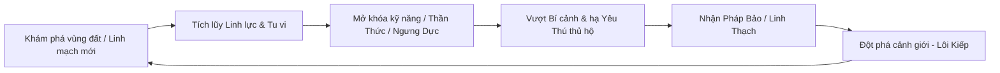
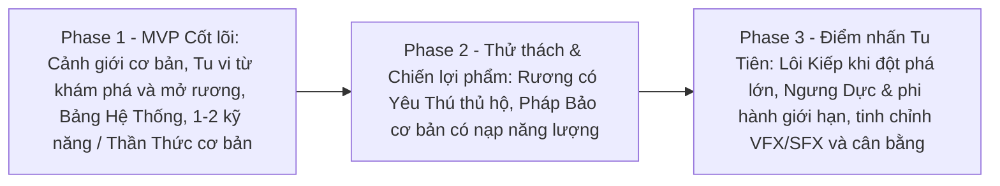

# 01. Ideation – Hình thành ý tưởng

| Thuộc tính | Giá trị |
|---|---|
| Dự án | Plugin Survival Thám Hiểm + Tu Tiên + Hệ Thống Xuyên Không |
| Tên tạm (codename) | **TienLo** (Tiên Lộ – "con đường tu tiên") – *chờ chốt* |
| Nền tảng | Minecraft Java Edition – Paper 26.3 (Spigot-compatible API) |
| Phụ thuộc bắt buộc | **AuraSkills 2.4.0** (hard-depend – stat, mana, skill) |
| Bước vòng đời | 01 / 09 – Ideation |
| Trạng thái | Đã duyệt (Approved) – chuyển sang Bước 02 (Product Discovery) |
| Ngày | 2026-11-21 |

---

## 1. Tuyên bố ý tưởng (Elevator Pitch)

> Dành cho **server Survival/SMP** muốn giữ người chơi lâu hơn, **TienLo** biến thế giới vanilla thành một **thế giới tu tiên**: mỗi vùng đất có **linh khí** riêng, mỗi chuyến **thám hiểm** đem lại **tu vi**, mỗi **rương cổ** có thể có **yêu thú thủ hộ**, và mỗi lần **đột phá cảnh giới** là một trận **Lôi Kiếp** thật sự. Người chơi được dẫn dắt bởi một **"Bảng Hệ Thống"** đúng chất truyện xuyên không – mà **không cần cài client mod**.

## 2. Vấn đề cần giải quyết (Problem Statement)

| # | Vấn đề hiện tại | Hệ quả | Hướng giải quyết của TienLo |
|---|---|---|---|
| P1 | Vòng lặp vanilla "đào – xây – đánh boss" đơn điệu sau vài tuần | Người chơi bỏ server sau khi "xong" End | Tiến trình tu luyện dài hạn gắn với cảnh giới |
| P2 | Thám hiểm không được thưởng tương xứng (elytra rồi thì bay lướt qua mọi thứ) | Bản đồ rộng nhưng bị bỏ phí | Thưởng tu vi theo **chunk/mốc mới khám phá** và **linh khí khu vực** |
| P3 | Rương cấu trúc tự nhiên (dungeon, temple, ancient city…) dễ cướp, không thử thách | Loot mất giá trị | **Yêu Thú thủ hộ** xuất hiện khi mở rương / phong ấn |
| P4 | Plugin RPG phổ biến mang tính "MMO số", thiếu bản sắc văn hóa Á Đông | Người chơi VN thích tu tiên/xuyên không nhưng ít sản phẩm phù hợp | Chủ đề Tu Tiên + Hệ Thống Xuyên Không, thuật ngữ Hán-Việt |
| P5 | Nhiều plugin "đẹp" nhưng nặng server hoặc bắt cài mod | Admin ngại cài | Vanilla client, xử lý theo chunk, async DB, entity hiển thị chỉ khi cần |

## 3. Đối tượng mục tiêu (Target Users)

### 3.1 Khách hàng (người quyết định cài đặt)
- **Server Owner / Admin** server Survival/SMP (ưu tiên cộng đồng Việt Nam), quy mô **10–100 người chơi đồng thời**.
- Nhu cầu: tăng retention, có "điểm bán" khác biệt, dễ cấu hình, không làm tụt TPS, tương thích AuraSkills đang dùng.

### 3.2 Người dùng cuối (Personas sơ bộ – sẽ chi tiết ở Bước 02)

| Persona | Mô tả | Động lực chính | TienLo đáp ứng bằng |
|---|---|---|---|
| **Lữ Khách** (Explorer) | Thích đi xa, tìm biome/cấu trúc lạ | Khám phá, khoảnh khắc "wow" | Tu vi theo chunk mới, Thần Thức dò bảo vật, Ngưng Dực vượt địa hình |
| **Tu Sĩ** (Progression grinder) | Thích leo cấp, tối ưu chỉ số | Mạnh lên rõ rệt, danh hiệu | Cảnh giới, đột phá, Lôi Kiếp, stat qua AuraSkills |
| **Chiến Binh** (PvE fighter) | Thích đánh boss/quái khó | Thử thách, loot hiếm | Yêu Thú thủ hộ, Pháp Bảo |
| **Cư Dân** (Casual builder) | Chủ yếu xây dựng | Không bị ép chơi kiểu khác | Tính năng tùy chọn, không phạt người không tu luyện |
| **Quản Trị Viên** (Admin) | Vận hành server | Ổn định, cân bằng, dễ chỉnh | Config đầy đủ, lệnh admin, chống lạm dụng |

## 4. Giá trị cốt lõi (Value Proposition)

- **Với người chơi:** Có lý do để đi thám hiểm mãi mãi; cảm giác "nhân vật chính xuyên không có hệ thống" ngay trong vanilla.
- **Với admin:** Một gói nội dung dài hạn, cấu hình được, nhẹ server, xây trên AuraSkills sẵn có thay vì thêm một hệ RPG song song.

## 5. Trụ cột thiết kế (Design Pillars)

Mọi quyết định ở các bước sau phải đối chiếu với 5 trụ cột này:

1. **Khám phá là con đường tu luyện** – Nguồn tu vi chính đến từ đi xa, vào vùng nguy hiểm, chinh phục bí cảnh; không phải đứng AFK.
2. **Survival vẫn là gốc** – Không phá vỡ sinh tồn vanilla; cảnh giới thấp không bay tự do; thất bại có tổn thất *có kiểm soát*.
3. **Vanilla client, cảm giác "mod"** – Chỉ dùng GUI, BossBar, ActionBar, Title, Particle, Sound, Display Entity. Resource Pack là *tùy chọn* nâng cấp.
4. **Nhẹ server** – Xử lý theo ranh giới chunk, sự kiện thay vì quét theo tick; DB async; entity hiển thị sinh/huỷ theo trạng thái.
5. **Cân bằng & cấu hình được** – Mọi kỹ năng có điều kiện (cảnh giới, cooldown, linh lực); mọi con số nằm trong config.

## 6. Vòng lặp cốt lõi (Core Gameplay Loop)

**Vòng lặp phụ (meta loop):** Cảnh giới cao → đi được xa/nguy hiểm hơn (bay, chịu linh khí dày) → gặp vùng linh khí và yêu thú mạnh hơn → phần thưởng lớn hơn.

## 7. Phạm vi ý tưởng (Concept Scope)

### 7.1 Các phân hệ chức năng (theo brief)

| Mã | Phân hệ | Ý tưởng chính | Phase dự kiến |
|---|---|---|---|
| A | Tu Tiên, Cảnh Giới & Linh Khí | Cảnh giới Luyện Khí → Trúc Cơ → Kim Đan → Nguyên Anh; linh khí theo biome/chunk/độ cao/cấu trúc; đột phá | 1 (cơ bản), 3 (Lôi Kiếp) |
| B | Bảng Hệ Thống & Thần Thức | GUI/BossBar/ActionBar trạng thái; quét mục tiêu/khu vực | 1 |
| C | Ngưng Dực & Phi Hành | Cánh ItemDisplay + particle/sound; lướt gió → phi hành có giới hạn | 3 |
| D | Pháp Bảo, Bí Cảnh & Yêu Thú | Yêu thú thủ hộ rương/phong ấn; Pháp Bảo PDC có năng lượng nạp lại | 2 |

### 7.2 Ranh giới với AuraSkills (hard-depend)

Quyết định đã chốt: **TienLo phụ thuộc bắt buộc vào AuraSkills** cho stat & skill. Nguyên tắc ý tưởng: *AuraSkills lo "con số", TienLo lo "con đường tu tiên"*.

| Hạng mục | Do AuraSkills cung cấp (tái sử dụng) | Do TienLo sở hữu (xây mới) |
|---|---|---|
| Chỉ số nhân vật | Stat (Strength, Health, Toughness, Wisdom, Speed…) – TienLo cộng **stat modifier** theo cảnh giới | Bảng quy đổi cảnh giới → modifier |
| Linh lực | Đề xuất ánh xạ **Linh lực = Mana** của AuraSkills | Quy tắc tiêu hao/hồi theo linh khí khu vực |
| Kỹ năng | Hệ skill/XP sẵn có; khả năng tạo **custom skill/stat** qua API | Kỹ năng tu tiên (Thần Thức, Ngưng Dực, đột phá), Tu vi, Cảnh giới, Lôi Kiếp |
| Nội dung thế giới | – | Linh khí, khám phá chunk, Yêu Thú, Pháp Bảo, Bí cảnh |

> Lưu ý: Khả năng chính xác của API AuraSkills 2.4.0 (custom skill/stat, mana API, sự kiện) **cần xác minh ở Bước 02/04** trước khi chốt ánh xạ.

### 7.3 Ngoài phạm vi (Out of Scope – giai đoạn hiện tại)
- Client mod / Fabric / Forge; Bedrock (Geyser) – không cam kết hỗ trợ.
- Hệ thống tông môn/guild, kinh tế, PvP xếp hạng (để dành cho Bước 09 – mở rộng).
- Thế giới/dimension tạo mới hoàn toàn (Bí cảnh ban đầu dùng cấu trúc tự nhiên có sẵn).
- Folia – chưa cam kết (AuraSkills hỗ trợ Folia nhưng TienLo chưa nhắm tới ở MVP).

## 8. Lộ trình phát hành sơ bộ (Phased Delivery)

## 9. Chỉ số thành công đề xuất (Success Metrics – sẽ chốt ở Bước 03)

| Nhóm | Chỉ số | Mục tiêu đề xuất |
|---|---|---|
| Gắn kết | Tỉ lệ người chơi quay lại sau 7 ngày (D7) trên server thử nghiệm | Tăng so với baseline trước khi cài |
| Khám phá | Số chunk mới khám phá / người chơi / giờ | Tăng so với baseline |
| Tiến trình | Thời gian trung bình đạt Trúc Cơ | Cấu hình được; mục tiêu mặc định ~ vài giờ chơi |
| Hiệu năng | Chi phí plugin trên main thread | < 1 ms/tick ở 50 người chơi (đo bằng Spark) |
| Độ tin cậy | Mất dữ liệu tiến trình | 0 sự cố khi restart/crash bình thường |

## 10. Giả định (Assumptions)

| # | Giả định | Cần xác nhận ở |
|---|---|---|
| AS1 | Server mục tiêu chạy Paper 26.3 trên **Java 25** | Bước 04 |
| AS2 | AuraSkills 2.4.0 chạy ổn trên Paper 26.3 và có API đủ cho stat modifier + mana | Bước 02/04 |
| AS3 | Ngôn ngữ mặc định: Tiếng Việt, có file ngôn ngữ để dịch | Bước 03 |
| AS4 | Lưu trữ: SQLite mặc định, mở rộng MySQL/PostgreSQL | Bước 04 |
| AS5 | Yêu Thú tự xây logic trên entity vanilla; MythicMobs chỉ là tích hợp tùy chọn | Bước 02 |
| AS6 | Có Resource Pack tùy chọn, nhưng mọi tính năng phải dùng được khi không có | Bước 05 |

## 11. Rủi ro sơ bộ (Risks)

| # | Rủi ro | Mức | Hướng giảm thiểu |
|---|---|---|---|
| R1 | Môi trường dev hiện có **Java 21**, Paper 26.3 yêu cầu **Java 25** (theo `version.json` trong jar) | Cao | Cài JDK 25 trước Bước 06 |
| R2 | Hard-depend AuraSkills: thay đổi API/phiên bản AuraSkills làm vỡ plugin | Trung bình | Lớp adapter riêng, ghim phiên bản, test tương thích |
| R3 | Phi hành / Ngưng Dực bị lạm dụng (bay qua mọi thứ, xung đột anti-cheat) | Cao | Giới hạn theo cảnh giới + linh lực + cooldown; tương thích anti-cheat phổ biến |
| R4 | Lạm phát sức mạnh (Pháp Bảo, stat cộng dồn với AuraSkills) | Cao | Cơ chế năng lượng/tiêu hao, trần chỉ số, config cân bằng |
| R5 | Display Entity/particle gây lag khi đông người | Trung bình | Chỉ sinh khi bật, giới hạn tầm nhìn, huỷ ngay khi tắt |
| R6 | Farm khám phá bằng cách đi tạo chunk mới liên tục (exploit) | Trung bình | Giảm dần phần thưởng, mốc khám phá có giá trị, cooldown, giới hạn theo world border |
| R7 | Phạm vi lớn, dễ trễ | Trung bình | Chia Phase rõ, MVP nhỏ, duyệt từng bước |

## 12. Câu hỏi mở cần trả lời ở Bước 02 – Product Discovery

1. **Tên sản phẩm chính thức** và tông giọng thuật ngữ (Hán-Việt thuần hay pha hiện đại "Hệ Thống: Ting!")?
2. **Số cảnh giới & tiểu cảnh giới** (ví dụ mỗi đại cảnh giới có Sơ/Trung/Hậu kỳ/Đại viên mãn)? Phase 1 dừng ở cảnh giới nào?
3. **Linh lực = Mana AuraSkills** hay là một tài nguyên riêng? Tu vi có phải là XP của một **custom skill** AuraSkills không?
4. Nguồn tu vi ngoài khám phá & mở rương: thiền định/đả tọa, giết quái, linh thạch – tỉ trọng ra sao để **không khuyến khích AFK**?
5. **Mức phạt khi đột phá/Lôi Kiếp thất bại**: mất % tu vi, debuff tạm thời, hay hạ tiểu cảnh giới?
6. Có hỗ trợ **PvP** với kỹ năng tu tiên không, hay chỉ PvE?
7. Phạm vi world: chỉ Overworld hay cả Nether/End (linh khí khác nhau)?
8. Tích hợp tùy chọn ngoài AuraSkills: PlaceholderAPI, WorldGuard (vùng cấm bay), MythicMobs?

---

## Definition of Done – Bước 01

- [x] Xác định plugin làm gì, giải quyết vấn đề gì, dành cho ai
- [x] Trụ cột thiết kế & vòng lặp cốt lõi
- [x] Phạm vi phân hệ, ranh giới với AuraSkills, out-of-scope
- [x] Giả định, rủi ro, chỉ số thành công sơ bộ
- [x] Danh sách câu hỏi mở chuyển sang Bước 02
- [x] **Stakeholder duyệt** → sang Bước 02 (Product Discovery) (đã chốt câu trả lời cho 8 câu hỏi mở ngày 2026-11-22)
