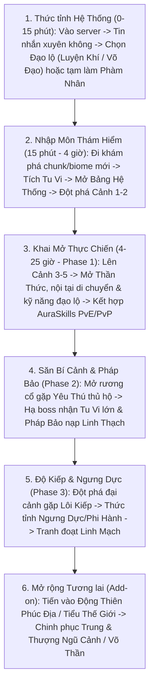
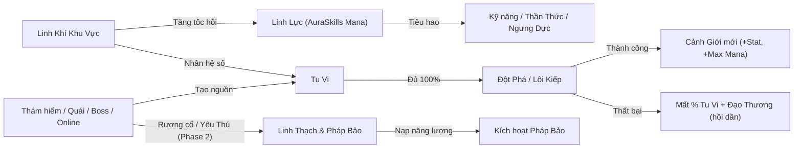

# 02. Product Discovery – Phân tích sản phẩm

| Thuộc tính | Giá trị |
|---|---|
| Dự án | Plugin Survival Thám Hiểm + Tu Tiên + Hệ Thống Xuyên Không |
| Tên chính thức | **TienLo** (Tiên Lộ) – lệnh gốc `/tienlo` (alias: `/tl`, `/hethong`, `/tutien`), quyền `tienlo.*`, placeholder `%tienlo_*%` |
| Nền tảng | Minecraft Java Edition – Paper 26.3 (Spigot-compatible API) |
| Phụ thuộc bắt buộc | **AuraSkills 2.4.0** (hard-depend – đã xác minh bytecode API) |
| Tích hợp tùy chọn | **PlaceholderAPI**, **WorldGuard**, **MythicMobs** (soft-depend) |
| Bước vòng đời | 02 / 09 – Product Discovery |
| Trạng thái | Đã duyệt (Approved) – chuyển sang Bước 03 (Requirement – BRD/PRD) |
| Ngày | 2026-11-22 |

---

## 1. Các quyết định sản phẩm đã chốt từ Bước 01

| Hạng mục | Quyết định đã chốt |
|---|---|
| Tông giọng "Hệ Thống" | Xuyên không hiện đại kết hợp thuật ngữ tu tiên Hán-Việt. Mẫu chuẩn: `"Hệ thống thông báo, ký chủ đã đột phá!"` |
| Hệ thống cảnh giới | Lấy cảm hứng từ **Kiếm Lai** với **2 đạo lộ song song**: **Luyện Khí Sĩ** (15 cảnh giới) và **Võ Đạo / Võ Phu** (11 cảnh giới). **Phase 1 dừng ở cảnh giới thứ 5** của cả hai đạo lộ. |
| Quan hệ với AuraSkills | **Linh Lực** dùng chính **Mana của AuraSkills**, nhưng TienLo điều chỉnh tốc độ hồi theo linh khí vùng và cộng tăng Max Mana khi đột phá. **Tu Vi** là hệ thống độc lập của TienLo quyết định cảnh giới/rank và sức mạnh gốc; **AuraSkills** là hệ thống kỹ năng phụ trợ. |
| Triết lý cân bằng chiến đấu | **Kỹ năng chiến đấu quyết định thắng bại**: người chơi kém 1 cảnh giới vẫn có thể đánh bại người hơn 1 cảnh giới nhờ trình độ điều khiển, sử dụng kỹ năng tu tiên, kỹ năng AuraSkills và Pháp Bảo. |
| Nguồn Tu Vi | Đi thám hiểm & mở rương, giết quái thường (có chống bãi farm), đánh Boss / Yêu Thú thủ hộ, và thời gian online chủ động (chống AFK). |
| Phạt khi đột phá / Lôi Kiếp thất bại | Mất `%` Tu Vi + chịu **debuff tạm thời** (Đạo Thương / Suy Yếu), **hồi phục dần về bình thường theo thời gian**. Không xóa tiến trình sinh tồn. |
| PvP | **Có hỗ trợ PvP** bằng kỹ năng tu tiên & Pháp Bảo (tôn trọng vùng an toàn / WorldGuard). |
| Phạm vi Thế giới | Áp dụng cho **tất cả thế giới** (Overworld, Nether, End, custom world) với mật độ linh khí riêng; thiết kế mở sẵn cho **add-on tương lai: Động Thiên Phúc Địa & Tiểu Thế Giới**. |
| Tích hợp ngoài | Hard-depend: `AuraSkills 2.4.0`. Soft-depend: `PlaceholderAPI`, `WorldGuard`, `MythicMobs`. |

---

## 2. Phân tích Người chơi & Hành trình Trải nghiệm (Personas & Journeys)

### 2.1 Chi tiết Personas

| Persona | Mục tiêu chính | Điểm đau (Pain Points) | Hành vi đặc trưng | Tiêu chí hài lòng |
|---|---|---|---|---|
| **Lữ Khách** (Explorer) | Tìm địa hình lạ, cấu trúc cổ, kho báu hiếm | Đi xa nhưng không có động lực dài hạn; rương cổ lặp lại | Chạy hàng nghìn block, dùng Thần Thức quét xung quanh, thích vùng Linh Khí cao | Mỗi chuyến đi xa đều tăng Tu Vi rõ rệt và có bất ngờ |
| **Tu Sĩ** (Progression) | Leo cảnh giới nhanh, tối ưu đạo lộ và chỉ số | Cày cuốc nhàm chán hoặc bị người dùng bãi farm vượt mặt | Theo dõi Bảng Hệ Thống thường xuyên, săn Boss, chọn vùng linh khí tốt để đột phá | Cảm giác "thăng hoa" mỗi lần đột phá, bảng tiến trình minh bạch |
| **Chiến Binh** (PvE / PvP) | Thử thách Boss khó & đối đầu người chơi khác bằng kỹ năng | Bị đè bẹp tuyệt đối chỉ vì chênh cấp; không có đất dụng võ cho kỹ năng | Kết hợp combo kỹ năng tu tiên + AuraSkills + Pháp Bảo | Kém 1 cảnh giới vẫn có cơ hội lật kèo nhờ trình độ |
| **Cư Dân Casual** (Builder / Farmer) | Chơi sinh tồn thư giãn, xây dựng | Bị ép đi đánh nhau, mất đồ hoặc bị phạt nặng khi không tu luyện | Online đều đặn, ít đi PvP, thích tích lũy nhẹ nhàng | Vẫn nhận Tu Vi nhỏ khi chơi chủ động, không bị phá ở vùng an toàn |
| **Quản Trị Viên** (Admin) | Giữ server ổn định (20 TPS), cân bằng kinh tế & sức mạnh | Exploit bãi farm mob/AFK, xung đột vùng cấm bay/safezone | Chỉnh YAML, gán WorldGuard flags, gắn MythicMobs & PlaceholderAPI | Config rõ ràng, chống farm hiệu quả, không tụt TPS |

### 2.2 Hành trình Người chơi (Player Journey)

---

## 3. Phân tích Hệ thống Cảnh giới Song Đạo (Kiếm Lai → Gameplay)

Plugin có **2 Đạo Lộ (Paths)** phản ánh hai phong cách chơi khác biệt:
- **Luyện Khí Sĩ (Qi Cultivator):** Thiên về **Linh Lực dồi dào, Thần Thức nhạy bén, kỹ năng tầm xa/tiện ích, Pháp Bảo và Phi Hành**.
- **Võ Đạo / Võ Phu (Martial Artist):** Thiên về **thân thể cường hãn, HP/phòng thủ/hồi phục khí huyết, áp sát và bùng nổ sát thương cận chiến**.

### 3.1 Lộ trình 15 Cảnh Giới – Luyện Khí Sĩ

| Bậc | Tầng lớn | Cảnh Giới | Tiểu tầng (Lore) | Bản sắc gameplay dự kiến | Phạm vi |
|---:|---|---|---|---|---|
| 1 | Hạ Ngũ Cảnh | **Bì (Da Đồng)** | 0–100% Tu Vi | Kích phát chân khí hộ thể, giảm nhẹ sát thương vật lý | **Phase 1** |
| 2 | Hạ Ngũ Cảnh | **Nhục (Cỏ Rễ)** | 0–100% Tu Vi | Tăng tốc độ hồi phục sinh lực tự nhiên | **Phase 1** |
| 3 | Hạ Ngũ Cảnh | **Cân (Gân Liễu)** | 0–100% Tu Vi | Tăng linh hoạt di chuyển, sức bật/vượt địa hình | **Phase 1** |
| 4 | Hạ Ngũ Cảnh | **Cốt (Khí Cốt)** | 0–100% Tu Vi | Tăng sức chịu đựng, kháng đẩy lùi, hấp thu linh khí tốt hơn | **Phase 1** |
| 5 | Hạ Ngũ Cảnh | **Thể (Lò Luyện)** | 0–100% Tu Vi | Thân thể thành lò luyện, mở rộng mạnh dung lượng Linh Lực & Thần Thức | **Phase 1 (Mốc trần MVP)** |
| 6 | Trung Ngũ Cảnh | **Động Phủ Cảnh** | Hạ / Trung / Thượng | Hấp thu linh khí thiên địa mạnh; mở khóa tầng đầu Ngưng Dực | Phase 3 / Mở rộng |
| 7 | Trung Ngũ Cảnh | **Quan Hải Cảnh** | Hạ / Trung / Thượng | Mở rộng kinh mạch, tăng mạnh tốc độ hồi Linh Lực & sinh lực tối đa | Mở rộng |
| 8 | Trung Ngũ Cảnh | **Long Môn Cảnh** | Hạ / Trung / Thượng | Cửa ải đại đột phá (khảo nghiệm Long Môn / Lôi Kiếp căng thẳng) | Mở rộng |
| 9 | Trung Ngũ Cảnh | **Kim Đan Cảnh** | Hạ / Trung / Thượng | Kết thành Kim Đan (có dị tượng thiên địa quanh người chơi); tăng mạnh hiệu năng Pháp Bảo | Mở rộng |
| 10 | Trung Ngũ Cảnh | **Nguyên Anh Cảnh** | Hạ / Trung / Thượng | Dương/Âm thần trong thức hải; mở rộng tầm & độ chi tiết Thần Thức | Mở rộng |
| 11 | Thượng Ngũ Cảnh | **Ngọc Phác Cảnh** | – | Vô cấu lưu ly chi khu – kháng hiệu ứng bất lợi & môi trường (lửa/độc/nước) | Mở rộng |
| 12 | Thượng Ngũ Cảnh | **Tiên Nhân Cảnh** | Tả / Hữu (Tiên Nhân – Nhân Tiên) | Cần tài nguyên/khí vận cao cấp từ Bí Cảnh/Tiểu Thế Giới để tiến cấp | Mở rộng |
| 13 | Thượng Ngũ Cảnh | **Phi Thăng Cảnh** | – | Đỉnh cao thế giới thường; kích hoạt Lôi Kiếp Thiên Đạo cực đại | Mở rộng |
| 14 | Thượng Ngũ Cảnh | **Thất Truyền Cảnh I (Hợp Đạo)** | Thiên Thời / Địa Lợi / Nhân Hòa | Chọn hướng Hợp Đạo nhận bộ buff đặc thù | Mở rộng |
| 15 | Thượng Ngũ Cảnh | **Thất Truyền Cảnh II (Thiên Tiên)** | – | Đỉnh phong tối thượng của Luyện Khí Sĩ | Mở rộng |

### 3.2 Lộ trình 11 Cảnh Giới – Võ Đạo (Võ Phu)

| Bậc | Tầng lớn | Cảnh Giới | Tiểu tầng (Lore) | Bản sắc gameplay dự kiến | Phạm vi |
|---:|---|---|---|---|---|
| 1 | Luyện Thể Tam Cảnh | **Ni Bôi Cảnh** | 0–100% Tu Vi | Thân thể vững chắc, tăng nhẹ máu & kháng đẩy lùi | **Phase 1** |
| 2 | Luyện Thể Tam Cảnh | **Mộc Thai Cảnh** | 0–100% Tu Vi | Da xương săn chắc, tăng độ bền phòng thủ & tốc độ | **Phase 1** |
| 3 | Luyện Thể Tam Cảnh | **Thủy Ngân Cảnh** | 0–100% Tu Vi | Khí huyết dồi dào, hồi phục nhanh khi chiến đấu; có khảo nghiệm *"Ni Bồ Tát Quá Giang"* khi đột phá | **Phase 1** |
| 4 | Luyện Khí Tam Cảnh | **Anh Hồn Cảnh** | 0–100% Tu Vi | Hình thành võ ý, tăng sát thương cận chiến & tỉ lệ/uy lực bạo kích | **Phase 1** |
| 5 | Luyện Khí Tam Cảnh | **Hùng Phách Cảnh** | 0–100% Tu Vi | Khí phách cường thịnh, mở khóa kỹ năng bùng phát khí huyết | **Phase 1 (Mốc trần MVP)** |
| 6 | Luyện Khí Tam Cảnh | **Võ Đảm Cảnh** | – | Tăng mạnh tinh thần chiến đấu, giảm sát thương nhận vào khi thấp máu | Phase 3 / Mở rộng |
| 7 | Luyện Thần Tam Cảnh | **Kim Thân Cảnh (Tiểu Tông Sư)** | – | Thân thể cứng như kim cương, giảm mạnh sát thương & kháng khống chế | Mở rộng |
| 8 | Luyện Thần Tam Cảnh | **Vũ Hóa Cảnh (Viễn Du Cảnh)** | – | Ngự phong phi hành (tương đương Ngưng Dực tầng cao của Luyện Khí Sĩ) | Mở rộng |
| 9 | Luyện Thần Tam Cảnh | **Sơn Điên Cảnh (Chỉ Cảnh Tông Sư)** | – | Áp đảo tuyệt đối ở cự ly gần (phạm vi 10 trượng), phá giáp mạnh | Mở rộng |
| 10 | Chỉ Cảnh | **Chỉ Cảnh** | Khí Thịnh / Quy Chân / Thần Đáo | Mỗi tiểu cảnh mở thêm ngưỡng sức mạnh cận chiến & uy áp | Mở rộng |
| 11 | Võ Thần | **Võ Thần Cảnh** | – | Đỉnh phong võ đạo, ngang tầm Luyện Khí Sĩ bậc 14 | Mở rộng |

### 3.3 Bảng quy đổi tương quan sức mạnh hai đạo (Cross-Path Tier Mapping)

Vì Luyện Khí Sĩ có 15 bậc còn Võ Đạo có 11 bậc (Võ Thần bậc 11 ngang Luyện Khí Sĩ bậc 14), hệ thống dùng một chỉ số nội bộ gọi là **Chiến Lực Bậc (Power Tier)** để cân bằng PvP, ngưỡng vào Bí Cảnh và phần thưởng Boss:

| Power Tier | Luyện Khí Sĩ | Võ Đạo | Giai đoạn triển khai |
|---|---|---|---|
| **Tier 1 – 5** | Bì → Nhục → Cân → Cốt → Thể | Ni Bôi → Mộc Thai → Thủy Ngân → Anh Hồn → Hùng Phách | **Phase 1 (MVP)** |
| **Tier 6 – 9** | Động Phủ → Quan Hải → Long Môn → Kim Đan | Võ Đảm → Kim Thân → Vũ Hóa → Sơn Điên | Phase 3 & Mở rộng |
| **Tier 10 – 12** | Nguyên Anh → Ngọc Phác → Tiên Nhân | Chỉ Cảnh (Khí Thịnh → Quy Chân → Thần Đáo) | Mở rộng |
| **Tier 13 – 14** | Phi Thăng → Thất Truyền I (Hợp Đạo) | Võ Thần Cảnh (tương đương bậc 14) | Mở rộng |
| **Tier 15** | Thất Truyền II (Thiên Tiên) | *(Võ Đạo "đường cụt" theo lore – bù bằng chỉ số tinh luyện)* | Mở rộng |

> **Chuyển hóa quy tắc lore sang luật game công bằng:**
> Các chi tiết khắc nghiệt trong nguyên tác (như *Long Môn Cảnh* thất bại 3 lần thì phế cả đời, hay *Phi Thăng* thất bại thì hồn phi phách tán) **không được khóa chết vĩnh viễn tài khoản người chơi**. Thay vào đó, chúng được thể hiện thành **khảo nghiệm / Lôi Kiếp độ khó cao** với hiệu ứng kịch tính; nếu thất bại, người chơi chịu **mất `%` Tu Vi + trạng thái Đạo Thương tạm thời** (hồi phục dần) và có thể chuẩn bị lại để thử tiếp.

---

## 4. Phân tích Tính năng & Quy tắc nghiệp vụ cốt lõi (Business Rules)

### BR-01: Nguồn Tu Vi & Luật Chống Lạm Dụng (Anti-Farm / Anti-AFK)

Tu Vi là thanh tiến trình độc lập của TienLo. Tỉ trọng nguồn Tu Vi được thiết kế sao cho **đi thám hiểm và đánh Boss luôn là cách lên nhanh nhất**, trong khi người chơi casual vẫn tiến bộ đều đặn:

| Nguồn Tu Vi | Tỉ trọng mục tiêu | Cơ chế thưởng | Luật chống lạm dụng (Anti-Exploit) |
|---|---:|---|---|
| **1. Thám hiểm & Rương cổ** | ~45–55% | Thưởng khi lần đầu đặt chân vào Chunk mới, Biome mới, Cấu trúc tự nhiên (Temple, Bastion, Ancient City, Trial Chambers…), và mở rương/Vault sinh tự nhiên chưa từng bị mở. Nhân hệ số theo Linh Khí khu vực. | • Mỗi Chunk chỉ thưởng **1 lần/người chơi** (hỗ trợ cả server cũ cài thêm plugin vì đếm từ lúc TienLo ghi nhận). • Cơ chế **Token Bucket / Diminishing Returns** theo tốc độ khám phá chunk/phút (chống dùng Elytra/dịch chuyển lướt siêu tốc nhưng không làm thiệt người đi thuyền/cưỡi ngựa). • Rương cấu trúc tự nhiên / Vault **chỉ thưởng Tu Vi & kích hoạt Yêu Thú cho người mở đầu tiên toàn server** (không tính rương do người chơi đặt). |
| **2. Boss & Yêu Thú Thủ Hộ** | ~20–30% | Thưởng Tu Vi lớn khi hạ Yêu Thú thủ hộ rương/phong ấn, Boss vanilla (Wither, Ender Dragon, Warden), hoặc Boss cấu hình từ MythicMobs. | • Chia Tu Vi theo **tỉ lệ đóng góp sát thương**, yêu cầu tối thiểu **`>= 5%` HP Boss** (tránh đánh ké 1 hit ăn phần). • Cooldown thưởng lặp lại theo loại Boss nếu spawn liên tục. |
| **3. Giết quái vật thường** | ~15–20% | Thưởng Tu Vi nhỏ theo loại quái & độ khó (quái Nether/End/Yêu Thú hoang dã cao hơn quái thường). | • **Chống bãi farm mob:** &nbsp;&nbsp;– Quái từ `SPAWNER` / `SPAWNER_EGG`: nhận 0% hoặc rất thấp (cấu hình được). &nbsp;&nbsp;– **Giảm dần theo Chunk (Chunk Diminishing Returns):** giết quá `N` quái trong cùng 1 chunk trong `T` phút → Tu Vi giảm dần về 0. &nbsp;&nbsp;– Trần Tu Vi từ quái thường theo giờ. |
| **4. Thời gian online chủ động** | ~5–10% | Cộng một lượng Tu Vi nhỏ định kỳ (VD mỗi 5 phút) khi người chơi đang hoạt động, nhân nhẹ theo Linh Khí vùng đang đứng. | • **Chống AFK:** Chỉ cộng nếu người chơi có hoạt động thực sự (di chuyển sang vị trí mới, đổi góc nhìn không lặp cơ học, tương tác block/chiến đấu) trong chu kỳ. • Trần tối đa theo giờ/ngày. |

### BR-02: Hệ thống Linh Khí Đa Thế Giới & Kiến trúc Mở (Pocket Worlds Ready)

- **Phạm vi:** Hoạt động trên **mọi thế giới** (Overworld, Nether, End, custom worlds). Mỗi thế giới có hệ số nền và bảng biome riêng trong config.
- **5 cấp mật độ Linh Khí:**
  1. **Khô Kiệt** (`0.5x`) – Vùng đất chết, bãi hoang cằn cỗi.
  2. **Loãng** (`0.8x`) – Vùng đồng bằng/khu dân cư thông thường.
  3. **Bình Thường** (`1.0x`) – Môi trường sinh tồn chuẩn.
  4. **Nồng Đậm** (`1.3x`) – Núi cao, rừng cổ đại, khu vực nguy hiểm, Nether/End đặc thù.
  5. **Linh Mạch** (`1.6x–2.0x`) – Điểm tụ linh hiếm (gần cấu trúc cổ, đỉnh núi, vùng dị thường), tỷ lệ gặp Yêu Thú/biến cố cao hơn.
- **Cách xác định nhẹ server:** Tính toán tất định (deterministic) từ `(World, Biome, Y-level, Chunk Seed, Override Zone)` kết hợp kiểm tra khi người chơi đổi chunk → **không cần quét block theo tick, không cần lưu hàng triệu chunk vào DB**.
- **Tác động của Linh Khí:**
  - Điều chỉnh tốc độ hồi **Linh Lực** (can thiệp vào `ManaRegenerateEvent.setAmount()` của AuraSkills).
  - Nhân hệ số **Tu Vi** nhận từ thám hiểm & hoạt động trong vùng.
  - Cộng tỉ lệ thành công / giảm áp lực khi **Đột phá**.
  - Rút ngắn thời gian hồi phục **Đạo Thương**.
- **Sẵn sàng cho Add-on tương lai (Động Thiên Phúc Địa / Tiểu Thế Giới):** Định nghĩa trừu tượng `SpiritZoneProvider` (hỗ trợ WorldGuard region override + API đăng ký vùng/thế giới tùy biến) để add-on tương lai chỉ cần cắm world/vùng mới vào mà không sửa core.

### BR-03: Quy tắc Đột Phá, Lôi Kiếp, An Toàn Môi Trường & Phạt Thất Bại

- **Điều kiện kích hoạt:** Đạt `100%` Tu Vi của cảnh giới hiện tại (và đủ vật phẩm/nghi thức nếu cảnh giới đó yêu cầu trong config). Người chơi chủ động kích hoạt qua Bảng Hệ Thống hoặc lệnh (tránh bị đột phá bất ngờ giữa lúc đang xây nhà/AFK).
- **Hai cấp độ đột phá:**
  - **Đột phá thường (Hạ Ngũ Cảnh / 5 cảnh đầu Võ Đạo – Phase 1):** Trạng thái tụ khí ngắn (5–15 giây) với hiệu ứng hạt, âm thanh, BossBar tiến độ; có tỷ lệ thành công cao (cộng thêm bởi Linh Khí khu vực). Riêng các mốc bản lề (VD *Thủy Ngân Cảnh – Ni Bồ Tát Quá Giang*, hoặc từ *Thể Cảnh* lên *Động Phủ*) có thử thách sinh tồn ngắn.
  - **Đột phá đại cảnh / Lôi Kiếp (Phase 3):** Triệu hồi các đợt Thiên Lôi theo sóng, hiển thị BossBar số đợt còn lại, gây sát thương có kiểm soát & hiệu ứng thời tiết/hình ảnh quanh khu vực. Người chơi phải sống sót hết các đợt sét (được dùng kỹ năng hộ thể, đan dược, Pháp Bảo, địa hình).
- **An toàn môi trường tuyệt đối (Anti-Grief):**
  - Sét Lôi Kiếp **không phá block, không gây cháy rừng/nhà, và không gây sát thương lan lên người chơi khác, thú nuôi (pet) hay dân làng (villager)** xung quanh.
- **Khi thành công:**
  - Thông báo xuyên không: `"[Hệ Thống] Hệ thống thông báo, ký chủ đã đột phá thành công lên <Cảnh Giới>!"` + Title + âm thanh + hiệu ứng hạt (và thông báo toàn server cho các đại cảnh giới lớn).
  - Cập nhật Cảnh Giới, nâng giới hạn Max Linh Lực (AuraSkills Mana) và cập nhật Stat/Trait Modifiers.
- **Khi thất bại (Đạo Thương – Hồi phục dần):**
  - Mất `%` Tu Vi hiện có (mặc định cấu hình ~15%–25%, không rớt xuống dưới 0% và không rớt vĩnh viễn cảnh giới).
  - Áp dụng trạng thái **Đạo Thương / Tẩu Hỏa Nhập Ma** trong thời gian `T` (VD 10–20 phút): giảm tạm thời một phần tốc độ hồi Linh Lực và một phần bonus chỉ số từ cảnh giới.
  - **Cơ chế hồi phục dần:** Mỗi chu kỳ (VD mỗi 1–2 phút), mức độ Đạo Thương giảm dần từng nấc (100% → 75% → 50% → 25% → Khỏi hẳn) cho đến khi trở về trạng thái ban đầu; đứng ở vùng Linh Khí Nồng Đậm/Linh Mạch giúp hồi nhanh hơn.

### BR-04: Bảng Hệ Thống, Chọn/Đổi Đạo Lộ & Thần Thức (Xuyên Không UX)

- **Trạng thái "Phàm Nhân" & Quy tắc Chọn / Đổi Đạo Lộ:**
  - Khi mới vào server, nếu người chơi đóng GUI chọn đạo lộ (chưa muốn tu luyện ngay), họ ở trạng thái **Phàm Nhân** (chơi sinh tồn bình thường, không nhận/mất Tu Vi) và có thể mở lại `/tienlo` (hoặc `/tl`, `/hethong`, `/tutien`) bất cứ lúc nào để thức tỉnh đạo lộ.
  - **Đổi Đạo Lộ:** Ở **Cảnh 1–2**, cho phép đổi đạo **1 lần miễn phí** qua Bảng Hệ Thống (reset về đầu Cảnh 1 – `0%` Tu Vi). Từ **Cảnh 3 trở lên**, muốn đổi đạo phải dùng **vật phẩm đặc biệt hoặc lệnh Admin**, khi đổi sẽ **quy đổi giảm 1 bậc `Power Tier` và về `0%` Tu Vi** của cảnh giới mới. Tính năng **Song Tu** để dành cho bản mở rộng tương lai.
- **Bảng Hệ Thống (System Panel):**
  - GUI trực quan mở bằng lệnh `/tienlo` (alias `/tl`, `/hethong`, `/tutien`) hoặc vật phẩm phím tắt tùy chọn.
  - Hiển thị: Đạo lộ, Cảnh giới hiện tại, thanh tiến độ Tu Vi, Linh Lực hiện tại/tối đa (đọc từ AuraSkills), tổng chỉ số cộng thêm, trạng thái Linh Khí nơi đang đứng, trạng thái Đạo Thương (nếu có), danh sách kỹ năng đang sở hữu & nút kích hoạt Đột Phá.
  - HUD tùy chọn (người chơi bật/tắt được, sử dụng `SkillsUser.pauseActionBar()` hoặc BossBar ngắn gọn để không xung đột ActionBar của AuraSkills).
- **Thần Thức (Divine Sense):**
  - Kỹ năng chủ động có sẵn từ Phase 1 (tiêu hao Linh Lực + cooldown).
  - Hai chế độ: **Quét mục tiêu đang nhìn** và **Quét phạm vi xung quanh**.
  - **Độ sâu thông tin tăng theo Cảnh giới:**
    - Cảnh giới 1–2: Mật độ Linh Khí khu vực + đánh giá sơ bộ nguy hiểm của mục tiêu (Yếu / Ngang tầm / Nguy hiểm).
    - Cảnh giới 3–4: Hiện Cảnh giới & Đạo lộ của người chơi/Yêu Thú mục tiêu, cảnh báo rương phong ấn trong bán kính ngắn.
    - Cảnh giới 5+: Hiện thông tin chi tiết hơn (độ hiếm rương cổ/dấu hiệu Linh Mạch gần đó, cảnh báo mục tiêu mạnh hơn mình).
  - Trong PvP: Nếu mục tiêu cao hơn nhiều cảnh giới, Thần Thức có thể trả về `"Khí tức hỗn độn, không thể nhìn thấu!"` (đúng chất tu tiên).

### BR-05: Tích hợp AuraSkills 2.4.0 (Đã xác minh API) & Cân bằng PvP / Combat

- **Xác minh kỹ thuật AuraSkills 2.4.0 (`jar/plugins/AuraSkills-2.4.0.jar`):**
  - Đã kiểm chứng trực tiếp bytecode các class API trong `dev.aurelium.auraskills.api`:
    - `ManaRegenerateEvent`: hỗ trợ `getPlayer()`, `getUser()`, `getAmount()`, `setAmount(double)`, `setCancelled(boolean)`.
    - `SkillsUser`: hỗ trợ `getMana()`, `getMaxMana()`, `setMana()`, `consumeMana()`, `addStatModifier()`, `removeStatModifier()`, `addTraitModifier()`, `removeTraitModifier()`, `sendActionBar()`, `pauseActionBar()`.
    - `Stats` (`STRENGTH`, `HEALTH`, `REGENERATION`, `LUCK`, `WISDOM`, `TOUGHNESS`, `CRIT_CHANCE`, `CRIT_DAMAGE`, `SPEED`) & `Traits` (`ATTACK_DAMAGE`, `HP`, `MANA_REGEN`, `MAX_MANA`, `DAMAGE_REDUCTION`, `MOVEMENT_SPEED`, `CRIT_CHANCE`, `CRIT_DAMAGE`…).
- **Phân vai rõ ràng:**
  - **AuraSkills giữ nguyên toàn bộ kỹ năng phụ trợ** (Mining, Fighting, Archery, Agility, Defense, Sorcery…) và hệ thống **Mana / Stat / Trait**.
  - **TienLo kết nối qua AuraSkills API:**
    1. **Linh Lực = Mana:** Đọc/tiêu hao Mana qua `SkillsUser.consumeMana()`; nâng Max Mana & Mana Regen theo cảnh giới qua `TraitModifier` (`Traits.MAX_MANA`, `Traits.MANA_REGEN`) và `StatModifier` với prefix định danh `tienlo:*`.
    2. **Hồi Linh Lực theo Linh Khí:** Lắng nghe `ManaRegenerateEvent` để gọi `setAmount()` nhân hệ số hồi mana theo cấp Linh Khí của chunk hiện tại (và giảm tạm thời nếu đang bị Đạo Thương).
    3. **Chỉ số Cảnh Giới:** Cộng modifier vào các Stat/Trait phù hợp của AuraSkills theo Đạo lộ (Luyện Khí tăng Wisdom/Max Mana/Regen/Speed; Võ Đạo tăng Health/Toughness/Strength/Regen).
- **Quy tắc cân bằng "Kém 1 cảnh giới vẫn thắng được" & Bảo hộ Tân thủ:**
  - Mỗi cảnh giới tăng tổng sức mạnh hiệu dụng (EHP + DPS quy đổi) trong khoảng **+8% đến +14%** (không tăng gấp đôi/gấp ba).
  - **Tương tác với Trang bị Vanilla:** Giữ nguyên giá trị của giáp/vũ khí Vanilla & Enchantment (đúng trụ cột "Survival là gốc"), nhưng kỹ năng chủ động tu tiên có **một phần nhỏ sát thương xuyên giáp nhẹ tăng theo `Power Tier`** để cảnh giới vẫn có trọng lượng khi đối đầu trang bị cuối (Netherite).
  - Kỹ năng tu tiên có **telegraph** (tín hiệu hình ảnh/âm thanh trước khi ra đòn), **cooldown** và **tiêu hao Linh Lực**, tạo cơ hội né đòn hoặc phản công.
  - **Bảo hộ Phàm Nhân & Tân thủ:** Người chơi ở trạng thái **Phàm Nhân** và **Cảnh giới 1** được **miễn nhiễm PvP từ kỹ năng tu tiên/Pháp Bảo** (trừ khi chính họ chủ động tấn công người chơi khác trước). Sát thương kỹ năng trong PvP tắt hoàn toàn trong vùng cấm PvP (WorldGuard).

### BR-06: Kỹ năng Đạo lộ, Nội tại Thám hiểm, Ngưng Dực, Yêu Thú & Pháp Bảo

- **Kỹ năng Đạo lộ & Nội tại Di chuyển (Phase 1):**
  - *Luyện Khí Sĩ:* **Hộ Thể Chân Khí** (lá chắn giảm sát thương ngắn hạn, tiêu hao Linh Lực) & **Ngự Khí Kích** (phóng luồng chân khí tầm trung).
  - *Võ Đạo:* **Cương Thể Bất Động** (tăng kháng đẩy lùi & giảm sát thương cận chiến ngắn hạn) & **Kình Lực Bộc Phát** (cường hóa đòn đánh cận chiến tiếp theo, gây đẩy lùi/phá thế).
  - *Nội tại hỗ trợ Lữ Khách từ Cảnh 3 (*Cân – Gân Liễu* & *Mộc Thai*):* Cộng rõ rệt **tốc độ di chuyển (`MOVEMENT_SPEED`), sức bật nhảy nhẹ và giảm sát thương rơi** để người chơi cảm nhận ngay năng lực vượt địa hình trong suốt 15–25 giờ của Phase 1 trước khi mở khóa Ngưng Dực ở Phase 3.
- **Bí Cảnh, Rương Cổ, Yêu Thú & Pháp Bảo (Phase 2):**
  - Khi người chơi đầu tiên trên server mở rương cấu trúc tự nhiên/Vault ở vùng Linh Khí từ mức cấu hình trở lên, có xác suất kích hoạt **Phong Ấn Rương**: triệu hồi **Yêu Thú Thủ Hộ** (mob nội bộ có bộ chiêu theo hệ Băng/Hỏa/Lôi/Độc hoặc mob từ **MythicMobs**).
  - **Giới hạn hoạt động Yêu Thú (Anti-Grief):** Yêu Thú có **bán kính truy đuổi tối đa (leash range)** quanh rương và **tự động biến mất (despawn) sau 3–5 phút** nếu không còn trong trạng thái giao tranh, tránh làm rác thế giới hoặc đuổi đánh người chơi casual đi ngang qua.
  - **Pháp Bảo (Artifacts):** Vật phẩm vanilla gắn dữ liệu `PersistentDataContainer`, có 4 bậc hiếm (*Phàm – Linh – Bảo – Tiên*), kỹ năng chủ động/nội tại, và thanh **Linh Năng (Charges/Energy)** cạn dần khi dùng → nạp lại bằng **Linh Thạch** thu được từ thám hiểm/Yêu Thú.
- **Ngưng Dực & Phi Hành Phân Tầng (Phase 3):**
  - Đôi cánh tạo từ `ItemDisplay` gắn theo lưng người chơi + Particle + Sound; chỉ tồn tại khi bật và huỷ ngay khi tắt/thoát game.
  - Tầng thấp (Hạ Ngũ Cảnh cuối / đầu Trung Ngũ Cảnh): **Lướt gió & giảm tốc độ rơi, vỗ cánh nhảy cao** hỗ trợ leo núi/vượt vực.
  - Tầng cao (Trung Ngũ Cảnh / Vũ Hóa Cảnh trở lên): **Phi hành có kiểm soát**, trừ Linh Lực liên tục theo giây; hết Linh Lực sẽ chuyển về trạng thái lướt hạ cánh an toàn thay vì rơi chết đột ngột. Tôn trọng cờ cấm bay WorldGuard.

### BR-07: Tích hợp Hệ sinh thái (Soft-Depend)

| Plugin | Vai trò tích hợp | Hành vi khi không cài |
|---|---|---|
| **AuraSkills 2.4.0** *(Hard)* | Mana = Linh Lực, Stat/Trait Modifiers, `ManaRegenerateEvent`, `UserLoadEvent` | Plugin từ chối bật & báo lỗi rõ ràng |
| **PlaceholderAPI** *(Soft)* | Cung cấp placeholder `%tienlo_path%`, `%tienlo_realm%`, `%tienlo_tuvi%`, `%tienlo_tuvi_percent%`, `%tienlo_spirit_level%`, `%tienlo_injury%`… | Bỏ qua đăng ký placeholder, không lỗi |
| **WorldGuard** *(Soft)* | Custom flags: `tienlo-fly`, `tienlo-skills`, `tienlo-pvp`, `tienlo-spirit-multiplier` | Dùng luật mặc định theo world config |
| **MythicMobs** *(Soft)* | Cho phép chọn ID mob MythicMobs làm Yêu Thú thủ hộ / Boss thưởng Tu Vi | Dùng hệ Yêu Thú nội bộ trên entity vanilla |

### BR-08: Ràng buộc Phi chức năng (NFR), Hiệu năng & Dữ liệu

- **Ngân sách hiệu năng:** Tổng thời gian xử lý trên main thread **`< 1 ms/tick` ở 50 người chơi đồng thời**; toàn bộ truy vấn/lưu trữ DB chạy bất đồng bộ (async).
- **Nén dữ liệu Chunk đã khám phá:** Để tránh phình DB khi hàng trăm người chơi khám phá hàng chục nghìn chunk, tọa độ `(chunkX, chunkZ)` mỗi thế giới được đóng gói dạng **64-bit packed chunk key / region bitmap** trong bộ nhớ đệm và lưu trữ nén theo người chơi.
- **Gỡ sạch Modifier (Clean State Guarantee):** Mọi `StatModifier` và `TraitModifier` gắn vào AuraSkills đều dùng định danh chuẩn `tienlo:<category>`. Khi người chơi đổi đạo lộ, reset nhân vật, hoặc admin chạy lệnh dọn dẹp/tắt plugin, TienLo gỡ sạch các modifier này để không làm lệch chỉ số gốc của AuraSkills.

---

## 5. Vòng tuần hoàn Kinh tế & Tài nguyên (Resource Loop)

**Điểm chặn lạm phát (Sinks & Caps):**
- **Tu Vi:** Cần lượng tăng dần theo cảnh giới; thất bại đột phá tiêu hao một phần; nguồn mob thường & online có trần theo giờ.
- **Linh Lực:** Giới hạn bởi Max Mana AuraSkills; mọi kỹ năng chủ động và phi hành đều tiêu hao liên tục.
- **Pháp Bảo (Phase 2):** Tiêu hao Linh Năng → tạo nhu cầu ổn định cho **Linh Thạch** từ thám hiểm.

---

## 6. Ma trận Phân bổ Tính năng theo 3 Phase (Phased Scope)

| Phân hệ / Tính năng | Phase 1 (MVP) | Phase 2 (Thử thách & Loot) | Phase 3 (Điểm nhấn Tu Tiên) | Mở rộng (Add-on / Sau) |
|---|---|---|---|---|
| **Song Đạo & Cảnh Giới** | Cảnh 1–5 Luyện Khí (Bì→Thể) & Cảnh 1–5 Võ Đạo (Ni Bôi→Hùng Phách) + Trạng thái Phàm Nhân & Đổi Đạo | Tinh chỉnh cân bằng Cảnh 1–5 | Mở rộng sang mốc đột phá đại cảnh (cảnh 6+) | Đủ 15 cảnh Luyện Khí & 11 cảnh Võ Đạo + Song Tu |
| **Nguồn Tu Vi & Anti-Farm** | Thám hiểm chunk/biome/rương đầu tiên, Quái thường (chống farm), Boss vanilla (`>= 5%` HP), Online chủ động (chống AFK) | Thêm nguồn Tu Vi từ Yêu Thú thủ hộ & MythicMobs | Cân bằng hệ số theo đại cảnh giới | Nguồn khí vận từ Tiểu Thế Giới |
| **Linh Khí Đa Thế Giới** | 5 cấp Linh Khí trên mọi world; tích hợp `ManaRegenerateEvent` | Khu vực Linh Mạch sinh rương phong ấn cao hơn | Cộng hưởng Linh Khí khi Độ Lôi Kiếp | **Động Thiên Phúc Địa & Tiểu Thế Giới** |
| **Đột Phá & Đạo Thương** | Đột phá nghi thức ngắn (Cảnh 1→5) + phạt mất % Tu Vi & Đạo Thương hồi dần | Thêm vật phẩm hỗ trợ đột phá / giảm Đạo Thương | **Sự kiện Lôi Kiếp** đầy đủ (sóng sét không phá block/cháy nhà, BossBar, VFX/SFX) | Khảo nghiệm đặc biệt (Long Môn, Hợp Đạo) |
| **Bảng Hệ Thống & Thần Thức** | GUI Bảng Hệ Thống (`/tienlo`), thông báo xuyên không, Thần Thức quét mục tiêu/khu vực (cấp 1–5) | Thần Thức phát hiện rương phong ấn & độ hiếm | Nâng cấp hiển thị dị tượng / cánh | Giao diện Động Thiên |
| **Kỹ năng Đạo lộ & PvP** | 2 kỹ năng chủ động/đạo + nội tại di chuyển Cảnh 3 + bảo hộ PvP Phàm Nhân/Cảnh 1 | Cân bằng PvP với Pháp Bảo | **Ngưng Dực (`ItemDisplay`) & Phi Hành phân tầng** | Kỹ năng đại cảnh giới cao |
| **Yêu Thú & Pháp Bảo** | *(Chưa)* | Rương phong ấn, Yêu Thú thủ hộ (có leash & tự despawn 3–5p), Pháp Bảo PDC + nạp Linh Thạch | Bổ sung Pháp Bảo hỗ trợ độ kiếp / cánh | Bí cảnh bản đồ riêng |
| **Tích hợp ngoài** | AuraSkills (Hard), PlaceholderAPI, WorldGuard cơ bản | MythicMobs | WorldGuard flag cấm bay (`tienlo-fly`) | API cho Add-on |

---

## 7. Các quyết định đã chốt qua phiên BA Review (`/grill-me`)

Toàn bộ câu hỏi mở và các điểm bổ sung từ BA Review đã được chốt để làm đầu vào cho **Bước 03 (Requirement – BRD/PRD)**:

| # | Hạng mục | Quyết định đã chốt |
|---:|---|---|
| 1 | **Chọn & Đổi Đạo Lộ** | Cho phép đóng GUI làm **Phàm Nhân** (chưa tu luyện, mở lại bằng `/tienlo` bất kỳ lúc nào). Khi đã chọn đạo: được **đổi 1 lần miễn phí ở Cảnh 1–2** (reset về đầu Cảnh 1 – `0%` Tu Vi); từ **Cảnh 3 trở lên** cần vật phẩm đặc biệt hoặc lệnh Admin và **quy đổi giảm 1 bậc `Power Tier` (`0%` Tu Vi)**. **Song Tu** để dành làm tính năng mở rộng về sau. |
| 2 | **Tên sản phẩm & Định danh** | Chốt tên chính thức **`TienLo`** (Tiên Lộ). Lệnh chính: `/tienlo` (alias: `/tl`, `/hethong`, `/tutien`), permission: `tienlo.*`, PlaceholderAPI: `%tienlo_*%`. |
| 3 | **Nhịp độ tiến trình Phase 1** | **Chậm & Cày cuốc dài hạn (`~15–25 giờ chơi tích cực` để lên đỉnh Cảnh 5 – Thể Cảnh / Hùng Phách Cảnh)** nhằm giữ chân người chơi lâu ngay từ Phase 1. Mọi ngưỡng Tu Vi đều cấu hình được trong YAML. |
| 4 | **Bộ kỹ năng Phase 1** | Chốt **Thần Thức** dùng chung + **Luyện Khí Sĩ** (*Hộ Thể Chân Khí*, *Ngự Khí Kích*) + **Võ Đạo** (*Cương Thể Bất Động*, *Kình Lực Bộc Phát*), **kèm nội tại di chuyển rõ rệt từ Cảnh 3** (tăng tốc chạy, bật nhảy nhẹ, giảm sát thương rơi) để hỗ trợ Lữ Khách đi thám hiểm trước khi có Ngưng Dực ở Phase 3. |
| 5 | **An toàn Môi trường & Bảo hộ Tân thủ** | Sét Lôi Kiếp **không phá block/cháy nhà, không đánh lan** sang người chơi khác, pet hay villager. Yêu Thú có **bán kính truy đuổi (leash)** và **tự despawn sau 3–5 phút** nếu không giao tranh. **Phàm Nhân & Cảnh 1** được miễn nhiễm PvP kỹ năng tu tiên (trừ khi chủ động đánh trước). |
| 6 | **Rương cổ, Boss, Cân bằng Giáp & Dữ liệu** | (1) Rương tự nhiên/Vault chỉ thưởng Tu Vi & kích hoạt Yêu Thú cho **người mở đầu tiên toàn server**; (2) Chia Tu Vi Boss theo `%` sát thương với ngưỡng tối thiểu **`>= 5%` HP Boss**; (3) Giữ giá trị đồ Vanilla nhưng kỹ năng tu tiên có **xuyên giáp nhẹ theo `Power Tier`**; (4) Lưu chunk khám phá dạng nén (**64-bit packed key / bitmap**) và gỡ sạch modifier AuraSkills (`tienlo:*`) khi đổi đạo/gỡ plugin. |

---

## Definition of Done – Bước 02

- [x] Chốt toàn bộ quyết định sản phẩm từ Bước 01 (tông giọng, song đạo Kiếm Lai, AuraSkills, nguồn Tu Vi, PvP, đa thế giới, tích hợp)
- [x] Phân tích chi tiết Personas & Hành trình người chơi
- [x] Chuyển hóa đầy đủ hệ thống 15 cảnh Luyện Khí + 11 cảnh Võ Đạo thành cấu trúc gameplay & bảng tương quan sức mạnh
- [x] Định nghĩa quy tắc nghiệp vụ cốt lõi (BR-01 → BR-08), xác minh bytecode API AuraSkills 2.4.0, luật chống farm/AFK/griefing, cân bằng PvP và vòng tuần hoàn tài nguyên
- [x] Phân định rõ phạm vi 3 Phase và khả năng mở rộng Động Thiên Phúc Địa
- [x] **Stakeholder duyệt & chốt toàn bộ câu hỏi mục 7 qua `/grill-me`** → sẵn sàng sang Bước 03 (Requirement – BRD/PRD)
