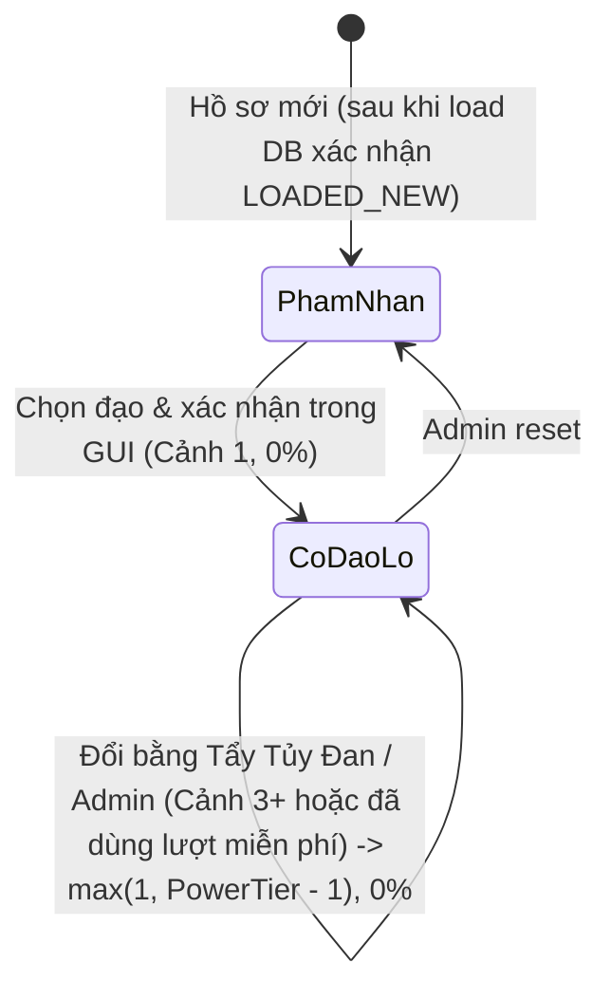
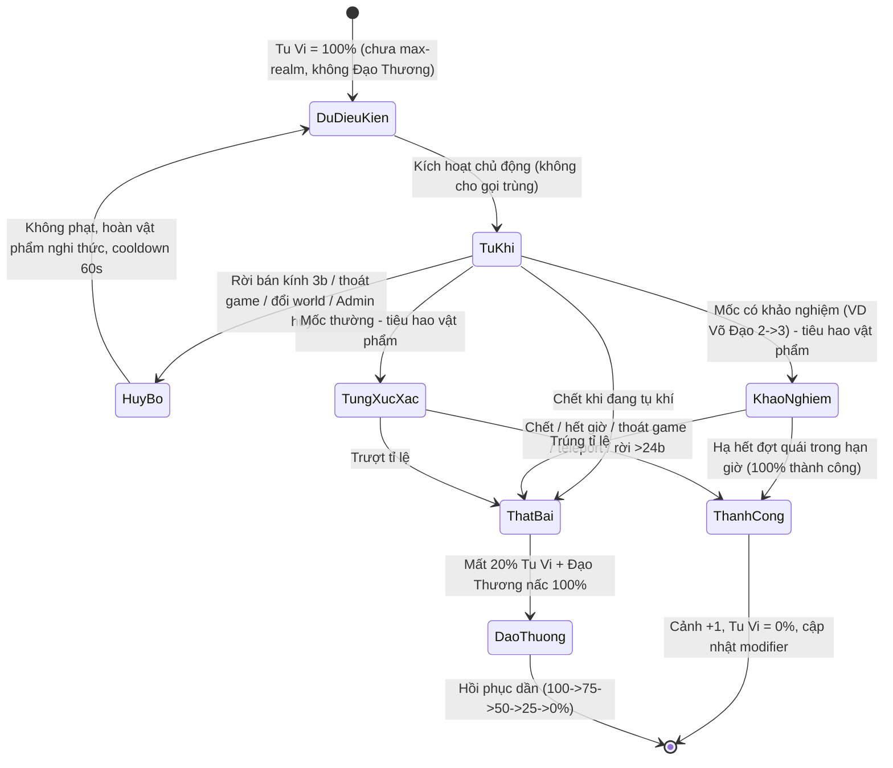

# 03. Requirement – Đặc tả yêu cầu (BRD / PRD)

| Thuộc tính | Giá trị |
|---|---|
| Dự án | **TienLo** (Tiên Lộ) – Plugin Survival Thám Hiểm + Tu Tiên + Hệ Thống Xuyên Không |
| Nền tảng | Minecraft Java Edition – Paper 26.3 (`protocol 777`), Java 25 (`bytecode major 69`) |
| Phụ thuộc bắt buộc | **AuraSkills 2.4.0** (hard-depend – đã kiểm chứng khởi động & bytecode trên Paper 26.3-257) |
| Tích hợp tùy chọn | **PlaceholderAPI**, **WorldGuard**, **MythicMobs** (soft-depend) |
| Đầu vào | [01-ideation.md](01-ideation.md), [02-product-discovery.md](02-product-discovery.md) (đã duyệt), kiểm chứng bytecode `paper-26.3-257.jar` & `AuraSkills-2.4.0.jar` |
| Bước vòng đời | 03 / 09 – Requirement |
| Phiên bản / Trạng thái | **v2.0 – Đã duyệt (Approved) – chuyển sang Bước 04 (Architecture)** |
| Ngày | 2026-11-22 |

---

## 0. Mục đích, phạm vi & quy ước tài liệu

### 0.1 Mục đích
Chuyển toàn bộ quyết định sản phẩm ở Bước 01–02 và kết quả kiểm chứng kỹ thuật / cân bằng thành **đặc tả yêu cầu kiểm chứng được** (functional + non-functional) để:
- **Bước 04 (Architecture)** thiết kế module, schema DB, event, adapter, service không phải đoán nghiệp vụ.
- **Bước 05 (UI/UX & Game Design)** chi tiết bố cục GUI, tổ hợp kích hoạt kỹ năng, câu chữ, file YAML và bảng số cuối cùng trong khung ngân sách đã chốt.
- **Bước 07 (Testing)** xây dựng test case trực tiếp từ Acceptance Criteria và tiêu chí NFR.

### 0.2 Phạm vi chi tiết hóa
| Phase | Mức độ chi tiết trong tài liệu này |
|---|---|
| **Phase 1 (MVP)** | **Đầy đủ** – FR chi tiết, ca biên, state machine, khung số mặc định đã kiểm chứng toán học, User Story & AC phủ 100% yêu cầu `M` |
| Phase 2 (Thử thách & Loot) | Mức tính năng – FR khung cho Yêu Thú Thủ Hộ, Pháp Bảo, Linh Thạch, MythicMobs |
| Phase 3 (Điểm nhấn Tu Tiên) | Mức tính năng – FR khung cho Cảnh 6+, Lôi Kiếp an toàn, Ngưng Dực & Phi Hành, WorldGuard `tienlo-fly` |

### 0.3 Quy ước mã & độ ưu tiên
| Tiền tố | Ý nghĩa |
|---|---|
| `BO-xx` | Mục tiêu kinh doanh (Business Objective) |
| `KPI-xx` | Chỉ số thành công có thước đo |
| `FR-<MODULE>-xx` | Yêu cầu chức năng |
| `NFR-<NHÓM>-xx` | Yêu cầu phi chức năng |
| `US-xx` / `AC-xx.y` | User Story & Acceptance Criteria (`Given / When / Then`) |
| `OQ-xx` | Điểm quyết định sản phẩm nhỏ cần xác nhận khi duyệt Bước 03 |

- **MoSCoW:** `M` = Must (bắt buộc cho phase), `S` = Should (nên có), `C` = Could (tùy chọn), `W` = Won't (ngoài phạm vi phase).
- **Phase:** `P1`, `P2`, `P3`, `EXT`.
- Ký hiệu **(cfg)** = giá trị mặc định cấu hình được qua YAML; có thể tinh chỉnh ở Bước 05 & Bước 07 (Gameplay Test).

---

## 1. Business Requirements (BRD)

### 1.1 Mục tiêu kinh doanh

| Mã | Mục tiêu | Truy vết |
|---|---|---|
| BO-01 | Tăng **retention** server Survival/SMP bằng tiến trình tu luyện dài hạn (Phase 1 đạt trung vị **15–25 giờ chơi tích cực** tới đỉnh Cảnh 5) | P1 (Ideation), Quyết định #3 (Discovery) |
| BO-02 | Biến **thám hiểm** thành nguồn Tu Vi chủ đạo (cấu trúc, biome, rương cổ, chunk mới), không thưởng AFK hay bãi farm | P2, BR-01 |
| BO-03 | Tạo **bản sắc Á Đông khác biệt** (Song Đạo Kiếm Lai + Hệ Thống Xuyên Không, thuật ngữ Hán-Việt) cho cộng đồng Survival VN | P4 |
| BO-04 | **Nhẹ server (< 1 ms/tick)** và **không cần client mod** để Server Owner tự tin triển khai trên SMP thật | P5, Trụ cột 3–4 |
| BO-05 | **Tái sử dụng AuraSkills 2.4.0** (Mana = Linh Lực, Stat/Trait Modifiers) và đảm bảo **gỡ sạch 100%** không để lại dư lượng chỉ số | Ideation 7.2, BR-05, BR-08 |

### 1.2 Chỉ số thành công (KPI)

| Mã | Chỉ số | Mục tiêu | Cách đo |
|---|---|---|---|
| KPI-01 | Retention D7 trên server thử nghiệm | **+15% tương đối** so với baseline 2 tuần trước khi cài | `first_join`, `last_seen` trong `PlayerProfile` |
| KPI-02 | Số chunk mới khám phá / người chơi / giờ online | **+30%** so với baseline | Bộ đếm `ExploredRegion` vs. baseline trước khi bật thưởng |
| KPI-03 | Thời gian chơi tích cực trung vị để đạt **100% Cảnh 5** | **15–25 giờ** | `RealmMilestone.playtime_active_at_reach` qua `/tl admin stats` |
| KPI-04 | Tỉ trọng nguồn Tu Vi thực tế | **Phase 1:** Thám hiểm `55–65%` · Boss & Tinh Anh `10–18%` · Quái `15–20%` · Online `6–12%` **Phase 2+ (đủ Yêu Thú):** Thám hiểm `45–55%` · Boss & Yêu Thú `20–30%` · Quái `15–20%` · Online `5–10%` | `GainLedger` qua `/tl admin stats` *(tách riêng P1 vì P1 chưa có Yêu Thú Thủ Hộ & MythicMobs)* |
| KPI-05 | Tỉ lệ người chơi mới thức tỉnh đạo lộ trong phiên đầu | **≥ 70%** | `PlayerProfile.awakened_in_first_session` qua `/tl admin stats` |
| KPI-06 | Chi phí main thread của plugin | **< 1 ms/tick** trung bình (`< 2 ms` p95) ở 50 người chơi hoạt động | Spark profiler 30 phút |
| KPI-07 | Mất dữ liệu tiến trình | **0** khi restart bình thường; **≤ 60 giây** khi crash cứng | Test `/stop` & kill process |

### 1.3 Stakeholders

| Vai trò | Quan tâm chính | Tham gia duyệt |
|---|---|---|
| Product Owner (chủ dự án) | Tầm nhìn, nhịp độ, cân bằng Song Đạo, phạm vi từng phase | Duyệt mọi bước |
| Server Owner / Admin (khách hàng) | 20 TPS, YAML rõ ràng, chống farm/exploit, gỡ cài sạch | Bước 03, 05, 08 |
| Người chơi (5 persona) | Trải nghiệm xuyên không, công bằng PvE/PvP, không ép casual | Gameplay Test (Bước 07) |
| Developer / QA Agent | Đặc tả không mơ hồ, API đã kiểm chứng, AC đo kiểm được | Bước 04, 06, 07 |

### 1.4 Phạm vi

**Trong phạm vi toàn dự án:** 4 phân hệ A–D của Ideation, Song Đạo Kiếm Lai (15 cảnh Luyện Khí Sĩ, 11 cảnh Võ Đạo), triển khai theo 3 Phase tại [Mục 6 – Discovery](02-product-discovery.md#6-ma-trận-phân-bổ-tính-năng-theo-3-phase-phased-scope).

**Ngoài phạm vi (Out of Scope – MVP & giai đoạn hiện tại):**
| Hạng mục | Lý do / Thời điểm |
|---|---|
| Client mod (Fabric/Forge), Bedrock/Geyser | Trụ cột 3 – không cam kết |
| Folia | Chưa hỗ trợ ở MVP |
| Đồng bộ dữ liệu thời gian thực nhiều server (BungeeCord/Velocity dùng chung DB) | Chốt ngoài phạm vi MVP (quy mô mục tiêu 10–100 người / 1 server SMP) |
| Tông môn/guild, hệ thống tiền tệ/kinh tế, PvP xếp hạng | Bước 09 – mở rộng |
| Song Tu (tu đồng thời 2 đạo lộ) | Mở rộng tương lai |
| Động Thiên Phúc Địa / Tiểu Thế Giới | Add-on tương lai (core chỉ mở `SpiritZoneProvider` & API) |
| `BrushableBlock` (khảo cổ Suspicious Sand/Gravel) | Không đi qua `LootGenerateEvent` trên Paper 26.3 – để mở rộng sau P1 |

### 1.5 Ràng buộc kỹ thuật & môi trường (Đã kiểm chứng)

| Mã | Ràng buộc | Trạng thái xác minh |
|---|---|---|
| CON-01 | Paper **26.3** (`protocol_version: 777`), **Java 25** (`bytecode major 69`). Máy dev đã cài sẵn `jdk-25.0.5.0.3` (chỉ cần cấu hình toolchain Gradle/Maven trỏ JDK 25). | Đã kiểm chứng từ `paper-26.3-257.jar` |
| CON-02 | **AuraSkills 2.4.0** là hard-depend; mọi API cần dùng (`SkillsUser`, `ManaRegenerateEvent`, `UserLoadEvent`, `SkillsLoadEvent`, `DamageEvent`, `StatModifier`/`TraitModifier.setNonPersistent()`, `Stats`, `Traits`) đã kiểm chứng từ bytecode. | Đã kiểm chứng từ `AuraSkills-2.4.0.jar` |
| CON-03 | Vanilla client 100%: GUI, BossBar, ActionBar, Title, Particle, Sound, Display Entity (`setVisibleByDefault(false)` không cần ProtocolLib); Resource Pack là tùy chọn. | Đã kiểm chứng từ `paper-api-26.3` |
| CON-04 | Lưu trữ: SQLite mặc định; hỗ trợ MySQL/MariaDB (`M`), PostgreSQL (`S`). Mọi I/O DB bất đồng bộ. | Ràng buộc kiến trúc |
| CON-05 | 100% thông số gameplay nằm trong file YAML và 100% chuỗi hiển thị nằm trong file ngôn ngữ. | Trụ cột 5 |

### 1.6 Giả định

| Mã | Giả định | Trạng thái / Ảnh hưởng nếu sai |
|---|---|---|
| AS-01 | AuraSkills 2.4.0 vận hành ổn định trên Paper 26.3-257 | Đã xác minh khởi động sạch (`11 skills, 9 stats, 17 traits`, `NBTAPI MC26_3`); kiểm thử runtime đầy đủ ở Bước 07 |
| AS-02 | Paper 26.3 có đủ `Attribute` cho nội tại di chuyển & lá chắn (`MOVEMENT_SPEED`, `JUMP_STRENGTH`, `SAFE_FALL_DISTANCE`, `FALL_DAMAGE_MULTIPLIER`, `KNOCKBACK_RESISTANCE`, `MAX_ABSORPTION`) + `addTransientModifier()` | **Đã xác minh 100%** từ `paper-api-26.3` |
| AS-03 | Các soft-depend (PlaceholderAPI, WorldGuard 7.x, MythicMobs 5.x) có bản tương thích Paper 26.3 | Nếu plugin nào chưa cập nhật, tích hợp đó tạm bỏ qua sạch mà core vẫn chạy |
| AS-04 | Một server chạy một CSDL TienLo độc lập (không đồng bộ sống đa server) | Khớp Out of Scope |
| AS-05 | Ngôn ngữ mặc định là Tiếng Việt (`vi_VN`), kèm bản Tiếng Anh (`en_US`) | – |

---

## 2. Thuật ngữ (Glossary)

| Thuật ngữ | Định nghĩa chính xác trong hệ thống |
|---|---|
| **Ký chủ** | Cách "Hệ Thống" gọi người chơi trong thông báo xuyên không |
| **Phàm Nhân** | Người chơi chưa chọn đạo lộ (`path = null`): chơi sinh tồn vanilla hoàn toàn bình thường, không nhận/mất Tu Vi, không bị sửa hồi Mana AuraSkills |
| **Đạo Lộ (Path)** | `LUYEN_KHI` (Luyện Khí Sĩ) hoặc `VO_DAO` (Võ Đạo / Võ Phu) |
| **Cảnh Giới (Realm)** | Bậc tu luyện trong một đạo lộ (Luyện Khí 1–15, Võ Đạo 1–11); Phase 1 giới hạn 1–5 |
| **Power Tier** | Thang quy đổi sức mạnh nội bộ 1–15 giữa 2 đạo ([Discovery 3.3](02-product-discovery.md#33-bảng-quy-đổi-tương-quan-sức-mạnh-hai-đạo-cross-path-tier-mapping)); ở Phase 1: Cảnh `N` = Tier `N` |
| **Tu Vi** | Điểm tiến trình **số nguyên ≥ 0** trong cảnh giới hiện tại (`0 → ngưỡng cảnh`, hiển thị `0.0%–100.0%`) trên thang chuẩn **160.000** cho Phase 1 |
| **Linh Lực** | Chính là **Mana của AuraSkills** |
| **Linh Khí** | Mật độ năng lượng khu vực gồm 5 cấp: Khô Kiệt (`0.5x`), Loãng (`0.8x`), Bình Thường (`1.0x`), Nồng Đậm (`1.3x`), Linh Mạch (`1.60x–2.00x`) |
| **Đột Phá** | Nghi thức chủ động chuyển từ `100%` cảnh hiện tại lên cảnh kế tiếp |
| **Đạo Thương** | Trạng thái debuff tạm thời khi đột phá thất bại, giảm dần qua 4 nấc (`100% → 75% → 50% → 25% → 0%`) |
| **Thần Thức** | Kỹ năng chủ động dò xét mục tiêu hoặc khu vực |
| **Rương tự nhiên** | Container sinh kèm loot table tự nhiên (`Chest`, `Barrel`, `StorageMinecart`, `Vault` Trial Chambers) chưa từng được mở lần đầu |
| **Modifier TienLo** | Mọi `StatModifier`/`TraitModifier` AuraSkills (`name = "tienlo:<nhóm>"`, **bắt buộc `setNonPersistent()`**) và mọi vanilla `AttributeModifier` (`NamespacedKey("tienlo", "<nhóm>")`, **bắt buộc `addTransientModifier()`**) |

---

## 3. Vai trò người dùng & phân quyền

| Vai trò | Mô tả | Nhóm quyền gốc |
|---|---|---|
| Người chơi | Dùng toàn bộ tính năng gameplay bình thường | `tienlo.use` (mặc định: `true`) |
| Quản Trị Viên | Quản lý hồ sơ, cấu hình, thống kê, dọn dẹp, cấp vật phẩm | `tienlo.admin.*` (mặc định: `op`) |
| Quyền Bypass (chủ động cấp) | Bỏ qua cooldown / chống farm / trần nguồn cho mục đích test hoặc đặc quyền riêng | `tienlo.bypass.*` (mặc định: **`false`** – tránh Admin/OP khi chơi thử vô tình bỏ qua cơ chế cân bằng) |

Danh mục đầy đủ lệnh, quyền và hỗ trợ Console tại [Mục 8](#8-danh-mục-lệnh--quyền-mức-yêu-cầu).

---

## 4. Functional Requirements (PRD)

### 4.1 FR-CORE – Vòng đời plugin, cấu hình & môi trường

| Mã | Yêu cầu | Ưu tiên | Phase |
|---|---|:---:|:---:|
| FR-CORE-01 | Khi khởi động, nếu thiếu AuraSkills hoặc phiên bản không thuộc dải hỗ trợ (`2.4.x`), plugin **tự tắt (disable)** và ghi log `ERROR` rõ tên dependency thiếu + phiên bản yêu cầu. | M | P1 |
| FR-CORE-02 | Tự động phát hiện soft-depend (`PlaceholderAPI`, `WorldGuard`, `MythicMobs`) lúc khởi động; chỉ đăng ký adapter khi plugin tương ứng bật, không ném lỗi khi thiếu. | M | P1 |
| FR-CORE-03 | Toàn bộ con số gameplay (ngưỡng Tu Vi, hệ số Linh Khí, thưởng từng nguồn, cooldown, mana cost, công thức sát thương, ngưỡng chống farm, tỉ lệ đột phá…) cấu hình được qua YAML. | M | P1 |
| FR-CORE-04 | Kiểm tra hợp lệ config khi load/reload: khóa sai kiểu/ngoài khoảng → ghi `WARN` kèm đường dẫn khóa chính xác, fallback về giá trị mặc định của khóa đó; plugin vẫn hoạt động bình thường. | M | P1 |
| FR-CORE-05 | `/tl admin reload` nạp lại toàn bộ YAML gameplay và file ngôn ngữ **không cần restart**, đồng bộ lại modifier cho người chơi online; riêng cấu hình kết nối DB yêu cầu restart và thông báo rõ. | M | P1 |
| FR-CORE-06 | File config có `config-version`; khi nâng cấp plugin tự thêm khóa mới kèm giá trị mặc định, bảo toàn các giá trị admin đã chỉnh. | S | P1 |
| FR-CORE-07 | Bật/tắt từng phân hệ độc lập qua `modules.<tên>.enabled` (ví dụ tắt nguồn Tu Vi online, tắt PvP skill, tắt khảo nghiệm). | S | P1 |
| FR-CORE-08 | Danh sách **`disabled-worlds`**: khi người chơi bước vào world bị loại trừ (`PlayerChangedWorldEvent`), TienLo **tạm gỡ toàn bộ modifier `tienlo:*`**, tạm dừng đếm Đạo Thương, chặn nhận Tu Vi, chặn dùng kỹ năng/đột phá/chọn-đổi đạo và bỏ qua can thiệp `ManaRegenerateEvent`; khi rời sang world hợp lệ thì tự áp lại modifier & khôi phục Đạo Thương. | M | P1 |
| FR-CORE-09 | Danh sách **`ignored-gamemodes`** (mặc định: `[CREATIVE, SPECTATOR]`): người chơi ở chế độ này không nhận Tu Vi, không ghi nhận Chunk/Biome/Cấu trúc, không nhận thưởng rương tự nhiên, không được kích hoạt đột phá/khảo nghiệm, không bị tính vào KPI, và bị ẩn khỏi quét Thần Thức. | M | P1 |

### 4.2 FR-PATH – Phàm Nhân, Chọn & Đổi Đạo Lộ

| Mã | Yêu cầu | Ưu tiên | Phase |
|---|---|:---:|:---:|
| FR-PATH-01 | Chỉ sau khi tải DB hoàn tất và xác nhận trạng thái **`LOADED_NEW`** (tuyệt đối không chạy khi đang tải hoặc `LOAD_FAILED`), chờ độ trễ `3 giây` (cfg) rồi gửi thông báo xuyên không và mở GUI chọn đạo (bỏ qua nếu đang ở `disabled-worlds` hoặc `ignored-gamemodes`). | M | P1 |
| FR-PATH-02 | GUI chọn đạo hiển thị rõ 2 đạo (*Luyện Khí Sĩ* vs *Võ Đạo*), mô tả bản sắc gameplay, nhóm chỉ số nổi trội và bộ kỹ năng Phase 1; bắt buộc có **bước xác nhận** trước khi chốt. | M | P1 |
| FR-PATH-03 | Đóng GUI không chọn → giữ trạng thái **Phàm Nhân**: không nhận/mất Tu Vi, không dùng kỹ năng tu tiên, **không bị điều chỉnh hồi Mana AuraSkills**, không chịu phạt gameplay sinh tồn. Nhắc nhẹ tối đa 1 lần/phiên (tắt vĩnh viễn được bằng cờ `mortal_reminder_muted`) rằng có thể mở `/tienlo`. | M | P1 |
| FR-PATH-04 | Phàm Nhân mở `/tienlo` (hoặc alias) ở world hợp lệ bất kỳ lúc nào để thức tỉnh đạo lộ; khởi đầu tại **Cảnh 1 – 0% Tu Vi** và ghi nhận `awakened_at` / `awakened_in_first_session`. | M | P1 |
| FR-PATH-05 | **Đổi đạo miễn phí 1 lần:** chỉ áp dụng khi `free_switch_used == false` **VÀ** `max_realm_reached <= 2` (tránh tụt từ Cảnh 3→2 rồi đổi miễn phí). Kết quả: đạo mới **Cảnh 1 – 0% Tu Vi**, đánh dấu `free_switch_used = true` vĩnh viễn. | M | P1 |
| FR-PATH-06 | **Đổi đạo có phí (Cảnh 3+ hoặc đã hết lượt miễn phí):** cần tiêu hao đúng **1 vật phẩm đổi đạo (*Tẩy Tủy Đan*)** hoặc dùng lệnh `/tl admin switch`. Kết quả: cảnh mới = `max(1, PowerTier_cũ - 1)` của đạo mới, **0% Tu Vi**. | M | P1 |
| FR-PATH-07 | **Chống race condition & nguyên tử:** khóa thao tác theo UUID; tại thời điểm bấm xác nhận phải **kiểm tra lại toàn bộ điều kiện** (`FR-PATH-08`, vẫn còn vật phẩm trên người), trừ đúng 1 item (không xóa cả stack), gỡ sạch modifier `tienlo:*` cũ, áp modifier mới, xóa cooldown kỹ năng đạo cũ và lưu DB; lỗi giữa chừng phải rollback trạng thái trước đó. | M | P1 |
| FR-PATH-08 | Cấm chọn hoặc đổi đạo khi đang: trong tiến trình Đột Phá / Khảo Nghiệm, có **combat tag (cả PvP lẫn PvE trong 15 giây gần nhất – cfg)**, đang có Đạo Thương, hoặc đang ở `disabled-worlds`. | M | P1 |
| FR-PATH-09 | Ghi **audit log** cho mọi lần thức tỉnh và đổi đạo (thời điểm, UUID, đạo/cảnh cũ → mới, phương thức: miễn phí / vật phẩm / admin). | S | P1 |
| FR-PATH-10 | Vật phẩm đổi đạo (*Tẩy Tủy Đan*): định danh bằng PDC kèm **chữ ký/mã xác thực cấp server** (khớp `NFR-SEC-03`, chống giả mạo bằng anvil hay `/give` NBT thô); cấp được bằng `/tl admin give` và **có công thức chế tạo đắt giá bật mặc định ở Phase 1 (cfg, tắt được)** (ví dụ `1 Heart of the Sea` hoặc `1 Nether Star` + `4 Diamond Block` + `4 Blaze Rod` – chi tiết ở Bước 05) để server SMP không có admin shop vẫn dùng được `FR-PATH-06` *(xem OQ-01)*. Nguồn rơi từ Yêu Thú bổ sung ở P2. | M | P1 |

### 4.3 FR-REALM – Cảnh Giới & Tu Vi

| Mã | Yêu cầu | Ưu tiên | Phase |
|---|---|:---:|:---:|
| FR-REALM-01 | Hồ sơ người chơi lưu Tu Vi là **số nguyên ≥ 0** trên thang chuẩn **160.000 cho Phase 1**. **Quy tắc làm tròn chung:** `Math.round(raw_value)` (nếu `raw_value > 0` và kết quả làm tròn = 0 → làm tròn lên `1`, trừ trường hợp nguồn bị phạt cứng `0%`). | M | P1 |
| FR-REALM-02 | Danh sách cảnh giới (tên, mô tả lore, ngưỡng Tu Vi, modifier Stat/Trait/Attribute, kỹ năng mở khóa, yêu cầu đột phá) cấu hình độc lập theo từng đạo; Phase 1 khóa trần `max-realm: 5` (cfg). | M | P1 |
| FR-REALM-03 | **Cảnh báo `≥ 90%` & trần `100%`:** Khi Tu Vi lần đầu đạt `≥ 90%` cảnh hiện tại, nhắc ngắn người chơi sắp đầy Tu Vi (tránh lãng phí Boss/cooldown). Tu Vi không vượt quá ngưỡng cảnh: khi đạt `100%`, phần dư bị bỏ và thông báo **đúng 1 lần** (`breakthrough_notified = true`) đã đủ điều kiện đột phá. | M | P1 |
| FR-REALM-04 | Ở cảnh trần (`realm == max-realm`) và đạt `100%`: hiển thị trạng thái *"Bình cảnh – Thiên Đạo chưa mở"*, ẩn/khóa nút Đột Phá, **không tích trữ Tu Vi dư cho Phase 3** và **tạm dừng đánh dấu Chunk/Biome/Cấu trúc cá nhân** (cfg) để người chơi không bị "đốt" bản đồ trong lúc chờ Phase 3 *(xem OQ-02)*. | M | P1 |
| FR-REALM-05 | Mọi lần cộng Tu Vi đi qua **một cổng xử lý duy nhất (`TuViService`)** nhận `(player, source, rawAmount, applySpiritMultiplier)` để áp nhất quán: kiểm tra Phàm Nhân / `disabled-worlds` / `ignored-gamemodes` / trần nguồn / hệ số Linh Khí / làm tròn / thống kê `GainLedger` / gộp thông báo / phát sự kiện API. | M | P1 |
| FR-REALM-06 | Phát sự kiện API nội bộ cho add-on: `TuViGainEvent` (hủy/sửa lượng được), `BreakthroughStartEvent`, `BreakthroughResultEvent`, `PathSwitchEvent`. | S | P1 |
| FR-REALM-07 | Phàm Nhân, người ở `disabled-worlds`, người ở `ignored-gamemodes`, và người chưa nạp xong hồ sơ (`!LOADED`) nhận `0` Tu Vi. | M | P1 |
| FR-REALM-08 | Khi nâng cấp lên Phase 3, nâng `max-realm` lên Cảnh 6+ (Động Phủ Cảnh / Võ Đảm Cảnh trở lên) qua config mà không phá vỡ dữ liệu hồ sơ Phase 1. | M | P3 |

**Bảng ngưỡng Tu Vi mặc định Phase 1 (cfg – thang 160.000, tốc độ chơi tích cực trung bình ~8.000 Tu Vi/giờ):**

| Cảnh | Luyện Khí Sĩ | Võ Đạo | Ngưỡng Tu Vi | Lũy kế | Thời gian lũy kế ước tính *(lối chơi cân bằng → thám hiểm)* |
|---:|---|---|---:|---:|---:|
| 1 | Bì (Da Đồng) | Ni Bôi | 8.000 | 8.000 | ~1,0 – 1,3 giờ |
| 2 | Nhục (Cỏ Rễ) | Mộc Thai | 16.000 | 24.000 | ~2,8 – 3,8 giờ |
| 3 | Cân (Gân Liễu) | Thủy Ngân | 28.000 | 52.000 | ~5,8 – 8,0 giờ |
| 4 | Cốt (Khí Cốt) | Anh Hồn | 44.000 | 96.000 | ~10,5 – 14,5 giờ |
| 5 | Thể (Lò Luyện) | Hùng Phách | 64.000 | **160.000** | **~16,5 – 24,5 giờ** *(đạt chuẩn 15–25 giờ ở cả SMP mới & cũ)* |

### 4.4 FR-GAIN – Nguồn Tu Vi & Chống lạm dụng (BR-01)

#### 4.4.1 Thám hiểm & Rương cổ *(Toàn bộ nguồn mục 4.4.1 đều nhân `× hệ số Linh Khí` tại vị trí kích hoạt)*

| Mã | Yêu cầu | Ưu tiên | Phase |
|---|---|:---:|:---:|
| FR-GAIN-01 | Lần đầu người chơi bước vào một chunk (theo world) chưa có trong `ExploredRegion` → thưởng `4 (cfg) × hệ số Linh Khí` (cho ra số nguyên phân biệt 5 cấp: `2 / 3 / 4 / 5 / 6–8`). Mỗi chunk chỉ thưởng **1 lần/người chơi**. | M | P1 |
| FR-GAIN-02 | **Chống lướt siêu tốc & hold-W (2 lớp):** (a) **Token bucket:** dung lượng burst **`15` chunk** (cfg), nạp **`55` chunk/phút** (cfg — đủ cho ngựa vanilla nhanh nhất `14,23 b/s = 53,4 ch/phút` không bao giờ cạn xô). Khi xô cạn → nhận **`0%`** (cfg) và **không đánh dấu chunk đã khám phá** (tránh bay Elytra đốt bản đồ). (b) **Trần chunk thô theo giờ:** tối đa **`2.400` Tu Vi/giờ** (cfg, cửa sổ trượt 60 phút, ~600 chunk/giờ ở 1.0x) từ `FR-GAIN-01` để lối chạy thuyền/ngựa trống không vượt mặt lối chơi thám hiểm cấu trúc + đánh quái. | M | P1 |
| FR-GAIN-03 | Chunk đặt chân vào qua dịch chuyển (`/tp`, `/home`, ender pearl, cổng Nether/End — cfg theo `TeleportCause`) không thưởng `FR-GAIN-01` cho chunk đích; các chunk đi bộ kế tiếp tính bình thường. | S | P1 |
| FR-GAIN-04 | Lần đầu đặt chân vào một **loại biome** (theo world) khi **`!player.isGliding()`** → thưởng **`350` (cfg) × hệ số Linh Khí** (hỗ trợ override theo từng biome). | M | P1 |
| FR-GAIN-05 | Lần đầu tiến vào phạm vi **3D (`GeneratedStructure.getBoundingBox()` – kiểm tra cả trục Y)** của một **cấu trúc tự nhiên cụ thể** khi **`!player.isGliding()`** → thưởng **`800 – 2.500` (cfg) × hệ số Linh Khí** theo loại cấu trúc (Village thấp; Ancient City / Bastion / End City / Trial Chambers cao); lần đầu khám phá **loại** cấu trúc đó thưởng thêm **`+50%`** (cfg). Config bắt buộc hỗ trợ **nhóm / wildcard / default fallback** (ví dụ `minecraft:abandoned_camp_*` cho 18 cấu trúc mới của MC 26.3, `minecraft:village_*`, `minecraft:ruined_portal*`). | M | P1 |
| FR-GAIN-06 | **Rương tự nhiên lần đầu sinh loot toàn server (`LootGenerateEvent`):** thưởng **`250 – 600` (cfg) × hệ số Linh Khí** theo loot table. Áp dụng 4 quy tắc kiểm chứng từ NMS Paper 26.3: (a) Kiểm tra & đánh dấu `ClaimedContainer`/PDC **đồng bộ trên main thread** (tránh 2 người mở cùng tick nhận đúp) và chống tái thưởng khi server bật Paper `lootables.auto-replenish`; (b) **Double Chest** dedupe cặp block, chỉ thưởng **1 lần**; (c) Chỉ thưởng khi `event.getEntity() instanceof Player` và `!event.isPlugin()` (đập vỡ rương, Hopper hút đồ, đập `DecoratedPot` không thưởng); (d) Nếu Phàm Nhân hoặc người ở `CREATIVE` mở rương đầu tiên, vanilla đã sinh loot nên rương không còn nguyên sơ cho người sau (riêng `SPECTATOR` trong vanilla không gọi `unpackLootTable`). | M | P1 |
| FR-GAIN-07 | **Trial Chambers Vault (`BlockDispenseLootEvent`):** lọc chặt **`event.getBlock().getState() instanceof Vault`** (loại trừ `TrialSpawner` cũng bắn event này) và `event.getPlayer() != null`; chỉ thưởng **`500` (cfg) × hệ số Linh Khí** cho người mở **đầu tiên toàn server** (`vault.getRewardedPlayers().isEmpty()` + chưa có trong `ClaimedContainer`/PDC). | M | P1 |
| FR-GAIN-08 | Dữ liệu khám phá cá nhân (`ExploredRegion`, Biome, Cấu trúc) được đếm từ thời điểm TienLo cài đặt → server SMP cũ vẫn hoạt động tự nhiên; riêng rương đã mở từ trước khi cài đã mất loot table vanilla nên không thưởng. | M | P1 |

#### 4.4.2 Boss & Mini-Boss *(Không nhân hệ số Linh Khí để tránh kéo boss về Linh Mạch)*

| Mã | Yêu cầu | Ưu tiên | Phase |
|---|---|:---:|:---:|
| FR-GAIN-10 | Danh sách Boss & Mini-Boss mặc định ở Phase 1 (cfg, mở rộng được theo EntityType hoặc ID MythicMobs ở P2): • **Mini-Boss (tiếp cận từ Cảnh 1–4):** Piglin Brute `200`, Evoker `400`, Ravager `450`, Elder Guardian `1.500`. • **Boss lớn:** Warden `5.000`, Wither `5.500`, Ender Dragon `8.000`. | M | P1 |
| FR-GAIN-11 | **Công thức chia Tu Vi & chống cheese Boss:** (a) **Chống cheese (kẹt Wither dưới bedrock / đẩy rơi):** chỉ phát thưởng nếu tổng sát thương có nguồn hợp lệ từ người chơi **`≥ 50%` HP tối đa của Boss** (cfg; loại trừ ngạt, rơi, void, lava môi trường, cramming). (b) **Điều kiện nhận phần:** người chơi đóng góp **`≥ 5%` HP tối đa Boss** (cfg – theo Quyết định #6 Discovery), đang online cùng world (cho phép vừa chết và respawn trong vòng `5 phút` sau đòn đánh cuối). Sát thương từ projectile, pet đã thuần, TNT/Bed/Respawn Anchor do người chơi kích hoạt, Thorns, Fire Aspect và kỹ năng TienLo được quy về chủ; bản ghi sát thương của Boss tự hết hạn nếu Boss hồi đầy 100% HP ngoài giao tranh quá `5 phút` (cfg). (c) **Công thức chia co-op:** gọi `N` là số người chơi đóng góp `≥ 10%` HP Boss (chống dùng alt 5% bơm pool); `pool = baseReward × min(1.5, 1 + 0.15 × max(0, N - 1))` (cfg); phần mỗi người đủ điều kiện `≥ 5%` = `min(baseReward, pool × damage_i / max(boss_max_hp, total_valid_damage))`. | M | P1 |
| FR-GAIN-12 | **Cooldown theo loại Boss / người chơi (cfg):** Boss lớn (`Warden`, `Wither`, `Ender Dragon`): `2 giờ`; `Elder Guardian`: **`3 lượt / 2 giờ`** (hoặc cooldown `15 phút` để người chơi ăn đủ 3 con trong 1 Ocean Monument); `Evoker` / `Ravager` (Raid): **cửa sổ 1 trận Raid (`10 phút` hoạt động / tối đa `2` Evoker + `2` Ravager), sau đó áp cooldown `30–45 phút`/người** (không cắt thưởng giữa chừng khi thủ làng thật nhưng vẫn chặn Raid farm). Trong cooldown vẫn ghi nhận sát thương (không phá ngưỡng 50% của đồng đội) nhưng nhận `0` Tu Vi kèm thông báo. | M | P1 |
| FR-GAIN-13 | **Blocklist `SpawnReason` riêng cho Boss (cfg):** chỉ chặn `SPAWNER`, `SPAWNER_EGG`, `DISPENSE_EGG`, `TRIAL_SPAWNER`, `COMMAND`, `CUSTOM`; **cho phép** `BUILD_WITHER` (Wither), `DEFAULT` (Ender Dragon hồi sinh bằng 4 End Crystal), `NATURAL` (Warden), `CHUNK_GEN` (Elder Guardian). | M | P1 |

#### 4.4.3 Quái vật thường *(Không nhân hệ số Linh Khí)*

| Mã | Yêu cầu | Ưu tiên | Phase |
|---|---|:---:|:---:|
| FR-GAIN-20 | Quái hostile thưởng Tu Vi theo loại (cfg): Overworld thường `25–40`, Nether `45–60`, End `55`, quái tinh anh không thuộc danh sách Mini-Boss (Witch, Breeze, Hoglin, Ghast, Shulker…) `100–180`. Quái passive mặc định `0`. | M | P1 |
| FR-GAIN-21 | **Hệ số theo `CreatureSpawnEvent.SpawnReason` (cfg):** • **Chặn `0%` mặc định:** `SPAWNER`, `SPAWNER_EGG`, `DISPENSE_EGG`, `SLIME_SPLIT`, `NETHER_PORTAL`, `REINFORCEMENTS`, `BREEDING`, `INFECTION`, `CURED`, `DROWNED`, `PIGLIN_ZOMBIFIED`, `FROZEN`, `METAMORPHOSIS`, `SILVERFISH_BLOCK`, `POTION_EFFECT` *(chống farm Oozing/Infested)*, `SPELL`, `DUPLICATION`, `OMINOUS_ITEM_SPAWNER`, `COMMAND`, `CUSTOM` *(chặn luôn quái khảo nghiệm Thủy Ngân)*. • **`TRIAL_SPAWNER`:** **`75%`** (cfg – vì vanilla đã có cooldown 30 phút/người). • **`RAID`:** thưởng trong **cửa sổ 1 trận Raid (`10 phút` hoạt động), sau đó áp cooldown Raid `30–45 phút`/người** (cfg). | M | P1 |
| FR-GAIN-22 | **Giảm dần theo vùng `3×3` chunk (chống bãi farm ngã tư 4 chunk):** đếm tổng quái chết hợp lệ trong vùng `3×3` chunk quanh điểm chết trong **cửa sổ trượt `10 phút`** (cfg, tính chung toàn server tại vùng đó): `1–35` con nhận `100%`; từ con thứ `36` đến `55` (hard-cap, cfg) giảm tuyến tính về `0%`; `> 55` con nhận `0%`. | M | P1 |
| FR-GAIN-23 | **Chống máy nghiền rơi 1-hit:** chỉ thưởng khi tổng sát thương có nguồn hợp lệ từ người chơi (vũ khí, cung, Fire Aspect/Flame, pet đã thuần, kỹ năng TienLo; **loại trừ** rơi, lava môi trường, ngạt, cramming, xương rồng) **`≥ 50%` `maxHealth`** của quái (cfg). | M | P1 |
| FR-GAIN-24 | Trần Tu Vi từ quái thường: **`2.400` Tu Vi/giờ** (cfg, cửa sổ trượt 60 phút); chạm trần thông báo tối đa 1 lần / `10 phút`. | M | P1 |

#### 4.4.4 Online chủ động

| Mã | Yêu cầu | Ưu tiên | Phase |
|---|---|:---:|:---:|
| FR-GAIN-30 | Mỗi chu kỳ **`5 phút`** (cfg), nếu người chơi đạt tiêu chí hoạt động thực sự, cộng **`55` (cfg) × hệ số Linh Khí** tại vị trí hiện tại. | M | P1 |
| FR-GAIN-31 | **Tiêu chí "hoạt động thực sự" trong chu kỳ (thỏa ≥ 1 mục – cfg):** (a) Dịch chuyển tịnh **`≥ 24` block** so với đầu chu kỳ, không bị đẩy cơ học (dòng nước, minecart, piston) **và không lặp qua lại đúng 2 ô `3×3` `A↔B` quá `3` chu kỳ liên tiếp**; (b) **`≥ 10` tương tác có nghĩa**, trong đó đào/đặt block phải trải trên **`≥ 6` tọa độ block khác nhau** (chặn macro đập-đặt 1 block / máy cobble), chiến đấu phải trúng mục tiêu hostile hợp lệ (loại Armor Stand, Boat, pet đã thuần), hoặc chế tạo/giao dịch thành công. Xoay góc nhìn đơn thuần **không** được tính. | M | P1 |
| FR-GAIN-32 | Trần Tu Vi online: **`900` / giờ** (cửa sổ trượt 60 phút) và **`4.500` / ngày** (cửa sổ trượt 24 giờ – cfg). | M | P1 |

### 4.5 FR-SPIRIT – Linh Khí đa thế giới (BR-02)

| Mã | Yêu cầu | Ưu tiên | Phase |
|---|---|:---:|:---:|
| FR-SPIRIT-01 | 5 cấp mật độ Linh Khí (cfg): **Khô Kiệt** (`0.50x`), **Loãng** (`0.80x`), **Bình Thường** (`1.00x`), **Nồng Đậm** (`1.30x`), **Linh Mạch** (`1.60x–2.00x`, giá trị cụ thể tính tất định từ hash chunk ánh xạ tuyến tính trong `[1.60, 2.00]` làm tròn 2 chữ số thập phân). | M | P1 |
| FR-SPIRIT-02 | Tính **tất định (deterministic)** từ `(world, biome, khoảng Y, seed chunk, override zone)`. Cùng tọa độ sau restart cho cùng kết quả; **không lưu bảng chunk Linh Khí vào DB**. | M | P1 |
| FR-SPIRIT-03 | Cấu hình theo từng world: hệ số nền, bảng biome → cấp, dải Y thưởng/phạt (mặc định **phạt Nether Roof `Y ≥ 128`** xuống Khô Kiệt `0.50x` và tùy chọn `0` Tu Vi chunk – cfg), tỉ lệ Linh Mạch (~`2%` chunk – cfg); world chưa khai báo dùng cấu hình `default`. | M | P1 |
| FR-SPIRIT-04 | Chỉ tính lại khi người chơi **đổi chunk**, đổi dải Y vượt ngưỡng cấu hình, hoặc đổi vùng override (không quét theo tick). Khi cấp Linh Khí thay đổi → thông báo ngắn trên ActionBar/HUD (bật/tắt được). | M | P1 |
| FR-SPIRIT-05 | **Phạm vi tác động của Linh Khí:** (a) tốc độ hồi Linh Lực (`FR-AURA-02`), (b) Tu Vi từ **Thám hiểm & Rương cổ (`FR-GAIN-01..07`)** và **Online chủ động (`FR-GAIN-30`)**, (c) điều chỉnh tỉ lệ Đột Phá (`FR-BREAK-04`), (d) tốc độ hồi Đạo Thương (`FR-BREAK-09`). **Không** nhân vào Quái thường & Boss. | M | P1 |
| FR-SPIRIT-06 | Cung cấp interface **`SpiritZoneProvider`** cho WorldGuard và add-on tương lai (*Động Thiên Phúc Địa / Tiểu Thế Giới*) đăng ký vùng/world ưu tiên cao hơn công thức mặc định. | M | P1 |
| FR-SPIRIT-07 | Lệnh `/tl admin spirit` in chi tiết cấp, hệ số và từng thành phần tính toán (world, biome, Y, seed Linh Mạch, override). | S | P1 |

### 4.6 FR-BREAK – Đột Phá, Khảo Nghiệm & Đạo Thương (BR-03)

| Mã | Yêu cầu | Ưu tiên | Phase |
|---|---|:---:|:---:|
| FR-BREAK-01 | Kích hoạt **chủ động** qua Bảng Hệ Thống hoặc `/tl breakthrough` (tuyệt đối không tự động). Điều kiện: `100%` Tu Vi, `realm < max-realm`, không có Đạo Thương, không đang tụ khí/khảo nghiệm (chặn gọi song song), đã hết cooldown hủy (`60s`), đủ vật phẩm nghi thức (nếu cảnh cấu hình), không ở `disabled-worlds` / `ignored-gamemodes` / WorldGuard `tienlo-skills: deny`. | M | P1 |
| FR-BREAK-02 | **Tụ khí:** kéo dài `5–15 giây` (cfg theo cảnh), hiển thị BossBar riêng (tạm ưu tiên đè BossBar HUD thường), particle & sound. Người chơi phải giữ trong bán kính `3 block` (cfg) quanh tâm tụ khí; bị cấm dùng kỹ năng chủ động trong lúc tụ khí (được phép dùng khi vào `KhaoNghiem`). | M | P1 |
| FR-BREAK-03 | Rời bán kính, thoát game, đổi world, hoặc Admin reset trong lúc **Tụ khí** → **Hủy không phạt**, hoàn trả/chưa tiêu hao vật phẩm nghi thức, áp cooldown thử lại `60 giây` (cfg). **Chết** trong lúc tụ khí (không tính kích hoạt Totem of Undying cứu sống) → tính là **Thất bại**. Vật phẩm nghi thức chỉ tiêu hao tại thời điểm kết thúc Tụ khí để bước vào `TungXucXac` hoặc `KhaoNghiem`. | M | P1 |
| FR-BREAK-04 | **Tỉ lệ thành công gốc (mốc không khảo nghiệm – cfg):** `C1→2: 95%`, `C2→3: 88%`, `C3→4: 80%`, `C4→5: 72%`. Điều chỉnh theo Linh Khí (cfg): Khô Kiệt `-10`, Loãng `-5`, Bình Thường `0`, Nồng Đậm `+5`, Linh Mạch `+10` điểm %. Kẹp kết quả trong `[5%, 98%]`. | M | P1 |
| FR-BREAK-05 | Bảng Hệ Thống hiển thị minh bạch **tỉ lệ thành công dự kiến** (hoặc mô tả Khảo Nghiệm), điều kiện vật phẩm và hậu quả thất bại trước khi bấm xác nhận. | M | P1 |
| FR-BREAK-06 | **Khảo nghiệm mốc bản lề (mặc định bật cho Võ Đạo `C2→C3 – Thủy Ngân: Ni Bồ Tát Quá Giang`, cấu hình bật/tắt được theo từng mốc):** (a) **Không double jeopardy:** vượt qua khảo nghiệm = **100% đột phá thành công** (không tung xúc xắc lần 2); (b) **Mục tiêu:** tiêu diệt toàn bộ các đợt quái khảo nghiệm trong `75 giây` (cfg, dải `60–90s`) trong đấu trường bán kính `24 block` (cfg) — tránh đào hố trốn; (c) **An toàn môi trường & chống exploit:** trước khi bắt đầu kiểm tra đủ không gian spawn và vùng không bị WorldGuard `mob-spawning: deny` (nếu spawn bị chặn → hủy không phạt thay vì tự thắng); quái khảo nghiệm gắn `setPersistent(false)` + PDC `tienlo:trial_mob` (tự xóa nếu chunk nạp lại sau crash), không phá block, chỉ tấn công người độ kiếp (không đánh villager/pet/người khác), **miễn nhiễm sát thương từ người chơi khác** (cấm kéo hộ), rơi 0 đồ & 0 Tu Vi; (d) **Thoát game / dịch chuyển / đổi world / rời bán kính `> 24 block` / chết / hết giờ** trong lúc `KhaoNghiem` → **Thất bại** ngay lập tức và despawn toàn bộ quái khảo nghiệm. | M | P1 |
| FR-BREAK-07 | **Khi thành công:** `realm + 1`, `max_realm_reached = max(...)`, `tuvi = 0`, `breakthrough_notified = false`, ghi `RealmMilestone`, cập nhật modifier (Max Mana, Stat/Trait, Attribute), mở khóa kỹ năng mới, gửi thông báo xuyên không (chat + Title + sound + particle); phát thông báo toàn server cho mốc cấu hình (mặc định: lên Cảnh 5). | M | P1 |
| FR-BREAK-08 | **Khi thất bại:** trừ **`20%`** (cfg, dải `15–25%`) ngưỡng Tu Vi của cảnh hiện tại (`max(0, tuvi - penalty)`), **không bao giờ rớt cảnh**, reset `breakthrough_notified = false` và áp Đạo Thương. | M | P1 |
| FR-BREAK-09 | **Đạo Thương (hồi phục dần):** tổng thời gian chuẩn `900 giây` (`15 phút` – cfg), giảm theo 4 nấc theo tỉ lệ thời gian còn lại (khoảng nửa mở): `100%` (`(75%, 100%]`), `75%` (`(50%, 75%]`), `50%` (`(25%, 50%]`), `25%` (`(0%, 25%]`), `0%` (`= 0%`, khỏi). Ở nấc `100%`: giảm `30%` tốc độ hồi Linh Lực và giảm `30%` toàn bộ bonus Stat/Trait của TienLo (cfg; không giảm dưới chỉ số gốc AuraSkills, không giảm tốc độ di chuyển thành âm, **không giảm Tu Vi nhận vào**), giảm tỉ lệ thuận theo nấc. Đứng ở vùng Nồng Đậm / Linh Mạch tăng tốc hồi `×1.25 / ×1.50` (cfg). Thời gian chỉ trôi khi **online ở world hợp lệ** (cfg). **Chết và uống sữa tuyệt đối không xóa Đạo Thương.** | M | P1 |
| FR-BREAK-10 | Lưu bền vững `InjuryState` (`remaining_seconds`, `total_seconds`); sau khi thoát/vào lại hoặc server restart phải khôi phục chính xác nấc & thời gian còn lại. Khi Đạo Thương/modifier thay đổi làm giảm `MaxHP` hoặc `MaxMana`, kẹp ngay `HP <= MaxHP` & `Mana <= MaxMana`. | M | P1 |
| FR-BREAK-11 | **Lôi Kiếp (đột phá đại cảnh):** triệu hồi sóng Thiên Lôi với BossBar đếm đợt. Hiện thực bằng `World.strikeLightningEffect(loc)` (đã kiểm chứng NMS: 100% không cháy, không phá block, không `thunderHit`, không biến mob, không đánh lan người chơi khác/pet/villager) + tự phát âm thanh sấm + gây sát thương có kiểm soát lên đúng người độ kiếp qua `DamageSource.builder(DamageType.LIGHTNING_BOLT)`. Tôn trọng WorldGuard. | M | P3 |

### 4.7 FR-AURA – Tích hợp AuraSkills 2.4.0 & Ngân sách Cân bằng (BR-05)

| Mã | Yêu cầu | Ưu tiên | Phase |
|---|---|:---:|:---:|
| FR-AURA-01 | Linh Lực = Mana của AuraSkills. Adapter phải **kiểm tra `skillsUser.getMana() >= cost` trước** rồi mới trừ mana (`consumeMana` / `setMana`) nhằm tránh AuraSkills tự bắn kèm tin nhắn thiếu mana gây trùng lặp thông báo. Thiếu mana → không kích hoạt kỹ năng, không tính cooldown, chỉ gửi thông báo của Hệ Thống. | M | P1 |
| FR-AURA-02 | Lắng nghe `ManaRegenerateEvent`: bỏ qua nếu người chơi là **Phàm Nhân**, đang ở **`disabled-worlds`** hoặc **`ignored-gamemodes`**. Với người tu luyện: `newAmount = event.getAmount() × spiritMultiplier × (1 - injuryManaPenalty)`, **bắt buộc kẹp** `min(newAmount, max(0.0, user.getMaxMana() - user.getMana()))` (do `User.setMana()` của AuraSkills 2.4.0 không tự kẹp trần `maxMana`). | M | P1 |
| FR-AURA-03 | Áp modifier theo đạo & cảnh qua AuraSkills API (`StatModifier`/`TraitModifier`, định danh `tienlo:<nhóm>`) kết hợp vanilla `Attribute` (`addTransientModifier` cho `Attribute.KNOCKBACK_RESISTANCE`, vì AuraSkills 2.4.0 không có Stat/Trait này). **Cả hai đạo đều bắt buộc có nền Max Mana & `Traits.MANA_REGEN`** (khắc phục nền `20 Mana / 0.1 regen/s` của AuraSkills 2.4.0 khiến Võ Đạo C1 không đủ 20–25 Mana dùng kỹ năng): • *Luyện Khí Sĩ:* `Stats.WISDOM` *(tự cấp `+2.0 MaxMana/điểm` trong AuraSkills — không cộng chồng `Traits.MAX_MANA`)*, `Traits.MANA_REGEN`, `Stats.HEALTH`, `Stats.TOUGHNESS`, `Stats.STRENGTH`, `Traits.MOVEMENT_SPEED` (`tienlo:realm_speed`, nhẹ), `Stats.REGENERATION` (từ Nhục), vanilla `Attribute.KNOCKBACK_RESISTANCE` (từ Cốt). • *Võ Đạo:* `Stats.HEALTH`, `Stats.TOUGHNESS`, `Stats.STRENGTH`, `Traits.MAX_MANA` & `Traits.MANA_REGEN` (mức ~50% Luyện Khí), vanilla `Attribute.KNOCKBACK_RESISTANCE` (từ Ni Bôi), `Traits.MOVEMENT_SPEED` nhẹ (`tienlo:realm_speed`, từ Mộc Thai), `Stats.REGENERATION` (từ Thủy Ngân), `Stats.CRIT_CHANCE` & `Stats.CRIT_DAMAGE` (từ Anh Hồn). | M | P1 |
| FR-AURA-04 | **Ràng buộc cân bằng toán học (BR-05):** định nghĩa sức mạnh tổng hợp `Power = sqrt(EHP × DPS)`; mỗi bậc cảnh giới tăng **`+8% đến +13%` Power** (tương đương chỉ số đấu tay đôi `CPI = EHP × DPS` tăng `1.17× – 1.28×` mỗi cảnh → người kém 1 cảnh vẫn thắng được khi né 1 chiêu hoặc đánh chuẩn hơn). Tại Cảnh 2 (mốc mở khóa kỹ năng công), bước tăng stat bị động phải thấp hơn để tổng `(stat + skill)` vẫn nằm trong dải. | M | P1 |
| FR-AURA-05 | **Đồng bộ 2 chiều & idempotent:** áp modifier chỉ khi **CẢ** AuraSkills `UserLoadEvent` **VÀ** TienLo `PlayerProfile` đều đã sẵn sàng (bất kể cái nào xong trước). Tự động áp lại trên: đột phá, đổi đạo, đổi nấc Đạo Thương, `PlayerChangedWorldEvent`, `PlayerRespawnEvent`, `/tl admin reload`, và `SkillsLoadEvent` (khi admin chạy `/skills reload`). Thao tác idempotent (với vanilla `AttributeInstance`, **xóa key cũ trước khi gọi `addTransientModifier()`** để tránh `IllegalArgumentException`). | M | P1 |
| FR-AURA-06 | **Đảm bảo Gỡ sạch tuyệt đối (`Clean State Guarantee`):** mọi `StatModifier`/`TraitModifier` **BẮT BUỘC gọi `.setNonPersistent()`** (AuraSkills bỏ qua khi ghi YAML/SQL DB) và mọi vanilla `AttributeModifier` **BẮT BUỘC dùng `addTransientModifier()`** (Paper không ghi vào `playerdata`). Ngoài ra, khi đổi đạo, reset, vào `disabled-worlds`, plugin disable, hoặc chạy `/tl admin cleanup <player\|all>`, TienLo gỡ sạch mọi modifier có tiền tố `tienlo:` trên người chơi online (và quét dọn modifier tồn dư cũ nếu có). | M | P1 |
| FR-AURA-07 | Toàn bộ lời gọi AuraSkills đi qua **một lớp Adapter duy nhất** (`AuraSkillsPort`); phần core không import trực tiếp class AuraSkills. | M | P1 |
| FR-AURA-08 | Không đọc sửa hay ghi đè skill, XP, level hay cấu hình gốc của AuraSkills. | M | P1 |

**Khung ngân sách Stat tích lũy tham chiếu Phase 1 (đã mô phỏng trên Iron / Diamond Prot IV / Netherite Prot IV – đầu vào cho Bước 05):**

| Cảnh | Luyện Khí Sĩ *(HP / Tgh / Str / Wis(+MaxMana) / ManaRegen / Spd / KB)* | Võ Đạo *(HP / Tgh / Str / CritC-D / +MaxMana / ManaRegen / Reg / Spd / KB)* | Tăng `sqrt(EHP×DPS)` *(Diamond Prot IV)* |
|---|---|---|---|
| **C1** | `+1 / +10 / +5 / +15(+30) / +1.2 / 0 / 0%` | `+2 / +10 / +7 / 0–0 / +20 / +0.8 / 0 / 0 / +10%` | LK `+10.3%` · VĐ `+10.7%` |
| **C2** *(mở SK công)* | `+2 / +13 / +8 / +25(+50) / +1.6 / +2 / 0%` | `+3 / +16 / +11 / 0–0 / +30 / +1.0 / 0 / +2 / +15%` | LK `+9.2%` · VĐ `+10.6%` |
| **C3** *(+Nội tại T3)* | `+4 / +20 / +14 / +35(+70) / +2.0 / +3 / 0%` | `+5 / +26 / +18 / 0–0 / +40 / +1.2 / +10 / +2 / +20%` | LK `+10.1%` · VĐ `+10.2%` |
| **C4** | `+6 / +30 / +21 / +45(+90) / +2.5 / +4 / +15%` | `+7 / +36 / +26 / 5%–10% / +50 / +1.4 / +12 / +2 / +25%` | LK `+10.4%` · VĐ `+10.6%` |
| **C5** | `+8 / +40 / +29 / +60(+120) / +3.0 / +5 / +20%` | `+10 / +48 / +35 / 8%–16% / +60 / +1.7 / +15 / +2 / +30%` | LK `+10.9%` · VĐ `+12.2%` |

*(Ghi chú kỹ thuật cho Bước 04/05: (1) Luyện Khí nhận `+30..+120 MaxMana` trực tiếp từ `Stats.WISDOM` (`×2.0`), **không** cộng chồng `Traits.MAX_MANA`; Võ Đạo (`Wisdom = 0`) mới cộng trực tiếp qua `Traits.MAX_MANA`. (2) Ưu tiên áp tốc độ di chuyển thống nhất qua AuraSkills `Traits.MOVEMENT_SPEED` với 2 tên modifier tách biệt `tienlo:realm_speed` (cột `Spd`) và `tienlo:traveler_speed` (Nội tại Lữ Khách `FR-SKILL-05`, **cộng dồn** với `realm_speed`) thay vì trộn thêm vanilla `Attribute.MOVEMENT_SPEED` để `/stats` hiển thị chuẩn xác.)*

### 4.8 FR-UI – Bảng Hệ Thống, HUD & Thông báo (BR-04)

| Mã | Yêu cầu | Ưu tiên | Phase |
|---|---|:---:|:---:|
| FR-UI-01 | `/tienlo` (alias `/tl`, `/hethong`, `/tutien`) mở Bảng Hệ Thống (GUI chest). Nếu là Phàm Nhân → mở GUI chọn đạo. | M | P1 |
| FR-UI-02 | Bảng Hệ Thống hiển thị đầy đủ: đạo lộ, cảnh giới (tên + lore), thanh Tu Vi (số + `%`), Linh Lực hiện tại/tối đa, tổng chỉ số cộng thêm từ TienLo, cấp & hệ số Linh Khí nơi đứng, Đạo Thương (nấc + thời gian còn lại), danh sách kỹ năng (đã mở / bị khóa + điều kiện), nút **Đột Phá** (kèm tỉ lệ hoặc mô tả Khảo Nghiệm), nút **Đổi Đạo** (kèm điều kiện), thống kê khám phá (chunk/biome/cấu trúc), và **mục Hướng dẫn tân thủ** giải thích cách kiếm Tu Vi & đột phá (đáp ứng `NFR-UX-01`). | M | P1 |
| FR-UI-03 | **HUD tùy chọn từng người chơi (lưu DB):** BossBar Tu Vi (mặc định: **Bật** – tự ẩn/nhường chỗ khi BossBar Đột Phá hoạt động) và ActionBar trạng thái (mặc định: **Bật** khi có sự kiện Linh Khí/Tu Vi). Khi gửi ActionBar bằng `Player.sendActionBar(Component)` (MiniMessage), bắt buộc gọi `SkillsUser.pauseActionBar(duration, TimeUnit)` trước để không bị AuraSkills đè/giật. | M | P1 |
| FR-UI-04 | Thông báo theo tông "Hệ Thống" (mẫu chuẩn: `"[Hệ Thống] Hệ thống thông báo, ký chủ đã đột phá thành công lên <Cảnh Giới>!"`) cho: thức tỉnh, nhận Tu Vi (gộp các lần nhận nhỏ trong cửa sổ `5 giây` – cfg, tối đa 1 thông báo / 5 giây), mốc `≥ 90%`, đủ `100%` đột phá, kết quả đột phá, Đạo Thương, chạm trần nguồn Tu Vi / giảm thưởng chống farm (tối đa 1 lần / 10 phút). | M | P1 |
| FR-UI-05 | Người chơi chỉnh mức thông báo bằng `/tl notify <full\|compact\|off>` (mức `off` vẫn giữ thông báo quan trọng: đột phá, Đạo Thương, lỗi thao tác). | S | P1 |
| FR-UI-06 | 100% chuỗi hiển thị nằm trong file ngôn ngữ, hỗ trợ MiniMessage; phát hành kèm `vi_VN` (`M`) và `en_US` (`S`). | M | P1 |
| FR-UI-07 | `/tl info [player]`: xem tóm tắt hồ sơ bản thân (`tienlo.info: true`). Xem hồ sơ người khác (`/tl info <player>`) mặc định **khóa cho quản trị viên (`tienlo.info.others: op`, config `public-profile: false`)** nhằm bảo vệ công năng trinh sát của Thần Thức; khi `public-profile: true` vẫn tuân thủ luật ẩn cảnh giới của `FR-SENSE-04`. | M | P1 |
| FR-UI-08 | Tùy chọn vật phẩm phím tắt mở Bảng Hệ Thống (mặc định **tắt** trong config để không chiếm ô hotbar survival). | C | P1 |

### 4.9 FR-SENSE – Thần Thức (BR-04)

| Mã | Yêu cầu | Ưu tiên | Phase |
|---|---|:---:|:---:|
| FR-SENSE-01 | Khả dụng từ Cảnh 1 cho cả 2 đạo với 2 chế độ: **Quét mục tiêu** (thực thể đang nhìn trong tầm `24 block` – cfg; `10` Linh Lực, hồi `15 giây`) và **Quét khu vực** (`20` Linh Lực, hồi `45 giây` – cfg). | M | P1 |
| FR-SENSE-02 | Bán kính Quét khu vực theo cảnh (cfg): Cảnh 1–2: `16 block` · Cảnh 3–4: `24 block` · Cảnh 5: `32 block`. | M | P1 |
| FR-SENSE-03 | **Độ sâu thông tin tăng theo Cảnh giới:** • **Cảnh 1–2:** cấp & hệ số Linh Khí khu vực + mức nguy hiểm mục tiêu (*Yếu* / *Ngang tầm* / *Nguy hiểm*, xác định bằng `PowerTier` đối với người chơi hoặc tỉ lệ `MaxHP + AttackDamage` đối với quái vanilla – ngưỡng cfg). • **Cảnh 3–4:** thêm Đạo lộ & Cảnh giới của mục tiêu + số lượng và **hướng la bàn 8 hướng** (không lộ tọa độ X/Y/Z kiểu X-Ray) của các rương tự nhiên / Vault chưa mở trong bán kính (quét nhẹ qua `Chunk.getTileEntities(false)` + `StorageMinecart`). • **Cảnh 5:** thêm phân hạng độ hiếm rương (theo nhóm loot table) + hướng la bàn 8 hướng của **Linh Mạch** gần nhất trong bán kính `5 chunk` (cfg). | M | P1 |
| FR-SENSE-04 | **Luật che giấu & ẩn mục tiêu:** (a) Nếu mục tiêu là người chơi có `PowerTier_mục_tiêu - PowerTier_người_quét ≥ 2` (cfg), trả về `"Khí tức hỗn độn, không thể nhìn thấu!"` (**ưu tiên cao hơn** cả nhãn *Yếu/Ngang tầm/Nguy hiểm* ở Cảnh 1–2 và hiển thị tương ứng trong Quét khu vực); (b) Bỏ qua hoàn toàn người chơi ở `SPECTATOR`, trạng thái Vanish (`!caster.canSee(target)`), và người đang có hiệu ứng `INVISIBILITY` (trừ khi người quét đạt Cảnh 5 – cfg). | M | P1 |
| FR-SENSE-05 | **Đánh dấu chỉ người quét thấy (không cần ProtocolLib):** dùng `Player.spawnParticle` và/hoặc Display Entity đặt **`setVisibleByDefault(false)` + `setPersistent(false)`** + `Player.showEntity(plugin, entity)` + `setGlowColorOverride(Color)`, tự hủy sau tối đa `10 giây` (cfg) hoặc khi người quét thoát/đổi world. Không bao giờ gọi `setGlowing(true)` trực tiếp lên entity thật (tránh lộ cho toàn server). | M | P1 |
| FR-SENSE-06 | Tùy chọn (cfg): khi người chơi có cảnh giới cao hơn bị quét, gửi thông báo ngắn *"Có một luồng thần thức vừa lướt qua..."*. | C | P1 |
| FR-SENSE-07 | Phát hiện rương đang bị Phong Ấn (có Yêu Thú Thủ Hộ) và phân loại độ hiếm Pháp Bảo/Yêu Thú. | M | P2 |

### 4.10 FR-SKILL – Kỹ năng Đạo lộ, Nội tại & Ngưng Dực (BR-06)

**Bộ kỹ năng chủ động Phase 1 (giá trị mặc định đã cân bằng – cfg):**

| Mã | Kỹ năng | Đạo | Mở ở | Hiệu ứng & Thông số (cfg) | Linh Lực | Hồi chiêu |
|---|---|---|:---:|---|:---:|:---:|
| SK-00 | **Thần Thức** | Chung | Cảnh 1 | Xem `FR-SENSE-01..06` | `10 / 20` | `15s / 45s` |
| SK-01 | **Hộ Thể Chân Khí** | Luyện Khí | Cảnh 1 | Tạo lá chắn hấp thụ **`14% / 15% / 17% / 18% / 20%`** Max HP (C1→C5) trong `6 giây`. Tăng tạm `Attribute.MAX_ABSORPTION` (`transient tienlo:shield_cap`); nếu người chơi đang có Absorption cao hơn (Golden Apple), giữ giá trị lớn hơn thay vì ghi đè tụt xuống. | `25` | `24s` |
| SK-02 | **Ngự Khí Kích** | Luyện Khí | Cảnh 2 | Telegraph `0.35s`, phóng luồng chân khí tầm `16 block` trúng mục tiêu hợp lệ đầu tiên (**bay xuyên qua người chơi đang được bảo hộ PvP** để chống body-block). Sát thương gốc **`9.5 / 12.5 / 15.5 / 18.5`** (C2→C5), áp xuyên giáp chuẩn `FR-SKILL-04`. **Loại bỏ `AttackDamageTrait` / nội tại vũ khí trên tay chính của AuraSkills** qua `DamageEvent`. | `15` | `8s` |
| SK-03 | **Cương Thể Bất Động** | Võ Đạo | Cảnh 1 | Kháng đẩy lùi `100%` + giảm **`20% / 22% / 25% / 27% / 30%`** (C1→C5) **MỌI loại sát thương** (vật lý, cung, phép, kỹ năng; trừ Void/Kill) trong `5 giây` + tăng **`+10%` tốc độ di chuyển trong `3 giây` đầu** (chống bị thả diều). | `20` | `24s` |
| SK-04 | **Kình Lực Bộc Phát** | Võ Đạo | Cảnh 2 | Kích hoạt **chờ tụ kình `0.3s`** (telegraph hạt/âm thanh rõ trên tay rồi duy trì trạng thái sáng tay trong `5 giây`); đòn cận chiến kế tiếp đạt `attackCooldown ≥ 85%` gây **`+4.5 / +6.5 / +8.5 / +10.5`** (C2→C5) sát thương cộng thêm + `×1.10 / 1.12 / 1.15 / 1.18` sát thương gốc vũ khí (**loại trừ bonus rơi của Chùy/Mace và không nhân chồng Vanilla Jump-Crit vào phần sát thương chuẩn**) + gây **Chậm I (`1.5s`)** & đẩy lùi nhẹ + xuyên giáp chuẩn `FR-SKILL-04`. Cooldown tính từ lúc tung trúng mục tiêu hợp lệ hoặc hết `5s` nạp; đánh vào mục tiêu bất hợp lệ (được bảo hộ) không tiêu hao kình. | `18` | `10s` |

*(Ghi chú mở rộng cảnh 5 – xem OQ-03: kỹ năng được mở sớm ở C1–C2 để tạo nhịp thực chiến ngay đầu Phase 1 và tăng tiến sức mạnh rõ rệt tới C5; kỹ năng chủ động thứ 3 của mỗi đạo dành cho Phase 2/3.)*

| Mã | Yêu cầu | Ưu tiên | Phase |
|---|---|:---:|:---:|
| FR-SKILL-01 | Kích hoạt kỹ năng trên **vanilla client** bằng ít nhất: (a) lệnh `/tl skill <id>`, và (b) cơ chế kích hoạt nhanh không cần mod (VD tổ hợp phím / menu nhanh – chốt UX ở Bước 05). | M | P1 |
| FR-SKILL-02 | Trước khi thi triển, kiểm tra đủ: đạo lộ, cảnh giới tối thiểu, permission `tienlo.skill.<id>`, không bị cấm ở `disabled-worlds` / `ignored-gamemodes` / trạng thái `TuKhi`, WorldGuard `tienlo-skills: allow` (kiểm tra cả vị trí caster và target), hết cooldown, đủ Linh Lực (`FR-AURA-01`). | M | P1 |
| FR-SKILL-03 | Kỹ năng tấn công (`SK-02`, `SK-04`) bắt buộc có **telegraph** `0.3–0.5 giây` (cfg) bằng particle và sound rõ ràng để đối thủ có cơ hội né/phản xạ. | M | P1 |
| FR-SKILL-04 | **Xuyên giáp theo `Power Tier`:** kỹ năng tu tiên chủ động quy đổi **`3% × Power Tier`** (trần **`15%`** ở Phase 1 – cfg) lượng sát thương thành **sát thương chuẩn (True Damage)** bỏ qua Vanilla Armor và Enchantment Protection (nhưng vẫn chịu AuraSkills `DAMAGE_REDUCTION` và lá chắn hấp thụ). Không dùng `EntityDamageEvent.DamageModifier` đã deprecated và không chia thành 2 lần `damage()` dính i-frames. Đòn đánh thường vanilla giữ nguyên 100% giá trị giáp & enchant. | M | P1 |
| FR-SKILL-05 | **Nội tại Lữ Khách (đồng bộ Power Tier 3 – *Cân* / *Thủy Ngân*):** tách rõ từng modifier (`Traits.MOVEMENT_SPEED` với tên riêng `tienlo:traveler_speed` **cộng thêm** vào `tienlo:realm_speed` của Mục 4.7; 3 chỉ số còn lại dùng vanilla `addTransientModifier` tiền tố `tienlo:`): • `MOVEMENT_SPEED`: C3 `+10%`, C4 `+12%`, C5 `+14%` (cfg); • `JUMP_STRENGTH`: C3–C5 `+19%` (bật cao hơn ~1 block); • `SAFE_FALL_DISTANCE`: C3–C5 `+2.0 block`; • `FALL_DAMAGE_MULTIPLIER`: C3 `-30%`, C4 `-35%`, C5 `-40%` (cfg). | M | P1 |
| FR-SKILL-06 | Nội tại phụ theo lore từng cảnh (cfg): *Nhục* (+hồi sinh lực), *Cốt* (+kháng đẩy lùi), *Ni Bôi* (+kháng đẩy lùi), *Mộc Thai* (`+2%` tốc độ nhẹ), *Thủy Ngân* (+hồi khí huyết), *Anh Hồn* (+bạo kích) — phản ánh vào bảng ngân sách Stat Mục 4.7. | S | P1 |
| FR-SKILL-07 | Không có nội tại/kỹ năng nào cho phép bay tự do hoặc miễn nhiễm 100% sát thương rơi ở Phase 1 (giữ Trụ cột 2). | M | P1 |
| FR-SKILL-08 | **Ngưng Dực & Phi Hành phân tầng:** đôi cánh `ItemDisplay` gắn lưng + particle + sound, `setPersistent(false)`, chỉ sinh khi bật và hủy ngay khi tắt/thoát/đổi world; tầng thấp lướt gió/giảm rơi/vỗ cánh; tầng cao phi hành có kiểm soát trừ Linh Lực mỗi giây, cạn Linh Lực → chuyển sang trạng thái lướt hạ cánh an toàn (không rơi chết đột ngột); tôn trọng WorldGuard `tienlo-fly`; tương thích anti-cheat phổ biến (tạm miễn kiểm tra bay qua API/flag hoặc thiết kế vận tốc hợp chuẩn – chi tiết Bước 04/07). | M | P3 |

### 4.11 FR-PVP – Luật PvP, Bảo hộ Tân thủ & Thực thể An toàn (BR-05)

| Mã | Yêu cầu | Ưu tiên | Phase |
|---|---|:---:|:---:|
| FR-PVP-01 | Kỹ năng tu tiên & Pháp Bảo chỉ gây sát thương/hiệu ứng bất lợi lên người chơi khác khi **tất cả** điều kiện thỏa: PvP bật ở world, WorldGuard (nếu cài) cho phép `pvp` **và** `tienlo-pvp` tại **CẢ vị trí người dùng lẫn mục tiêu**, và mục tiêu không đang được bảo hộ. Kiểm tra bảo hộ & WorldGuard chạy trước `DamageListener` (`EventPriority.LOW` hoặc trước khi gọi `damage()`) để AuraSkills không kích hoạt XP/Bleed/Crit nhầm. | M | P1 |
| FR-PVP-02 | **Bảo hộ Phàm Nhân & Cảnh 1:** miễn nhiễm hoàn toàn sát thương và hiệu ứng bất lợi từ kỹ năng tu tiên/Pháp Bảo của người chơi khác; đạn kỹ năng (`SK-02`) bay xuyên qua mục tiêu được bảo hộ (không bị dùng làm lá chắn sống). PvP vanilla (kiếm/cung) vẫn theo luật server. | M | P1 |
| FR-PVP-03 | **Mất bảo hộ khi khởi chiến:** người được bảo hộ chỉ mất bảo hộ trong **`30 giây`** (cfg, tự gia hạn khi tiếp tục tấn công) nếu họ **chủ động khởi chiến trước** với người chơi khác (đánh trực tiếp hoặc hành vi thù địch gián tiếp: đổ lava/lửa, đặt TNT/End Crystal, đặt cobweb, ném thuốc hại gây sát thương lên người chơi). Đánh trả tự vệ sau khi bị người khác đánh kiếm vanilla trước **không** làm mất bảo hộ kỹ năng tu tiên. | M | P1 |
| FR-PVP-04 | Kỹ năng tu tiên không được gây đẩy lùi/khống chế gián tiếp lên mục tiêu đang được bảo hộ. | M | P1 |
| FR-PVP-05 | **An toàn thực thể trung lập:** kỹ năng tu tiên không gây sát thương/đẩy lùi lên thú nuôi (pet) đã thuần của người chơi khác, dân làng (villager), Armor Stand, Item Frame trong vùng WorldGuard cấm `pvp` / `damage-animals` / `build` (và có tùy chọn tắt thân thiện toàn server – cfg). | M | P1 |
| FR-PVP-06 | Tùy chọn ghi log PvP có dùng kỹ năng tu tiên (cfg, mặc định tắt) phục vụ xử lý tranh chấp. | C | P1 |

### 4.12 FR-ADMIN – Quản trị & Vận hành

| Mã | Yêu cầu | Ưu tiên | Phase |
|---|---|:---:|:---:|
| FR-ADMIN-01 | Bộ lệnh admin đầy đủ (xem Mục 8): xem hồ sơ, đặt đạo/cảnh/Tu Vi, cộng/trừ Tu Vi, chuyển đạo cưỡng bức, reset Phàm Nhân, xóa/đặt Đạo Thương, đặt lại lượt đổi miễn phí, cấp vật phẩm, cleanup modifier, debug Linh Khí/anti-farm, xem thống kê KPI, reload. Các lệnh sửa dữ liệu hỗ trợ **người chơi offline** (cập nhật DB) và **chạy được từ Console**; nếu mục tiêu đang trong Đột Phá / Khảo Nghiệm thì tự động hủy cưỡng bức & despawn quái trước khi thay đổi trạng thái. | M | P1 |
| FR-ADMIN-02 | Mọi lệnh admin làm thay đổi dữ liệu người chơi bắt buộc ghi **audit log** (`timestamp`, `actor`, `target`, `command/action`, `old_value → new_value`). | M | P1 |
| FR-ADMIN-03 | `/tl admin stats`: hiển thị số liệu đo KPI (tỉ lệ thức tỉnh phiên đầu `KPI-05`, phân bố người chơi theo đạo/cảnh, thời gian chơi tích cực trung vị đạt từng cảnh `KPI-03`, tỉ trọng Tu Vi theo 4 nguồn `KPI-04`, số lần kích hoạt anti-farm/anti-AFK/bucket). | S | P1 |
| FR-ADMIN-04 | `/tl admin debug <player>`: bật/tắt log chi tiết quyết định nhận Tu Vi & chống lạm dụng cho 1 người chơi cụ thể. | S | P1 |
| FR-ADMIN-05 | `/tl admin purge <days> [confirm]`: xóa dữ liệu người chơi không hoạt động `> days` ngày, yêu cầu xác nhận 2 bước (hết hạn sau 30 giây). | C | P1 |
| FR-ADMIN-06 | Tab-complete đầy đủ cho mọi lệnh và ẩn toàn bộ lệnh/tham số người gửi không có quyền. | M | P1 |

### 4.13 FR-INT – Tích hợp Hệ sinh thái (BR-07)

| Mã | Yêu cầu | Ưu tiên | Phase |
|---|---|:---:|:---:|
| FR-INT-01 | **PlaceholderAPI:** đăng ký đầy đủ `%tienlo_path%`, `%tienlo_path_id%`, `%tienlo_realm%`, `%tienlo_realm_index%`, `%tienlo_power_tier%`, `%tienlo_tuvi%`, `%tienlo_tuvi_max%`, `%tienlo_tuvi_percent%`, `%tienlo_spirit_level%`, `%tienlo_spirit_multiplier%`, `%tienlo_injury%`, `%tienlo_injury_time%`. Trả chuỗi cấu hình được cho Phàm Nhân (VD `"Phàm Nhân"`, `"0"`, `""`), không bao giờ trả `null`. | M | P1 |
| FR-INT-02 | **WorldGuard:** đăng ký 4 custom flag ở P1: `tienlo-skills` (`allow/deny`), `tienlo-pvp` (`allow/deny`), `tienlo-gain` (`allow/deny`), `tienlo-spirit-multiplier` (`double`, override hệ số Linh Khí). **Ánh xạ hệ số thực → 5 cấp Linh Khí rời rạc (cho `FR-BREAK-04/09` & placeholder):** `≤ 0.65` → Khô Kiệt · `(0.65, 0.90]` → Loãng · `(0.90, 1.15]` → Bình Thường · `(1.15, 1.45]` → Nồng Đậm · `> 1.45` → Linh Mạch. | M | P1 |
| FR-INT-03 | **WorldGuard:** đăng ký flag `tienlo-fly` (`allow/deny`) cho Ngưng Dực & Phi Hành. | M | P3 |
| FR-INT-04 | **MythicMobs:** cho phép khai báo ID mob MythicMobs làm Yêu Thú Thủ Hộ hoặc Boss thưởng Tu Vi trong YAML. | M | P2 |
| FR-INT-05 | **Public Java API** cho add-on tương lai: đọc hồ sơ, cộng Tu Vi qua `TuViService`, đăng ký `SpiritZoneProvider`, đăng ký lắng nghe các sự kiện TienLo (`FR-REALM-06`). | S | P1 |

### 4.14 FR-DATA – Dữ liệu & Lưu trữ (BR-08)

| Mã | Yêu cầu | Ưu tiên | Phase |
|---|---|:---:|:---:|
| FR-DATA-01 | Hỗ trợ SQLite (mặc định) và MySQL/MariaDB (`M`); PostgreSQL (`S`), chọn qua `storage.type`. | M | P1 |
| FR-DATA-02 | Toàn bộ đọc/ghi DB thực thi bất đồng bộ (async thread pool); main thread không bao giờ chờ I/O DB (ngoại trừ bước flush an toàn khi tắt server). | M | P1 |
| FR-DATA-03 | Nạp hồ sơ async khi người chơi đăng nhập, giữ cache trên RAM khi online, ghi các bản ghi bẩn (`dirty`) định kỳ mỗi **`60 giây`** (cfg) và ghi ngay lập tức tại các mốc quan trọng (thoát game, đột phá, đổi đạo, lệnh admin). | M | P1 |
| FR-DATA-04 | Khi server tắt bình thường (`onDisable`): flush đồng bộ toàn bộ dữ liệu bẩn ra DB trước khi đóng connection pool. | M | P1 |
| FR-DATA-05 | Dữ liệu chunk đã khám phá lưu dạng **nén theo region (`32×32` chunk = bitmap `1024 bit` = `128 byte`/region)** cho mỗi cặp `(uuid, world)`; nạp lười (lazy-load) theo region khi người chơi đi vào. | M | P1 |
| FR-DATA-06 | `ClaimedContainer` (rương tự nhiên & Vault đã thưởng toàn server) kiểm tra đồng bộ trên main thread (cache/PDC) và đồng bộ xuống DB bất đồng bộ; tách định danh cho Block (`world, x, y, z`) và Entity (`entity_uuid` cho `StorageMinecart`). | M | P1 |
| FR-DATA-07 | Quản lý phiên bản schema (`schema_version`) và chạy migration tự động theo thứ tự khi nâng cấp plugin (có backup file SQLite trước migration). | M | P1 |
| FR-DATA-08 | Lệnh `/tl admin migrate <sqlite\|mysql>` chuyển đổi toàn bộ dữ liệu an toàn (chỉ chạy từ Console, khóa ghi tạm trong lúc migrate). | C | P1 |
| FR-DATA-09 | **Trạng thái nạp hồ sơ (`LOADING`, `LOADED`, `LOADED_NEW`, `LOAD_FAILED`):** trong lúc `LOADING` hoặc `LOAD_FAILED`, người chơi không nhận Tu Vi, không dùng kỹ năng, không mở GUI chọn đạo (tránh ghi đè hồ sơ cũ); khi `LOAD_FAILED`, gửi thông báo lỗi rõ và cho phép thử tải lại. | M | P1 |

### 4.15 Khung Yêu cầu Phase 2 – Yêu Thú Thủ Hộ, Pháp Bảo & Linh Thạch

| Mã | Yêu cầu | Ưu tiên | Phase |
|---|---|:---:|:---:|
| FR-GUARD-01 | Khi người mở đầu tiên toàn server tương tác rương tự nhiên/Vault tại vùng có Linh Khí đạt ngưỡng cấu hình, có xác suất kích hoạt **Phong Ấn Rương**: khóa rương tạm thời và triệu hồi Yêu Thú Thủ Hộ (logic nội bộ hoặc ID MythicMobs); hạ Yêu Thú thưởng `1.500–3.500` Tu Vi (cfg) và mở khóa rương. | M | P2 |
| FR-GUARD-02 | Yêu Thú có bộ chiêu theo hệ nguyên tố (Băng / Hỏa / Lôi / Độc / Khống chế) với sức mạnh điều chỉnh theo cấp Linh Khí & `Power Tier` người kích hoạt. | M | P2 |
| FR-GUARD-03 | **Anti-grief Yêu Thú:** `leash-range` quanh rương (cfg, VD `24 block`), tự despawn sau `3–5 phút` ngoài giao tranh, `setPersistent(false)`, không phá block, không tấn công villager/pet và không thưởng nếu bị kéo ra ngoài cheese. | M | P2 |
| FR-ART-01 | Pháp Bảo = item vanilla gắn PDC có **chữ ký chống giả mạo**, 4 bậc hiếm (*Phàm – Linh – Bảo – Tiên*), kỹ năng chủ động/nội tại và thanh Linh Năng. | M | P2 |
| FR-ART-02 | Linh Năng tiêu hao khi kích hoạt và nạp lại bằng **Linh Thạch** (thu từ thám hiểm/rương cổ/Yêu Thú); khi cạn năng lượng Pháp Bảo mất hiệu lực nhưng không bị hủy item. | M | P2 |
| FR-ART-03 | Giới hạn số Pháp Bảo hoạt động đồng thời & áp trần cộng dồn chỉ số với AuraSkills (giảm thiểu rủi ro R4). | M | P2 |

---

## 5. User Stories & Acceptance Criteria (Phase 1 – Phủ 100% Yêu cầu `M`)

### 5.1 Danh mục User Stories

| Mã | User Story | Persona | FR liên kết |
|---|---|---|---|
| US-01 | Là người chơi mới, tôi muốn được Hệ Thống chào đón và chọn đạo lộ an toàn sau khi tải dữ liệu. | Mọi persona | FR-PATH-01, 02, 04 |
| US-02 | Là Cư Dân, tôi muốn giữ trạng thái Phàm Nhân mà không bị phạt sinh tồn hay tụt hồi Mana. | Cư Dân | FR-PATH-03, FR-AURA-02, FR-PVP-02 |
| US-03 | Là Lữ Khách, tôi muốn nhận Tu Vi xứng đáng (nhân Linh Khí) từ chunk, biome, cấu trúc, rương & Vault mới. | Lữ Khách | FR-GAIN-01, 04..08, FR-SPIRIT-01..05 |
| US-04 | Là Admin, tôi muốn ngựa/thuyền chơi thật không bị phạt, nhưng Elytra/Băng Xanh/Nether Roof không thể cày lậu. | Admin | FR-GAIN-02..05, FR-SPIRIT-03 |
| US-05 | Là Chiến Binh, tôi muốn săn Boss & Mini-Boss (solo hoặc co-op) nhận phần thưởng công bằng và không bị cheese. | Chiến Binh | FR-GAIN-10..13 |
| US-06 | Là Admin, tôi muốn chặn bãi farm mob, máy nghiền rơi 1-hit và AFK nhưng vẫn thưởng người đi Trial Chambers & chơi chủ động. | Admin / Cư Dân | FR-GAIN-20..24, 30..32 |
| US-07 | Là Tu Sĩ, tôi muốn đột phá minh bạch, nhận đủ chỉ số & kỹ năng khi thành công, và vượt Khảo Nghiệm Thủy Ngân công bằng. | Tu Sĩ | FR-BREAK-01..07, FR-REALM-01..05 |
| US-08 | Là Tu Sĩ, tôi muốn thất bại đột phá chỉ gây tổn thất tạm thời (Đạo Thương hồi dần, không mất khi chết/uống sữa). | Tu Sĩ | FR-BREAK-08..10 |
| US-09 | Là Lữ Khách, tôi muốn dùng Thần Thức dò Linh Khí, rương chưa mở, Linh Mạch và cảnh giới mục tiêu mà không làm lộ cho người khác. | Lữ Khách | FR-SENSE-01..05, FR-UI-07 |
| US-10 | Là Chiến Binh, tôi muốn kỹ năng Song Đạo có telegraph, đủ Mana dùng từ C1, xuyên giáp rõ ràng, tôn trọng bảo hộ & WorldGuard. | Chiến Binh | FR-SKILL-01..07, FR-AURA-01..04, FR-PVP-01..05 |
| US-11 | Là người chơi, tôi muốn đổi đạo an toàn (miễn phí 1 lần ở C1–2 hoặc bằng Tẩy Tủy Đan ở C3+) mà không bị lỗi hay dupe. | Mọi persona | FR-PATH-05..10 |
| US-12 | Là người chơi, tôi muốn dùng Bảng Hệ Thống & HUD rõ ràng, không đè ActionBar AuraSkills và thấy đúng placeholder. | Mọi persona | FR-UI-01..07, FR-INT-01, 02 |
| US-13 | Là Admin, tôi muốn khởi động kiểm tra dependency, reload nóng, cô lập `disabled-worlds`/`CREATIVE`, quản trị offline, audit log và gỡ sạch 100% modifier. | Admin | FR-CORE-01..09, FR-AURA-05..08, FR-ADMIN-01..06 |
| US-14 | Là Admin, tôi muốn dữ liệu an toàn khi restart/crash/lỗi DB và không làm phình bộ nhớ/DB. | Admin | FR-DATA-01..09 |

### 5.2 Acceptance Criteria chi tiết

**US-01 – Thức tỉnh**
- **AC-01.1** Given người chơi chưa có hồ sơ và DB trả `LOADED_NEW`, When đứng ở world hợp lệ sau `3s`, Then nhận thông báo xuyên không và GUI chọn đạo mở ra.
- **AC-01.2** Given đang ở GUI chọn đạo, When chọn *Luyện Khí* và bấm xác nhận, Then hồ sơ = `LUYEN_KHI`, Cảnh 1 (*Bì*), `0` Tu Vi, `awakened_in_first_session = true`; modifier non-persistent Cảnh 1 được áp; `SK-00` & `SK-01` khả dụng.
- **AC-01.3** Given người chơi đã có hồ sơ (`LOADED`), When đăng nhập lại, Then GUI chọn đạo **không** tự mở.

**US-02 – Phàm Nhân**
- **AC-02.1** Given Phàm Nhân đứng ở vùng *Khô Kiệt* (`0.5x`), When hồi Mana AuraSkills, Then lượng Mana hồi giữ nguyên `100%` gốc của AuraSkills (không bị nhân `0.5x`).
- **AC-02.2** Given Phàm Nhân đóng GUI chọn đạo rồi đi vào chunk mới hoặc giết quái, Then nhận `0` Tu Vi, không đánh dấu chunk trong `ExploredRegion`, không có thông báo Tu Vi; When gõ `/tienlo` ở world hợp lệ, Then mở lại GUI chọn đạo (`FR-PATH-04`).
- **AC-02.3** Given Phàm Nhân chưa khởi chiến, When người chơi khác bắn `SK-02` hướng về họ, Then luồng chân khí **bay xuyên qua**, gây `0` sát thương/đẩy lùi.

**US-03 – Thám hiểm & Linh Khí**
- **AC-03.1** Given người chơi có đạo lộ bước vào chunk mới ở 5 cấp Linh Khí (`0.5x/0.8x/1.0x/1.3x/2.0x`) với `base = 4`, Then nhận lần lượt **`2 / 3 / 4 / 5 / 8` Tu Vi**; quay lại chunk đó nhận `0`.
- **AC-03.2** Given người chơi bước vào lần đầu một Biome mới (không lướt Elytra) ở Bình Thường, Then nhận `350 × 1.0` Tu Vi (`FR-GAIN-04`); When bước vào phạm vi 3D `BoundingBox` của một Bastion ở Nồng Đậm (`1.3x`) khi không lướt Elytra, Then nhận `base_structure × 1.5 (loại đầu) × 1.3`; đi trên mặt đất Y=70 phía trên Ancient City ở Y=-40 **không** kích hoạt thưởng.
- **AC-03.3** Given một **Double Chest** tự nhiên chưa sinh loot, When người chơi A mở đầu tiên, Then A nhận **đúng 1 lần** thưởng rương (`× Linh Khí`); When người chơi B mở sau (hoặc khi bật `auto-replenish` của Paper), Then B nhận `0`. Đập vỡ rương hoặc đặt Hopper hút đồ nhận `0`.
- **AC-03.4** Given một Trial Chambers **Vault** chưa ai mở, When người chơi A mở bằng chìa, Then A nhận thưởng Vault; When B mở tiếp Vault đó (hoặc khi `TrialSpawner` nhả loot), Then nhận `0`.
- **AC-03.5** Given cùng tọa độ `(world, chunkX, chunkZ, y)`, When restart server, Then cấp & hệ số Linh Khí trả về giống hệt trước restart.

**US-04 – Chống lướt siêu tốc & khai thác địa hình**
- **AC-04.1** Given người chơi cưỡi ngựa vanilla nhanh nhất (`~53,4 ch/phút`) đi thẳng 10 phút qua chunk mới (chưa chạm trần giờ `2.400`), Then `100%` chunk mới nhận thưởng đủ (nhờ bucket burst `15`, nạp `55/phút`).
- **AC-04.2** Given người chơi bay Elytra vượt `120` chunk mới trong 1 phút, Then tối đa **`≤ 70` chunk** trong phút đầu (`15` burst + `55` nạp, và tối đa `55` chunk/phút ở trạng thái ổn định) nhận thưởng; các chunk khi xô cạn nhận **`0` Tu Vi** và **không bị đánh dấu đã khám phá**.
- **AC-04.3** Given người chơi bay Elytra (`isGliding() == true`) qua Biome/Cấu trúc mới, Then **không** kích hoạt thưởng Biome/Cấu trúc.
- **AC-04.4** Given người chơi chạy trên Nether Roof (`Y ≥ 128`), Then Linh Khí bị phạt về *Khô Kiệt* (`0.5x`) / thưởng chunk theo cấu hình phạt Y.

**US-05 – Boss & Mini-Boss**
- **AC-05.1** Given 2 người chơi hạ Wither (tạo bằng `BUILD_WITHER`): A gây `70%` HP, B gây `30%` HP (cả hai `≥ 10%`), Then `pool = 5.500 × 1.15 = 6.325`; A nhận `4.428` (`≤ 5.500`), B nhận `1.898`.
- **AC-05.2** Given Wither bị kẹt bedrock chịu `60%` HP sát thương ngạt và người chơi chỉ chém `40%` HP (`< 50%`), When Wither chết, Then nhận `0` Tu Vi; tương tự Boss sinh từ `SPAWNER_EGG` hoặc `COMMAND` luôn cho `0` Tu Vi (`FR-GAIN-13`).
- **AC-05.3** Given người chơi A đánh `96%` HP Boss và alt B đánh `4%` (`< 5%`), Then B nhận `0` và `pool` không được tăng hệ số co-op (`N = 1`).
- **AC-05.4** Given người chơi giết liên tiếp 3 Elder Guardian trong cùng 1 Ocean Monument, Then cả 3 con đều thưởng Tu Vi; con thứ 4 trong vòng 2 giờ nhận `0` kèm thông báo cooldown.

**US-06 – Chống farm mob & Online chủ động**
- **AC-06.1** Given quái sinh từ `SPAWNER`, `POTION_EFFECT` (Oozing), `SLIME_SPLIT`, `NETHER_PORTAL` hoặc `CUSTOM`, When bị giết, Then nhận `0` Tu Vi; quái từ `TRIAL_SPAWNER` nhận `75%`.
- **AC-06.2** Given quái bị rơi còn `1 HP` (chịu `> 50%` sát thương rơi) rồi bị người chơi 1-hit kết liễu, Then nhận `0` Tu Vi.
- **AC-06.3** Given 56 quái tự nhiên bị giết trong cùng vùng `3×3` chunk trong `10 phút`, Then con 1–35 nhận `100%`, con 36–55 giảm tuyến tính, con 56 nhận `0`.
- **AC-06.4** Given người chơi đạt `2.400` Tu Vi quái thường trong `60 phút` gần nhất, When giết thêm quái, Then nhận `0` và thông báo chạm trần (tối đa 1 lần / `10 phút`).
- **AC-06.5** Given người chơi đứng yên xoay chuột hoặc đập-đặt đúng 1 block trong `5 phút`, Then nhận `0` Tu Vi online; When di chuyển `≥ 24` block hợp lệ (không lặp `A↔B`) hoặc đào `≥ 10` block trên `≥ 6` tọa độ khác nhau trong `5 phút` ở vùng Bình Thường, Then nhận `55` Tu Vi (chặn ở trần `900/h`, `4.500/ngày`).

**US-07 – Đột Phá thành công & Khảo Nghiệm Thủy Ngân**
- **AC-07.1** Given Luyện Khí Cảnh 2 chạm mốc `≥ 90%` Tu Vi, Then nhận cảnh báo sắp đầy; When đạt `100%` (phần Tu Vi dư bị bỏ, nhận đúng 1 thông báo đủ điều kiện) và đứng ở Linh Mạch mở Bảng Hệ Thống, Then thấy tỉ lệ `88% + 10% = 98%`; When tụ khí xong và trúng tỉ lệ, Then lên Cảnh 3 (*Cân*), `0` Tu Vi, cập nhật modifier (gồm Nội tại Lữ Khách Tier 3), ghi `RealmMilestone`, nhận thông báo xuyên không + Title + sound + particle.
- **AC-07.2** Given đang tụ khí, When rời bán kính `3` block, Then hủy không phạt, không mất vật phẩm nghi thức, cooldown `60s`.
- **AC-07.3** Given Võ Đạo Cảnh 2 `100%` kích hoạt Đột Phá lên Thủy Ngân tại vùng hợp lệ, When hạ toàn bộ đợt quái khảo nghiệm trong hạn giờ, Then **100% đột phá thành công** (không tung xúc xắc lại); quái khảo nghiệm không đánh villager/người khác và không nhận sát thương từ người chơi khác.
- **AC-07.4** Given đang trong `KhaoNghiem`, When người chơi thoát game, dịch chuyển hoặc chạy ra ngoài `24` block, Then tính là **Thất bại** (mất `20%` Tu Vi + Đạo Thương) và toàn bộ quái khảo nghiệm biến mất ngay.
- **AC-07.5** Given người chơi đứng trong vùng WorldGuard `mob-spawning: deny`, When kích hoạt Khảo Nghiệm, Then bị từ chối trước khi bắt đầu (không bị tự thắng miễn phí).
- **AC-07.6** Given người chơi đạt `100%` Cảnh 5 (`max-realm`), When đi vào chunk/biome/cấu trúc mới, Then nhận `0` Tu Vi, nút Đột Phá hiện *"Bình cảnh – Thiên Đạo chưa mở"*, và các mốc cá nhân mới **không** bị đánh dấu đã khám phá.

**US-08 – Đột Phá thất bại & Đạo Thương**
- **AC-08.1** Given đột phá Cảnh 3→4 thất bại, Then Tu Vi còn `80%` ngưỡng Cảnh 3 (`22.400`), giữ nguyên Cảnh 3, áp Đạo Thương nấc `100%` (`900s`).
- **AC-08.2** Given đang bị Đạo Thương nấc `100%`, When chết hoặc uống xô sữa, Then Đạo Thương **không bị xóa**; khi online ở vùng Linh Mạch (`1.5x`), thời gian Đạo Thương giảm nhanh gấp `1.5×`, giảm qua 4 nấc và khỏi hẳn; Tu Vi nhận vào không bị trừ.
- **AC-08.3** Given Đạo Thương còn `300s` (nấc `50%`), When thoát game 2 giờ rồi vào lại (hoặc server restart), Then vẫn còn `300s` (nấc `50%`), chỉ trôi tiếp khi online.

**US-09 – Thần Thức & Quyền xem hồ sơ**
- **AC-09.1** Given Cảnh 1 có `25` Linh Lực, When quét khu vực, Then trừ `20` Linh Lực, hồi chiêu `45s`, hiển thị cấp Linh Khí và phân loại nguy hiểm; nếu chỉ có `5` Linh Lực, không kích hoạt, không tính cooldown và **chỉ gửi 1 thông báo thiếu Linh Lực** của Hệ Thống (không trùng thông báo AuraSkills).
- **AC-09.2** Given Cảnh 3 quét khu vực có 2 rương tự nhiên chưa mở trong `24` block, Then hiển thị số lượng + hướng 8 hướng và chỉ người quét thấy hiệu ứng đánh dấu (người chơi B đứng cạnh không thấy hiệu ứng glow/particle).
- **AC-09.3** Given người chơi A (Cảnh 2) quét mục tiêu B (Cảnh 4, chênh `≥ 2` Power Tier), Then nhận `"Khí tức hỗn độn, không thể nhìn thấu!"`; người chơi ở `SPECTATOR` hoặc Vanish không xuất hiện trong kết quả.
- **AC-09.4** Given người chơi thường không có quyền `op`, When gõ `/tl info <player_khác>`, Then bị từ chối quyền (không bypass được Thần Thức).

**US-10 – Kỹ năng Song Đạo, Cân bằng Mana & PvP**
- **AC-10.1** Given Võ Đạo mới thức tỉnh Cảnh 1 (AuraSkills Wisdom = 0), When kiểm tra Max Mana, Then đạt `40` (`20` gốc + `20` TienLo), đủ kích hoạt ngay `SK-03` (`20` Mana – giảm `20%` mọi sát thương + `100%` kháng đẩy lùi 5s + `+10%` speed 3s); tương tự Luyện Khí Cảnh 1 kích hoạt `SK-01` khi đang có Absorption từ Golden Apple lớn hơn sẽ giữ giá trị cao hơn thay vì ghi đè tụt xuống.
- **AC-10.2** Given người chơi Cảnh 5 đứng ở Linh Mạch với Mana `139/140`, When `ManaRegenerateEvent` nhân `2.0x`, Then Mana kẹp tối đa đúng **`140/140`** (không tràn `maxMana`).
- **AC-10.3** Given Luyện Khí Cảnh 3 cầm kiếm Sharp V thi triển `SK-02` vào mục tiêu mặc Netherite Prot IV, Then có telegraph `0.35s`, không kích hoạt `AttackDamageTrait`/Bleed của kiếm trong AuraSkills, và `9%` (`3% × 3`) sát thương đi qua dưới dạng sát thương chuẩn xuyên giáp/Protection.
- **AC-10.4** Given Võ Đạo Cảnh 3 nhảy rơi từ cao 10 block cầm Chùy (Mace) có nạp `SK-04`, Then bonus `SK-04` **không** nhân chồng lên sát thương rơi của Mace.
- **AC-10.5** Given người chơi đạt Power Tier 3 (*Cân* hoặc *Thủy Ngân*), Then `MOVEMENT_SPEED` tăng `+10%`, nhảy cao hơn `~1` block, rơi an toàn tăng `+2` block và sát thương rơi giảm `30%`.
- **AC-10.6** Given người chơi A đứng ngoài vùng WorldGuard `tienlo-pvp: deny` bắn `SK-02` vào B (hoặc vào pet/villager) đang đứng trong vùng cấm, Then gây `0` sát thương/đẩy lùi; trong vùng `tienlo-skills: deny` không thể kích hoạt kỹ năng (`FR-SKILL-02`).
- **AC-10.7** Given người chơi Cảnh 1 bị Cảnh 4 đánh kiếm vanilla trước rồi đánh kiếm tự vệ lại, Then Cảnh 1 **vẫn giữ nguyên bảo hộ kỹ năng tu tiên**; ngược lại nếu Cảnh 1 chủ động đánh hoặc đổ lava lên Cảnh 4 trước, Then mất bảo hộ trong `30s`.

**US-11 – Đổi đạo**
- **AC-11.1** Given Luyện Khí Cảnh 2 (`max_realm_reached = 2`, `free_switch_used = false`), When đổi sang Võ Đạo và xác nhận, Then thành Võ Đạo Cảnh 1 – `0%`, `free_switch_used = true`, toàn bộ modifier Luyện Khí bị gỡ sạch, ghi audit log.
- **AC-11.2** Given Võ Đạo Cảnh 4 cầm stack `3` *Tẩy Tủy Đan*, When click đúp nút xác nhận đổi sang Luyện Khí (hoặc vứt item trước lúc xác nhận), Then hoặc chỉ thành công đúng 1 lần trừ đúng `1` item (còn `2`) thành Luyện Khí Cảnh 3 – `0%`, hoặc bị từ chối nếu không còn item; vật phẩm giả mạo đổi tên bằng Anvil không có chữ ký PDC (`FR-PATH-10`, `NFR-SEC-03`) luôn bị từ chối.
- **AC-11.3** Given người chơi đang có combat tag PvE/PvP (`< 15s`) hoặc Đạo Thương hoặc đứng ở `disabled-worlds`, When đổi đạo, Then bị từ chối kèm lý do rõ.

**US-12 – Bảng Hệ Thống, HUD & Tích hợp**
- **AC-12.1** Given người chơi mở `/tienlo`, Then thấy đầy đủ thông tin `FR-UI-02` (bao gồm mục Hướng dẫn tân thủ) trong `< 50 ms`.
- **AC-12.2** Given ActionBar HUD bật, When nhận Tu Vi hoặc đổi cấp Linh Khí, Then ActionBar MiniMessage hiển thị mượt mà không bị AuraSkills giật/đè trong thời gian hiển thị; `/tl hud bossbar off` ẩn BossBar và giữ trạng thái sau khi đăng nhập lại.
- **AC-12.3** Given PlaceholderAPI đã cài, When parse toàn bộ 12 placeholder `FR-INT-01` cho cả Phàm Nhân lẫn người tu luyện, Then trả chuỗi đúng định dạng, không `null`.
- **AC-12.4** Given vùng WorldGuard đặt `tienlo-spirit-multiplier: 1.8`, When người chơi đứng trong vùng, Then Linh Khí nhận giá trị `1.80x` và ánh xạ thành cấp **Linh Mạch** cho cả đột phá, Đạo Thương lẫn placeholder; trong vùng đặt `tienlo-gain: deny`, mọi nguồn Tu Vi trả về `0`.

**US-13 – Vận hành Admin, Môi trường & Gỡ sạch**
- **AC-13.1** Given server thiếu AuraSkills, When khởi động, Then TienLo ghi log `ERROR` rõ ràng và tự disable sạch không ném stacktrace rác; ngược lại khi có AuraSkills nhưng thiếu PlaceholderAPI/WorldGuard/MythicMobs (`FR-CORE-02`), plugin khởi động bình thường không lỗi.
- **AC-13.2** Given config có 1 khóa sai kiểu (`chunk-base: "abc"`), When chạy `/tl admin reload`, Then ghi `WARN` chỉ rõ khóa lỗi, dùng mặc định cho khóa đó, nạp các khóa hợp lệ khác bình thường.
- **AC-13.3** Given người chơi Cảnh 3 bước vào world nằm trong `disabled-worlds`, Then toàn bộ modifier `tienlo:*` bị gỡ ngay lập tức và Đạo Thương tạm dừng; khi quay về Overworld thì tự áp lại chính xác.
- **AC-13.4** Given người chơi ở `GameMode.CREATIVE`, When bay qua chunk/cấu trúc mới hoặc giết quái, Then nhận `0` Tu Vi và không ghi dấu khám phá.
- **AC-13.5** Given ghi nhận chỉ số gốc AuraSkills & vanilla Attribute trước khi tu luyện, When lên Cảnh 3 rồi dừng server, gỡ file `TienLo.jar` (hoặc chạy `/tl admin cleanup <player>`), Then kiểm tra file/DB AuraSkills và chỉ số in-game **không còn bất kỳ modifier `tienlo:*` nào** (nhờ `setNonPersistent()` + `addTransientModifier()`).
- **AC-13.6** Given Admin chạy `/tl admin set` trên Console cho người chơi offline (hoặc người đang trong Khảo Nghiệm), Then ghi audit log, cập nhật DB chính xác (và hủy cưỡng bức Khảo Nghiệm + despawn quái nếu đang online); người chơi thường không có quyền admin không thấy lệnh `admin` trong tab-complete (`FR-ADMIN-06`).

**US-14 – An toàn Dữ liệu**
- **AC-14.1** Given người chơi nhận Tu Vi rồi admin `/stop` ngay sau đó, When khởi động lại, Then giữ nguyên `100%` Tu Vi.
- **AC-14.2** Given server bị kill đột ngột (`SIGKILL`/Taskkill), When khởi động lại, Then dữ liệu mất tối đa `≤ 60 giây` gần nhất, không hỏng hồ sơ hay schema.
- **AC-14.3** Given DB tạm không kết nối được lúc người chơi vào (`LOAD_FAILED`), Then người chơi nhận thông báo, không nhận Tu Vi, không mở GUI chọn đạo, và hồ sơ cũ trong DB **không** bị ghi đè khi DB hồi phục.

---

## 6. Non-Functional Requirements (NFR)

| Mã | Nhóm | Yêu cầu | Cách kiểm chứng |
|---|---|---|---|
| NFR-PERF-01 | Hiệu năng | Chi phí main thread **`< 1 ms/tick` trung bình**, **`< 2 ms` p95** ở 50 người chơi hoạt động đồng thời. | Spark profile 30 phút (kịch bản di chuyển + combat) |
| NFR-PERF-02 | Hiệu năng | Không có tác vụ lặp mỗi tick quét toàn bộ người chơi/block; xử lý theo sự kiện hoặc tác vụ định kỳ `≥ 1 giây`. | Code review + Spark |
| NFR-PERF-03 | Hiệu năng | Mở Bảng Hệ Thống `< 50 ms` phía server (100% từ RAM cache). | Đo timing server |
| NFR-PERF-04 | Hiệu năng | Bộ nhớ dữ liệu khám phá trung bình `≤ 256 KB` / người chơi online (nhờ bitmap `128 byte`/region + lazy-load). | Heap snapshot |
| NFR-SCALE-01 | Quy mô | Hỗ trợ `10–100` người chơi đồng thời; `10.000` hồ sơ trong DB không làm chậm thời gian nạp hồ sơ (`< 200 ms` p95). | Load test SQLite & MySQL |
| NFR-REL-01 | Độ tin cậy | `0` mất dữ liệu khi tắt bình thường; RPO `≤ 60 giây` khi crash cứng. | AC-14.1, AC-14.2 |
| NFR-REL-02 | Độ tin cậy | Lỗi ở bất kỳ adapter soft-depend nào (WorldGuard/PAPI/MythicMobs) được bắt, log và không làm sập core. | Fault injection test |
| NFR-REL-03 | Độ tin cậy | Thao tác đổi đạo, đột phá, cleanup và migration có tính nguyên tử (không để trạng thái nửa vời). | Test gián đoạn giữa thao tác |
| NFR-COMP-01 | Tương thích | Paper 26.3, Java 25, AuraSkills 2.4.0 (`2.4.x`); cảnh báo rõ nếu phát hiện phiên bản ngoài dải. | Test khởi động |
| NFR-COMP-02 | Tương thích | 100% vanilla client, không bắt buộc Resource Pack, không phụ thuộc ProtocolLib. | Gameplay test vanilla client |
| NFR-COMP-03 | Tương thích | Không xung đột/giật ActionBar & BossBar với AuraSkills. | AC-12.2 |
| NFR-SEC-01 | Bảo mật | Mọi lệnh & tab-complete kiểm tra permission; `tienlo.bypass.*` mặc định `false`, `tienlo.info.others` mặc định `op`. | Test permission matrix |
| NFR-SEC-02 | Bảo mật | 100% truy vấn SQL dùng PreparedStatement; không bao giờ log mật khẩu / chuỗi kết nối DB. | Code review & kiểm tra log |
| NFR-SEC-03 | Bảo mật | Vật phẩm đặc biệt (*Tẩy Tủy Đan*, Pháp Bảo P2) gắn PDC kèm **chữ ký HMAC/token bí mật sinh theo server** — miễn nhiễm anvil rename và `/give` NBT giả mạo. | Test giả mạo item |
| NFR-SEC-04 | Bảo mật | Không rò rỉ thông tin người chơi khác (Vanish, Spectator, cảnh giới vượt `≥ 2` Power Tier, tọa độ X/Y/Z rương). | Test AC-09.x |
| NFR-CFG-01 | Cấu hình | 100% con số gameplay nằm trong YAML kèm chú thích tiếng Việt rõ ý nghĩa & khoảng hợp lệ. | Review config |
| NFR-I18N-01 | Ngôn ngữ | 100% chuỗi hiển thị lấy từ file ngôn ngữ MiniMessage, không hard-code tiếng Việt/Anh trong Java. | Static check / review |
| NFR-OBS-01 | Quan sát | Log phân mức (`INFO/WARN/ERROR/DEBUG`), tiền tố `[TienLo]`; audit log lưu tách biệt (bảng `audit_log` hoặc file riêng xoay vòng). | Review log |
| NFR-MAINT-01 | Bảo trì | Cô lập toàn bộ dependency ngoài (AuraSkills, WorldGuard, PAPI, MythicMobs) trong lớp adapter; core không import trực tiếp class bên thứ 3. | Architecture review (Bước 04) |
| NFR-MAINT-02 | Bảo trì | Toàn bộ logic thuần (Linh Khí, làm tròn Tu Vi, tỉ lệ đột phá, token bucket, chia Tu Vi Boss, chống farm 3×3, chống AFK, tính Power) có Unit Test với **coverage ≥ 70%**. | Báo cáo JaCoCo (Bước 07) |
| NFR-UX-01 | Trải nghiệm | Người chơi mới hiểu cách thức tỉnh, kiếm Tu Vi & đột phá trong `≤ 15 phút` không cần đọc wiki ngoài (nhờ Hướng dẫn trong Bảng Hệ Thống). | Gameplay test 5 người |
| NFR-UX-02 | Trải nghiệm | Chống spam: gộp thông báo Tu Vi tối đa `1` lần / `5 giây`; thông báo chạm trần tối đa `1` lần / `10 phút`. | Gameplay test |
| NFR-PRIV-01 | Riêng tư | Không gửi dữ liệu ra ngoài server; nếu sau này tích hợp bStats phải tắt được qua config. | Code review |

---

## 7. Yêu cầu dữ liệu (Mức Logic)

> Thiết kế bảng SQL, kiểu cột, chỉ mục cụ thể thuộc Bước 04.

### 7.1 Dữ liệu bền vững (Database)

| Thực thể | Thuộc tính chính | Phạm vi | Phase |
|---|---|---|:---:|
| `SchemaVersion` | `version`, `applied_at` | Server | P1 |
| `PlayerProfile` | `uuid`, `last_name`, `path` (`null` = Phàm Nhân), `realm`, `max_realm_reached`, `tuvi` (long/int ≥ 0), `free_switch_used`, `breakthrough_notified`, `mortal_reminder_muted`, `first_join`, `last_seen`, `awakened_at`, `awakened_in_first_session`, `playtime_active_seconds` | Người chơi | P1 |
| `InjuryState` | `uuid`, `remaining_seconds` (giây chuẩn ở 1.0x), `total_seconds` (suy ra nấc `100/75/50/25/0%`) | Người chơi | P1 |
| `PlayerSettings` | `uuid`, `hud_bossbar`, `hud_actionbar`, `notify_level` (`FULL/COMPACT/OFF`), `locale` (`C`) | Người chơi | P1 |
| `RealmMilestone` | `uuid`, `path`, `realm`, `reached_at`, `playtime_active_at_reach` *(phục vụ KPI-03 & `/tl admin stats`)* | Người chơi | P1 |
| `ExploredRegion` | `uuid`, `world`, `region_x`, `region_z`, `bitmap` (`128 byte` = `32×32` chunk) | Người chơi × world | P1 |
| `DiscoveredBiome` | `uuid`, `world`, `biome_key` | Người chơi | P1 |
| `DiscoveredStructure` | `uuid`, `structure_instance_key` (`<world>:<structure_key>:<minX>:<minY>:<minZ>`), `structure_type` | Người chơi | P1 |
| `ClaimedBlockContainer` | `world`, `x`, `y`, `z`, `container_type` (`CHEST/BARREL/VAULT`), `claimed_by_uuid`, `claimed_at` | Server | P1 |
| `ClaimedEntityContainer` | `entity_uuid` (`StorageMinecart`), `claimed_by_uuid`, `claimed_at` | Server | P1 |
| `GainLedger` | `uuid`, `source` (`EXPLORE/BOSS/MOB/ONLINE`), `bucket_hour`, `amount` *(trần nguồn & KPI-04)* | Người chơi | P1 |
| `BossCooldown` | `uuid`, `boss_key`, `charges_used`, `window_start_at` *(hỗ trợ cả cooldown đơn lẫn 3 lượt/2h Elder Guardian)* | Người chơi | P1 |
| `AntiFarmStats` | `date`, `rule_key` (`BUCKET/CHUNK_CAP/MOB_DR/MOB_CAP/AFK`), `trigger_count` *(phục vụ `/tl admin stats`)* | Server | P1 |
| `AuditLog` | `id`, `created_at`, `actor`, `target_uuid`, `action`, `old_value`, `new_value` | Server | P1 |
| `Artifact` *(PDC item)* | `artifact_id`, `rarity`, `energy`, `max_energy`, `signature` | Item | P2 |

### 7.2 Dữ liệu phiên chạy (Runtime In-Memory – giữ theo UUID kể cả khi relog ngắn)
- Trạng thái tải hồ sơ (`LOADING / LOADED / LOADED_NEW / LOAD_FAILED`) & rào đồng bộ 2 chiều (`auraLoaded && profileLoaded`).
- Khóa thao tác nguyên tử theo UUID (chống click đúp đổi đạo / đột phá).
- Trạng thái phiên Đột Phá / Khảo Nghiệm đang diễn ra (tâm, thời gian, tập UUID quái khảo nghiệm).
- Cooldown kỹ năng (`SK-00..04`), cooldown hủy tụ khí (`60s`), combat tag PvP/PvE (`15s`), timer mất bảo hộ PvP (`30s`).
- Bộ đếm chống lạm dụng: Token bucket chunk (`15/55`), cửa sổ trượt `60 phút` tách riêng cho **trần chunk thô (`2.400/h`)**, **trần quái thường (`2.400/h`)** và **trần online (`900/h`, `4.500/24h`)**, cửa sổ trượt `3×3` chunk mob kill (`10 phút`), cửa sổ Raid (`10 phút` + cooldown `30–45p`), lịch sử chu kỳ anti-AFK (`A↔B`), bảng đóng góp sát thương Boss theo `boss_entity_uuid`.
- Bộ đệm gộp thông báo Tu Vi (`5 giây`) và bộ đếm spam thông báo chạm trần (`10 phút`).

**Chính sách lưu giữ:** hồ sơ người chơi giữ vô thời hạn trừ khi admin chạy `/tl admin purge`; `GainLedger` chi tiết giữ `30 ngày` (cfg) rồi gộp theo ngày.

---

## 8. Danh mục Lệnh & Quyền (Mức yêu cầu)

> Cú pháp chi tiết, thông điệp trả về và bố cục GUI sẽ chốt ở Bước 05.

| Lệnh | Chức năng | Permission | Mặc định | Console |
|---|---|---|:---:|:---:|
| `/tienlo` (`/tl`, `/hethong`, `/tutien`) | Mở Bảng Hệ Thống / GUI chọn đạo | `tienlo.use` | `true` | Không |
| `/tl info` | Xem hồ sơ bản thân | `tienlo.info` | `true` | Không |
| `/tl info <player>` | Xem hồ sơ người khác | `tienlo.info.others` | **`op`** | Có |
| `/tl path` | Mở giao diện chọn / đổi đạo lộ | `tienlo.path.choose`, `tienlo.path.switch` | `true` | Không |
| `/tl breakthrough` | Kích hoạt Đột Phá | `tienlo.breakthrough` | `true` | Không |
| `/tl sense [target\|area]` | Dùng Thần Thức | `tienlo.skill.sense` | `true` | Không |
| `/tl skill <id>` | Dùng kỹ năng chủ động | `tienlo.skill.<id>` | `true` | Không |
| `/tl hud <bossbar\|actionbar> <on\|off>` | Bật/tắt HUD cá nhân | `tienlo.hud` | `true` | Không |
| `/tl notify <full\|compact\|off>` | Chỉnh mức thông báo | `tienlo.notify` | `true` | Không |
| `/tl help` | Trợ giúp danh sách lệnh | `tienlo.use` | `true` | Có |
| `/tl admin profile <player>` | Xem hồ sơ chi tiết (online/offline) | `tienlo.admin.profile` | `op` | Có |
| `/tl admin set <player> <path> <realm> [percent]` | Đặt đạo/cảnh/Tu Vi | `tienlo.admin.set` | `op` | Có |
| `/tl admin switch <player> <path>` | Đổi đạo cưỡng bức (quy đổi theo luật) | `tienlo.admin.path` | `op` | Có |
| `/tl admin tuvi <add\|take\|set> <player> <amount>` | Điều chỉnh Tu Vi | `tienlo.admin.tuvi` | `op` | Có |
| `/tl admin reset <player>` | Reset về Phàm Nhân & gỡ modifier | `tienlo.admin.reset` | `op` | Có |
| `/tl admin injury <clear\|set> <player> [seconds]` | Xóa / đặt Đạo Thương (hỗ trợ QA) | `tienlo.admin.injury` | `op` | Có |
| `/tl admin freeswitch reset <player>` | Đặt lại lượt đổi đạo miễn phí | `tienlo.admin.path` | `op` | Có |
| `/tl admin give <player> <item> [amount]` | Cấp vật phẩm TienLo có chữ ký PDC | `tienlo.admin.give` | `op` | Có |
| `/tl admin cleanup <player\|all>` | Gỡ sạch modifier `tienlo:*` | `tienlo.admin.cleanup` | `op` | Có |
| `/tl admin spirit` | Debug chi tiết Linh Khí tại vị trí | `tienlo.admin.debug` | `op` | Không |
| `/tl admin debug <player>` | Bật/tắt log chống lạm dụng | `tienlo.admin.debug` | `op` | Có |
| `/tl admin stats` | Xem báo cáo KPI nội bộ | `tienlo.admin.stats` | `op` | Có |
| `/tl admin reload` | Nạp lại YAML & file ngôn ngữ | `tienlo.admin.reload` | `op` | Có |
| `/tl admin purge <days> [confirm]` | Dọn dữ liệu không hoạt động (2 bước) | `tienlo.admin.purge` | `op` | Có |
| `/tl admin migrate <sqlite\|mysql>` | Chuyển đổi CSDL (`C`) | `tienlo.admin.migrate` | `op` | **Chỉ Console** |

**Wildcard & Bypass Permissions:**
- `tienlo.*` (gồm nhóm người chơi + admin, **không** tự bao gồm `tienlo.bypass.*`), `tienlo.skill.*` (`true`), `tienlo.admin.*` (`op`).
- `tienlo.bypass.*` (`tienlo.bypass.cooldown`, `tienlo.bypass.antifarm`, `tienlo.bypass.cap`): mặc định **`false`** (phải cấp tường minh).

---

## 9. Ma trận Truy vết (Discovery → Requirement → Test)

| Nguồn Discovery | Yêu cầu Bước 03 | Nhóm US / AC kiểm chứng |
|---|---|---|
| Quyết định chốt Mục 1 (tông giọng, Song Đạo, AuraSkills, PvP, đa world) | FR-UI-04, FR-REALM-02, FR-AURA-*, FR-PVP-*, FR-SPIRIT-03 | US-01, US-10, US-12 |
| BR-01 Nguồn Tu Vi & chống lạm dụng | FR-GAIN-01..32, FR-REALM-05, KPI-04 | US-03, US-04, US-05, US-06 |
| BR-02 Linh Khí đa thế giới & `SpiritZoneProvider` | FR-SPIRIT-01..07, FR-INT-02, 05 | US-03, US-04, US-12 |
| BR-03 Đột Phá, Khảo Nghiệm, Lôi Kiếp, Đạo Thương | FR-BREAK-01..11 | US-07, US-08 |
| BR-04 Bảng Hệ Thống, Phàm Nhân, đổi đạo, Thần Thức | FR-PATH-*, FR-UI-*, FR-SENSE-* | US-01, US-02, US-09, US-11, US-12 |
| BR-05 AuraSkills 2.4.0 & cân bằng `+8%–13%` / PvP | FR-AURA-*, FR-SKILL-04, FR-PVP-* | US-02, US-10, US-13 |
| BR-06 Kỹ năng Đạo lộ, Nội tại Tier 3, Yêu Thú, Pháp Bảo, Ngưng Dực | FR-SKILL-*, FR-GUARD-*, FR-ART-* | US-10 (P1); P2/P3 |
| BR-07 Tích hợp soft-depend | FR-CORE-02, FR-INT-* | US-12, US-13 |
| BR-08 NFR, nén region bitmap, gỡ sạch modifier | NFR-*, FR-DATA-*, FR-AURA-06 | US-13, US-14 |
| Quyết định #3 – nhịp độ 15–25 giờ | Bảng thang 160.000 (Mục 4.3), KPI-03 | Mô phỏng cân bằng + Gameplay Test |

---

## 10. Phạm vi Phát hành Phase 1 (MVP Release Scope)

| Nhóm | Bao gồm trong MVP | Chuyển sang Phase 2 / 3 / Mở rộng |
|---|---|---|
| Đạo lộ & Cảnh giới | Phàm Nhân, 2 đạo, Cảnh 1–5 (`160.000` Tu Vi), đổi đạo (miễn phí C1–2 + *Tẩy Tủy Đan* C3+) | Cảnh 6+ (P3), Song Tu (EXT) |
| Tu Vi & Chống farm | 4 nguồn (Thám hiểm/Rương/Vault, Boss & Mini-Boss, Quái thường + `TRIAL_SPAWNER 75%`, Online) + toàn bộ chống lạm dụng | Yêu Thú Thủ Hộ & MythicMobs (P2) |
| Linh Khí | 5 cấp tất định, mọi world + phạt Nether Roof, WorldGuard override, `SpiritZoneProvider` | Động Thiên Phúc Địa (EXT) |
| Đột Phá | Tụ khí, tỉ lệ `95/88/80/72%`, Khảo Nghiệm Thủy Ngân (`M`, không double jeopardy), Đạo Thương hồi dần | Lôi Kiếp đại cảnh (P3) |
| UI & Thần Thức | Bảng Hệ Thống (kèm Hướng dẫn tân thủ), GUI chọn đạo, HUD BossBar/ActionBar, thông báo, `vi_VN`, Thần Thức 2 chế độ | Resource Pack tùy chọn (Bước 05/P3) |
| Kỹ năng & PvP | 4 kỹ năng đạo lộ (`SK-01..04`) + Nội tại Tier 3 + Xuyên giáp True Dmg + Bảo hộ Phàm Nhân/Cảnh 1 | Pháp Bảo & Linh Thạch (P2), Ngưng Dực & Phi Hành (P3) |
| Tích hợp & Quản trị | AuraSkills 2.4.0 (`setNonPersistent()`), PAPI (12 placeholder), WorldGuard (4 flag), bộ lệnh admin, audit log, cleanup, reload, `disabled-worlds`, `ignored-gamemodes` | MythicMobs (P2), `tienlo-fly` (P3), Migrate DB (`C`) |

**Tiêu chí chấp nhận phát hành MVP:** `100%` yêu cầu `M` của P1 hoàn tất; `100%` Acceptance Criteria Mục 5.2 pass; đạt `NFR-PERF-01`, `NFR-REL-01`, `NFR-MAINT-02`; `0` lỗi mức Critical/High.

---

## 11. Sổ theo dõi Rủi ro (Cập nhật từ Ideation)

| # | Rủi ro | Mức | Trạng thái / Giảm thiểu |
|---|---|---|---|
| R1 | Môi trường dev cần JDK 25 cho Paper 26.3 | **Thấp** *(hạ từ Cao)* | Đã xác minh máy dev có `jdk-25.0.5.0.3` (`CON-01`), chỉ cần trỏ Gradle/Maven toolchain |
| R2 | Hard-depend AuraSkills đổi API ở bản tương lai | Trung bình | Cô lập trong `AuraSkillsPort` (`FR-AURA-07`), ghim dải `2.4.x` (`NFR-COMP-01`) |
| R3 | Phi hành / Ngưng Dực bị lạm dụng hoặc xung đột anti-cheat *(P3)* | Cao | Giới hạn cảnh + trừ Linh Lực liên tục + `tienlo-fly` + kiểm thử anti-cheat ở Bước 07 (`FR-SKILL-08`) |
| R4 | Lạm phát sức mạnh từ Pháp Bảo / cộng dồn AuraSkills *(P2)* | Cao | Linh Năng nạp Linh Thạch + giới hạn số lượng & trần chỉ số (`FR-ART-02/03`) |
| R5 | Display Entity / Particle gây lag khi đông người *(P1/P3)* | Trung bình | `setVisibleByDefault(false)` + `setPersistent(false)` + hủy ngay khi hết hạn (`FR-SENSE-05`, `FR-SKILL-08`) |
| R6 | Farm khám phá / Elytra / Băng Xanh / Nether Roof | Trung bình | Bucket `15/55`, overflow `0%`, trần chunk `2.400/h`, `!isGliding()`, 3D BoundingBox, phạt Nether Roof (`FR-GAIN-02..05`, `FR-SPIRIT-03`) |
| R7 | Phạm vi lớn, dễ trượt tiến độ | Trung bình | Khóa chặt Release Scope P1 (Mục 10), duyệt từng bước |
| R8 | Tốc độ kiếm Tu Vi thực tế lệch khỏi dải 15–25 giờ | Trung bình | Đã mô phỏng toán học thang `160.000`; gắn thống kê `KPI-03/04` trong `/tl admin stats` để cân chỉnh ở Gameplay Test |
| R9 | Ca biên API Paper 26.3 cho Rương/Vault/Cấu trúc | **Thấp** *(đã xác minh)* | Đã kiểm chứng bytecode NMS và đưa trực tiếp vào yêu cầu (`DoubleChest`, `TrialSpawner` vs `Vault`, `entity == null`, `auto-replenish`, 3D `BoundingBox`, `ABANDONED_CAMP_*`) |
| R10 | Tương tác AuraSkills nội bộ (tràn Mana, double-message, weapon damage trên `SK-02`, persistence) | **Thấp** *(đã xác minh)* | Đã khóa toàn bộ cách xử lý bắt buộc trong `FR-AURA-01/02/05/06` và `SK-02` |

---

## 12. Các quyết định BA đã khóa & 3 điểm xác nhận trước khi sang Bước 04

### 12.1 Các điểm BA đã chuẩn hóa trực tiếp (từ Discovery, bytecode & mô hình cân bằng)
1. **Phạt Tu Vi khi chết thường:** Chốt **`0%` (cfg)** — nhất quán Trụ cột 2 và tránh phạt ngược người đi thám hiểm nguy hiểm.
2. **Chunk khi đang là Phàm Nhân:** Chốt **Không ghi nhận** — nhất quán Quyết định #1 (riêng rương tự nhiên vẫn tính toàn server do vanilla đã sinh loot).
3. **Mốc mở Nội tại Lữ Khách:** Chốt đồng bộ **Power Tier 3** (*Cân – Gân Liễu* & *Thủy Ngân*) để cân bằng 2 đạo; *Mộc Thai* (C2 Võ Đạo) giữ `+2%` tốc độ nhẹ theo lore.
4. **Thời gian hồi Đạo Thương:** Chốt **chỉ trôi khi online ở world hợp lệ (cfg)** để giữ giá trị cơ chế đứng Linh Mạch hồi nhanh và tránh khuyến khích thoát game chờ hết phạt.
5. **Đồng bộ nhiều server (Velocity/BungeeCord):** Chốt **Out of Scope cho MVP**.
6. **Quyền `/tl info <player>`:** Chốt mặc định **`op` (`public-profile: false`)** để không phá công năng Thần Thức.
7. **Khảo Nghiệm Thủy Ngân (Võ Đạo C2→C3):** Nâng lên bắt buộc **`M`** khớp Mục 10 và **bỏ double jeopardy** (vượt khảo nghiệm = 100% thành công).
8. **Tự vệ PvP (Phàm Nhân / Cảnh 1):** Chỉ mất bảo hộ 30s khi **chủ động khởi chiến trước** (khớp Discovery BR-05).

### 12.2 3 Điểm xác nhận khi duyệt Bước 03 *(Đã chốt ngày 2026-11-22)*

> **Quyết định Stakeholder (2026-11-22):** Đồng ý **chốt theo phương án đề xuất BA** cho cả 3 điểm `OQ-01`, `OQ-02`, `OQ-03` (áp dụng làm giá trị mặc định và giữ cấu hình được qua YAML).

| # | Hạng mục | Phương án đã chốt (theo đề xuất BA – 2026-11-22) | Phương án thay thế (không chọn) |
|---:|---|---|---|
| **OQ-01** | **Nguồn *Tẩy Tủy Đan* (đổi đạo C3+) ở Phase 1** | Bật mặc định **công thức chế tạo đắt giá** (cfg, tắt được) + lệnh Admin — để SMP không có admin shop vẫn dùng được `FR-PATH-06` | Mặc định tắt công thức (chỉ Admin cấp ở P1, chờ Yêu Thú rơi ở P2) |
| **OQ-02** | **Đánh dấu bản đồ & Tu Vi dư ở trần Cảnh 5 (`100%`)** | **0% tích trữ cho Phase 3** + **tạm dừng đánh dấu Chunk/Biome/Cấu trúc cá nhân** khi đã `100%` trần Cảnh 5 (không "đốt" bản đồ chờ P3) | Cho tích trữ tối đa `X%` Tu Vi dư, hoặc vẫn đánh dấu bản đồ bình thường |
| **OQ-03** | **Mốc mở 2 kỹ năng đạo lộ Phase 1 vs Lore Cảnh 5 (*Hùng Phách*)** | Giữ mở sớm ở **Cảnh 1 & Cảnh 2** + **cường hóa hiệu năng mạnh theo cảnh tới Cảnh 5** (kỹ năng chủ động thứ 3 để P2/P3) | Dời kỹ năng thứ 2 lên Cảnh 3–4 (đầu game ít nút bấm hơn) |

---

## Definition of Done – Bước 03

- [x] BRD: mục tiêu kinh doanh, KPI có số đo (tách rõ Phase 1 vs Phase 2+), stakeholder, phạm vi, ràng buộc & giả định đã kiểm chứng thực tế từ jar
- [x] Thuật ngữ & mô hình phân quyền (gồm `tienlo.bypass.*: false`, `tienlo.info.others: op`)
- [x] Functional Requirements Phase 1 chi tiết (14 nhóm module + khung Phase 2/3), xử lý triệt để toàn bộ ca biên, state machine & bẫy bytecode AuraSkills 2.4.0 / Paper 26.3
- [x] Mô hình cân bằng định lượng: thang 160.000 (15–25 giờ), khung ngân sách Stat Song Đạo (`+8%–13%` Power/cảnh), chống lạm dụng đa lớp
- [x] User Stories & Acceptance Criteria phủ **100%** yêu cầu `M` của Phase 1
- [x] Non-Functional Requirements có cách đo kiểm, dữ liệu logic + runtime, danh mục lệnh/quyền/Console, ma trận truy vết, sổ rủi ro không gãy tham chiếu
- [x] **Stakeholder xác nhận 3 điểm Mục 12.2 (đã duyệt theo đề xuất BA ngày 2026-11-22)** → chuyển sang Bước 04 (Architecture)
