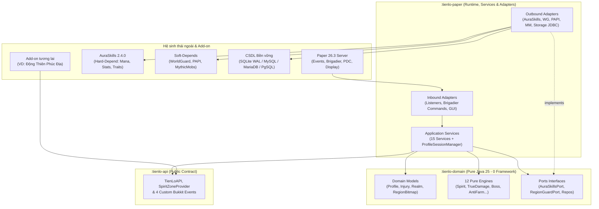
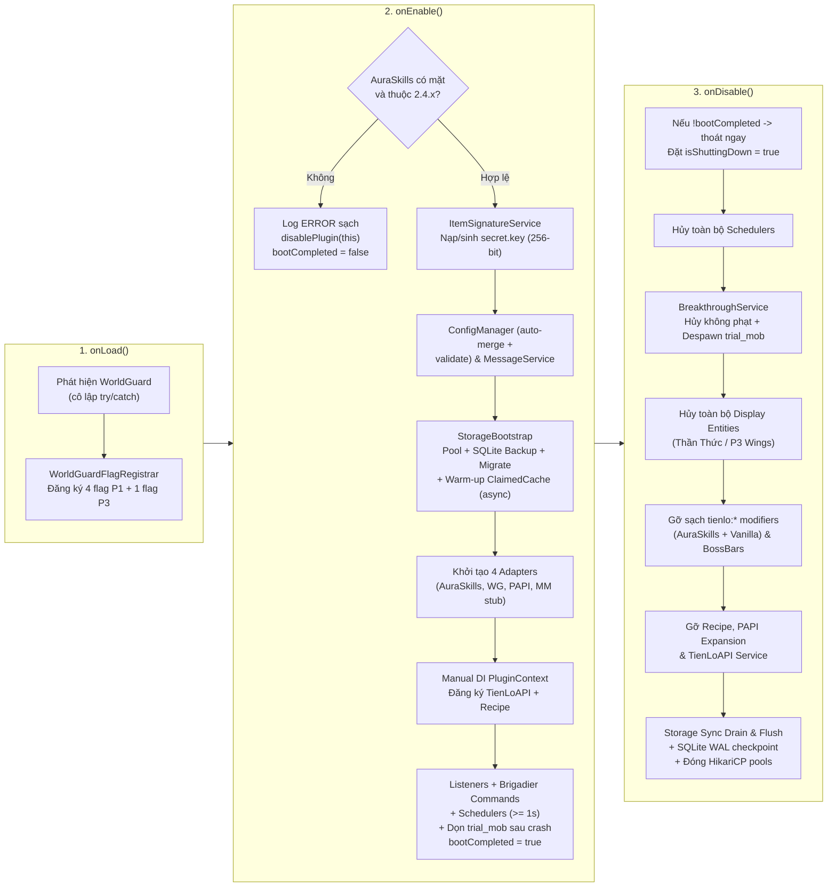
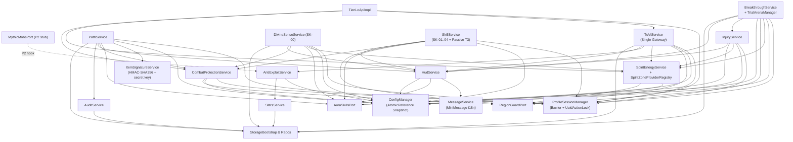
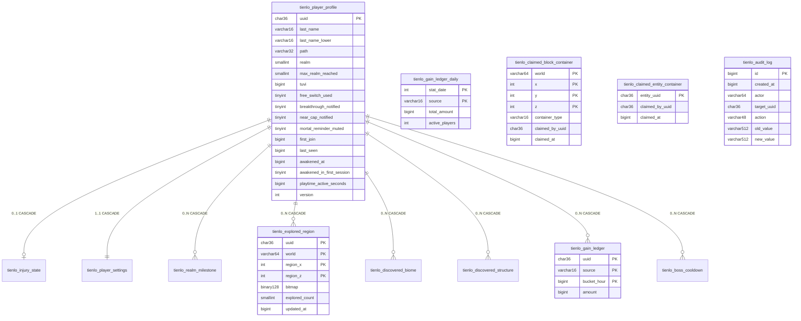
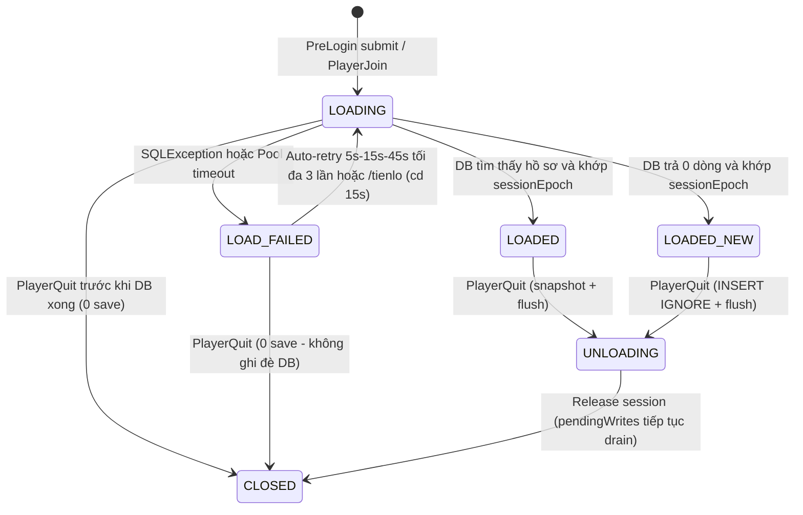
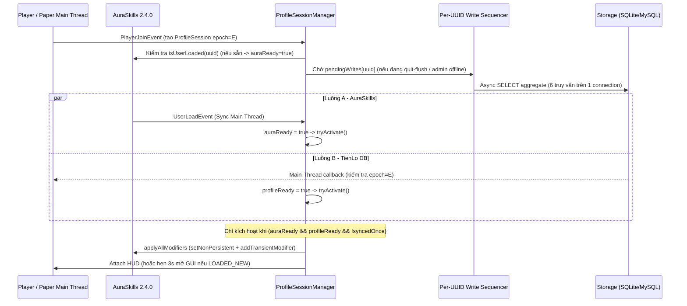
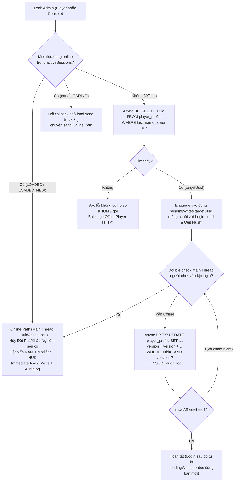

# 04. Architecture – Thiết kế Kiến trúc Kỹ thuật

| Thuộc tính | Giá trị |
|---|---|
| Dự án | **TienLo** (Tiên Lộ) – Plugin Survival Thám Hiểm + Tu Tiên + Hệ Thống Xuyên Không |
| Nền tảng | Minecraft Java Edition – Paper 26.3 (`protocol 777`), Java 25 (`bytecode major 69`) |
| Phụ thuộc bắt buộc | **AuraSkills 2.4.0** (dải `2.4.x` – fail-fast trong `onEnable()`, đã kiểm chứng bytecode) |
| Tích hợp tùy chọn | **PlaceholderAPI**, **WorldGuard 7.x**, **MythicMobs 5.x** (soft-depend, cô lập adapter) |
| Đầu vào | [01-ideation.md](01-ideation.md), [02-product-discovery.md](02-product-discovery.md), [03-requirements.md](03-requirements.md) (v2.0 – đã duyệt), kiểm chứng bytecode `paper-26.3-257.jar` & `AuraSkills-2.4.0.jar` |
| Bước vòng đời | 04 / 09 – Architecture |
| Phiên bản / Trạng thái | **v1.0 – Hoàn thiện – chờ duyệt** |
| Ngày | 2026-11-22 |

---

## 0. Mục tiêu Kiến trúc & Nguyên tắc Thiết kế

### 0.1 Mục đích tài liệu
Chuyển toàn bộ yêu cầu chức năng (`FR-*`), phi chức năng (`NFR-*`), thực thể dữ liệu và ràng buộc nền tảng đã chốt tại [03-requirements.md](03-requirements.md) thành **bản thiết kế kỹ thuật hoàn chỉnh, không mơ hồ**, sẵn sàng làm đầu vào trực tiếp cho:
- **Bước 05 (UI/UX & Game Design):** hoàn thiện cấu trúc 6 file YAML, file ngôn ngữ MiniMessage (`vi_VN`, `en_US`), bố cục GUI và cơ chế kích hoạt nhanh kỹ năng trong đúng khung dịch vụ đã định nghĩa.
- **Bước 06 (Development):** khởi tạo 3 Gradle module, triển khai từng domain engine, application service, listener, adapter, DAO và migration SQL theo đúng hợp đồng giao diện.
- **Bước 07 (Testing):** viết bộ Unit Test (`≥ 70%` coverage trên `:tienlo-domain`), Integration Test SQLite/MySQL và kịch bản Spark profiling / fault injection.

### 0.2 Bảy nguyên tắc kiến trúc cốt lõi
1. **Hexagonal ép biên ở Compile-Time (`NFR-MAINT-01/02`):** Toàn bộ logic thuần (Linh Khí, làm tròn Tu Vi, tỉ lệ đột phá, Đạo Thương, Token Bucket, chống farm `3×3`, chia thưởng Boss, giải True Damage, HMAC) nằm trong `:tienlo-domain` thuần Java 25 — không thể `import` Bukkit, Paper, AuraSkills hay JDBC.
2. **Zero-Blocking Main Thread (`FR-DATA-02`, `NFR-PERF-01/02`):** 100% truy vấn DB chạy bất đồng bộ qua pool riêng; không có tác vụ mỗi tick quét người chơi hoặc block; mọi hot-path (`PlayerMoveEvent`, `ManaRegenerateEvent`, PlaceholderAPI, GUI) vận hành `O(1)` từ RAM cache.
3. **Đảm bảo Gỡ Sạch Tuyệt Đối (`FR-AURA-06`):** Mọi modifier AuraSkills bắt buộc `.setNonPersistent()`, mọi vanilla `AttributeModifier` bắt buộc `addTransientModifier()`, mọi quái khảo nghiệm & Display Entity bắt buộc `setPersistent(false)` kèm PDC dọn sau crash.
4. **Một Cổng Tu Vi Duy Nhất (`FR-REALM-05`):** Mọi nguồn Tu Vi (kể cả API add-on) đi qua duy nhất `TuViService.grant(...)` để đảm bảo nhất quán cổng lọc, trần nguồn, Linh Khí, làm tròn, thống kê `GainLedger`, gộp thông báo và sự kiện API.
5. **Linh Khí Tất Định Không Trạng Thái (`FR-SPIRIT-02`):** Tính bằng hàm băm 64-bit thuần toán học từ `(worldSeed, chunkX, chunkZ, yBand, biome)` kết hợp chuỗi ưu tiên `SpiritZoneProvider`; không lưu bảng Linh Khí vào CSDL.
6. **Cô lập Lỗi Soft-Depend (`NFR-REL-02`):** Mọi plugin tùy chọn (`WorldGuard`, `PlaceholderAPI`, `MythicMobs`) đi qua Port + Adapter bọc `try/catch (Throwable)` với fallback `NoOp*` an toàn.
7. **Đóng gói Nhẹ & Offline-Safe (`CON-01..04`):** Tận dụng thư viện runtime sẵn có của Paper 26.3 (`sqlite-jdbc`, `mysql-connector-j`, `fastutil`, `adventure/minimessage`, `slf4j`), chỉ shade + relocate `HikariCP` (và `postgresql` nếu bật `[S]`), không phụ thuộc tải Maven từ Internet lúc khởi động server.

---

## 1. Tổng quan Kiến trúc, Cấu trúc Module & Build

### 1.1 Kiến trúc Tổng thể (Hexagonal / Ports & Adapters)



### 1.2 Cấu trúc Gradle Multi-Module (Kotlin DSL, Java 25)

Áp dụng kiến trúc 3 Gradle subprojects với chiều phụ thuộc một chiều nghiêm ngặt: **`:tienlo-paper` → `:tienlo-domain` → `:tienlo-api`** (riêng `:tienlo-api` chỉ `compileOnly` `paper-api` để phát Custom Bukkit Events & `SpiritZoneProvider`). Root package thống nhất: **`com.tienlo.*`**.

```text
tienlo/
├── settings.gradle.kts                  # include(":tienlo-api", ":tienlo-domain", ":tienlo-paper")
├── gradle/libs.versions.toml            # Version catalog tập trung
├── build.gradle.kts                     # Root convention: Java 25 toolchain, UTF-8, JUnit 5, JaCoCo
├── tienlo-api/                          # Public Java API cho add-on (FR-INT-05, FR-REALM-06)
│   └── src/main/java/com/tienlo/api/
│       ├── TienLoAPI.java
│       ├── TienLoProvider.java
│       ├── model/                       # PathType, SpiritLevel, TuViSource, PlayerProfileSnapshot,
│       │                                # SpiritSnapshot, TuViGrantResult
│       ├── spirit/                      # SpiritZoneProvider, SpiritZoneOverride
│       └── event/                       # TuViGainEvent, BreakthroughStartEvent,
│                                        # BreakthroughResultEvent, PathSwitchEvent
├── tienlo-domain/                       # PURE JAVA 25 — 0 phụ thuộc Bukkit/Paper/AuraSkills/SQL
│   ├── src/main/java/com/tienlo/domain/
│   │   ├── model/                       # PlayerProfile, InjuryState, PlayerSettings, RealmDefinition,
│   │   │                                # SkillDefinition, RegionBitmap, GainSource, DirtySection
│   │   ├── engine/                      # SpiritCalculator, TuViRoundingPolicy, RealmProgressionPolicy,
│   │   │                                # BreakthroughFormula, InjuryCurve, TokenBucket,
│   │   │                                # SlidingWindowCounter, AntiAfkEvaluator, BossRewardDistributor,
│   │   │                                # TrueDamageSolver, PowerBudgetCalculator, HmacSignatureCodec
│   │   └── port/                        # AuraSkillsPort, RegionGuardPort, MythicMobsPort,
│   │                                    # SchedulerPort, ClockPort, ProfileRepository,
│   │                                    # ExploredRegionRepository, ClaimedContainerRepository,
│   │                                    # LedgerStatsRepository, MigrationStoragePort
│   └── src/test/java/com/tienlo/domain/ # JUnit 5 + AssertJ, JaCoCo >= 70% bắt buộc (mục tiêu 85%+)
└── tienlo-paper/                        # Application Services + Paper 26.3 Infrastructure + Adapters
    └── src/main/
        ├── resources/
        │   ├── plugin.yml               # api-version: '26.3', softdepend, permissions tree
        │   ├── config.yml               # Core, storage, modules, disabled-worlds, ignored-gamemodes
        │   ├── realms.yml               # 2 đạo, ngưỡng 160.000, ngân sách Stat, mô tả lore
        │   ├── skills.yml               # SK-00..04, Nội tại Tier 3, xuyên giáp, PvP protection
        │   ├── spirit.yml               # 5 cấp Linh Khí, world/biome/Y-band, Nether Roof penalty
        │   ├── sources.yml              # 4 nguồn Tu Vi, wildcard cấu trúc, anti-farm, Boss/Mob
        │   ├── items.yml                # Tẩy Tủy Đan (chữ ký PDC, công thức chế tạo P1)
        │   ├── messages/
        │   │   ├── vi_VN.yml            # Mặc định – 100% MiniMessage
        │   │   └── en_US.yml            # Tiếng Anh – fallback key về vi_VN nếu thiếu
        │   └── db/migration/
        │       ├── sqlite/V001__init.sql
        │       ├── mysql/V001__init.sql
        │       └── postgresql/V001__init.sql
        └── java/com/tienlo/paper/
            ├── TienLoPlugin.java        # Entrypoint onLoad / onEnable / onDisable
            ├── PluginContext.java       # Manual DI container (DAG không vòng lặp)
            ├── config/                  # ConfigManager, ConfigMigrator, ConfigValidator, TienLoConfig
            ├── i18n/                    # MessageService (MiniMessage + pauseActionBar)
            ├── service/                 # 15 Application Services + ProfileSessionManager
            ├── combat/                  # ActiveSkillDamageContext, PendingMeleeStrikeTracker,
            │                            # SkillExecutor (SK-00..04)
            ├── listener/                # LifecycleListener, CombatDamageListener,
            │                            # AuraSkillsEventListener, ExplorationListener,
            │                            # ContainerLootListener, MobAndBossListener,
            │                            # TrialMobListener, GuiListener, AntiAfkListener
            ├── command/                 # TienLoCommandRegistrar (Paper LifecycleEvents.COMMANDS)
            ├── gui/                     # TienLoGuiHolder, SystemPanelGui, PathSelectGui,
            │                            # ConfirmActionGui, GuideGui
            ├── storage/                 # StorageBootstrap, SqlDialect, StorageExecutor,
            │                            # MigrationRunner, DbCredentials, JDBC Repositories/DAOs
            ├── adapter/                 # AuraSkillsAdapter, WorldGuardFlagRegistrar,
            │                            # WorldGuardAdapter, NoOpRegionGuardAdapter,
            │                            # WorldGuardSpiritZoneProvider, PlaceholderApiAdapter,
            │                            # NoOpMythicMobsAdapter
            ├── api/                     # TienLoApiImpl
            └── ext/                     # Extension hooks P2/P3 (ContainerSealHook,
                                         # BreakthroughStageStrategy, WingDisplayPort, AntiCheatBridgePort)
```

### 1.3 Toolchain, Chiến lược Đóng gói & Kiểm chứng Thư viện Paper 26.3

Kiểm chứng trực tiếp `jar/server/libraries` của `paper-26.3-257.jar` cho thấy runtime Paper 26.3 đã ship sẵn đầy đủ các thư viện nền tảng:

| Nhóm phụ thuộc | Thư viện & Phiên bản | Phạm vi Gradle | Lý do kiến trúc |
|---|---|---|---|
| **Java Toolchain** | JDK 25 (`--release 25`, bytecode major `69`) | Root build | Khớp `version.json` Paper 26.3 (`jdk-25.0.5.0.3` đã sẵn sàng trên máy dev) |
| **Paper Runtime (`compileOnly`)** | `paper-api:26.3.build.257-stable`, `sqlite-jdbc:3.49.1.0`, `mysql-connector-j:9.2.0`, `fastutil:8.5.18`, `adventure-api`/`minimessage:5.2.0`, `snakeyaml:2.2`, `gson:2.14.0`, `slf4j-api:2.0.17` | `compileOnly` | **Không shade lại** để tránh xung đột classloader và lỗi khóa file native JNI của `sqlite-jdbc`; `mysql-connector-j:9.2.0` kết nối được cả MySQL 8.x lẫn MariaDB 10.6+ |
| **Plugin APIs (`compileOnly`)** | `AuraSkills:2.4.0`, `WorldGuard:7.x`, `PlaceholderAPI`, `MythicMobs:5.x` | `compileOnly` | Chỉ import bên trong package `com.tienlo.paper.adapter` |
| **Shaded & Relocated** | `com.zaxxer:HikariCP` → `com.tienlo.libs.hikari` (và `org.postgresql:postgresql` → `com.tienlo.libs.postgresql` nếu bật `[S]`) | `implementation` + `ShadowJar` | Đóng gói bởi `com.gradleup.shadow` trên `:tienlo-paper` (~2 MB), chạy **offline-safe 100%** (không tải Maven lúc boot). Cache LRU `ExploredRegion` dùng `LinkedHashMap` (access-order) thuần JDK nên không cần kéo Caffeine; Migration tự viết gọn nên không kéo Flyway |
| **Testing & Quality** | `JUnit 5`, `AssertJ`, `JaCoCo` | `testImplementation` | `jacocoTestCoverageVerification` gắn vào task `check` của `:tienlo-domain`, bắt buộc `LINE >= 0.70` và `BRANCH >= 0.70` (`NFR-MAINT-02`) |

### 1.4 Mô tả Plugin (`plugin.yml`) & Đăng ký Lệnh (Brigadier)

Áp dụng **ADR-01**: sử dụng `plugin.yml` (`api-version: '26.3'`) kết hợp API hiện đại của Paper 26.3 (`getLifecycleManager().registerEventHandler(LifecycleEvents.COMMANDS, ...)`):
- **`softdepend: [AuraSkills, WorldGuard, PlaceholderAPI, MythicMobs]`:**
  - Nếu có `AuraSkills` và `WorldGuard`, Paper luôn nạp/khởi động chúng trước `TienLo` (đảm bảo `WorldGuard.onLoad()` hoàn tất trước `TienLo.onLoad()`).
  - Nếu **thiếu `AuraSkills`**, đặt ở `softdepend` (thay vì `depend`) cho phép `TienLo.onEnable()` chạy cổng fail-fast tự in đúng 1 dòng `[TienLo] ERROR` chỉ rõ thiếu AuraSkills `2.4.x` rồi gọi `disablePlugin(this)` — triệt tiêu hoàn toàn stacktrace `UnknownDependencyException` rác (`FR-CORE-01`, `AC-13.1`).
- **Tương thích Add-on (`FR-INT-05`):** `plugin.yml` dùng chung `PluginClassLoaderGroup` mặc định của Paper nên mọi plugin add-on tương lai thấy ngay `com.tienlo.api.*` mà không cần mở cờ classloader đặc biệt.
- **Lệnh Brigadier (`FR-ADMIN-06`):** Không khai báo khối `commands:` cũ trong `plugin.yml`; toàn bộ lệnh `/tienlo` (alias `/tl`, `/hethong`, `/tutien`) đăng ký qua `LifecycleEvents.COMMANDS` kèm predicate `.requires(src -> src.getSender().hasPermission(...))` để ẩn tuyệt đối nhánh `/tl admin ...` khỏi tab-complete của người chơi thường.
- **Cây `permissions:` trong `plugin.yml` (`NFR-SEC-01`):**
  - `tienlo.use`, `tienlo.info`, `tienlo.path.choose`, `tienlo.path.switch`, `tienlo.breakthrough`, `tienlo.skill.*`, `tienlo.hud`, `tienlo.notify`: mặc định `true`.
  - `tienlo.info.others`, `tienlo.admin.*`: mặc định `op`.
  - `tienlo.bypass.*` (`tienlo.bypass.cooldown`, `tienlo.bypass.antifarm`, `tienlo.bypass.cap`): mặc định **`false`**; wildcard `tienlo.*` **không** tự gộp `tienlo.bypass.*`.

---

## 2. Vòng đời Plugin – Bootstrap (`onLoad` → `onEnable`) & Shutdown (`onDisable`)



**Các quy tắc vòng đời quan trọng:**
1. **WorldGuard Flag Registration ở `onLoad()`:** Bắt buộc chạy trong `onLoad()` (trước `WorldGuard.onEnable()`). Nếu gặp `FlagConflictException` (do reload plugin khác hoặc flag đã tồn tại), kiểm tra kiểu flag hiện có và tái sử dụng an toàn thay vì ném ngoại lệ.
2. **Thứ tự Shutdown sạch (`FR-DATA-04`, `AC-14.1`):** Core luôn hoàn tất dọn trạng thái gameplay (hủy Đột Phá/Khảo Nghiệm, despawn `tienlo:trial_mob`, hủy Display, gỡ modifier) **trước** khi Storage chụp snapshot dirty cuối cùng và drain hàng đợi ghi.
3. **Chính sách Đột Phá / Khảo Nghiệm khi Server chủ động `/stop` (ADR-07):** Khi `isShuttingDown == true`, `BreakthroughService.abortAllForShutdown()` hủy cả `TuKhi` lẫn `KhaoNghiem` **không phạt** (hoàn trả vật phẩm nghi thức nếu đã tiêu hao lúc mở `KhaoNghiem` và despawn toàn bộ quái khảo nghiệm), tách biệt hoàn toàn với việc người chơi tự thoát game trong lúc server đang chạy (`!isShuttingDown` → tính thất bại `KhaoNghiem` theo `FR-BREAK-06d`).

---

## 3. Hệ thống Services, Domain Engines & Giải pháp Kỹ thuật Trọng yếu

### 3.1 Sơ đồ Phụ thuộc Services (Manual DI qua `PluginContext` – DAG không vòng lặp)



### 3.2 Tầng Domain Thuần Java (`:tienlo-domain` – Bắt buộc Unit Test `≥ 70%`)

| Pure Engine | Trách nhiệm toán học / quy tắc thuần | FR / NFR kiểm chứng |
|---|---|---|
| `SpiritCalculator` | Hash `SplitMix64` từ `(worldSeed, chunkX, chunkZ, salt)`, tính Linh Mạch `2%` trong `[1.60, 2.00]`, luật dải Y (phạt Nether Roof `Y >= 128`), ánh xạ hệ số thực → 5 cấp rời rạc | `FR-SPIRIT-01..03`, `FR-INT-02` |
| `TuViRoundingPolicy` | `Math.round(raw)`, tối thiểu `1` khi `raw > 0` (trừ cờ phạt cứng `0%`) | `FR-REALM-01` |
| `RealmProgressionPolicy` | Kẹp Tu Vi tại ngưỡng cảnh, kích hoạt cờ `≥ 90%` / `100%`, luật trần Cảnh 5 (`suppressPersonalMapMark`), quy đổi `PowerTier` khi đổi đạo | `FR-REALM-02..04`, `FR-PATH-05/06` |
| `BreakthroughFormula` | Tính tỉ lệ gốc (`95/88/80/72%`) + điều chỉnh Linh Khí (`-10..+10`), kẹp `[5%, 98%]`, phạt thất bại `20%` không rớt cảnh | `FR-BREAK-04`, `FR-BREAK-08` |
| `InjuryCurve` | Tính nấc Đạo Thương nửa mở `(75%,100%] → (50%,75%] → (25%,50%] → (0%,25%] → 0%`, hệ số phạt Stat/Mana và tốc độ hồi theo Linh Khí | `FR-BREAK-09` |
| `TokenBucket` | Bucket dung lượng `15`, nạp `55/60s` theo nanosecond clock (tiêm `ClockPort`), overflow trả `false` | `FR-GAIN-02a` |
| `SlidingWindowCounter` | Ring-buffer cố định `O(1)` cho trần giờ (`int[60]`), trần 24h (`int[144]` mỗi ô 10p), vùng `3×3` mob DR (`short[10]` với đường cong `1–35 → 100%`, `36–55 → tuyến tính về 0%`, `>55 → 0%`) và cửa sổ Raid | `FR-GAIN-02b`, `FR-GAIN-12`, `FR-GAIN-22`, `FR-GAIN-24`, `FR-GAIN-32` |
| `AntiAfkEvaluator` | Kiểm tra dịch chuyển tịnh `≥ 24b` (không đẩy cơ học, không dao động `A↔B` quá 3 chu kỳ) hoặc `≥ 10` tương tác với `≥ 6` tọa độ block / hit hostile / craft-trade | `FR-GAIN-31` |
| `BossRewardDistributor` | Lọc tổng sát thương hợp lệ `≥ 50%` HP Boss, lọc người nhận `≥ 5%`, đếm `N` người `≥ 10%`, tính `pool = base * min(1.5, 1 + 0.15 * max(0, N - 1))` và chia phần kẹp `<= base` | `FR-GAIN-11` |
| `TrueDamageSolver` | Mô phỏng chính xác `CombatRules` Armor + Protection + Breach và giải phương trình bù đơn điệu bằng 16 bước chia đôi (bisection) | `FR-SKILL-04` |
| `PowerBudgetCalculator` | Tính `EHP`, `DPS`, `Power = sqrt(EHP * DPS)` và xác minh bước tăng `+8%..+13%` cho test cân bằng config | `FR-AURA-04` |
| `HmacSignatureCodec` | Tạo/xác thực chữ ký `Base64Url(HMAC-SHA256)` so sánh hằng thời gian `MessageDigest.isEqual` | `FR-PATH-10`, `NFR-SEC-03` |

### 3.3 Đặc tả 15 Application Services (`:tienlo-paper`)

1. **`ConfigManager` (`FR-CORE-03..07`, `NFR-CFG-01`):**
   - Quản lý 6 file YAML (`config.yml`, `realms.yml`, `skills.yml`, `spirit.yml`, `sources.yml`, `items.yml`), mỗi file gắn `config-version`.
   - **Auto-Merge (`FR-CORE-06`):** so sánh khóa trên đĩa với mẫu trong JAR; bổ sung khóa mới kèm chú thích tiếng Việt, bảo toàn mọi chỉnh sửa của Admin.
   - **Typed Validation (`FR-CORE-04`):** kiểm tra kiểu & miền giá trị từng khóa; khóa sai ghi `WARN [TienLo] Config '<file>:<path>' không hợp lệ (...), dùng mặc định: <default>` và fallback cục bộ.
   - **Atomic Hot-Reload (`FR-CORE-05`):** dựng bản `TienLoConfig` bất biến mới rồi hoán đổi qua `AtomicReference.set(newCfg)`, phát tín hiệu đồng bộ lại modifier online & refresh công thức *Tẩy Tủy Đan*. Nếu khối `storage.*` thay đổi → giữ nguyên pool hiện tại và in cảnh báo cần restart.
2. **`MessageService` (`FR-UI-03..06`, `NFR-I18N-01`):**
   - Nạp `messages/vi_VN.yml` (mặc định) và `messages/en_US.yml` (fallback key về `vi_VN`). Parse `MiniMessage` qua `TagResolver` (luôn dùng `Placeholder.unparsed(...)` cho tên người chơi để chống tag injection).
   - Áp lọc `PlayerSettings.notify_level` (`FULL` / `COMPACT` / `OFF`; kênh `CRITICAL` gồm đột phá, Đạo Thương, lỗi thao tác luôn đi qua).
   - Mọi lệnh gửi ActionBar đi qua `sendActionBar(player, key, durationSec, resolvers...)` — **luôn gọi `auraSkillsPort.pauseActionBar(player, durationSec, SECONDS)` trước `player.sendActionBar(component)`** (`FR-UI-03`).
3. **`PathService` (`FR-PATH-01..10`):**
   - Khi `ProfileSession` qua rào 2 chiều với `LOADED_NEW` ở world/gamemode hợp lệ → lập lịch `3s` (cfg), kiểm tra lại player còn online & vẫn Phàm Nhân rồi gửi thông báo xuyên không và mở `PathSelectGui`.
   - Phàm Nhân đóng GUI → giữ trạng thái Phàm Nhân, nhắc nhẹ tối đa 1 lần/phiên (tắt vĩnh viễn bằng `mortal_reminder_muted`).
   - **Chọn / Đổi đạo nguyên tử (`FR-PATH-07`):** thực thi dưới `UuidActionLock` (chi tiết 7 bước giao dịch & rollback tại [Mục 6.4](#64-khóa-nguyên-tử-theo-uuid-uuidactionlock--giao-dịch-đổi-đạo-nguyên-tử-fr-path-07)).
4. **`TuViService` (`FR-REALM-01..07`, Single Gateway):**
   - Hợp đồng duy nhất: `TuViGrantResult grant(Player player, TuViSource source, double rawAmount, boolean applySpiritMultiplier, GainContext ctx)`.
   - Pipeline 8 bước cố định:
     1. **Cổng kiểm tra:** `session.isLoaded()`, `profile.hasPath()`, `!disabledWorld`, `!ignoredGamemode`, `regionGuard.canGainTuVi(player, loc)`.
     2. **Trần Cảnh 5 (`FR-REALM-04`, `OQ-02`):** nếu `realm == maxRealm && tuvi >= threshold` → trả `AT_MAX_REALM_CAP` (`0` Tu Vi) và cờ `suppressPersonalMapMark = true` để nguồn khám phá không đánh dấu chunk/biome/cấu trúc mới.
     3. **Trần nguồn cửa sổ trượt (`AntiExploitService`):** kiểm trần chunk `2.400/h`, quái thường `2.400/h`, online `900/h` & `4.500/24h` (miễn khi có `tienlo.bypass.cap`).
     4. **Nhân Linh Khí (`FR-SPIRIT-05`):** nhân `SpiritEnergyService.getCached(player).multiplier()` **chỉ khi `applySpiritMultiplier == true`** (Thám hiểm/Rương/Vault & Online; **không** nhân cho Boss/Quái).
     5. **Làm tròn (`TuViRoundingPolicy`):** `Math.round`, tối thiểu `1` nếu `raw > 0` và chưa bị phạt `0%`.
     6. **Sự kiện API:** bắn `TuViGainEvent` (sync, `Cancellable`, cho phép add-on sửa `finalAmount`).
     7. **Cộng & Mốc cảnh:** kẹp `tuvi <= threshold` (bỏ phần dư); kiểm tra mốc `≥ 90%` (`nearCapNotified`, 1 lần/cảnh) và `100%` (`breakthroughNotified`, 1 lần/cảnh).
     8. **Ghi nhận & Thông báo:** cộng delta vào `GainLedger` (`EXPLORE/BOSS/MOB/ONLINE`), đánh dấu dirty profile, đẩy vào bộ gộp `5s` của `HudService`.
5. **`SpiritEnergyService` & `SpiritZoneProviderRegistry` (`FR-SPIRIT-01..07`):**
   - Registry sắp giảm dần theo `priority`: Add-on (gợi ý `≥ 200`) → `WorldGuardSpiritZoneProvider` (`100`) → `DefaultDeterministicProvider` (`0`).
   - Công thức `SpiritCalculator`: `SplitMix64(worldSeed ^ (chunkX * 0x9E3779B97F4A7C15L) ^ (chunkZ * 0xBF58476D1CE4E5B9L) ^ configSalt)` → `u ∈ [0, 1)`; `u < 0.02` (cfg) ra **Linh Mạch** với hệ số `round2(1.60 + (u / 0.02) * 0.40) ∈ [1.60, 2.00]`; ngược lại dùng nền `(world, biome)` + điều chỉnh dải Y (mặc định Nether `Y >= 128` ép xuống **Khô Kiệt `0.50x`**).
   - Ánh xạ số thực override (WorldGuard/Add-on) về 5 cấp rời rạc (`FR-INT-02`): `≤ 0.65` Khô Kiệt · `(0.65, 0.90]` Loãng · `(0.90, 1.15]` Bình Thường · `(1.15, 1.45]` Nồng Đậm · `> 1.45` Linh Mạch.
   - Cache 1 `SpiritSnapshot(world, chunkKey, yBand, tier, multiplier, providerId, breakdown)` trên `ProfileSession`; chỉ tính lại khi đổi chunk, đổi dải Y, đổi world hoặc vùng WG (`FR-SPIRIT-04`); cung cấp breakdown chi tiết cho `/tl admin spirit`.
6. **`AntiExploitService` (`FR-GAIN-02..32`):**
   - **Chunk Token Bucket (`FR-GAIN-02a`):** `capacity = 15`, `refill = 55/60s` (`System.nanoTime()`). Cạn xô → `REJECTED_BUCKET` (`0%` Tu Vi, không đánh dấu `ExploredRegion`).
   - **Sliding Windows `O(1)`:** tách biệt `ChunkCapWindow[60]`, `MobCapWindow[60]`, `OnlineHourWindow[60]`, `OnlineDayWindow[144]` (mỗi ô 10 phút, seed lúc login từ `tienlo_gain_ledger` 24h gần nhất), `RaidWindowState` (10p hoạt động, giới hạn `2 Evoker + 2 Ravager`, cooldown `30–45p`), và `Mob3x3Window` toàn server (`short[10]`, cộng 9 ô `[-1..+1]×[-1..+1]` trong `O(9)`).
   - **Valid Damage & `BossDamageTracker` (`FR-GAIN-11..13`, `FR-GAIN-23`):** quy sát thương từ vũ khí, projectile, pet thuần, TNT/Bed/Respawn Anchor có nguồn player, Thorns, Fire Aspect/Flame và kỹ năng TienLo về `attackerUuid`; loại bỏ fall, lava môi trường, ngạt, cramming, void, cactus. `BossCombatRecord` reset khi Boss hồi `100%` HP ngoài giao tranh `> 5 phút`; cho phép người chơi chết và respawn trong `5 phút` sau đòn đánh cuối. Kiểm tra `BossCooldown` (hỗ trợ cả cooldown đơn `2h` lẫn `3 lượt / 2h` Elder Guardian).
   - **`AntiAfkEvaluator` (`FR-GAIN-31`):** kiểm tra chu kỳ `5 phút` trên tập staggered (rải đều tải) kèm chống lặp `A↔B` quá 3 chu kỳ và yêu cầu `≥ 6` tọa độ block khác nhau.
   - Hỗ trợ `tienlo.bypass.antifarm` / `tienlo.bypass.cap`, đếm `AntiFarmStats` (`LongAdder`) và log quyết định chi tiết khi admin bật `/tl admin debug <player>`.
7. **`BreakthroughService` & `TrialArenaManager` (`FR-BREAK-01..11`):**
   - FSM `IDLE → TU_KHI → (KHAO_NGHIEM | TUNG_XUC_XAC) → IDLE` dưới `UuidActionLock`.
   - Bắn `BreakthroughStartEvent` (cancellable) trước `TuKhi`, `BreakthroughResultEvent` (`SUCCESS / FAILED / CANCELLED`) khi kết thúc.
   - Vật phẩm nghi thức chỉ kiểm tra đầu `TuKhi` và **chỉ tiêu hao tại thời điểm kết thúc `TuKhi`** (`FR-BREAK-03`); hủy giữa `TuKhi` không mất đồ và áp cooldown `60s`.
   - **`TrialArenaManager` (`FR-BREAK-06`):** kiểm tra đủ không gian thoáng và `regionGuard.canMobSpawn(center)` trước khi vào `KhaoNghiem` (bị chặn → hủy không phạt, không tự thắng). Quái sinh với `SpawnReason.CUSTOM`, `setPersistent(false)`, PDC `tienlo:trial_mob = 1` + `tienlo:trial_owner = uuid`; chặn phá block, ép target chỉ vào chủ, miễn sát thương người chơi khác, 0 drop & 0 XP. Rời `> 24b`, teleport, đổi world, thoát game (khi `!isShuttingDown`), chết hoặc hết `75s` → thất bại ngay + despawn toàn bộ đợt. Hạ sạch đợt → `100%` thành công (bỏ double jeopardy).
8. **`InjuryService` (`FR-BREAK-09/10`):**
   - Lưu `remainingSeconds` (giây chuẩn ở `1.0x`) và `totalSeconds` (`900s`). Task `1s` chỉ giảm thời gian cho người chơi online ở world hợp lệ với hệ số `1.0 / 1.25 / 1.50` theo cấp Linh Khí.
   - Chỉ gọi `AuraSkillsPort.syncModifiers()` tại điểm chuyển nấc (`100% → 75% → 50% → 25% → 0%`), kẹp `HP <= MaxHP` & `Mana <= MaxMana`. Không dùng vanilla `PotionEffect` nên chết hoặc uống sữa tuyệt đối không xóa Đạo Thương.
9. **`SkillService` (`SK-00..04` + Nội tại Tier 3 `FR-SKILL-05`):**
   - Cổng kiểm tra chung `FR-SKILL-02` → trừ Mana qua `auraSkillsPort.consumeManaIfEnough()` (`FR-AURA-01`).
   - `SK-01` (*Hộ Thể Chân Khí*): tăng tạm vanilla transient `Attribute.MAX_ABSORPTION` (`tienlo:shield_cap`), gọi `setAbsorptionAmount(max(current, shield))` (không đè tụt Golden Apple), gỡ sau `6s`.
   - `SK-02` (*Ngự Khí Kích*) & `SK-04` (*Kình Lực Bộc Phát*): chi tiết cơ chế combat Paper 26.3 tại [Mục 3.4](#34-giải-pháp-kỹ-thuật-sạch-cho-combat-paper-263-sk-02-sk-04--truedamagesolver).
   - `SK-03` (*Cương Thể Bất Động*): `5s` trạng thái Cương Thể — transient `Attribute.KNOCKBACK_RESISTANCE` (`tienlo:sk03_kb = 1.0`), giảm `20–30%` mọi sát thương trừ `VOID`/`KILL` tại `EntityDamageEvent HIGHEST`, cộng thêm `+10%` tốc độ trong `3s` đầu qua `Traits.MOVEMENT_SPEED` non-persistent (`tienlo:sk03_speed`).
   - **Nội tại Lữ Khách Power Tier 3+ (`FR-SKILL-05`):** áp tốc độ qua AuraSkills `Traits.MOVEMENT_SPEED` tên riêng `tienlo:traveler_speed` (cộng dồn với `tienlo:realm_speed` để `/stats` hiển thị chuẩn) + 3 vanilla `addTransientModifier` (`tienlo:traveler_jump`, `tienlo:traveler_safe_fall`, `tienlo:traveler_fall_mult`), luôn xóa key cũ trước khi thêm.
10. **`CombatProtectionService` (`FR-PVP-01..06`, `FR-PATH-08`):**
    - Quản lý `combatTagExpiry` (`15s` cho cả PvP và PvE) và `protectionLostUntil` (`30s` cho Phàm Nhân / Cảnh 1).
    - **Phân biệt khởi chiến vs tự vệ (`FR-PVP-03`):** ghi `attackedByMap[victim][attacker] = now + 30s` khi người chơi bị tấn công trước (kể cả kiếm vanilla). Nếu người được bảo hộ đánh trả đúng kẻ vừa tấn công mình → **giữ nguyên bảo hộ kỹ năng**; chỉ khi họ chủ động khởi chiến trước (đánh trực tiếp hoặc đổ lava/lửa, đặt TNT/End Crystal/cobweb, ném thuốc hại gây hại người chơi khác) mới đánh dấu mất bảo hộ `30s`.
    - `canSkillAffect(caster, target)`: kiểm tra PvP bật ở world + WorldGuard `pvp` & `tienlo-pvp` tại **cả vị trí caster lẫn target** + bảo hộ + an toàn thực thể trung lập (`FR-PVP-05`: pet đã thuần của người khác, villager, Armor Stand, Item Frame).
11. **`DivineSenseService` (`FR-SENSE-01..06`):**
    - Quét mục tiêu (`24b` raytrace, `10` Mana, `15s` CD) và Quét khu vực (`16/24/32b`, `20` Mana, `45s` CD).
    - Đọc rương chưa mở qua `Chunk.getTileEntities(false)` (`Lootable.hasLootTable()` chưa nằm trong `ClaimedContainerCache`, `Vault.getRewardedPlayers().isEmpty()`) + `StorageMinecart` trong bán kính → trả số lượng + hướng la bàn 8 hướng (không bao giờ lộ tọa độ X/Y/Z – `NFR-SEC-04`). Ở Cảnh 5 quét lưới `11×11` chunk bằng `SpiritCalculator` thuần RAM (~0.02 ms) tìm Linh Mạch gần nhất theo 8 hướng.
    - Che giấu (`FR-SENSE-04`): ưu tiên kiểm tra `targetTier - casterTier >= 2` trước nhãn nguy hiểm; bỏ qua `SPECTATOR`, `!caster.canSee(target)` (Vanish), và `INVISIBILITY` (trừ caster Cảnh 5).
    - Đánh dấu chỉ người quét thấy (`FR-SENSE-05`): `Player.spawnParticle` và/hoặc `BlockDisplay`/`ItemDisplay` đặt **`setVisibleByDefault(false)` + `setPersistent(false)` + `caster.showEntity(plugin, display)` + `setGlowColorOverride(color)`**, tự hủy sau `≤ 10s` hoặc khi quit/đổi world/`onDisable`. Tuyệt đối không gọi `entity.setGlowing(true)` trên thực thể thật.
12. **`HudService` (`FR-UI-03/04`, `NFR-UX-02`):**
    - Ngăn xếp BossBar ưu tiên: BossBar Đột Phá / Khảo Nghiệm tự động tạm đè BossBar Tu Vi.
    - Bộ đệm gộp thông báo Tu Vi `5 giây` (`PendingGainBatch`) và bộ chống spam cảnh báo chạm trần/chống farm `10 phút`.
13. **`ItemSignatureService` (`FR-PATH-10`, `NFR-SEC-03`):**
    - Khi boot lần đầu, sinh khóa bí mật 256-bit bằng `SecureRandom` lưu Base64 vào `plugins/TienLo/secret.key` (đặt quyền POSIX `0600`, không bao giờ log, **không sinh lại khi `/tl admin reload`**).
    - PDC chuẩn: `tienlo:item_id`, `tienlo:item_ver`, `tienlo:item_payload`, `tienlo:item_sig = Base64Url(HMAC-SHA256(secretKey, item_id + "|" + ver + "|" + payload))`. Xác thực hằng thời gian bằng `MessageDigest.isEqual` → chặn 100% giả mạo bằng Anvil hay `/give` NBT thô.
    - Ký sẵn kết quả `ShapedRecipe` của *Tẩy Tủy Đan* (bật mặc định theo `OQ-01`, cấu hình tắt được).
14. **`AuditService` (`FR-PATH-09`, `FR-ADMIN-02`, `NFR-OBS-01`):**
    - Ghi bất đồng bộ vào bảng `tienlo_audit_log` và tùy chọn ghi song song file xoay vòng `logs/audit-YYYY-MM.log`.
15. **`StatsService` (`KPI-01..05`, `FR-ADMIN-03`):**
    - Truy vấn bất đồng bộ + cache `60s` cho `/tl admin stats`: tỉ lệ thức tỉnh phiên đầu (`KPI-05`), phân bố đạo/cảnh, trung vị `playtime_active_at_reach` (`KPI-03`), tỉ trọng 4 nguồn (`KPI-04`, cộng `tienlo_gain_ledger` + `tienlo_gain_ledger_daily`), số lần kích hoạt anti-farm (`tienlo_anti_farm_stats`).

### 3.4 Giải pháp Kỹ thuật Sạch cho Combat Paper 26.3 (`SK-02`, `SK-04` & `TrueDamageSolver`)

Kiểm chứng trực tiếp bytecode `CombatRules`, `MaceItem`, `Player.attack`, `LivingEntity.resolvePlayerResponsibleForDamage`, `CraftDamageSourceBuilder`, `bypasses_armor.json`, AuraSkills `DamageListener` và `FightingAbilities.bleedListener` chỉ ra 3 bẫy kỹ thuật quan trọng và giải pháp triệt tiêu sạch:

#### A. Bẫy `bypasses_armor` & AuraSkills `bleedListener` trên `SK-02` (*Ngự Khí Kích*)
- **Vấn đề:** Trên Paper 26.3, `DamageType.GENERIC`, `MAGIC`, `INDIRECT_MAGIC`, `SONIC_BOOM` đều nằm trong tag `bypasses_armor` (bỏ qua 100% giáp thay vì `3% × PowerTier`). Đồng thời, `FightingAbilities.bleedListener` (`MONITOR`) của AuraSkills kiểm tra `event.getDamager() instanceof Player` + cầm kiếm trên tay để kích hoạt Bleed ngay cả khi đã xóa `attackModifiers`; còn `CraftDamageSourceBuilder.build()` ném `IllegalArgumentException` nếu có `causingEntity` mà thiếu `directEntity`.
- **Giải pháp sạch:** Khi raycast `SK-02` (bay xuyên qua người được bảo hộ PvP) chạm mục tiêu hợp lệ:
  1. Sinh tạm 1 `org.bukkit.entity.Marker` (`setPersistent(false)` — thực thể thuần server-side, **0 packet mạng, 0 vật lý, 0 AI**).
  2. Khởi tạo `DamageSource`:
     ```java
     DamageSource source = DamageSource.builder(DamageType.PLAYER_ATTACK)
         .withCausingEntity(caster)
         .withDirectEntity(transientMarker)
         .build();
     ```
  3. Gọi `target.damage(baseSkillDmg, source)` trong `try (var ctx = ActiveSkillDamageContext.openScoped(SK_02, caster, target, ...)) { ... } finally { transientMarker.remove(); }` ngay cùng tick (context tự đóng vô điều kiện khi thoát khối `try`, không bao giờ rò rỉ kể cả khi sự kiện bị cancel hay ném ngoại lệ).
- **Hiệu quả đã kiểm chứng:**
  - `event.getDamager()` là `Marker` → `bleedListener` bỏ qua (`0` Bleed), `DamageListener.getDamager()` trả `null` → bỏ qua `100%` `AttackDamageTrait`/Crit/FirstStrike của vũ khí tay chính, `DamageSource.getWeaponItem()` trả `null` (không ăn nhầm `BREACH` của vũ khí tay chính), nhưng vẫn giữ nguyên `DamageReductionTrait` (Toughness) của mục tiêu!
  - Lớp bảo vệ thứ 2: listener `DamageEvent` (`HIGHEST`) vẫn gọi `damageMeta.clearAttackModifiers()` khi `ActiveSkillDamageContext.matches(SK_02, event)`.
  - NMS `resolvePlayerResponsibleForDamage` đọc `DamageSource.getEntity()` (= `caster`) → giữ nguyên `getKiller()`, death message, loot table, `BossDamageTracker` và `CombatProtectionService`.

#### B. Bẫy Reset Attack Cooldown, Thứ tự Công thức Mace/Jump-Crit & Chống Leak trên `SK-04` (*Kình Lực Bộc Phát*)
- **Vấn đề đã xác minh từ bytecode `net.minecraft.world.entity.player.Player.attack(Entity)`:**
  1. `Player.attack()` đặt lại `attackStrengthTicker = 0` **trước** khi bắn `EntityDamageByEntityEvent`, làm `player.getAttackCooldown()` đọc trong listener bị sai lệch.
  2. Thứ tự tính sát thương gốc của Paper 26.3 là:
     `total = (baseAttr * scaleFactor + maceBonus) * (isCrit ? 1.5f : 1.0f) + scaledEnchantBonus`
     (tức `maceBonus` cộng **trước** khi nhân `1.5×`, còn `Sharpness`/`Smite`/`Bane` cộng **sau** `1.5×`) nên không thể đảo ngược trực tiếp `rawDmg`.
  3. Nếu mở `ActiveSkillDamageContext` ở `NORMAL` nhưng plugin khác cancel sự kiện trước `HIGHEST` (hoặc `Player.attack()` thoát sớm như `deflectProjectile`/`dmg <= 0`), context và `PendingMeleeStrike` sẽ rò rỉ sang đòn kế tiếp nếu không khóa theo tick/event và đóng ở `MONITOR (ignoreCancelled = false)`.
- **Giải pháp sạch:**
  1. Lắng nghe `com.destroystokyo.paper.event.player.PlayerAttackEntityCooldownResetEvent` (`MONITOR`, bắn ngay trước `EntityDamageByEntityEvent` trong cùng stack frame `Player.attack()`) để chụp `PendingMeleeStrike(cooledStrength, targetEntityId, currentTick)` (dùng `Bukkit.getCurrentTick()`).
  2. Tại `EntityDamageByEntityEvent` (`NORMAL`), chỉ consume `PendingMeleeStrike` khi khớp tuyệt đối `strike.tick == currentTick && strike.targetEntityId == target.getEntityId()` (bản ghi cũ do `Player.attack()` return sớm tự bị bỏ qua), mục tiêu hợp lệ và `cooledStrength >= 0.85f`:
     - Tính thẳng **`weaponBaseNoCrit`** theo công thức thuận khớp bytecode `Player.attack()`:
       ```java
       double scaleFactor = 0.2 + cooledStrength * cooledStrength * 0.8;
       double baseAttrDamage = attacker.getAttribute(Attribute.ATTACK_DAMAGE).getValue();
       double weaponBaseNoCrit = Math.min(rawDmg, baseAttrDamage * scaleFactor + scaledMeleeEnchantBonus);
       ```
       *(trong đó `scaledMeleeEnchantBonus` là bonus enchant cận chiến `Sharpness`/`Smite`/`Bane of Arthropods` theo mục tiêu nhân `cooledStrength` theo đúng `Player.attack()` — tự động loại sạch 100% cả `maceBonus` lẫn hệ số Jump-Crit `1.5×` mà không cần đảo ngược `rawDmg`)*.
     - Cộng bonus `SK-04` chỉ trên `weaponBaseNoCrit`: `event.setDamage(rawDmg + weaponBaseNoCrit * (mult - 1.0) + flatBonus)`.
     - Gắn `ActiveSkillDamageContext.bindEvent(SK_04, event, trueDamageBasis = weaponBaseNoCrit * mult + flatBonus)` chứa **tham chiếu trực tiếp tới đúng instance `event`** (`ctx.event == event`). **Chưa** áp Slowness/đẩy lùi và **chưa** tiêu hao nạp kình tại `NORMAL`.
  3. Tại **`EntityDamageEvent` (`MONITOR`, `ignoreCancelled = false`)** — thực thi **TRƯỚC mọi guard `isCancelled`**:
     - Luôn đóng/gỡ vô điều kiện `ActiveSkillDamageContext` khớp `event` (triệt tiêu 100% rò rỉ context dù plugin khác cancel ở `HIGH`/`HIGHEST`).
     - Chỉ khi `!event.isCancelled() && event.getFinalDamage() > 0` mới hoàn tất hiệu ứng phụ `SK-04`: tiêu hao trạng thái nạp kình, bắt đầu cooldown `10s`, áp Slowness I (`1.5s`) + đẩy lùi nhẹ.

#### C. Thuật toán `TrueDamageSolver` (Single-Hit, 0 Deprecated API, `FR-SKILL-04`)
Không dùng `EntityDamageEvent.DamageModifier` (deprecated), không gọi 2 lần `damage()` (dính i-frames), không sửa `setHealth()` trực tiếp (phá Absorption & Totem of Undying):
- Chạy tại **`EntityDamageEvent` (`EventPriority.HIGHEST`)** — ngay **sau** AuraSkills `HIGH` (đã áp `DAMAGE_REDUCTION` Toughness) và **sau** giảm sát thương `SK-03` của mục tiêu, chỉ kích hoạt khi `ActiveSkillDamageContext.matches(event)` (khớp đúng `event` cho `SK-04` hoặc đúng phạm vi `Marker` cho `SK-02`):
  1. Nếu mục tiêu đang giơ khiên chặn đòn (`target instanceof HumanEntity h && h.isBlocking()` và sát thương đã bị khiên chắn) → không bù xuyên giáp.
  2. Đặt $D = \text{event.getDamage()}$ (đã tính AuraSkills Toughness & `SK-03`), $p = \min(\text{cfgCap}, 0.03 \times \text{PowerTier})$ (Phase 1 trần `0.15`), $D_{\text{eligible}}$ (= $D$ cho `SK-02`, hoặc phần đã loại Mace/Jump-Crit tỉ lệ theo hệ số phòng thủ cho `SK-04`), và $D_{\text{true}} = p \times D_{\text{eligible}}$.
  3. Đọc `armor`, `armorToughness`, `protEpf` (tổng level `Enchantment.PROTECTION` trên 4 mảnh giáp, kẹp `20.0`) và `breachLevel` (nếu `SK-04` cầm vũ khí có `BREACH`). Nếu `armor == 0 && protEpf == 0` → trả $D_{\text{comp}} = D$ trong `O(1)`.
  4. Ngược lại, dùng hàm đơn điệu tăng thuần Java $V(x)$ mô phỏng chính xác `CombatRules.getDamageAfterAbsorb` + `CombatRules.getDamageAfterMagicAbsorb`:
     - Mục tiêu sát thương sau Armor & Protection (trước Resistance & Absorption):
       $$D_{\text{target}} = V(D - D_{\text{true}}) + D_{\text{true}}$$
     - Giải phương trình $V(D_{\text{comp}}) = D_{\text{target}}$ bằng **16 bước chia đôi (bisection)** trên $[D, \min(D_{\text{target}} / 0.04, D \times 6.0)]$ (~150 ns, sai số `< 1e-4`, 0 heap allocation) rồi gọi **`event.setDamage(D_comp)`**.
- **Bảo chứng toàn vẹn:** Paper tự tính tiếp Armor, Resistance, Protection, **Absorption (`SK-01`/Golden Apple)** và **Totem of Undying** trong **đúng 1 đòn duy nhất**, giữ `event.getFinalDamage()` chính xác cho mọi plugin PvP/CombatLog khác.

#### D. Luồng thực thi Combat Kỹ năng (`SK-02` / `SK-04` + AuraSkills + `TrueDamageSolver`)

```mermaid
sequenceDiagram
    participant C as Caster / SkillExecutor
    participant E as Paper Event Bus
    participant P as CombatProtection (LOW)
    participant S as SkillService (NORMAL)
    participant A as AuraSkills (HIGH)
    participant T as TrueDamage & SK-03 (HIGHEST)
    participant M as Cleanup & Trackers (MONITOR)

    Note over C: SK-02: Marker transient + try-finally; SK-04: chụp (cooled, targetId, tick) ở CooldownResetEvent
    C->>E: EntityDamageByEntityEvent
    E->>P: Priority LOW
    Note over P: Chặn trial_mob ngoại lai, bảo hộ PvP, WG pvp/tienlo-pvp, pet/villager -> cancel sớm
    E->>S: Priority NORMAL
    Note over S: Nếu SK-04 khớp (tick, targetId): tính weaponBaseNoCrit thuận, bind ActiveSkillDamageContext(event)
    E->>A: Priority HIGH (AuraSkills DamageListener)
    Note over A: SK-02 bỏ qua AttackDamage/Bleed (Marker + clearAttackModifiers), giữ Toughness mục tiêu
    E->>T: Priority HIGHEST
    Note over T: 1) Áp giảm 20-30% SK-03 mục tiêu; 2) TrueDamageSolver (khớp event, 16-step bisection) -> setDamage
    E->>M: Priority MONITOR (ignoreCancelled = false)
    Note over M: Luôn pop ActiveSkillDamageContext trước! Nếu !cancelled -> chốt SK-04 (CD, Slowness, KB) + Trackers
```

---

## 4. Event Pipeline Toàn diện (Paper 26.3 + AuraSkills 2.4.0)

| # | Event | Priority | Thread | Early-Exit Guards | Luồng xử lý & Ngăn xung đột |
|---|---|---:|---|---|---|
| 1 | `AsyncPlayerPreLoginEvent` | `MONITOR` | Async Login | `loginResult != ALLOWED` | Submit non-blocking `PreloadTicket(uuid, future, ttl=30s)` vào DB Reader pool (sau `pendingWrites[uuid]` nếu có) rồi **return ngay** — không bao giờ chặn đăng nhập (`FR-DATA-02/09`). |
| 2 | `PlayerJoinEvent` | `MONITOR` | Main → Async DB | – | Tạo `ProfileSession(LOADING, epoch=E)`, gắn `PreloadTicket` (hoặc dispatch async load sau `pendingWrites[uuid]`), chủ động kiểm tra `auraSkillsPort.isUserLoaded(uuid)` để cập nhật rào 2 chiều `auraReady && profileReady` (`FR-AURA-05`). |
| 3 | `UserLoadEvent` *(AuraSkills)* | `NORMAL` | Main (Sync) | `!sessionExists` | Đặt `session.auraReady = true`; nếu `profileReady && !syncedOnce` → áp modifier `tienlo:*` idempotent, gắn HUD; nếu `LOADED_NEW` (world/gm hợp lệ) hẹn `3s` mở GUI chọn đạo. |
| 4 | `SkillsLoadEvent` *(AuraSkills)* | `MONITOR` | Main (Sync) | – | Lên lịch `runTask` (+1 tick) re-sync idempotent modifier `tienlo:*` cho mọi người chơi online hợp lệ sau `/skills reload` (`FR-AURA-05`). |
| 5 | `PlayerQuitEvent` | `MONITOR` | Main → Async DB | – | Khi `LOADING`/`LOAD_FAILED`: đóng session, `0` DB write. Khi `LOADED`/`LOADED_NEW`: nếu `!isShuttingDown` hủy `TuKhi` (0 phạt) / **thất bại** `KhaoNghiem` + despawn `trial_mob`; hủy Display Thần Thức; gỡ transient modifiers; chụp snapshot đẩy `pendingWrites[uuid]`; giữ runtime chống farm theo UUID có TTL. |
| 6 | `ManaRegenerateEvent` *(AuraSkills, 1s)* | `HIGH` | Main (Sync) | `isCancelled`, `!LOADED`, Phàm Nhân, `disabled-worlds`, `ignored-gamemodes` | `newAmt = amt * spiritMult * (1 - injuryManaPen)`; **kẹp bắt buộc** `min(newAmt, max(0.0, user.getMaxMana() - user.getMana()))` khắc phục bug `User.setMana()` không tự kẹp trần (`FR-AURA-02`). |
| 7 | `PlayerAttackEntityCooldownResetEvent` *(Paper)* | `MONITOR` | Main | `isCancelled`, `!hasArmedSk04` | Chụp `PendingMeleeStrike(getCooledAttackStrength(), targetEntityId, currentTick)` trước khi `Player.attack()` reset ticker (`SK-04`). |
| 8 | `EntityDamageByEntityEvent` | `LOW` | Main | `isCancelled` | Chặn người chơi khác đánh `tienlo:trial_mob` (`FR-BREAK-06c`); chặn kỹ năng/Pháp Bảo lên mục tiêu bảo hộ / WG `pvp` & `tienlo-pvp` / thực thể trung lập **trước AuraSkills `HIGH`** (`FR-PVP-01..05`). |
| 9 | `EntityDamageByEntityEvent` | `NORMAL` | Main | `isCancelled`, `!hasArmedSk04` | Consume `PendingMeleeStrike` chỉ khi khớp `(targetEntityId, currentTick)` & `cooledStrength >= 0.85f`; tính `weaponBaseNoCrit` theo công thức thuận (loại Mace & Jump-Crit), cập nhật `event.setDamage(...)` và bind `ActiveSkillDamageContext(SK_04, event, trueDamageBasis)` *(chưa áp Slowness/tiêu hao kình)*. |
| 10 | `DamageEvent` *(AuraSkills)* | `HIGHEST` | Main (Sync) | `isCancelled` | Lớp bảo vệ thứ 2 cho `SK-02`: nếu `ActiveSkillDamageContext.matches(SK_02, event)` → `damageMeta.clearAttackModifiers()` (giữ nguyên `defenseModifiers` Toughness của mục tiêu). |
| 11 | `EntityDamageEvent` | `HIGHEST` | Main | `isCancelled` | (1) Áp giảm `20–30%` mọi sát thương cho `SK-03` (trừ `VOID`/`KILL`); (2) Nếu `ActiveSkillDamageContext.matches(event)` (`SK-02`/`SK-04`) → chạy `TrueDamageSolver` gọi `event.setDamage(D_comp)` (`FR-SKILL-04`). |
| 12 | `EntityDamageEvent` / `EntityDamageByEntityEvent` | `MONITOR` *(ignoreCancelled = false)* | Main | *(Đóng context TRƯỚC guard)* → sau đó `isCancelled`, `finalDamage <= 0` | **(a) Vô điều kiện (kể cả khi bị cancel):** pop `ActiveSkillDamageContext` khớp `event` (0 leak); **(b) Khi `!isCancelled && finalDamage > 0`:** hoàn tất `SK-04` (tiêu hao nạp kình, bắt đầu CD `10s`, áp Slowness I `1.5s` + đẩy lùi nhẹ), cập nhật `BossDamageTracker` (`FR-GAIN-11`), mob valid damage (`FR-GAIN-23`), combat tag `15s` (`FR-PATH-08`), bảng khởi chiến / tự vệ `30s` (`FR-PVP-03`), và tương tác Anti-AFK (`FR-GAIN-31b`). |
| 13 | `EntityDeathEvent` | `MONITOR` | Main | – | Nếu `tienlo:trial_mob`: xóa drop & XP, báo tiến độ `TrialArenaManager`; ngược lại phân phối Boss (`BossDamageTracker` + `BossCooldown`) hoặc quái thường (`SpawnReason`, `>=50%`, `3×3` DR, trần `2.400/h`). |
| 14 | `PlayerDeathEvent` | `MONITOR` | Main | – | Thất bại `TuKhi` / `KhaoNghiem` đang chạy + despawn `trial_mob` (Totem of Undying không bắn event này → tự bảo toàn `FR-BREAK-03`); giữ nguyên `InjuryState`; `0%` phạt Tu Vi chết thường. |
| 15 | `CreatureSpawnEvent` | `MONITOR` | Main | `isCancelled`, `!hostileOrBoss` | Gắn gọn 1 byte PDC `tienlo:spawn_reason` để lọc `FR-GAIN-13` & `FR-GAIN-21` lúc chết (0 tiêu tốn RAM map theo mob). |
| 16 | `EntityTargetLivingEntityEvent` | `HIGH` | Main | `!isTrialMob` | Nếu `target != trialOwner` → cancel và ép target quay lại `trialOwner` (`FR-BREAK-06c`). |
| 17 | `EntityChangeBlockEvent` | `HIGH` | Main | `!isTrialMob` | Cancel 100% hành vi phá/đổi block của `tienlo:trial_mob` (`FR-BREAK-06c`). |
| 18 | `PlayerMoveEvent` | `MONITOR` | Main | `isCancelled`, **cùng block `(x,y,z)` (`< 20ns`)**, `!LOADED`, `disabled-worlds`, `ignored-gamemodes` | (1) Nếu trong `activeBreakthroughs`: kiểm bán kính `3b` (`TuKhi`) / `24b` (`KhaoNghiem`); (2) Chỉ khi **đổi chunk hoặc vượt ngưỡng Y-band**: cập nhật `SpiritEnergyService` (ActionBar khi đổi cấp), chạy Token Bucket `15/55` + `ExploredRegion` + Biome (`!isGliding()`) + 3D `GeneratedStructure.getBoundingBox()` (`!isGliding()`). |
| 19 | `PlayerTeleportEvent` | `MONITOR` | Main | `isCancelled` | Đánh dấu chunk đích bỏ qua `FR-GAIN-01` theo `TeleportCause` (`FR-GAIN-03`); hủy `TuKhi` (0 phạt) / thất bại `KhaoNghiem`; làm mới Spirit cache. |
| 20 | `PlayerChangedWorldEvent` | `MONITOR` | Main | – | Vào `disabled-worlds`: gỡ sạch `tienlo:*`, tạm dừng Đạo Thương, ẩn HUD; rời sang world hợp lệ: áp lại modifier & khôi phục Đạo Thương (`FR-CORE-08`). Hủy `TuKhi` / thất bại `KhaoNghiem`; hủy Display Thần Thức; làm mới Spirit cache. |
| 21 | `PlayerGameModeChangeEvent` | `MONITOR` | Main | `isCancelled` | Vào `ignored-gamemodes`: hủy `TuKhi` / thất bại `KhaoNghiem`, hủy Display Thần Thức (`FR-CORE-09`). |
| 22 | `PlayerRespawnEvent` | `MONITOR` | Main | – | Lên lịch `+1 tick` sync idempotent `tienlo:*` modifiers (sau khi Paper hoàn tất reset attribute `FR-AURA-05`), giữ nguyên `InjuryState`, làm mới Spirit cache. |
| 23 | `LootGenerateEvent` | `MONITOR` | Main | `isCancelled`, `isPlugin()`, `!(entity instanceof Player)` | Chuẩn hóa canonical `DoubleChest` (`min(left, right)`); kiểm & đánh dấu **đồng bộ trên Main Thread** vào `ClaimedContainerCache` + PDC `tienlo:claimed` (cả 2 nửa, chống mở đúp cùng tick & Paper `auto-replenish`); `INSERT IGNORE` async; chỉ thưởng Tu Vi cho người tu luyện hợp lệ (`FR-GAIN-06`). |
| 24 | `BlockDispenseLootEvent` | `MONITOR` | Main | `isCancelled`, `player == null`, **`!(block.getState() instanceof Vault)`** | Loại trừ `TrialSpawner`; kiểm `vault.getRewardedPlayers().isEmpty()` + `ClaimedContainerCache`/PDC; đánh dấu đồng bộ + `INSERT IGNORE` async; thưởng Tu Vi (`FR-GAIN-07`). |
| 25 | `ChunkLoadEvent` | `MONITOR` | Main | – | Dọn dẹp sau crash: quét entity chunk vừa nạp, xóa ngay mọi entity có PDC `tienlo:trial_mob` (và dự phòng P2 `tienlo:guardian_mob`, `tienlo:sense_display`). |
| 26 | `InventoryClickEvent` / `Drag` / `Close` + `BlockBreak` / `BlockPlace` / `CraftItem` / `PlayerBucketEmpty` / `PotionSplash` | `HIGH` (GUI) / `MONITOR` (còn lại) | Main | `!(topHolder instanceof TienLoGuiHolder)` / `isCancelled`, `!LOADED` | (a) GUI: cancel 100% di chuyển item, định tuyến thao tác qua `UuidActionLock`; (b) Hoạt động: ghi nhận tọa độ block phân biệt & craft cho `AntiAfkEvaluator` (`FR-GAIN-31b`); (c) Thù địch gián tiếp (lava/lửa/TNT/cobweb/thuốc hại gần player) cho `CombatProtectionService` (`FR-PVP-03`). |

---

## 5. Tầng Lưu trữ, Connection Pool, DDL Chuẩn hóa & Nén Bản đồ

### 5.1 Kiến trúc Repository / DAO & Quy ước Xuyên DBMS (`FR-DATA-01..08`, `NFR-SEC-02`)

Tầng `:tienlo-domain` chỉ phụ thuộc 5 Repository Ports (`ProfileRepository`, `ExploredRegionRepository`, `ClaimedContainerRepository`, `LedgerStatsRepository`, `MigrationStoragePort`) trả về `CompletableFuture<T>`. Tầng `com.tienlo.paper.storage` triển khai theo mô hình 3 lớp:

```text
Application Services (Main Thread)
        │  CompletableFuture<T> (100% async)
        ▼
Repository Ports (com.tienlo.domain.port)
        │
        ▼
JDBC Repository / DAO Implementations (100% PreparedStatement, Batch & TX)
        │                              │
        ▼                              ▼
   SqlDialect                   StorageExecutor
(SQLite / MySQL / PgSQL)      (HikariCP Pool + Per-UUID Sequencer)
```

- **`SqlDialect` (`SQLITE`, `MYSQL`, `MARIADB`, `POSTGRESQL [S]`):** trừu tượng hóa cú pháp Upsert (`ON CONFLICT(...) DO UPDATE SET` vs `ON DUPLICATE KEY UPDATE`), `INSERT OR IGNORE` / `INSERT IGNORE` / `ON CONFLICT DO NOTHING`, kiểu tự tăng (`INTEGER PRIMARY KEY AUTOINCREMENT` / `BIGINT AUTO_INCREMENT` / `BIGSERIAL`), và cột nhị phân (`BLOB` / `BINARY(128)` / `BYTEA`).
- **`storage.table-prefix`:** mặc định `"tienlo_"`, kiểm tra bắt buộc bằng regex `^[a-zA-Z0-9_]{0,24}$` lúc khởi động (fail-fast nếu sai định dạng, chặn SQL injection qua tên bảng).
- **Quy ước Thời gian & UUID:** mọi mốc thời gian lưu **`BIGINT` UTC Epoch Milliseconds** (và `INT` `YYYYMMDD` UTC cho thống kê ngày, `BIGINT` `epochMillis / 3_600_000L` cho `bucket_hour`) — loại bỏ 100% lỗi lệch múi giờ và giới hạn năm 2038. Mọi UUID lưu chuỗi chuẩn 36 ký tự chữ thường (`CHAR(36) CHARACTER SET ascii COLLATE ascii_bin` trên MySQL/MariaDB, `TEXT` trên SQLite, `CHAR(36)` trên PostgreSQL).
- **Bảo mật truy vấn (`NFR-SEC-02`):** `100%` truy vấn dùng `PreparedStatement` tham số hóa; mật khẩu & JDBC URL bọc trong `DbCredentials` override `toString()` trả `"***"`, không bao giờ lọt ra log/stacktrace.

### 5.2 Chiến lược Connection Pool & Threading theo DBMS

| Tiêu chí | SQLite (Mặc định – `M`) | MySQL 8.x / MariaDB 10.6+ (`M`) | PostgreSQL 15+ (`S`) |
|---|---|---|---|
| **Driver Runtime** | `sqlite-jdbc:3.49.1.0` *(có sẵn trong Paper 26.3)* | `mysql-connector-j:9.2.0` *(có sẵn trong Paper 26.3, tương thích cả MariaDB 10.6+)* | `postgresql` *(shade + relocate `com.tienlo.libs.postgresql` khi bật `[S]`)* |
| **Mô hình Pool (HikariCP shaded)** | **Tách 2 HikariCP pool:**<br>• Writer pool: `maxPool = 1` (single-writer)<br>• Reader pool: `maxPool = 3` (1 câu đơn `connectionInitSql = "PRAGMA query_only = ON"`) | **1 HikariCP pool:**<br>• `maximumPoolSize = 8` (cfg, `clamp(cpu*2, 4, 10)`)<br>• `minimumIdle = 2` | Giống MySQL (`maximumPoolSize = 8`, `minimumIdle = 2`) |
| **Executor / Tuần tự hóa** | • `tienlo-db-writer`: `SingleThreadExecutor` (triệt tiêu `SQLITE_BUSY`)<br>• `tienlo-db-reader`: `FixedThreadPool(3)` (đọc song song nhờ WAL) | • `tienlo-db-io`: `FixedThreadPool(6)`<br>• Tuần tự hóa theo từng UUID bằng **Per-UUID Write Sequencer** (`pendingWrites`) | Giống MySQL + Per-UUID Write Sequencer |
| **Cấu hình bắt buộc** | **Bắt buộc cấu hình qua `org.sqlite.SQLiteConfig` + `org.sqlite.SQLiteDataSource` truyền vào `HikariConfig.setDataSource(ds)`** *(KHÔNG nối nhiều PRAGMA bằng `;` trong `connectionInitSql`, vì `sqlite-jdbc 3.49.1` chỉ chạy câu đầu và bỏ qua phần còn lại!)*:<br>• `enforceForeignKeys(true)` (`foreign_keys=ON`)<br>• `setBusyTimeout(5000)` (`busy_timeout=5000`)<br>• `setSynchronous(SynchronousMode.NORMAL)`<br>• `setTempStore(TempStore.MEMORY)`<br>• `setCacheSize(-16384)` (16 MB)<br>• Writer: `setJournalMode(JournalMode.WAL)` + đúng 1 câu đơn `connectionInitSql = "PRAGMA wal_autocheckpoint = 1000"`<br>• Reader: đúng 1 câu đơn `connectionInitSql = "PRAGMA query_only = ON"` | • `characterEncoding=utf8`<br>• `connectionCollation=utf8mb4_unicode_ci`<br>• `useUnicode=true&serverTimezone=UTC`<br>• `cachePrepStmts=true&prepStmtCacheSize=250&prepStmtCacheSqlLimit=2048`<br>• `useServerPrepStmts=true`<br>• `rewriteBatchedStatements=true` (tăng tốc batch 5–10×)<br>• `connectionTimeout=5000`, `maxLifetime=1500000`, `keepaliveTime=300000`, `leakDetectionThreshold=15000` | • `reWriteBatchedInserts=true`<br>• `prepareThreshold=3`<br>• `ApplicationName=TienLo`<br>• Timeout / lifetime giống MySQL |
| **Bảng & Charset** | UTF-8 gốc, `WITHOUT ROWID` cho các bảng khóa tổ hợp | `ENGINE=InnoDB DEFAULT CHARSET=utf8mb4 COLLATE=utf8mb4_unicode_ci` | UTF-8 gốc |
| **Shutdown đặc thù** | Drain `pendingWrites` → `PRAGMA wal_checkpoint(TRUNCATE);` → `PRAGMA optimize;` → đóng pool | Drain `pendingWrites` → `dataSource.close()` | Drain `pendingWrites` → `dataSource.close()` |

### 5.3 Sơ đồ Quan hệ Thực thể (ER Diagram)



> **Thiết kế Khóa ngoại (`ON DELETE CASCADE` vs Độc lập):**
> - 8 bảng dữ liệu cá nhân gắn `ON DELETE CASCADE` vào `tienlo_player_profile(uuid)` để `/tl admin purge <days>` dọn sạch hồ sơ cũ một cách nguyên tử.
> - `tienlo_claimed_block_container`, `tienlo_claimed_entity_container`, `tienlo_gain_ledger_daily`, `tienlo_anti_farm_stats` và `tienlo_audit_log` **cố ý không gắn FK `CASCADE`**: khi dọn người chơi không hoạt động, trạng thái rương/Vault đã mở vẫn giữ nguyên (chống mở lại ăn thưởng) và lịch sử thống kê/audit được bảo toàn.
> - Thực thể thứ 15 ở [Mục 7.1 – 03-requirements.md](03-requirements.md#71-dữ-liệu-bền-vững-database) (`Artifact` – Phase 2) lưu trực tiếp trên ItemStack PDC, không phát sinh bảng DB ở Phase 1.

### 5.4 Danh mục 14+1 Bảng & Chiến lược Chỉ mục

| # | Bảng (tiền tố `tienlo_`) | Thực thể Mục 7.1 | Khóa chính (PK) | Chỉ mục bổ sung (Indexes) | Mục đích truy vấn chính |
|---:|---|---|---|---|---|
| 1 | `tienlo_schema_version` | `SchemaVersion` | `(version)` | – | Kiểm tra & chạy migration lúc `onEnable` |
| 2 | `tienlo_player_profile` | `PlayerProfile` | `(uuid)` | `idx_profile_name_lower (last_name_lower)`<br>`idx_profile_last_seen (last_seen)`<br>`idx_profile_path_realm (path, realm)` | Login PK seek; tra tên offline; `/tl admin purge`; `/tl admin stats` |
| 3 | `tienlo_injury_state` | `InjuryState` | `(uuid)` | – *(FK `CASCADE`)* | Nạp cùng profile qua `LEFT JOIN`; xóa dòng khi hồi hết (`= 0`) |
| 4 | `tienlo_player_settings` | `PlayerSettings` | `(uuid)` | – *(FK `CASCADE`)* | Nạp cùng profile qua `LEFT JOIN` |
| 5 | `tienlo_realm_milestone` | `RealmMilestone` | `(uuid, path, realm)` | `idx_milestone_path_realm (path, realm, playtime_active_at_reach)` | Covering index tính trung vị `KPI-03` không chạm data page |
| 6 | `tienlo_explored_region` | `ExploredRegion` | `(uuid, world, region_x, region_z)` | `idx_explored_uuid_count (uuid, explored_count)` | Lazy-load 1 region theo PK; `SUM(explored_count)` không đọc BLOB |
| 7 | `tienlo_discovered_biome` | `DiscoveredBiome` | `(uuid, world, biome_key)` | – *(FK `CASCADE`)* | Prefix scan theo `uuid` lúc login (≤ 100 dòng) |
| 8 | `tienlo_discovered_structure` | `DiscoveredStructure` | `(uuid, structure_instance_key)` | `idx_struct_uuid_type (uuid, structure_type)` | Prefix scan lúc login + kiểm thưởng `+50%` loại đầu |
| 9 | `tienlo_claimed_block_container` | `ClaimedBlockContainer` | `(world, x, y, z)` | `idx_claimed_block_time (claimed_at)` | Warm-up packed-long lúc startup; `INSERT IGNORE` async |
| 10 | `tienlo_claimed_entity_container` | `ClaimedEntityContainer` | `(entity_uuid)` | `idx_claimed_entity_time (claimed_at)` | Warm-up `Set<UUID>` lúc startup; `INSERT IGNORE` async |
| 11a | `tienlo_gain_ledger` | `GainLedger` *(chi tiết 30 ngày)* | `(uuid, source, bucket_hour)` | `idx_ledger_hour_source (bucket_hour, source, amount)` | Upsert cộng dồn; `KPI-04`; seed trần 24h; rollup xóa `> 30 ngày` |
| 11b | `tienlo_gain_ledger_daily` | Rollup ngày của `GainLedger` | `(stat_date, source)` | – | Lịch sử `KPI-04` dài hạn sau khi gộp dữ liệu `> 30 ngày` |
| 12 | `tienlo_boss_cooldown` | `BossCooldown` | `(uuid, boss_key)` | `idx_boss_cd_expires (expires_at)` | Nạp cooldown còn hạn lúc login; dọn định kỳ 24h |
| 13 | `tienlo_anti_farm_stats` | `AntiFarmStats` | `(stat_date, rule_key)` | – | Flush cộng dồn delta mỗi 60s; `/tl admin stats` |
| 14 | `tienlo_audit_log` | `AuditLog` | `(id)` auto-increment | `idx_audit_target_time (target_uuid, created_at DESC)`<br>`idx_audit_created_at (created_at DESC)` | Tra lịch sử người chơi & log vận hành gần nhất |

*(Các cột kỹ thuật bổ sung so với mô hình logic tối thiểu Mục 7.1: `last_name_lower` cho tra cứu tên offline `O(log N)`, `near_cap_notified` bảo toàn cảnh báo `≥ 90%` `FR-REALM-03` qua relog, `version` cho optimistic locking offline admin, `explored_count` tránh giải nén BLOB khi đếm tổng chunk, `expires_at` ở `boss_cooldown` cho dọn tự động.)*

### 5.5 DDL Đầy đủ – SQLite (`db/migration/sqlite/V001__init.sql` – SQLite 3.49.1 WAL)

```sql
-- Bắt buộc bật trên MỖI connection qua SQLiteConfig.enforceForeignKeys(true) (không gộp nhiều PRAGMA bằng ';' trong connectionInitSql)

CREATE TABLE IF NOT EXISTS tienlo_schema_version (
    version      INTEGER PRIMARY KEY,
    description  TEXT    NOT NULL,
    checksum     TEXT    NOT NULL,
    applied_at   INTEGER NOT NULL,
    execution_ms INTEGER NOT NULL DEFAULT 0
);

CREATE TABLE IF NOT EXISTS tienlo_player_profile (
    uuid                      TEXT    PRIMARY KEY,
    last_name                 TEXT    NOT NULL,
    last_name_lower           TEXT    NOT NULL,
    path                      TEXT    NULL CHECK (path IS NULL OR path IN ('LUYEN_KHI', 'VO_DAO')),
    realm                     INTEGER NOT NULL DEFAULT 0 CHECK (realm >= 0),
    max_realm_reached         INTEGER NOT NULL DEFAULT 0 CHECK (max_realm_reached >= 0),
    tuvi                      INTEGER NOT NULL DEFAULT 0 CHECK (tuvi >= 0),
    free_switch_used          INTEGER NOT NULL DEFAULT 0 CHECK (free_switch_used IN (0, 1)),
    breakthrough_notified     INTEGER NOT NULL DEFAULT 0 CHECK (breakthrough_notified IN (0, 1)),
    near_cap_notified         INTEGER NOT NULL DEFAULT 0 CHECK (near_cap_notified IN (0, 1)),
    mortal_reminder_muted     INTEGER NOT NULL DEFAULT 0 CHECK (mortal_reminder_muted IN (0, 1)),
    first_join                INTEGER NOT NULL,
    last_seen                 INTEGER NOT NULL,
    awakened_at               INTEGER NULL,
    awakened_in_first_session INTEGER NOT NULL DEFAULT 0 CHECK (awakened_in_first_session IN (0, 1)),
    playtime_active_seconds   INTEGER NOT NULL DEFAULT 0 CHECK (playtime_active_seconds >= 0),
    version                   INTEGER NOT NULL DEFAULT 1 CHECK (version >= 1)
);
CREATE INDEX IF NOT EXISTS idx_profile_name_lower ON tienlo_player_profile (last_name_lower);
CREATE INDEX IF NOT EXISTS idx_profile_last_seen  ON tienlo_player_profile (last_seen);
CREATE INDEX IF NOT EXISTS idx_profile_path_realm ON tienlo_player_profile (path, realm);

CREATE TABLE IF NOT EXISTS tienlo_injury_state (
    uuid              TEXT    PRIMARY KEY,
    remaining_seconds REAL    NOT NULL CHECK (remaining_seconds >= 0),
    total_seconds     INTEGER NOT NULL CHECK (total_seconds > 0),
    updated_at        INTEGER NOT NULL,
    FOREIGN KEY (uuid) REFERENCES tienlo_player_profile (uuid) ON DELETE CASCADE
) WITHOUT ROWID;

CREATE TABLE IF NOT EXISTS tienlo_player_settings (
    uuid          TEXT    PRIMARY KEY,
    hud_bossbar   INTEGER NOT NULL DEFAULT 1 CHECK (hud_bossbar IN (0, 1)),
    hud_actionbar INTEGER NOT NULL DEFAULT 1 CHECK (hud_actionbar IN (0, 1)),
    notify_level  TEXT    NOT NULL DEFAULT 'FULL' CHECK (notify_level IN ('FULL', 'COMPACT', 'OFF')),
    locale        TEXT    NULL,
    FOREIGN KEY (uuid) REFERENCES tienlo_player_profile (uuid) ON DELETE CASCADE
) WITHOUT ROWID;

CREATE TABLE IF NOT EXISTS tienlo_realm_milestone (
    uuid                     TEXT    NOT NULL,
    path                     TEXT    NOT NULL,
    realm                    INTEGER NOT NULL CHECK (realm >= 1),
    reached_at               INTEGER NOT NULL,
    playtime_active_at_reach INTEGER NOT NULL CHECK (playtime_active_at_reach >= 0),
    PRIMARY KEY (uuid, path, realm),
    FOREIGN KEY (uuid) REFERENCES tienlo_player_profile (uuid) ON DELETE CASCADE
) WITHOUT ROWID;
CREATE INDEX IF NOT EXISTS idx_milestone_path_realm
    ON tienlo_realm_milestone (path, realm, playtime_active_at_reach);

CREATE TABLE IF NOT EXISTS tienlo_explored_region (
    uuid           TEXT    NOT NULL,
    world          TEXT    NOT NULL,
    region_x       INTEGER NOT NULL,
    region_z       INTEGER NOT NULL,
    bitmap         BLOB    NOT NULL CHECK (length(bitmap) = 128),
    explored_count INTEGER NOT NULL DEFAULT 0 CHECK (explored_count BETWEEN 0 AND 1024),
    updated_at     INTEGER NOT NULL,
    PRIMARY KEY (uuid, world, region_x, region_z),
    FOREIGN KEY (uuid) REFERENCES tienlo_player_profile (uuid) ON DELETE CASCADE
) WITHOUT ROWID;
CREATE INDEX IF NOT EXISTS idx_explored_uuid_count
    ON tienlo_explored_region (uuid, explored_count);

CREATE TABLE IF NOT EXISTS tienlo_discovered_biome (
    uuid          TEXT    NOT NULL,
    world         TEXT    NOT NULL,
    biome_key     TEXT    NOT NULL,
    discovered_at INTEGER NOT NULL,
    PRIMARY KEY (uuid, world, biome_key),
    FOREIGN KEY (uuid) REFERENCES tienlo_player_profile (uuid) ON DELETE CASCADE
) WITHOUT ROWID;

CREATE TABLE IF NOT EXISTS tienlo_discovered_structure (
    uuid                   TEXT    NOT NULL,
    structure_instance_key TEXT    NOT NULL,
    structure_type         TEXT    NOT NULL,
    discovered_at          INTEGER NOT NULL,
    PRIMARY KEY (uuid, structure_instance_key),
    FOREIGN KEY (uuid) REFERENCES tienlo_player_profile (uuid) ON DELETE CASCADE
) WITHOUT ROWID;
CREATE INDEX IF NOT EXISTS idx_struct_uuid_type
    ON tienlo_discovered_structure (uuid, structure_type);

CREATE TABLE IF NOT EXISTS tienlo_claimed_block_container (
    world           TEXT    NOT NULL,
    x               INTEGER NOT NULL,
    y               INTEGER NOT NULL,
    z               INTEGER NOT NULL,
    container_type  TEXT    NOT NULL CHECK (container_type IN ('CHEST', 'BARREL', 'VAULT')),
    claimed_by_uuid TEXT    NOT NULL,
    claimed_at      INTEGER NOT NULL,
    PRIMARY KEY (world, x, y, z)
) WITHOUT ROWID;
CREATE INDEX IF NOT EXISTS idx_claimed_block_time
    ON tienlo_claimed_block_container (claimed_at);

CREATE TABLE IF NOT EXISTS tienlo_claimed_entity_container (
    entity_uuid     TEXT    PRIMARY KEY,
    claimed_by_uuid TEXT    NOT NULL,
    claimed_at      INTEGER NOT NULL
) WITHOUT ROWID;
CREATE INDEX IF NOT EXISTS idx_claimed_entity_time
    ON tienlo_claimed_entity_container (claimed_at);

CREATE TABLE IF NOT EXISTS tienlo_gain_ledger (
    uuid        TEXT    NOT NULL,
    source      TEXT    NOT NULL CHECK (source IN ('EXPLORE', 'BOSS', 'MOB', 'ONLINE')),
    bucket_hour INTEGER NOT NULL,
    amount      INTEGER NOT NULL DEFAULT 0 CHECK (amount >= 0),
    PRIMARY KEY (uuid, source, bucket_hour),
    FOREIGN KEY (uuid) REFERENCES tienlo_player_profile (uuid) ON DELETE CASCADE
) WITHOUT ROWID;
CREATE INDEX IF NOT EXISTS idx_ledger_hour_source
    ON tienlo_gain_ledger (bucket_hour, source, amount);

CREATE TABLE IF NOT EXISTS tienlo_gain_ledger_daily (
    stat_date      INTEGER NOT NULL,
    source         TEXT    NOT NULL CHECK (source IN ('EXPLORE', 'BOSS', 'MOB', 'ONLINE')),
    total_amount   INTEGER NOT NULL DEFAULT 0 CHECK (total_amount >= 0),
    active_players INTEGER NOT NULL DEFAULT 0 CHECK (active_players >= 0),
    PRIMARY KEY (stat_date, source)
) WITHOUT ROWID;

CREATE TABLE IF NOT EXISTS tienlo_boss_cooldown (
    uuid            TEXT    NOT NULL,
    boss_key        TEXT    NOT NULL,
    charges_used    INTEGER NOT NULL DEFAULT 0 CHECK (charges_used >= 0),
    window_start_at INTEGER NOT NULL,
    expires_at      INTEGER NOT NULL,
    PRIMARY KEY (uuid, boss_key),
    FOREIGN KEY (uuid) REFERENCES tienlo_player_profile (uuid) ON DELETE CASCADE
) WITHOUT ROWID;
CREATE INDEX IF NOT EXISTS idx_boss_cd_expires
    ON tienlo_boss_cooldown (expires_at);

CREATE TABLE IF NOT EXISTS tienlo_anti_farm_stats (
    stat_date     INTEGER NOT NULL,
    rule_key      TEXT    NOT NULL CHECK (rule_key IN ('BUCKET','CHUNK_CAP','MOB_DR','MOB_CAP','AFK','RAID_CD','BOSS_CHEESE','BOSS_CD')),
    trigger_count INTEGER NOT NULL DEFAULT 0 CHECK (trigger_count >= 0),
    PRIMARY KEY (stat_date, rule_key)
) WITHOUT ROWID;

CREATE TABLE IF NOT EXISTS tienlo_audit_log (
    id          INTEGER PRIMARY KEY AUTOINCREMENT,
    created_at  INTEGER NOT NULL,
    actor       TEXT    NOT NULL,
    target_uuid TEXT    NOT NULL,
    action      TEXT    NOT NULL,
    old_value   TEXT    NULL,
    new_value   TEXT    NULL
);
CREATE INDEX IF NOT EXISTS idx_audit_target_time ON tienlo_audit_log (target_uuid, created_at DESC);
CREATE INDEX IF NOT EXISTS idx_audit_created_at  ON tienlo_audit_log (created_at DESC);
```

### 5.6 DDL Đầy đủ – MySQL 8.x / MariaDB 10.6+ (`db/migration/mysql/V001__init.sql`)

```sql
CREATE TABLE IF NOT EXISTS tienlo_schema_version (
    version      INT          NOT NULL,
    description  VARCHAR(255) NOT NULL,
    checksum     CHAR(64)     CHARACTER SET ascii COLLATE ascii_bin NOT NULL,
    applied_at   BIGINT       NOT NULL,
    execution_ms INT          NOT NULL DEFAULT 0,
    PRIMARY KEY (version)
) ENGINE=InnoDB DEFAULT CHARSET=utf8mb4 COLLATE=utf8mb4_unicode_ci;

CREATE TABLE IF NOT EXISTS tienlo_player_profile (
    uuid                      CHAR(36)    CHARACTER SET ascii COLLATE ascii_bin NOT NULL,
    last_name                 VARCHAR(16) NOT NULL,
    last_name_lower           VARCHAR(16) CHARACTER SET ascii COLLATE ascii_bin NOT NULL,
    path                      VARCHAR(32) CHARACTER SET ascii COLLATE ascii_bin NULL,
    realm                     SMALLINT    NOT NULL DEFAULT 0,
    max_realm_reached         SMALLINT    NOT NULL DEFAULT 0,
    tuvi                      BIGINT      NOT NULL DEFAULT 0,
    free_switch_used          TINYINT(1)  NOT NULL DEFAULT 0,
    breakthrough_notified     TINYINT(1)  NOT NULL DEFAULT 0,
    near_cap_notified         TINYINT(1)  NOT NULL DEFAULT 0,
    mortal_reminder_muted     TINYINT(1)  NOT NULL DEFAULT 0,
    first_join                BIGINT      NOT NULL,
    last_seen                 BIGINT      NOT NULL,
    awakened_at               BIGINT      NULL,
    awakened_in_first_session TINYINT(1)  NOT NULL DEFAULT 0,
    playtime_active_seconds   BIGINT      NOT NULL DEFAULT 0,
    version                   INT         NOT NULL DEFAULT 1,
    PRIMARY KEY (uuid),
    INDEX idx_profile_name_lower (last_name_lower),
    INDEX idx_profile_last_seen  (last_seen),
    INDEX idx_profile_path_realm (path, realm),
    CONSTRAINT chk_profile_tuvi CHECK (tuvi >= 0),
    CONSTRAINT chk_profile_realm CHECK (realm >= 0 AND max_realm_reached >= 0)
) ENGINE=InnoDB DEFAULT CHARSET=utf8mb4 COLLATE=utf8mb4_unicode_ci;

CREATE TABLE IF NOT EXISTS tienlo_injury_state (
    uuid              CHAR(36) CHARACTER SET ascii COLLATE ascii_bin NOT NULL,
    remaining_seconds DOUBLE   NOT NULL,
    total_seconds     INT      NOT NULL,
    updated_at        BIGINT   NOT NULL,
    PRIMARY KEY (uuid),
    CONSTRAINT fk_injury_profile FOREIGN KEY (uuid)
        REFERENCES tienlo_player_profile (uuid) ON DELETE CASCADE,
    CONSTRAINT chk_injury_secs CHECK (remaining_seconds >= 0 AND total_seconds > 0)
) ENGINE=InnoDB DEFAULT CHARSET=utf8mb4 COLLATE=utf8mb4_unicode_ci;

CREATE TABLE IF NOT EXISTS tienlo_player_settings (
    uuid          CHAR(36)    CHARACTER SET ascii COLLATE ascii_bin NOT NULL,
    hud_bossbar   TINYINT(1)  NOT NULL DEFAULT 1,
    hud_actionbar TINYINT(1)  NOT NULL DEFAULT 1,
    notify_level  VARCHAR(16) CHARACTER SET ascii COLLATE ascii_bin NOT NULL DEFAULT 'FULL',
    locale        VARCHAR(16) CHARACTER SET ascii COLLATE ascii_bin NULL,
    PRIMARY KEY (uuid),
    CONSTRAINT fk_settings_profile FOREIGN KEY (uuid)
        REFERENCES tienlo_player_profile (uuid) ON DELETE CASCADE
) ENGINE=InnoDB DEFAULT CHARSET=utf8mb4 COLLATE=utf8mb4_unicode_ci;

CREATE TABLE IF NOT EXISTS tienlo_realm_milestone (
    uuid                     CHAR(36)    CHARACTER SET ascii COLLATE ascii_bin NOT NULL,
    path                     VARCHAR(32) CHARACTER SET ascii COLLATE ascii_bin NOT NULL,
    realm                    SMALLINT    NOT NULL,
    reached_at               BIGINT      NOT NULL,
    playtime_active_at_reach BIGINT      NOT NULL,
    PRIMARY KEY (uuid, path, realm),
    INDEX idx_milestone_path_realm (path, realm, playtime_active_at_reach),
    CONSTRAINT fk_milestone_profile FOREIGN KEY (uuid)
        REFERENCES tienlo_player_profile (uuid) ON DELETE CASCADE
) ENGINE=InnoDB DEFAULT CHARSET=utf8mb4 COLLATE=utf8mb4_unicode_ci;

CREATE TABLE IF NOT EXISTS tienlo_explored_region (
    uuid           CHAR(36)    CHARACTER SET ascii COLLATE ascii_bin NOT NULL,
    world          VARCHAR(64) NOT NULL,
    region_x       INT         NOT NULL,
    region_z       INT         NOT NULL,
    bitmap         BINARY(128) NOT NULL,
    explored_count SMALLINT    NOT NULL DEFAULT 0,
    updated_at     BIGINT      NOT NULL,
    PRIMARY KEY (uuid, world, region_x, region_z),
    INDEX idx_explored_uuid_count (uuid, explored_count),
    CONSTRAINT fk_explored_profile FOREIGN KEY (uuid)
        REFERENCES tienlo_player_profile (uuid) ON DELETE CASCADE
) ENGINE=InnoDB DEFAULT CHARSET=utf8mb4 COLLATE=utf8mb4_unicode_ci;

CREATE TABLE IF NOT EXISTS tienlo_discovered_biome (
    uuid          CHAR(36)     CHARACTER SET ascii COLLATE ascii_bin NOT NULL,
    world         VARCHAR(64)  NOT NULL,
    biome_key     VARCHAR(128) CHARACTER SET ascii COLLATE ascii_bin NOT NULL,
    discovered_at BIGINT       NOT NULL,
    PRIMARY KEY (uuid, world, biome_key),
    CONSTRAINT fk_biome_profile FOREIGN KEY (uuid)
        REFERENCES tienlo_player_profile (uuid) ON DELETE CASCADE
) ENGINE=InnoDB DEFAULT CHARSET=utf8mb4 COLLATE=utf8mb4_unicode_ci;

CREATE TABLE IF NOT EXISTS tienlo_discovered_structure (
    uuid                   CHAR(36)     CHARACTER SET ascii COLLATE ascii_bin NOT NULL,
    structure_instance_key VARCHAR(191) CHARACTER SET ascii COLLATE ascii_bin NOT NULL,
    structure_type         VARCHAR(128) CHARACTER SET ascii COLLATE ascii_bin NOT NULL,
    discovered_at          BIGINT       NOT NULL,
    PRIMARY KEY (uuid, structure_instance_key),
    INDEX idx_struct_uuid_type (uuid, structure_type),
    CONSTRAINT fk_structure_profile FOREIGN KEY (uuid)
        REFERENCES tienlo_player_profile (uuid) ON DELETE CASCADE
) ENGINE=InnoDB DEFAULT CHARSET=utf8mb4 COLLATE=utf8mb4_unicode_ci;

CREATE TABLE IF NOT EXISTS tienlo_claimed_block_container (
    world           VARCHAR(64) NOT NULL,
    x               INT         NOT NULL,
    y               INT         NOT NULL,
    z               INT         NOT NULL,
    container_type  VARCHAR(16) CHARACTER SET ascii COLLATE ascii_bin NOT NULL,
    claimed_by_uuid CHAR(36)    CHARACTER SET ascii COLLATE ascii_bin NOT NULL,
    claimed_at      BIGINT      NOT NULL,
    PRIMARY KEY (world, x, y, z),
    INDEX idx_claimed_block_time (claimed_at)
) ENGINE=InnoDB DEFAULT CHARSET=utf8mb4 COLLATE=utf8mb4_unicode_ci;

CREATE TABLE IF NOT EXISTS tienlo_claimed_entity_container (
    entity_uuid     CHAR(36) CHARACTER SET ascii COLLATE ascii_bin NOT NULL,
    claimed_by_uuid CHAR(36) CHARACTER SET ascii COLLATE ascii_bin NOT NULL,
    claimed_at      BIGINT   NOT NULL,
    PRIMARY KEY (entity_uuid),
    INDEX idx_claimed_entity_time (claimed_at)
) ENGINE=InnoDB DEFAULT CHARSET=utf8mb4 COLLATE=utf8mb4_unicode_ci;

CREATE TABLE IF NOT EXISTS tienlo_gain_ledger (
    uuid        CHAR(36)    CHARACTER SET ascii COLLATE ascii_bin NOT NULL,
    source      VARCHAR(16) CHARACTER SET ascii COLLATE ascii_bin NOT NULL,
    bucket_hour BIGINT      NOT NULL,
    amount      BIGINT      NOT NULL DEFAULT 0,
    PRIMARY KEY (uuid, source, bucket_hour),
    INDEX idx_ledger_hour_source (bucket_hour, source, amount),
    CONSTRAINT fk_ledger_profile FOREIGN KEY (uuid)
        REFERENCES tienlo_player_profile (uuid) ON DELETE CASCADE
) ENGINE=InnoDB DEFAULT CHARSET=utf8mb4 COLLATE=utf8mb4_unicode_ci;

CREATE TABLE IF NOT EXISTS tienlo_gain_ledger_daily (
    stat_date      INT         NOT NULL,
    source         VARCHAR(16) CHARACTER SET ascii COLLATE ascii_bin NOT NULL,
    total_amount   BIGINT      NOT NULL DEFAULT 0,
    active_players INT         NOT NULL DEFAULT 0,
    PRIMARY KEY (stat_date, source)
) ENGINE=InnoDB DEFAULT CHARSET=utf8mb4 COLLATE=utf8mb4_unicode_ci;

CREATE TABLE IF NOT EXISTS tienlo_boss_cooldown (
    uuid            CHAR(36)    CHARACTER SET ascii COLLATE ascii_bin NOT NULL,
    boss_key        VARCHAR(64) CHARACTER SET ascii COLLATE ascii_bin NOT NULL,
    charges_used    SMALLINT    NOT NULL DEFAULT 0,
    window_start_at BIGINT      NOT NULL,
    expires_at      BIGINT      NOT NULL,
    PRIMARY KEY (uuid, boss_key),
    INDEX idx_boss_cd_expires (expires_at),
    CONSTRAINT fk_boss_cd_profile FOREIGN KEY (uuid)
        REFERENCES tienlo_player_profile (uuid) ON DELETE CASCADE
) ENGINE=InnoDB DEFAULT CHARSET=utf8mb4 COLLATE=utf8mb4_unicode_ci;

CREATE TABLE IF NOT EXISTS tienlo_anti_farm_stats (
    stat_date     INT         NOT NULL,
    rule_key      VARCHAR(32) CHARACTER SET ascii COLLATE ascii_bin NOT NULL,
    trigger_count BIGINT      NOT NULL DEFAULT 0,
    PRIMARY KEY (stat_date, rule_key)
) ENGINE=InnoDB DEFAULT CHARSET=utf8mb4 COLLATE=utf8mb4_unicode_ci;

CREATE TABLE IF NOT EXISTS tienlo_audit_log (
    id          BIGINT       NOT NULL AUTO_INCREMENT,
    created_at  BIGINT       NOT NULL,
    actor       VARCHAR(64)  NOT NULL,
    target_uuid CHAR(36)     CHARACTER SET ascii COLLATE ascii_bin NOT NULL,
    action      VARCHAR(48)  CHARACTER SET ascii COLLATE ascii_bin NOT NULL,
    old_value   VARCHAR(512) NULL,
    new_value   VARCHAR(512) NULL,
    PRIMARY KEY (id),
    INDEX idx_audit_target_time (target_uuid, created_at DESC),
    INDEX idx_audit_created_at  (created_at DESC)
) ENGINE=InnoDB DEFAULT CHARSET=utf8mb4 COLLATE=utf8mb4_unicode_ci;
```

*(Với **PostgreSQL 15+ `[S]`** `db/migration/postgresql/V001__init.sql`: thay `TINYINT(1)` → `SMALLINT`, `BINARY(128)` → `BYTEA CHECK (octet_length(bitmap) = 128)`, `DOUBLE` → `DOUBLE PRECISION`, `BIGINT AUTO_INCREMENT` → `BIGSERIAL`, bỏ `ENGINE=InnoDB` và `CHARACTER SET ascii`; mọi tên bảng, khóa chính, khóa ngoại và chỉ mục giữ giống 100%.)*

### 5.7 Hiệu năng Nạp Hồ sơ `< 200 ms p95` (10.000 Hồ sơ) & Rollup 30 ngày `GainLedger`

- **Tập 6 truy vấn nạp đăng nhập (trên 1 connection, 100% PK / PK-prefix seek):**
  1. `SELECT p.*, i.remaining_seconds, i.total_seconds, s.hud_bossbar, s.hud_actionbar, s.notify_level, s.locale FROM tienlo_player_profile p LEFT JOIN tienlo_injury_state i ON p.uuid=i.uuid LEFT JOIN tienlo_player_settings s ON p.uuid=s.uuid WHERE p.uuid=?` *(1 dòng – PK seek)*.
  2. `SELECT boss_key, charges_used, window_start_at, expires_at FROM tienlo_boss_cooldown WHERE uuid=? AND expires_at > ?` *(0–5 dòng)*.
  3. `SELECT world, biome_key FROM tienlo_discovered_biome WHERE uuid=?` *(0–100 dòng)*.
  4. `SELECT structure_instance_key, structure_type FROM tienlo_discovered_structure WHERE uuid=?` *(0–500 dòng)*.
  5. `SELECT COALESCE(SUM(explored_count), 0) FROM tienlo_explored_region WHERE uuid=?` *(1 scalar qua covering index `idx_explored_uuid_count`, không chạm BLOB)*.
  6. `SELECT source, bucket_hour, amount FROM tienlo_gain_ledger WHERE uuid=? AND bucket_hour >= ?` *(≤ 24 giờ gần nhất, ≤ 96 dòng — seed lại `OnlineDayWindow[144]` vào ô đầu mỗi giờ tương ứng sau restart)*.
- **Độ trễ dự kiến ở 10.000 hồ sơ (`NFR-SCALE-01`):** SQLite WAL local **`2–8 ms` (p95 `< 15 ms`)** · MySQL LAN **`10–25 ms` (p95 `< 45 ms`)** — dư biên `4–10×` so với ngưỡng `200 ms p95`.
- **Retention 30 ngày & Rollup `GainLedger`:** Chạy bất đồng bộ `+60s` sau khi boot và định kỳ mỗi `24 giờ`. Gom theo từng ngày UTC đã hoàn tất trước ngưỡng `retentionDays` (mặc định `30 ngày`) trong 1 transaction: tổng hợp `(stat_date, source, SUM(amount), COUNT(DISTINCT uuid))` → Upsert vào `tienlo_gain_ledger_daily` → xóa dải `bucket_hour` của ngày đó từ `tienlo_gain_ledger` (dùng `idx_ledger_hour_source`) + dọn `tienlo_boss_cooldown WHERE expires_at < now`.

### 5.8 Migration Runner Tự động & `/tl admin migrate` (`FR-DATA-07/08`)

1. **Auto-Migration Runner (chạy đồng bộ trong `onEnable()` trước khi mở listener):**
   - Đảm bảo `tienlo_schema_version` tồn tại → đọc `currentVersion`.
   - **An toàn phiên bản:** nếu `currentVersion > pluginLatestSchemaVersion` → ghi `ERROR` và **fail-fast disable plugin** (không chạy bản cũ trên DB mới). Kiểm tra SHA-256 `checksum` các version đã áp (lệch → `WARN` nghiêm trọng, fail-fast nếu `storage.strict-checksum: true`).
   - **Auto-Backup SQLite bắt buộc** *(khi `currentVersion > 0` và có script mới)*: chạy `VACUUM INTO '<dataFolder>/backups/tienlo-v<old>-<yyyyMMdd-HHmmss>.db'` (tạo bản sao nhất quán 100% khi đang bật WAL; fallback `wal_checkpoint(TRUNCATE)` + copy file); tự xoay vòng giữ tối đa `5` bản backup (cfg).
   - **Thực thi tuần tự:** SQLite/PostgreSQL bọc mỗi `Vxxx` trong 1 transaction (rollback toàn phần khi lỗi); MySQL/MariaDB dùng các bước idempotent và fail-fast nếu gặp lỗi DDL.
2. **Lệnh `/tl admin migrate <sqlite|mysql>` (Console-only, xác nhận 2 bước TTL `30s`, `C`):**
   - Chuyển `StorageMode = MIGRATION_FREEZE` (chặn ghi gameplay mới, hủy không phạt Đột Phá/Khảo Nghiệm đang mở) → flush đồng bộ 100% dirty cache ra DB nguồn → mở kết nối DB đích & khởi tạo schema (từ chối nếu DB đích không trống trừ khi `--overwrite`) → streaming batch copy `500 dòng/TX` theo đúng thứ tự FK (`player_profile` → 8 bảng con → 5 bảng độc lập) → đối chiếu `COUNT(*)` trên mọi bảng + `SUM(tuvi)` + `SUM(explored_count)`.
   - Khớp `100%` → backup `config.yml`, đổi `storage.type`, đặt `StorageMode = MIGRATED_RESTART_REQUIRED` (chống split-brain), ghi `ADMIN_MIGRATE` vào `audit_log` DB đích và yêu cầu restart. Lỗi/lệch → trả `NORMAL`, DB nguồn nguyên vẹn `100%`.

### 5.9 Bit-Packing `ExploredRegion`, LRU Cache `≤ 256 KB / player` & `ClaimedContainer`

- **Bit-Packing `32×32` chunk = `128 byte` (`FR-DATA-05`, chính xác với tọa độ âm):**
  ```java
  int regionX   = cx >> 5;                       // Math.floorDiv(cx, 32): -1 -> -1, -33 -> -2
  int regionZ   = cz >> 5;
  int bitIndex  = ((cz & 31) << 5) | (cx & 31);  // [0..1023], bất biến dấu âm
  int byteIndex = bitIndex >>> 3;                // [0..127]
  int bitMask   = 1 << (bitIndex & 7);           // 0x01 .. 0x80
  boolean seen  = (bitmap[byteIndex] & bitMask) != 0;
  ```
  Chỉ bật bit & tăng `exploredCount` sau khi vượt mọi cổng (có đạo, world/gm hợp lệ, còn Token Bucket, chưa đạt `100%` Cảnh 5).
- **Bounded LRU Cache thuần JDK (`NFR-PERF-04`):**
  - Dùng `LinkedHashMap<RegionKey, RegionCacheEntry>` (access-order), giới hạn cứng **`MAX_CACHED_REGIONS_PER_PLAYER = 256`** (cfg) → ~`77 KB` (`256 × ~300 B`); cộng `DiscoveredBiome` (~8 KB), `DiscoveredStructure` (~40 KB) & metadata session → trung bình `< 60 KB`, worst-case **`< 150 KB ≤ 256 KB / player`**.
  - **Lazy-Load không mất chunk đầu biên:** khi bước vào region chưa có trong cache, đẩy `PendingChunkVisit(cx, cz, spiritMult, ts)` (cap 16/region) và chạy 1 `inFlightLoads.computeIfAbsent(key, ...)` async; DB xong post về Main Thread (kiểm `sessionEpoch`) lắp vào cache rồi xử lý toàn bộ hàng đợi.
  - **Non-Dirty Eviction:** tuyệt đối không evict entry đang `dirty == true` — nếu victim đang dirty, đẩy priority flush trước và chỉ giải phóng sau khi DB ack commit.
- **`ClaimedBlockContainer` & `ClaimedEntityContainer` (`FR-GAIN-06/07`, `FR-DATA-06`):**
  - Warm-up bất đồng bộ lúc `onEnable()` nạp vào `Map<String, LongOpenHashSet>` (fastutil có sẵn trong Paper 26.3, nén `(x,y,z)` theo chuẩn `BlockPos.asLong()`; 50.000 rương chỉ tốn ~`800 KB` toàn server; tự chuyển Bounded LRU `100_000` + PDC nếu vượt `500_000`) và `Set<UUID>` cho `StorageMinecart`.
  - Chuẩn hóa **`DoubleChest`** theo tọa độ canonical `min((x1,y1,z1), (x2,y2,z2))`.
  - **Kiểm tra & Đánh dấu 2 lớp đồng bộ Main Thread:** (1) kiểm PDC `tienlo:claimed` (cả 2 nửa nếu `DoubleChest`, kèm `vault.getRewardedPlayers().isEmpty()` nếu `Vault`) và (2) kiểm `ClaimedContainerCache`. Nếu chưa claim → gắn PDC `tienlo:claimed = 1` (lên **cả 2 nửa** `DoubleChest`) + thêm vào cache ngay trên Main Thread (triệt tiêu bắn đúp cùng tick và chống Paper `lootables.auto-replenish`) → đẩy `INSERT IGNORE` bất đồng bộ xuống DB.

---

## 6. Concurrency, Vòng đời Hồ sơ Bất đồng bộ & Runtime In-Memory State

### 6.1 State Machine `ProfileSession` & Chính sách Retry (`FR-DATA-09`, `AC-14.3`)



- **4 Bất biến an toàn:**
  1. **Không block login:** `AsyncPlayerPreLoginEvent` chỉ submit `PreloadTicket` (TTL `30s`) rồi return ngay; DB chết không làm người chơi bị kick timeout.
  2. **Chống Stale Callback (`sessionEpoch`):** mỗi `PlayerJoinEvent` tăng `ATOMIC_EPOCH`; mọi DB callback về Main Thread phải khớp `activeSessions.get(uuid) == session && session.state == LOADING`.
  3. **0 ghi đè hồ sơ cũ:** `save()` là no-op cứng ở `{LOADING, LOAD_FAILED, CLOSED}`. Bản ghi đầu tiên của `LOADED_NEW` luôn dùng `INSERT IGNORE` (lưu `first_join` / `last_seen` cho `KPI-01` để lần vào sau là `LOADED`, không mở lại GUI thức tỉnh – `AC-01.3`).
  4. **Retry khi `LOAD_FAILED`:** khóa cứng Tu Vi / kỹ năng / GUI chọn đạo, thông báo lỗi rõ, tự retry theo backoff **`5s → 15s → 45s`** (tối đa 3 lần, tự hủy nếu quit), sau đó cho phép thử lại bằng `/tienlo` (cooldown `15s`) hoặc relog.

### 6.2 Rào Đồng bộ 2 Chiều (`Two-Way Readiness Barrier`), `SkillsLoadEvent` & Rapid Relog



- **Main-Thread Confinement:** mọi biến trạng thái barrier (`profileReady`, `auraReady`, `syncedOnce`) chỉ sửa trên Main Thread → 0 deadlock.
- **Chống Race Rapid Relog (`< 50 ms`):** mọi tác vụ Load DB của `uuid` đều `thenComposeAsync` nối sau `pendingWrites.get(uuid)`. Do đó phiên mới **luôn đọc DB sau khi phiên cũ hoặc lệnh Admin offline đã `COMMIT` xong** (`0%` stale read, `0%` rollback/dupe).

### 6.3 Dirty-Tracking chi tiết & 3 Tầng Ghi (`FR-DATA-03/04`, `NFR-REL-01`)

- **Granular Dirty-Tracking (`EnumSet<DirtySection>`):** `PROFILE`, `INJURY`, `SETTINGS`, `REGIONS` (chỉ entry có `dirty == true`), `BIOMES`, `STRUCTURES`, `BOSS_COOLDOWNS`, `LEDGER_DELTAS` (`UPSERT amount = amount + ?`). Chụp immutable snapshot & xóa delta cục bộ trên Main Thread; nếu DB write gặp lỗi nhất thời, callback về Main Thread **cộng trả delta và đánh dấu dirty lại** để chu kỳ sau tự ghi tiếp.
- **3 Tầng Ghi:**
  1. **Periodic Flush (`60 giây` cfg – RPO `≤ 60s`):** quét trải tải (staggered sweep mỗi 5 giây quét 1/12 tập session có dirty, hoặc toàn bộ mỗi 60s khi ≤ 50 người) + batch `AntiFarmStats`.
  2. **Immediate High-Priority Async Write** *(qua `pendingWrites[uuid]`)*: Đột Phá thành công/thất bại (`player_profile` + `realm_milestone`/`injury_state` trong 1 TX), Thức tỉnh/Đổi đạo (`player_profile` + `audit_log` trong 1 TX), Lệnh Admin (`player_profile`/`injury_state` + `audit_log` trong 1 TX), `PlayerQuitEvent`.
  3. **Synchronous Drain trên `onDisable()` (`0` mất dữ liệu khi `/stop`):** chờ `dbWriteExecutor.awaitTermination(30, SECONDS)` hoàn tất 100% giao dịch trước khi chạy `wal_checkpoint(TRUNCATE)` và đóng pool.

### 6.4 Khóa Nguyên tử theo UUID (`UuidActionLock`) & Giao dịch Đổi Đạo Nguyên tử (`FR-PATH-07`)

`UuidActionLock` (`ConcurrentHashMap<UUID, ActiveAction>`, loại `PATH_SWITCH / BREAKTHROUGH_START / ADMIN_MUTATION`, cấp khóa non-blocking bằng `putIfAbsent(...) == null`, watchdog cảnh báo nếu giữ `> 10s`). Luồng Đổi Đạo nguyên tử gồm 7 bước:
1. `tryAcquire(uuid, PATH_SWITCH)` → thất bại từ chối ngay (triệt tiêu double-click GUI & xung đột Đột Phá).
2. Đóng GUI ngay (`player.closeInventory()`).
3. **Re-validate 100% điều kiện trên Main Thread:** `LOADED`, không Đột Phá/Khảo Nghiệm, không combat tag PvP/PvE `< 15s`, không Đạo Thương, world & gamemode hợp lệ.
4. **Trừ đúng `1` *Tẩy Tủy Đan* (nếu đổi có phí):** tìm slot hợp lệ qua `ItemSignatureService.verify(item, "tay_tuy_dan")`, sao lưu `rollbackCopy` (`amount = 1`), gọi `stack.setAmount(stack.getAmount() - 1)` (không bao giờ xóa cả stack).
5. Chụp Memento `ProfileBeforeState` (`path`, `realm`, `tuvi`, `freeSwitchUsed`, `breakthroughNotified`, `nearCapNotified`).
6. Đột biến RAM + Modifier trong `try/catch`: gỡ sạch `tienlo:*` cũ → đổi hồ sơ (`Cảnh 1` miễn phí; `max(1, oldPowerTier - 1)` có phí; `tuvi = 0`) → xóa cooldown kỹ năng đạo cũ → áp modifier mới + kẹp `HP/Mana` → bắn `PathSwitchEvent`.
7. Đẩy Immediate Async TX (`player_profile` + `audit_log`) vào `pendingWrites[uuid]` và giữ khóa tới khi hoàn tất (`2–15 ms`, timeout `5s`). Nếu bước 6 hoặc 7 lỗi → **Rollback toàn phần trên Main Thread** (khôi phục `ProfileBeforeState`, áp lại modifier cũ, hoàn `rollbackCopy` vào inventory hoặc thả dưới chân nếu đầy) rồi nhả khóa.

### 6.5 Lệnh Admin Offline Không Xung đột (Late-Join Handoff + Optimistic Locking)



- **An toàn cho `/tl admin purge <days> [confirm]` (`FR-ADMIN-05`):** Bước 1 chạy async `COUNT(*)` loại trừ toàn bộ UUID đang online, phát token xác nhận TTL `30s`. Bước 2 xóa theo từng lô `LIMIT 500` (luôn loại trừ UUID đang online tại thời điểm chạy), tận dụng `ON DELETE CASCADE` dọn 8 bảng cá nhân mà **bảo toàn 100%** `tienlo_claimed_*_container`, `tienlo_gain_ledger_daily`, `tienlo_anti_farm_stats` và `tienlo_audit_log`.

### 6.6 Bảng Toàn bộ Runtime In-Memory State (TTL & Chống Memory Leak)

| Nhóm | Cấu trúc dữ liệu & Phạm vi | Kích thước ước tính | TTL / Điều kiện dọn |
|---|---|---|---|
| **A. Gắn `ProfileSession`** *(giải phóng ngay khi Quit)* | `LoadState`, `ReadinessBarrier`, `sessionEpoch`; `ActiveBreakthroughSession` (tâm, pha, `Set<UUID>` trial mobs, BossBar); `HudRuntimeState`; `TuViNotificationBuffer` (`5s`); `ExploredRegionCache` (`LinkedHashMap` LRU ≤ 256); `DivineSenseMarkers` (`≤ 10s`); `CachedSpiritSnapshot` | `~60–150 KB / player` *(tuân thủ `≤ 256 KB`)* | Giải phóng `100%` ở `PlayerQuitEvent` (riêng `DivineSenseMarkers` hủy sau `≤ 10s` hoặc đổi world) |
| **B1. Cooldown & Combat** *(theo UUID – giữ qua relog ngắn)* | `SkillCooldownMap` (`SK-00..04` + hủy tụ khí `60s`); `CombatTagMap` (PvP + PvE `15s`); `PvpProtectionLossMap` (`30s`) + `AttackedByMap` (`30s`, tự vệ `FR-PVP-03`) | `~200 B / UUID` | Tự hết hạn theo `expiresAt` (`15s–60s`), dọn bởi sweeper `5 phút` |
| **B2. Anti-Exploit theo UUID** *(giữ qua relog ngắn)* | `ChunkTokenBucketMap` (`cap=15, refill=55/60s`); `HourlyCapWindows` (3 ring buffer `int[60]` cho chunk `2.400/h`, mob `2.400/h`, online `900/h`) + `OnlineDayWindow` (`int[144]`, mỗi ô `10 phút`, `576 B`, seed từ `tienlo_gain_ledger` 24h lúc login); `RaidWindowMap` (`10p`, `2+2`, cd `30–45p`); `AntiAfkStateMap` (gốc `5p`, `LongOpenHashSet` cap `16` block, 4 ô `3×3` phát hiện `A↔B`); `CapNotificationCooldownMap` (`10p`) | `~1.7 KB / UUID` | Sweeper định kỳ `5 phút`:<br>• Bucket / Cap notify: idle `10p`<br>• Anti-AFK: idle `20p`<br>• Raid window: `55p`<br>• Hourly windows: `65p`<br>• Online 24h window: `24h` |
| **B3. Admin & Lock** | `UuidActionLock`; `DebugToggleSet`; `PendingConfirmMap` (`purge` / `migrate`) | `< 4 KB` toàn server | Lock nhả sau TX (watchdog `10s`); Confirm hết hạn `30s` |
| **C. Server-Wide Spatial & Entity** | `ChunkClusterMobKillTracker` (`Map<WorldChunkKey, short[10]>`, tổng 9 ô `3×3` trong `O(9)`); `BossDamageTracker` (`Map<UUID, BossCombatRecord>`); `ClaimedContainerCache` (`Map<String, LongOpenHashSet>` + `Set<UUID>`); `AntiFarmStatsBuffer` (`Map<RuleKey, LongAdder>`) | • Mob `3×3`: `< 100 KB`<br>• Boss tracker: `< 20 KB`<br>• Claimed cache: `~800 KB` / 50k rương | • Mob `3×3`: evict sau `11p` không có kill<br>• Boss tracker: xóa khi Boss chết/unload, hồi `100%` HP ngoài giao tranh `> 5p`, hoặc TTL `10p`<br>• `AntiFarmStatsBuffer`: drain mỗi `60s` |

---

## 7. Public Java API, 4 Adapters & Điểm mở rộng Phase 2 / 3 / Add-on

### 7.1 Public Java API (`:tienlo-api`, `FR-INT-05`, `FR-REALM-06`)

Đăng ký đồng thời qua `Bukkit.getServicesManager().register(TienLoAPI.class, impl, plugin, ServicePriority.Normal)` và `TienLoProvider.get()`:

```java
public interface TienLoAPI {
    String getApiVersion(); // "1.0"
    Optional<PlayerProfileSnapshot> getProfile(UUID playerId);                 // O(1) RAM cache (online)
    CompletableFuture<Optional<PlayerProfileSnapshot>> loadProfile(UUID id);   // Online hoặc offline (async)
    TuViGrantResult grantTuVi(Player player, TuViSource source, double rawAmount, boolean applySpiritMultiplier);
    SpiritSnapshot getSpiritAt(Location location);
    SpiritSnapshot getCachedSpirit(Player player);
    void registerSpiritZoneProvider(SpiritZoneProvider provider);
    void unregisterSpiritZoneProvider(String providerId);
    boolean isProtectedFromSkills(Player target);
}

public interface SpiritZoneProvider {
    String getId();             // duy nhất, VD "dongthien:pocket_realm"
    int getPriority();          // cao hơn được ưu tiên (WG = 100, Default = 0, Add-on gợi ý >= 200)
    Optional<SpiritZoneOverride> resolve(World world, int chunkX, int chunkZ, int y);
}
```

- **4 Custom Bukkit Events (`com.tienlo.api.event`):** `TuViGainEvent` (`Cancellable`, `setFinalAmount(long)`), `BreakthroughStartEvent` (`Cancellable`), `BreakthroughResultEvent` (`SUCCESS / FAILED / CANCELLED`), `PathSwitchEvent` (`AWAKEN / FREE / ITEM / ADMIN`).

### 7.2 Thiết kế 4 Adapters Cô lập (`NFR-MAINT-01`, `NFR-REL-02`)

| Adapter | Port triển khai | Cơ chế kỹ thuật & Cô lập lỗi |
|---|---|---|
| **`AuraSkillsAdapter`** | `AuraSkillsPort` | Điểm duy nhất import `dev.aurelium.auraskills.*`. Mọi `StatModifier`/`TraitModifier` (`tienlo:*`) bắt buộc `.setNonPersistent()`; mọi vanilla attribute dùng `addTransientModifier()` (luôn `removeModifier` trước khi thêm). `consumeManaIfEnough()` kiểm `getMana() >= cost` trước rồi `setMana(mana - cost)` (tránh bug double-message). Đồng bộ tốc độ qua `Traits.MOVEMENT_SPEED` (`tienlo:realm_speed` + `tienlo:traveler_speed`). Cung cấp `pauseActionBar(player, duration, unit)` và kẹp `HP <= MaxHP`, `Mana <= MaxMana`. |
| **`WorldGuardAdapter` + `WorldGuardFlagRegistrar`** | `RegionGuardPort` + `SpiritZoneProvider` | `onLoad()` đăng ký 4 flag P1 (`StateFlag("tienlo-skills", true)`, `StateFlag("tienlo-pvp", true)`, `StateFlag("tienlo-gain", true)`, `DoubleFlag("tienlo-spirit-multiplier")`) + flag dự phòng P3 `StateFlag("tienlo-fly", true)` *(chưa áp dụng ở P1; bắt `FlagConflictException` để tái sử dụng)*. Truy vấn `RegionContainer.createQuery()` tại cả `casterLoc` & `targetLoc`, kiểm `Flags.MOB_SPAWNING`, `Flags.DAMAGE_ANIMALS`, `Flags.BUILD`. Đăng ký `WorldGuardSpiritZoneProvider` (`priority = 100`). Mọi lời gọi bọc `try/catch (Throwable)` + rate-limited `WARN`; fallback `NoOpRegionGuardAdapter` khi thiếu WG. |
| **`PlaceholderApiAdapter`** | `PlaceholderExpansion` | `getIdentifier() = "tienlo"`, `persist() = true`. Phục vụ đủ 12 placeholder `FR-INT-01` (`%tienlo_path%`, `%tienlo_path_id%`, `%tienlo_realm%`, `%tienlo_realm_index%`, `%tienlo_power_tier%`, `%tienlo_tuvi%`, `%tienlo_tuvi_max%`, `%tienlo_tuvi_percent%`, `%tienlo_spirit_level%`, `%tienlo_spirit_multiplier%`, `%tienlo_injury%`, `%tienlo_injury_time%`) 100% từ RAM cache (`< 1 µs`), dùng chuỗi cấu hình cho Phàm Nhân và **không bao giờ trả `null`**. |
| **`NoOpMythicMobsAdapter`** *(P1 stub)* | `MythicMobsPort` | Khai báo sẵn `isAvailable()`, `Optional<String> getMythicMobId(Entity)`, `Optional<LivingEntity> spawnMythicMob(String id, Location, double level)` để Phase 2 cắm thẳng `MythicMobsAdapter` mà không sửa `AntiExploitService` hay `GuardianService`. |

### 7.3 Điểm mở rộng Thiết kế sẵn cho Phase 2, Phase 3 & Add-on

| Giai đoạn | Extension Point sẵn trong Core | Cách tích hợp không phá kiến trúc P1 |
|---|---|---|
| **Phase 2 – Yêu Thú Thủ Hộ (`FR-GUARD-*`)** | `ContainerSealHook` (chạy trước khi mở rương/Vault) + `GuardianSession` tái sử dụng khuôn `TrialArenaManager` (`leash-range`, `setPersistent(false)`, PDC `tienlo:guardian_mob` dọn trên `ChunkLoadEvent`, cấm đánh villager/pet/phá block) + `MythicMobsPort` | Đăng ký `ContainerSealHook` triển khai P2 vào `ContainerLootListener`; phần thưởng đi thẳng qua `TuViService`. |
| **Phase 2 – Pháp Bảo & Linh Thạch (`FR-ART-*`)** | `ItemSignatureService` (hỗ trợ sẵn `item_payload` chứa `rarity|energy|max_energy`) + `ModifierBudgetCap` trong `AuraSkillsPort` (trần cộng dồn Realm + Pháp Bảo giảm rủi ro R4) | Thêm `ArtifactService` xác thực PDC & cấp modifier qua `AuraSkillsPort` dưới prefix `tienlo:artifact_*` (`setNonPersistent()`). |
| **Phase 3 – Cảnh 6+ & Lôi Kiếp (`FR-REALM-08`, `FR-BREAK-11`)** | `BreakthroughStageStrategy` (`NormalRollStage`, `TrialCombatStage`, P3 `HeavenlyTribulationStage`) + `max-realm` đọc động hoàn toàn từ `realms.yml` | Cắm `HeavenlyTribulationStage` dùng `World.strikeLightningEffect(loc)` (0 cháy/phá block/lan) + âm thanh sấm + `DamageSource.builder(DamageType.LIGHTNING_BOLT).build()` lên đúng người độ kiếp; không cần sửa schema DB. |
| **Phase 3 – Ngưng Dực & Phi Hành (`FR-SKILL-08`)** | `WingDisplayPort` (`ItemDisplay` `setPersistent(false)` quản lý vòng đời chung với `DivineSenseService` khi quit/đổi world/`onDisable`) + `RegionGuardPort.canFly()` (`tienlo-fly`) + `AntiCheatBridgePort` (miễn trừ bay cho Grim/Matrix/Vulcan) | Cắm `FlightService` tiêu hao Mana qua `AuraSkillsPort`, cạn Mana tự chuyển lướt hạ cánh an toàn. |
| **Add-on *Động Thiên Phúc Địa*** | `TienLoAPI` + `SpiritZoneProvider` (`priority >= 200`) + 4 Custom Bukkit Events | Đóng gói thành plugin độc lập phụ thuộc `TienLo`, ghi đè Linh Khí tiểu thế giới sạch 100%. |

---

## 8. Ngân sách Hiệu năng, Ma trận Failure Modes & Bảo mật

### 8.1 Ngân sách Hiệu năng Main Thread (`< 1 ms/tick` ở 50 người chơi – `NFR-PERF-01..04`, `KPI-06`)

*(Quy tắc cứng: **0 tác vụ mỗi tick** quét toàn bộ người chơi hoặc block – `NFR-PERF-02`)*

| Thành phần | Tần suất ở 50 người chơi | Chi phí / lần | Chi phí quy đổi / tick |
|---|---|---:|---:|
| `PlayerMoveEvent` (sub-block / xoay đầu ~95%) | ~950 / giây | ~0.03 µs | ~0.001 ms |
| `PlayerMoveEvent` (đổi chunk / Y-band ~5%) | ~5 / giây | ~40 µs | ~0.010 ms |
| `ManaRegenerateEvent` (AuraSkills 1s sync) | 50 / giây (2.5 / tick) | ~3 µs (RAM cache) | ~0.008 ms |
| Combat (`EntityDamage*` + `DamageEvent` + `TrueDamageSolver`) | ~15 / giây | ~25 µs (bisection ~0.15 µs) | ~0.019 ms |
| Task `1s` (Injury tick, Breakthrough/Trial timer, flush batch 5s, expire Display) | 1 / 20 ticks | ~140 µs | ~0.007 ms *(spike 0.14 ms)* |
| Task `60s` (Staggered snapshot dirty → đẩy async DB) | 1 / 1200 ticks | ~100 µs | `< 0.001 ms` |
| Task `5m` staggered (Anti-AFK & Online Tu Vi) | 10 người / 60s | ~40 µs | `< 0.002 ms` |
| `DivineSenseService` Quét khu vực C3–5 (`Chunk.getTileEntities(false)`) | ~1–2 / giây (CD 45s) | ~250 µs | ~0.025 ms |
| Mở GUI `/tienlo` (`NFR-PERF-03`) | theo yêu cầu | 1–3 ms (100% RAM) | `< 0.010 ms` |
| **TỔNG ƯỚC LƯỢNG MAIN THREAD** | – | – | **~0.08–0.18 ms/tick avg · `< 0.8 ms/tick` p95** *(dư biên `> 5×` mục tiêu `< 1 ms` avg / `< 2 ms` p95)* |

**Ngân sách Bộ nhớ (RAM):** `~60–150 KB / người chơi` (`ExploredRegion` LRU `≤ 256` ~77 KB + Biome/Structure/Session + ~1.9 KB runtime anti-farm) → tại `50` người chơi online tổng RAM phiên ~`4–8 MB` + ~`1 MB` cache toàn server (`ClaimedContainerCache`, `Mob3x3Window`, `BossDamageTracker`).

### 8.2 Ma trận Failure Modes, Cô lập Lỗi & Bảo mật (`NFR-REL-01..03`, `NFR-SEC-01..04`)

| Sự cố / Kịch bản tấn công | Cơ chế phát hiện & Cô lập | Trạng thái kết quả |
|---|---|---|
| Thiếu AuraSkills hoặc sai phiên bản (`!= 2.4.x`) | Fail-fast gate đầu `onEnable()` (`FR-CORE-01`) | Log `ERROR` rõ, `disablePlugin(this)`, `onDisable` thoát sạch, 0 stacktrace |
| WorldGuard / PAPI / MythicMobs thiếu hoặc ném Exception lúc chạy | Adapter bọc `try/catch (Throwable)` + `NoOp*` + rate-limited `WARN` (`NFR-REL-02`) | Core tiếp tục hoạt động bình thường |
| WorldGuard `FlagConflictException` ở `onLoad()` | Bắt ngoại lệ, kiểm tra kiểu flag hiện có & tái sử dụng | Không lỗi boot khi flag đã tồn tại |
| DB sập/timeout khi người chơi vào (`LOAD_FAILED`) | `ProfileSession` giữ `LOAD_FAILED`, chặn Tu Vi / kỹ năng / GUI chọn đạo, retry `5s/15s/45s` | **0 ghi đè hồ sơ cũ**, thông báo rõ, không kick timeout |
| Server crash cứng (`SIGKILL`) giữa Đột Phá / Khảo Nghiệm / Thần Thức | Modifier dùng `setNonPersistent()` / `addTransientModifier()`; mob & Display đặt `setPersistent(false)` + PDC `tienlo:trial_mob` dọn ở `ChunkLoadEvent` | 0 dư lượng chỉ số, 0 leak mob/Display, RPO dữ liệu `≤ 60s` |
| YAML lỗi cú pháp hoặc sai kiểu lúc boot / `/tl admin reload` | `ConfigValidator` ghi `WARN` chỉ rõ `<file>:<path>`, fallback mặc định cho riêng khóa lỗi (`FR-CORE-04`) | Giữ snapshot hợp lệ, không sập plugin |
| Giả mạo *Tẩy Tủy Đan* / Pháp Bảo bằng Anvil hoặc `/give` NBT | `ItemSignatureService` kiểm HMAC-SHA256 bằng `secret.key` (`MessageDigest.isEqual`) | Từ chối `100%` vật phẩm giả (`NFR-SEC-03`) |
| Click đúp GUI đổi đạo / vứt vật phẩm trước lúc xác nhận | `UuidActionLock` + re-validate + trừ đúng `1` item nguyên tử + Memento rollback (`FR-PATH-07`) | 0 dupe, 0 mất cả stack, 0 đổi đạo lậu |
| Admin `/skills reload` / người chơi respawn / đổi world | Lắng nghe `SkillsLoadEvent`, `PlayerRespawnEvent` (`+1 tick`), `PlayerChangedWorldEvent` gọi sync idempotent (`FR-AURA-05`) | Chỉ số luôn đúng, 0 `IllegalArgumentException` |
| DoubleChest / `TrialSpawner` / Paper `auto-replenish` / đập rương | Canonical DoubleChest coords + `instanceof Vault` + `entity instanceof Player` + kiểm/đánh dấu đồng bộ RAM+PDC (`FR-GAIN-06/07`) | Đúng 1 lần thưởng toàn server, 0 khai thác |
| Chơi xấu kéo Boss cheese / Elytra / Nether Roof / farm `3×3` / AFK | `BossDamageTracker` (`≥50%`), Token Bucket `15/55` (overflow `0%` + không đánh dấu), `!isGliding()`, 3D `BoundingBox`, phạt `Y>=128`, `3×3` mob DR, `AntiAfkEvaluator` | Bảo toàn nhịp `15–25 giờ` & tỉ trọng `KPI-04` |
| Lộ thông tin mật / tọa độ / người ẩn | `DbCredentials` che `***`, `secret.key` quyền `0600`, `/tl info <player>` mặc định `op`, Thần Thức lọc Vanish/Spectator/chênh `≥ 2` Tier và chỉ trả 8 hướng la bàn | Đạt chuẩn `NFR-SEC-01..04` |

---

## 9. Quyết định Kiến trúc (ADR), Ma trận Truy vết & Bàn giao

### 9.1 Nhật ký Quyết định Kiến trúc (ADR)

| Mã | Quyết định | Lý do ngắn gọn & Đánh đổi |
|---|---|---|
| **ADR-01** | Dùng `plugin.yml` (`api-version: '26.3'`) + `LifecycleEvents.COMMANDS` (Brigadier) thay vì `paper-plugin.yml` | Chung `PluginClassLoaderGroup` với 4 plugin tích hợp + mở `TienLoAPI` mặc định cho add-on + `WorldGuard.onLoad()` thuận tiện + fail-fast thiếu AuraSkills không văng stacktrace; vẫn tận dụng toàn bộ API hiện đại của Paper 26.3. |
| **ADR-02** | Chia 3 Gradle subprojects (`:tienlo-api`, `:tienlo-domain`, `:tienlo-paper`) với Java 25 toolchain | Ép biên Hexagonal ngay ở compile-time và cho phép chạy JUnit 5 + JaCoCo (`>= 70%`) siêu nhanh trên `:tienlo-domain` không cần MockBukkit. |
| **ADR-03** | SQLite WAL tách 2 HikariCP pools (1 Writer + 3 Readers), Per-UUID Write Sequencer; tận dụng driver sẵn của Paper 26.3 (`compileOnly`), chỉ shade `HikariCP` (no Caffeine, no Flyway) | Triệt tiêu `SQLITE_BUSY` nhưng vẫn đọc song song không nghẽn; giữ JAR ~2 MB, offline-safe 100%, không xung đột native JNI SQLite. |
| **ADR-04** | Giải True Damage xuyên giáp bằng `TrueDamageSolver` (single-hit bisection 16 bước) + `Marker` transient cho `SK-02` + `PlayerAttackEntityCooldownResetEvent` cho `SK-04` | Tránh hoàn toàn `DamageModifier` deprecated, i-frames 2 đòn, bug `Bleed` của AuraSkills và bug reset cooldown của `Player.attack()`, đồng thời giữ nguyên Absorption & Totem. |
| **ADR-05** | Clean State Guarantee tuyệt đối bằng `AuraSkillsModifier.setNonPersistent()` + vanilla `addTransientModifier()`; hợp nhất tốc độ trên `Traits.MOVEMENT_SPEED` (`tienlo:realm_speed` + `tienlo:traveler_speed`) | Gỡ `TienLo.jar` hoặc crash đột ngột để lại `0` modifier tồn dư; hiển thị `/stats` của AuraSkills luôn chính xác. |
| **ADR-06** | `ExploredRegion` 128-byte bitmap (LRU bounded 256/player bằng `LinkedHashMap`) + `ClaimedContainerCache` fastutil packed-long & canonical `DoubleChest` + PDC 2 lớp Main Thread | Giữ RAM `≤ 150 KB / player` (`< 256 KB`), kiểm tra rương/chunk `O(1)` không chạm DB trên Main Thread, chống mở đúp cùng tick & `auto-replenish`. |
| **ADR-07** | Tách chính sách hủy Khảo Nghiệm khi `/stop` (`isShuttingDown == true` → hủy không phạt + hoàn đồ + despawn) với người chơi tự thoát game (phạt thất bại); lưu khóa HMAC tại `secret.key` riêng | Tránh phạt oan người chơi khi admin bảo trì server; tách bí mật ký vật phẩm khỏi `config.yml` để an toàn khi chia sẻ/backup cấu hình. |

### 9.2 Ma trận Truy vết (`03-requirements.md` → Kiến trúc Bước 04)

| Nguồn Yêu cầu / Rủi ro | Thành phần Kiến trúc đáp ứng |
|---|---|
| `FR-CORE-01..09` | `TienLoPlugin` (fail-fast gate), `ConfigManager` (6 YAML, auto-merge, validator, hot-reload), `PluginContext`, `PlayerChangedWorldEvent` / `PlayerGameModeChangeEvent` |
| `FR-PATH-01..10`, `OQ-01` | `PathService`, `UuidActionLock`, `ItemSignatureService` (`secret.key`, `ShapedRecipe`), `PathSelectGui` / `ConfirmActionGui`, `AuditService` |
| `FR-REALM-01..08`, `OQ-02` | `TuViService` (Single Gateway), `TuViRoundingPolicy`, `RealmProgressionPolicy` (trần C5 `suppressPersonalMapMark`), `TienLoAPI` & 4 Custom Events |
| `FR-GAIN-01..32` | `AntiExploitService` (`TokenBucket`, `SlidingWindowCounter`, `Mob3x3Window`, `BossDamageTracker`, `AntiAfkEvaluator`), `ExplorationListener`, `ContainerLootListener` (`DoubleChest`, `Vault`, `ClaimedContainerCache`), `MobAndBossListener` |
| `FR-SPIRIT-01..07` | `SpiritCalculator` (`SplitMix64`, Nether Roof `Y>=128`), `SpiritEnergyService`, `SpiritZoneProviderRegistry`, `WorldGuardSpiritZoneProvider` |
| `FR-BREAK-01..11` | `BreakthroughService`, `BreakthroughFormula`, `TrialArenaManager`, `TrialMobListener`, `InjuryService`, `InjuryCurve`, `ChunkLoadEvent` cleanup, `BreakthroughStageStrategy` (P3 Lôi Kiếp) |
| `FR-AURA-01..08` | `AuraSkillsAdapter` (`setNonPersistent()`, `consumeManaIfEnough()`), `AuraSkillsEventListener` (`UserLoadEvent`, `SkillsLoadEvent`, `ManaRegenerateEvent` clamp, `DamageEvent`), `ProfileSessionManager` (2-way barrier) |
| `FR-UI-01..08` | `MessageService` (`MiniMessage`, `pauseActionBar`), `HudService` (BossBar stack, batch `5s`, rate-limit `10p`), `SystemPanelGui` / `GuideGui`, `TienLoCommandRegistrar` |
| `FR-SENSE-01..07` | `DivineSenseService` (`Chunk.getTileEntities(false)`, 8 hướng la bàn, lọc Tier/Vanish/Spectator, Display `setVisibleByDefault(false)` + `setPersistent(false)`) |
| `FR-SKILL-01..08`, `OQ-03` | `SkillService`, `SkillExecutor` (`SK-01..04`), `TrueDamageSolver`, `ActiveSkillDamageContext`, `PendingMeleeStrikeTracker`, `WingDisplayPort` (P3) |
| `FR-PVP-01..06` | `CombatProtectionService` (`combatTag 15s`, `attackedByMap` tự vệ vs khởi chiến `30s`, `canSkillAffect` 2 đầu + pet/villager), `CombatDamageListener` (`LOW`) |
| `FR-ADMIN-01..06` | `TienLoCommandRegistrar` (Brigadier `.requires(...)`), Offline Admin Handoff + OCC `version`, `AuditService`, `StatsService`, `purge` 2 bước |
| `FR-INT-01..05` | `:tienlo-api` (`TienLoAPI`, `SpiritZoneProvider`, 4 Events), `PlaceholderApiAdapter` (12 placeholders), `WorldGuardAdapter` + `WorldGuardFlagRegistrar`, `MythicMobsPort` |
| `FR-DATA-01..09` | `StorageBootstrap`, `SqlDialect`, SQLite 2-pool WAL / MySQL / PgSQL, 14+1 bảng DDL, `MigrationRunner` + `VACUUM INTO`, `ExploredRegion` 128B LRU, `ProfileSession` FSM + retry + `pendingWrites` |
| `FR-GUARD-*`, `FR-ART-*` *(P2)* | `ContainerSealHook`, `GuardianSession` (khuôn `TrialArenaManager`), `MythicMobsPort`, `ItemSignatureService` (`item_payload`), `ModifierBudgetCap` |
| `NFR-PERF/SCALE/REL/COMP/SEC/CFG/I18N/OBS/MAINT/UX/PRIV` | Toàn bộ kiến trúc Mục 1–8: 3 Gradle modules + JaCoCo `≥ 70%`, ngân sách `< 0.18 ms/tick`, RAM `< 150 KB/player`, DB `< 45 ms p95`, cô lập lỗi & HMAC/PreparedStatement |
| **Sổ Rủi ro `R1..R10`** | `R1` (JDK 25 toolchain) · `R2` (`AuraSkillsPort`) · `R3` (`WingDisplayPort` + `tienlo-fly` + `AntiCheatBridgePort`) · `R4` (`ModifierBudgetCap`) · `R5` (`setVisibleByDefault(false)` + `setPersistent(false)`) · `R6` (Bucket `15/55`, `!isGliding()`, 3D BB, Nether Roof) · `R7` (3 Gradle modules + P2/P3 hooks) · `R8` (`StatsService` + `GainLedger` rollup) · `R9` (`DoubleChest`, `Vault`, `entity instanceof Player`, 3D BB) · `R10` (`ManaRegenerateEvent` clamp, `Marker` `SK-02`, `setNonPersistent()`, `SkillsLoadEvent`) |

### 9.3 Đầu vào bàn giao cho Bước 05 (UI/UX & Game Design) & Bước 06 (Development)
- **Bước 05 cần chi tiết hóa trong khung kiến trúc này:**
  1. Thiết kế đầy đủ schema & giá trị mặc định của 6 file YAML (`config.yml`, `realms.yml`, `skills.yml`, `spirit.yml`, `sources.yml`, `items.yml`) và 2 file ngôn ngữ (`messages/vi_VN.yml`, `messages/en_US.yml`) kèm công thức chế tạo cụ thể của *Tẩy Tủy Đan*.
  2. Thiết kế bố cục slot, icon, lore và luồng điều hướng cho 4 màn hình GUI (`SystemPanelGui`, `PathSelectGui`, `ConfirmActionGui`, `GuideGui`).
  3. Chốt cơ chế kích hoạt nhanh kỹ năng trên vanilla client (`FR-SKILL-01b`: tổ hợp phím / thanh nhanh) và bảng hiệu ứng particle/sound telegraph (`FR-SKILL-03`).
- **Bước 06 có thể khởi tạo ngay** project Gradle 3 module (`:tienlo-api`, `:tienlo-domain`, `:tienlo-paper`), 12 Pure Engines + JUnit 5, và lớp `storage` + `V001__init.sql` theo đúng đặc tả Mục 1–7.

---

## Definition of Done – Bước 04

- [x] Chốt kiến trúc tổng thể Hexagonal 3 Gradle subprojects (`:tienlo-api`, `:tienlo-domain`, `:tienlo-paper`), Java 25 toolchain, đóng gói driver theo Paper 26.3 và `plugin.yml` + Brigadier (`ADR-01`)
- [x] Thiết kế vòng đời `onLoad` / `onEnable` / `onDisable` đầy đủ (fail-fast AuraSkills, WorldGuard flags, shutdown đồng bộ sạch)
- [x] Đặc tả đầy đủ 12 Pure Domain Engines (`≥ 70%` JaCoCo), 15 Application Services và giải pháp kỹ thuật sạch cho Combat Paper 26.3 (`SK-02` Marker, `SK-04` CooldownReset, `TrueDamageSolver` single-hit)
- [x] Hoàn thiện bảng Event Pipeline 26 sự kiện (Priority, Thread, Early-Exit Guards, phòng tránh xung đột AuraSkills/Paper)
- [x] Thiết kế tầng Lưu trữ, Connection Pool (SQLite 2-pool WAL, MySQL/MariaDB, PostgreSQL), DDL đầy đủ 14+1 bảng, chỉ mục, Rollup 30 ngày, Auto-Migration Runner (`VACUUM INTO`), `/tl admin migrate` và nén `ExploredRegion` 128B
- [x] Thiết kế Concurrency: `ProfileSession` FSM + Retry, Rào đồng bộ 2 chiều, Dirty-Tracking & 3 tầng ghi, `UuidActionLock`, Offline Admin Handoff + Optimistic Locking và bảng Runtime In-Memory State (TTL chống leak)
- [x] Đặc tả Public Java API, 4 Adapters cô lập và 5 nhóm Extension Points cho Phase 2, Phase 3 & Add-on
- [x] Đánh giá Ngân sách Hiệu năng (`< 1 ms/tick` @ 50 người chơi), Ma trận Failure Modes/Bảo mật, 7 ADR và Ma trận Truy vết 100% từ Bước 03
- [ ] **Stakeholder duyệt Kiến trúc Bước 04** → chuyển sang Bước 05 (UI/UX & Game Design)
