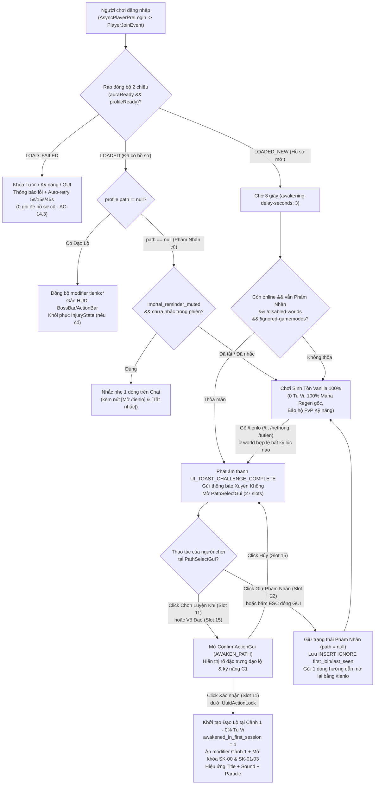
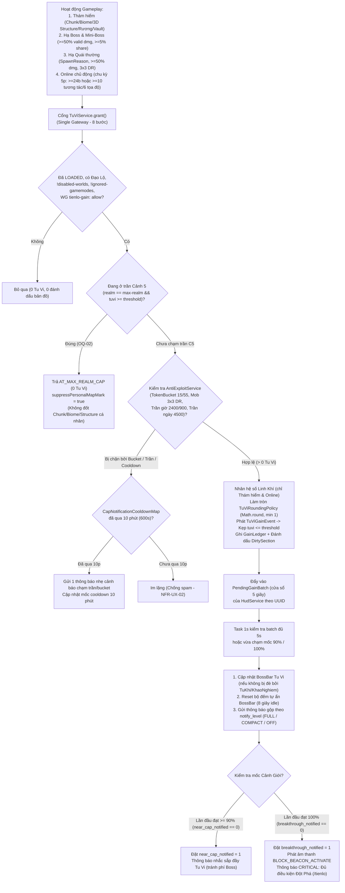
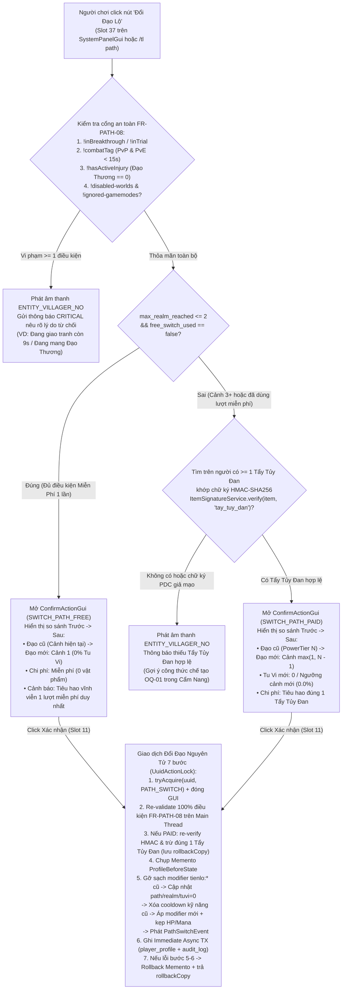
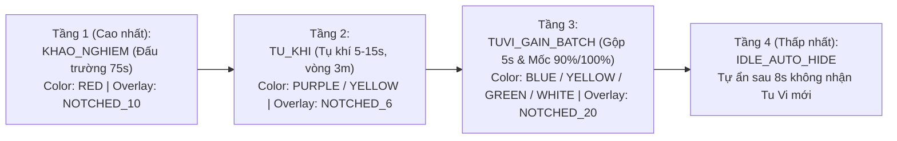
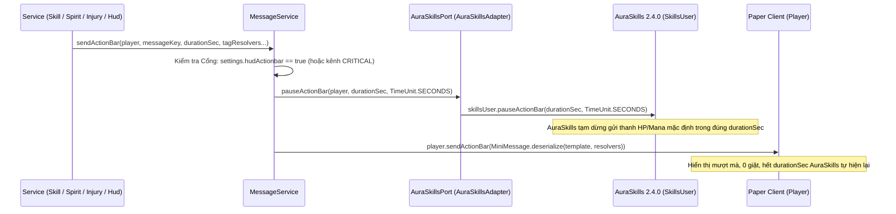
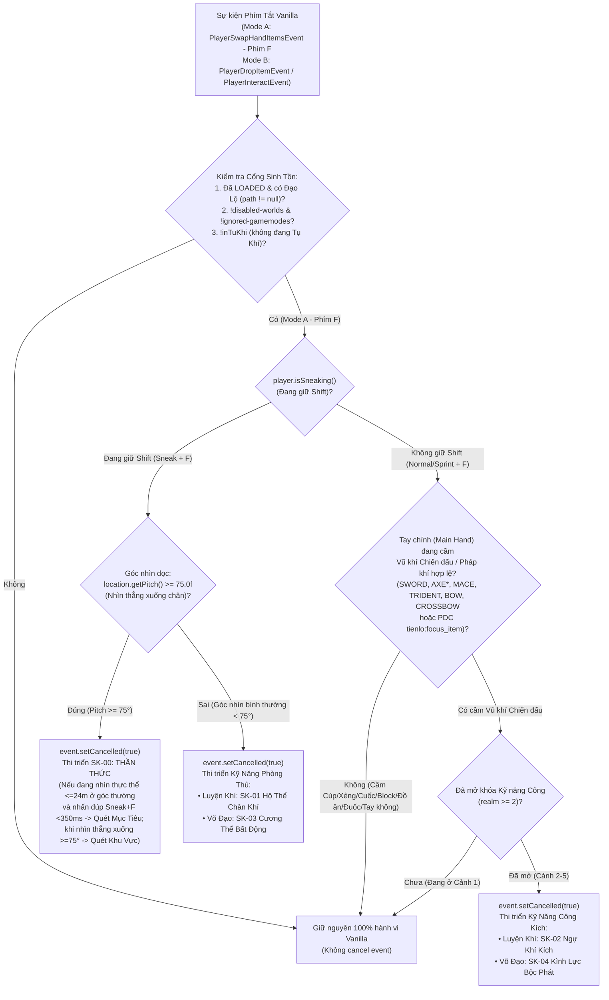

# 05. UI/UX & Game Design – Thiết kế Trải nghiệm Người chơi, Cân bằng Toán học & Cấu hình Chuẩn

| Thuộc tính | Giá trị |
|---|---|
| Dự án | **TienLo** (Tiên Lộ) – Plugin Survival Thám Hiểm + Tu Tiên + Hệ Thống Xuyên Không |
| Nền tảng | Minecraft Java Edition – Paper 26.3 (`protocol 777`), Java 25 (`bytecode major 69`) |
| Phụ thuộc bắt buộc | **AuraSkills 2.4.0** (dải `2.4.x` – đã kiểm chứng bytecode `Stats`, `Traits`, `SkillsUser`, `ManaRegenerateEvent`) |
| Tích hợp tùy chọn | **PlaceholderAPI** (12 placeholders), **WorldGuard 7.x** (4+1 custom flags), **MythicMobs 5.x** (P2 hook) |
| Đầu vào | [01-ideation.md](01-ideation.md), [02-product-discovery.md](02-product-discovery.md), [03-requirements.md](03-requirements.md) (v2.0 – đã duyệt), [04-architecture.md](04-architecture.md) (v1.0 – đã duyệt), bytecode `paper-26.3-257.jar` & `AuraSkills-2.4.0.jar` |
| Bước vòng đời | 05 / 09 – UI/UX & Game Design |
| Phiên bản / Trạng thái | **v1.0 – Hoàn thiện – chờ duyệt** |
| Ngày | 2026-11-22 |

---

## 0. Mục tiêu Thiết kế, Phạm vi & Cấu trúc Tài liệu

### 0.1 Mục đích tài liệu
Chuyển hóa toàn bộ đặc tả yêu cầu ([03-requirements.md](03-requirements.md)) và kiến trúc kỹ thuật Hexagonal ([04-architecture.md](04-architecture.md)) thành **bản thiết kế UI/UX, mô hình toán học cân bằng và bộ tài nguyên cấu hình / ngôn ngữ hoàn chỉnh 100%**, sẵn sàng đưa thẳng vào mã nguồn ở **Bước 06 (Development)** và làm chuẩn đối chiếu cho **Bước 07 (Testing)**:

1. **Phần I – Thiết kế UI/UX, 4 Màn hình GUI, HUD & Kích hoạt Kỹ năng (Mục 1 – 4):**
   - 4 lưu đồ hành trình người chơi (Thức tỉnh phiên đầu / Phàm Nhân, Vòng lặp Tu Vi gộp `5s`, Đột Phá / Khảo Nghiệm / Đạo Thương, Đổi Đạo nguyên tử).
   - Bố cục lưới slot chính xác (`0..26` và `0..53`), `Material` chuẩn Paper 26.3, `CustomModelData`, mẫu MiniMessage lore, ánh xạ click và âm thanh cho `PathSelectGui`, `SystemPanelGui`, `ConfirmActionGui`, `GuideGui`.
   - Ngăn xếp BossBar ưu tiên 4 tầng, giao thức `pauseActionBar` không xung đột với AuraSkills 2.4.0, ma trận thông báo 4 kênh (`FULL / COMPACT / OFF / CRITICAL`) và bảng Rate-Limit `10 phút`.
   - Kiến trúc bấm nhanh kỹ năng 3 chế độ trên Vanilla Client (**Mode A: Phím `F`**, **Mode B: `Shift+Q` / Chuột phải**, **Mode C: Lệnh/Macro**) kèm 5 quy tắc bảo vệ tay phụ và bảng Telegraph VFX (`Particle`), SFX (`Sound`), `Display Entity` (`setVisibleByDefault(false)`).
2. **Phần II – Mô hình Toán học Cân bằng & 6 File Cấu hình YAML Chuẩn (Mục 5 – 6):**
   - Chứng minh toán học nhịp độ `15–25 giờ chơi tích cực` đạt đỉnh Cảnh 5 (`160.000` Tu Vi) trên 3 Archetype người chơi với tỉ trọng nguồn đạt chuẩn `KPI-03` & `KPI-04`.
   - Chứng minh ngân sách sức mạnh Song Đạo (`Power = sqrt(EHP_ratio × DPS_ratio)`) tăng `+8%..+13%` mỗi bậc cảnh giới và đạt `≤ 1.75x` tại Cảnh 5 trên nền Full Enchanted Netherite + AuraSkills baseline (`FR-AURA-04`).
   - Thiết kế chi tiết đợt quái Đấu trường Khảo Nghiệm (`24m`, `75s`, thắng `100%` không roll lần 2), đường cong Đạo Thương 4 nấc nửa mở (`900s`) và toàn bộ 6 file YAML mặc định (`config.yml`, `realms.yml`, `skills.yml`, `spirit.yml`, `sources.yml`, `items.yml`).
3. **Phần III – Hệ thống Lệnh Brigadier, 12 PlaceholderAPI & Bộ Ngôn ngữ MiniMessage (Mục 7 – 9):**
   - Cây cú pháp Brigadier `/tienlo` (`/tl`, `/hethong`, `/tutien`) cho người chơi và Admin, lọc quyền `.requires(...)`, gợi ý tab-complete động và thành phần chat tương tác `<hover>`/`<click>`.
   - Bảng 12 PlaceholderAPI (`%tienlo_*%`) đọc `O(1)` từ RAM cache, đảm bảo zero-null cùng mẫu Scoreboard/Tablist.
   - Toàn bộ 2 file ngôn ngữ `messages/vi_VN.yml` và `messages/en_US.yml` (`100%` MiniMessage, khớp tuyệt đối `100%` khóa).

---

## PHẦN I: THIẾT KẾ UI/UX, GIAO DIỆN BẢNG HỆ THỐNG, KIẾN TRÚC HUD & CƠ CHẾ KÍCH HOẠT KỸ NĂNG

> **Phạm vi đặc tả:** Tài liệu này chi tiết hóa toàn bộ thiết kế trải nghiệm người chơi (Player Journey), 4 màn hình Inventory GUI (`PathSelectGui`, `SystemPanelGui`, `ConfirmActionGui`, `GuideGui`), ngăn xếp BossBar & điều phối ActionBar với AuraSkills 2.4.0, ma trận thông báo chống spam, cơ chế kích hoạt nhanh kỹ năng 3 chế độ trên Vanilla Client và bảng hiệu ứng Telegraph VFX/SFX/Display Entity đã kiểm chứng 100% bytecode trên `paper-api-26.3.build.257-stable.jar`.

---

## 1. Triết lý UI/UX & Luồng Trải nghiệm Người chơi (Player Journey Flows)

### 1.1 Năm Nguyên tắc Thiết kế UI/UX Cốt lõi

Thiết kế giao diện và trải nghiệm của **TienLo** bám sát 5 Trụ cột Thiết kế ([01-ideation.md](01-ideation.md#5-trụ-cột-thiết-kế-design-pillars)), quy tắc nghiệp vụ `BR-04/BR-05` ([02-product-discovery.md](02-product-discovery.md)) và bộ yêu cầu `FR-UI-01..08`, `NFR-UX-01..02`, `NFR-COMP-02..03` ([03-requirements.md](03-requirements.md)):

1. **Vanilla Client 100% – Cảm giác "Hệ Thống Xuyên Không" (`CON-03`, `NFR-COMP-02`):**
   - Sử dụng thuần túy Chest GUI (`InventoryHolder`), Adventure `BossBar`, `ActionBar`, `Title`, `Particle`, `Sound` và `BlockDisplay`/`ItemDisplay` (`setVisibleByDefault(false)` + `setPersistent(false)`).
   - Không yêu cầu cài mod client, không phụ thuộc ProtocolLib. Toàn bộ icon GUI đều gắn sẵn khóa `custom-model-data` (mặc định `0` cho vanilla; tự động hiển thị texture tùy chỉnh nếu server có Resource Pack).
2. **Tự giải thích trong `≤ 15 phút` đầu – Không cần đọc Wiki ngoài (`NFR-UX-01`):**
   - Mọi nút bấm trong Bảng Hệ Thống (`/tienlo`, `/tl`, `/hethong`, `/tutien`) đều hiển thị rõ: **Trạng thái hiện tại → Điều kiện cần đạt → Tác động / Phần thưởng → Hậu quả / Rủi ro → Thao tác chuột tương ứng**.
   - Tích hợp sẵn **Cẩm Nang Tu Tiên (`GuideGui` 5 chuyên mục)** ngay trong Bảng Hệ Thống để người chơi tra cứu trực tiếp in-game.
3. **Phản hồi Tức thì `< 50 ms` & An toàn Nguyên tử (`NFR-PERF-03`, `FR-PATH-07`):**
   - 100% dữ liệu hiển thị trên GUI (`PlayerProfile`, `SpiritSnapshot`, `InjuryState`, `SkillsUser` Mana/Stats, `ExploredRegion` count, cooldowns) được đọc `O(1)` từ RAM cache trên Main Thread (`1–3 ms`).
   - Mọi thao tác thay đổi trạng thái (Thức tỉnh, Đổi đạo, Đột phá) đều đi qua bộ chống dội click **`250 ms` debounce** kết hợp khóa nguyên tử **`UuidActionLock`** và màn hình xác nhận **`ConfirmActionGui`**.
4. **Hài hòa Tuyệt đối với AuraSkills 2.4.0 & Giao diện Sinh tồn (`FR-UI-03`, `NFR-COMP-03`):**
   - Trước mỗi lần gửi ActionBar của TienLo, `MessageService` luôn gọi `auraSkillsPort.pauseActionBar(player, durationSec, TimeUnit.SECONDS)` để tạm dừng thanh `HP / Mana / XP` của AuraSkills, triệt tiêu hoàn toàn hiện tượng nhấp nháy/giật chữ.
   - Ngăn xếp BossBar tự động ưu tiên theo ngữ cảnh (`Khảo Nghiệm` > `Tụ Khí` > `Tu Vi Batch 5s`) và tự ẩn sau **`8 giây` không tăng Tu Vi** để trả lại màn hình thoáng đãng cho người chơi xây dựng/sinh tồn.
5. **Chống Spam & Tôn trọng Quyền Lựa chọn của Người chơi (`FR-PATH-03`, `FR-UI-04/05`, `NFR-UX-02`):**
   - Gộp mọi nguồn cộng Tu Vi nhỏ lẻ trong cửa sổ **`5 giây`** (`PendingGainBatch` – tối đa 1 thông báo / 5 giây).
   - Khoảng lặng **`10 phút`** (`600 giây`) cho mọi cảnh báo chạm trần nguồn hoặc giảm thưởng chống farm (`CapNotificationCooldownMap`).
   - Người chơi đóng GUI chọn đạo được giữ nguyên thân phận **Phàm Nhân** (chơi sinh tồn vanilla 100%, không bị làm phiền quá 1 lần/phiên và có thể tắt nhắc vĩnh viễn qua `mortal_reminder_muted`).

> **Quy ước đồng nhất danh xưng & định danh hai Đạo Lộ (`02-product-discovery.md` → `04-architecture.md`):**
> - **Luyện Khí Sĩ / Ngự Khí Đạo:** Mã định danh DB/API chuẩn là **`LUYEN_KHI`** (khóa nhánh YAML `realms.yml`: `LUYEN_KHI` / alias hiển thị: *Luyện Khí Sĩ – Ngự Khí Đạo*). Cảnh 1–5 Phase 1: **Bì (Da Đồng) → Nhục (Cỏ Rễ) → Cân (Gân Liễu) → Cốt (Khí Cốt) → Thể (Lò Luyện)**.
> - **Võ Đạo / Thể Tu Đạo (Võ Phu):** Mã định danh DB/API chuẩn là **`VO_DAO`** (khóa nhánh YAML `realms.yml`: `VO_DAO` / alias hiển thị: *Võ Đạo – Thể Tu Đạo*). Cảnh 1–5 Phase 1: **Ni Bôi Cảnh → Mộc Thai Cảnh → Thủy Ngân Cảnh → Anh Hồn Cảnh → Hùng Phách Cảnh**.

---

### 1.2 Lưu đồ (a): Thức tỉnh Phiên Đầu & Nhánh Phàm Nhân (`FR-PATH-01..04`, `FR-DATA-09`, `US-01`, `US-02`)



---

### 1.3 Lưu đồ (b): Vòng lặp Gameplay Cốt lõi & Phản hồi HUD Gộp 5 Giây (`FR-REALM-01..05`, `FR-UI-03/04`, `NFR-UX-02`)



---

### 1.4 Lưu đồ (c): Máy trạng thái Đột Phá `TuKhi → KhaoNghiem / TungXucXac → Thành Công / Đạo Thương` (`FR-BREAK-01..10`)

```mermaid
stateDiagram-v2
    [*] --> SanSang: Tu Vi = 100% (realm < max-realm, hết CD 60s)
    SanSang --> KiemTraDieuKien: Click nút Đột Phá (Slot 22) hoặc /tl breakthrough

    state KiemTraDieuKien <<choice>>
    KiemTraDieuKien --> TuChoi: Thiếu vật phẩm nghi thức / WG tienlo-skills: deny / Đang Đạo Thương (mặc định allow-while-injured: false)
    KiemTraDieuKien --> ConfirmDaoThuong: Đang Đạo Thương nhưng server bật allow-while-injured: true
    ConfirmDaoThuong --> TuKhi: Xác nhận tại ConfirmActionGui (chấp nhận phạt -35% tỉ lệ & reset 900s nếu trượt)
    KiemTraDieuKien --> TuKhi: Đủ điều kiện chuẩn (cấp khóa UuidActionLock -> bắn BreakthroughStartEvent)

    state TuKhi {
        [*] --> DangTuKhi: Kéo dài 5-15s (cfg), khóa kỹ năng chủ động\nHiển thị BossBar TU_KHI + Vòng hạt bán kính 3.0 block
    }

    TuKhi --> HuyKhongPhat: Rời bán kính > 3b / Thoát game / Đổi world / Teleport / Server /stop
    HuyKhongPhat --> SanSang: 0 mất Tu Vi, 0 mất vật phẩm nghi thức\nÁp cooldown thử lại 60 giây

    TuKhi --> ThatBai: Chết trong lúc Tụ Khí (không có Totem cứu)

    TuKhi --> PhanNhanhMoc: Hoàn tất 100% thời gian Tụ Khí\n(Kiểm tra lại & TIÊU HAO vật phẩm nghi thức ngay tại đây)

    state PhanNhanhMoc <<choice>>
    PhanNhanhMoc --> KhaoNghiem: Mốc có Khảo Nghiệm (VD: C2->C3 Thủy Ngân & C4->C5)\n(Kiểm tra không gian & WG mob-spawning: allow;\nnếu WG chặn -> Hủy không phạt + hoàn đồ)
    PhanNhanhMoc --> TungXucXac: Mốc đột phá thường (Roll tỉ lệ)

    state KhaoNghiem {
        [*] --> ChienDauKhaoNghiem: Đấu trường bán kính 24b, thời gian 75s\nĐược dùng mọi kỹ năng chủ động\nBossBar KHAO_NGHIEM (RED, NOTCHED_10)\nQuái tienlo:trial_mob chỉ đánh chủ, miễn sát thương người khác
    }

    KhaoNghiem --> ThanhCong: Hạ sạch toàn bộ đợt quái trong <= 75s\n(100% Thành Công - KHÔNG tung xúc xắc lần 2!)
    KhaoNghiem --> ThatBai: Chết / Hết 75s / Rời > 24b / Teleport / Đổi world / Thoát game (!isShuttingDown)\n(Despawn ngay toàn bộ tienlo:trial_mob)

    state TungXucXac <<choice>>
    TungXucXac --> ThanhCong: Random < clamp(baseRate + spiritBonus - injuryPen, 5%, 98%)
    TungXucXac --> ThatBai: Random >= tỉ lệ thành công

    ThanhCong --> [*]: realm = realm + 1, tuvi = 0, breakthrough_notified = 0\nGhi RealmMilestone + Đồng bộ modifier tienlo:*\nMở khóa kỹ năng/nội tại mới + Title/VFX/SFX\n(Broadcast toàn server nếu đạt Cảnh 5)

    ThatBai --> DaoThuong: Trừ 20% ngưỡng Tu Vi cảnh hiện tại (max(0, tuvi - 20%), không rớt cảnh)\nÁp InjuryState 900s (15 phút) ở nấc 100% (-30% Mana Regen & TienLo Stat/Trait)\nHồi dần 100% -> 75% -> 50% -> 25% -> 0% (x1.25 Nồng Đậm, x1.50 Linh Mạch)
```

---

### 1.5 Lưu đồ (d): Luồng Đổi Đạo Lộ (Miễn phí Cảnh 1–2 vs Có phí bằng *Tẩy Tủy Đan* qua `ConfirmActionGui`, `FR-PATH-05..10`)



---

## 2. Thiết kế Chi tiết 4 Màn hình Inventory GUI (`TienLoGuiHolder`)

### 2.1 Kiến trúc Kỹ thuật Chung của Tầng GUI (`com.tienlo.paper.gui`)

Để đảm bảo hiệu năng `< 50 ms` (`NFR-PERF-03`), chống 100% lỗi kẹt/dupe vật phẩm và tương thích hoàn toàn với Paper 26.3:

1. **`TienLoGuiHolder` (implements `org.bukkit.inventory.InventoryHolder`):**
   - Mỗi instance giữ: `GuiType type` (`PATH_SELECT`, `SYSTEM_PANEL`, `CONFIRM_ACTION`, `GUIDE`), `UUID viewerUuid`, `int activeTabOrContext`, và `long lastClickEpochMillis`.
   - `GuiListener` kiểm tra `event.getInventory().getHolder(false) instanceof TienLoGuiHolder holder`:
     - **Chặn dịch chuyển vật phẩm tuyệt đối:** Gọi `event.setCancelled(true)` cho **100%** `InventoryClickEvent` (kể cả click ở bottom player inventory khi top inventory là `TienLoGuiHolder`, chặn `ClickType.NUMBER_KEY`, `SWAP_OFFHAND`, `SHIFT_LEFT`, `SHIFT_RIGHT`, `DOUBLE_CLICK`) và **100%** `InventoryDragEvent`.
2. **Chống Spam Click (`250 ms` Debounce) & Khóa Nguyên Tử (`UuidActionLock`):**
   - Mọi click vào slot chức năng đều kiểm tra `now - holder.getLastClickEpochMillis() < 250L`. Nếu `< 250 ms` → bỏ qua êm (không phát âm thanh rác).
   - Các nút thay đổi trạng thái bền vững (`Xác nhận Thức tỉnh`, `Xác nhận Đổi Đạo`, `Kích hoạt Đột Phá`) bắt buộc gọi `uuidActionLock.tryAcquire(uuid, actionType)` trước khi thực thi.
3. **Quy ước `CustomModelData` & Thẩm mỹ Vanilla:**
   - Mọi nút giao diện đều khai báo `custom-model-data` theo dải chuẩn (`10001..10099`) trong cấu hình/code để server có Resource Pack tự động ánh xạ sang khung UI cổ phong, trong khi trên Vanilla Client 100% vẫn hiển thị bằng `Material` đặc trưng, dễ phân biệt ngay lập tức.
   - Mọi dòng tên và lore đều khởi tạo qua `MiniMessage.miniMessage().deserialize(...)` và đặt `Component.decoration(TextDecoration.ITALIC, false)` làm mặc định để loại bỏ chữ nghiêng mặc định của Minecraft trên tên vật phẩm/lore.

---

### 2.2 Màn hình 1: `PathSelectGui` – Giao diện Thức Tỉnh & Chọn Đạo Lộ (`27` Slots, `3×9`)

- **Tiêu đề GUI (MiniMessage):** `<gradient:#00e5ff:#ffd700><bold>✦ Thiên Đạo Khai Mở • Chọn Đạo Lộ ✦</bold></gradient>`
- **Điều kiện mở:** Người chơi ở trạng thái **Phàm Nhân (`path == null`)** sau rào đồng bộ `3 giây` lần đầu vào server (`FR-PATH-01`) hoặc khi Phàm Nhân gõ `/tienlo` (`/tl`, `/hethong`, `/tutien`, `/tl path`) tại world hợp lệ (`FR-PATH-04`).

#### A. Sơ đồ Lưới Slot (`3×9`, chỉ số `0..26`)

```text
+----+----+----+----+----+----+----+----+----+
| 00 | 01 | 02 | 03 | 04 | 05 | 06 | 07 | 08 |  <- Hàng 1: Viền kính trang trí (Xanh Lam <-> Vàng Hổ Phách)
| 09 | 10 |[11]| 12 |[13]| 14 |[15]| 16 | 17 |  <- Hàng 2: [11] Luyện Khí Sĩ | [13] Thiên Đạo Luận | [15] Võ Đạo
| 18 | 19 | 20 | 21 |[22]| 23 | 24 | 25 | 26 |  <- Hàng 3: [22] Giữ Thân Phận Phàm Nhân (Đóng)
+----+----+----+----+----+----+----+----+----+
```

#### B. Bảng Đặc tả Chi tiết Từng Slot (`0..26` – Phủ kín 100% `27` Slots)

| Slot | Vai trò | Material (Paper 26.3) | CMD | Tên hiển thị (MiniMessage) | Thao tác Click & Hành vi | Sound Cue (`Sound`, Vol, Pitch) |
|---:|---|---|---:|---|---|---|
| `0, 1, 2, 9, 18, 19, 20` | Viền trái (Ngự Khí) | `CYAN_STAINED_GLASS_PANE` | `10001` | `<dark_aqua>✦</dark_aqua>` | Không thao tác (hủy click) | – |
| `3, 5, 10, 12, 14, 16, 21, 23` | Nền ngăn cách | `BLACK_STAINED_GLASS_PANE` | `10000` | `<dark_gray>•</dark_gray>` | Không thao tác (hủy click) | – |
| `4` | Đỉnh Thiên Đạo | `NETHER_STAR` | `10003` | `<gold><bold>✦ ẤN KÝ HỆ THỐNG XUYÊN KHÔNG ✦</bold></gold>` | Không thao tác (hiển thị lời chào Hệ Thống) | – |
| `6, 7, 8, 17, 24, 25, 26` | Viền phải (Võ Đạo) | `ORANGE_STAINED_GLASS_PANE` | `10002` | `<gold>✦</gold>` | Không thao tác (hủy click) | – |
| **`11`** | **Chọn Luyện Khí Sĩ (Ngự Khí Đạo)** | `AMETHYST_SHARD` | `10011` | `<aqua><bold>☯ LUYỆN KHÍ SĨ (NGỰ KHÍ ĐẠO)</bold></aqua>` | **Left/Right-Click:** Mở `ConfirmActionGui` (`AWAKEN_PATH`, `targetPath = LUYEN_KHI`) | `BLOCK_AMETHYST_BLOCK_CHIME` (`1.0f`, `1.2f`) |
| **`13`** | **Thẻ So Sánh Song Đạo & Luật Đổi Đạo** | `KNOWLEDGE_BOOK` | `10012` | `<yellow><bold>📜 THIÊN ĐẠO SONG HÀNH • CẨM NANG CHỌN ĐẠO</bold></yellow>` | **Left-Click:** Mở nhanh `GuideGui` (Tab 2: So sánh Song Đạo) | `ITEM_BOOK_PAGE_TURN` (`1.0f`, `1.0f`) |
| **`15`** | **Chọn Võ Đạo (Thể Tu Đạo)** | `BLAZE_POWDER` | `10013` | `<gold><bold>⚔ VÕ ĐẠO (THỂ TU ĐẠO • VÕ PHU)</bold></gold>` | **Left/Right-Click:** Mở `ConfirmActionGui` (`AWAKEN_PATH`, `targetPath = VO_DAO`) | `BLOCK_ANVIL_PLACE` (`0.8f`, `1.3f`) |
| **`22`** | **Giữ Thân Phận Phàm Nhân (Đóng)** | `LANTERN` | `10014` | `<gray><bold>❖ Tạm Giữ Thân Phận Phàm Nhân</bold></gray>` | **Left-Click:** Đóng GUI (`player.closeInventory()`). **Shift-Left-Click:** Đóng GUI & bật luôn `mortal_reminder_muted = true` | `UI_BUTTON_CLICK` (`0.8f`, `0.9f`) |

#### C. Mẫu Lore MiniMessage Chi tiết trên `PathSelectGui`

- **Slot `11` – Luyện Khí Sĩ (Ngự Khí Đạo – `LUYEN_KHI`):**
  ```yaml
  name: "<aqua><bold>☯ LUYỆN KHÍ SĨ (NGỰ KHÍ ĐẠO)</bold></aqua>"
  lore:
    - "<dark_gray>Đạo lộ cảm ứng thiên địa, lấy Linh Lực làm gốc</dark_gray>"
    - ""
    - "<gray>• <white>Bản sắc:</white> Linh Lực dồi dào, hồi phục nhanh theo Linh Khí,</gray>"
    - "<gray>  công kích chân khí tầm trung & lá chắn hộ thể linh hoạt.</gray>"
    - "<gray>• <white>Ngũ Cảnh Phase 1:</white> <aqua>Bì → Nhục → Cân → Cốt → Thể</aqua></gray>"
    - "<gray>• <white>Chỉ số nổi trội (Cảnh 1 → Cảnh 5):</white></gray>"
    - "  <dark_aqua>▸</dark_aqua> <aqua>Wisdom (+Max Linh Lực):</aqua> <white>+15 (+30) → +60 (+120)</white>"
    - "  <dark_aqua>▸</dark_aqua> <aqua>Hồi Linh Lực (Mana Regen):</aqua> <white>+1.2/s → +3.0/s</white>"
    - "  <dark_aqua>▸</dark_aqua> <green>Toughness / Health:</green> <white>+10 → +40 Tgh | +1 → +8 HP</white>"
    - "  <dark_aqua>▸</dark_aqua> <red>Strength / Speed:</red> <white>+5 → +29 Str | +0 → +5 Spd</white>"
    - "<gray>• <white>Tuyệt kỹ Đạo Lộ:</white></gray>"
    - "  <dark_aqua>▸</dark_aqua> <yellow>[Cảnh 1]</yellow> <aqua>Hộ Thể Chân Khí</aqua> <gray>(Lá chắn hấp thụ 14%–20% Max HP)</gray>"
    - "  <dark_aqua>▸</dark_aqua> <yellow>[Cảnh 2]</yellow> <aqua>Ngự Khí Kích</aqua> <gray>(Phóng kiếm khí 16m, xuyên giáp chuẩn)</gray>"
    - "  <dark_aqua>▸</dark_aqua> <yellow>[Cảnh 3]</yellow> <green>Nội Tại Lữ Khách</green> <gray>(+10%–14% Tốc chạy, Bật cao, Giảm rơi)</gray>"
    - ""
    - "<green><bold>▶ Click để chọn Luyện Khí Sĩ (Bắt đầu ở Bì Cảnh - 0%)</bold></green>"
  ```

- **Slot `15` – Võ Đạo (Thể Tu Đạo / Võ Phu – `VO_DAO`):**
  ```yaml
  name: "<gold><bold>⚔ VÕ ĐẠO (THỂ TU ĐẠO • VÕ PHU)</bold></gold>"
  lore:
    - "<dark_gray>Đạo lộ tôi luyện nhục thân, lấy Khí Huyết làm gốc</dark_gray>"
    - ""
    - "<gray>• <white>Bản sắc:</white> Sinh lực & phòng ngự cường hãn, kháng đẩy lùi,</gray>"
    - "<gray>  áp sát tốc chiến và bộc phát kình lực cận chiến uy mãnh.</gray>"
    - "<gray>• <white>Ngũ Cảnh Phase 1:</white> <gold>Ni Bôi → Mộc Thai → Thủy Ngân → Anh Hồn → Hùng Phách</gold></gray>"
    - "<gray>• <white>Chỉ số nổi trội (Cảnh 1 → Cảnh 5):</white></gray>"
    - "  <gold>▸</gold> <green>Health / Toughness:</green> <white>+2 → +10 HP | +10 → +48 Tgh</white>"
    - "  <gold>▸</gold> <red>Strength / Bạo kích:</red> <white>+7 → +35 Str | +5%–8% Crit (C4–5)</white>"
    - "  <gold>▸</gold> <yellow>Kháng đẩy lùi / Hồi máu:</yellow> <white>+10% → +30% KB | +10 → +15 Reg (C3+)</white>"
    - "  <gold>▸</gold> <aqua>Linh Lực nền (Max Mana):</aqua> <white>+20 → +60 | Regen +0.8/s → +1.7/s</white>"
    - "<gray>• <white>Tuyệt kỹ Đạo Lộ:</white></gray>"
    - "  <gold>▸</gold> <yellow>[Cảnh 1]</yellow> <gold>Cương Thể Bất Động</gold> <gray>(100% Kháng đẩy, Giảm 20%–30% mọi sát thương)</gray>"
    - "  <gold>▸</gold> <yellow>[Cảnh 2]</yellow> <gold>Kình Lực Bộc Phát</gold> <gray>(Tụ kình đòn cận chiến + Làm chậm + Đẩy lùi)</gray>"
    - "  <gold>▸</gold> <yellow>[Cảnh 3]</yellow> <green>Nội Tại Lữ Khách</green> <gray>& Khảo Nghiệm 'Ni Bồ Tát Quá Giang'</gray>"
    - ""
    - "<green><bold>▶ Click để chọn Võ Đạo (Bắt đầu ở Ni Bôi Cảnh - 0%)</bold></green>"
  ```

- **Slot `22` – Giữ Thân Phận Phàm Nhân:**
  ```yaml
  name: "<gray><bold>❖ Tạm Giữ Thân Phận Phàm Nhân</bold></gray>"
  lore:
    - "<gray>Chưa muốn bước vào con đường tu luyện ngay lúc này?</gray>"
    - ""
    - "<white>• Quyền lợi Phàm Nhân:</white>"
    - "  <dark_gray>▸</dark_gray> <gray>Chơi sinh tồn Vanilla bình thường 100%.</gray>"
    - "  <dark_gray>▸</dark_gray> <gray>Không bị giảm hồi Mana AuraSkills ở vùng Linh Khí thấp.</gray>"
    - "  <dark_gray>▸</dark_gray> <green>Được Bảo Hộ Tân Thủ:</green> <gray>Miễn nhiễm sát thương kỹ năng</gray>"
    - "    <gray>tu tiên từ người chơi khác (trừ khi chủ động đánh trước).</gray>"
    - "  <dark_gray>▸</dark_gray> <gray>Có thể gõ <yellow>/tienlo</yellow> bất kỳ lúc nào để thức tỉnh sau.</gray>"
    - ""
    - "<yellow>▶ Click Trái:</yellow> <white>Đóng bảng (Nhắc nhẹ tối đa 1 lần/phiên)</white>"
    - "<gold>▶ Shift + Click Trái:</gold> <white>Đóng & Tắt vĩnh viễn lời nhắc Phàm Nhân</white>"
  ```

- **Hành vi khi đóng `PathSelectGui` (`InventoryCloseEvent`, `FR-PATH-03`):**
  - Nếu người chơi đóng GUI bằng phím `ESC` hoặc click Slot `22` (không phải chuyển sang `ConfirmActionGui`):
    - Hồ sơ giữ nguyên `path = null` (Phàm Nhân).
    - Nếu `!profile.isMortalReminderMuted()` và chưa gửi lời nhắc trong phiên hiện tại (`!session.isMortalRemindedThisSession()`): đặt `session.setMortalRemindedThisSession(true)` và gửi đúng 1 dòng thông báo nhẹ qua `MessageService` (`path.mortal-close-notice`).

---

### 2.3 Màn hình 2: `SystemPanelGui` – Bảng Hệ Thống Trung Tâm (`54` Slots, `6×9`)

- **Tiêu đề GUI (MiniMessage):** `<gradient:#00e5ff:#7c4dff><bold>✦ Bảng Hệ Thống • Tiên Lộ [<path_short>] ✦</bold></gradient>`
- **Điều kiện mở:** Người chơi đã có Đạo Lộ (`path != null`) gõ `/tienlo` (`/tl`, `/hethong`, `/tutien`).

#### A. Sơ đồ Lưới Slot (`6×9`, chỉ số `0..53`)

```text
+----+----+----+----+----+----+----+----+----+
| 00 | 01 | 02 | 03 |[04]| 05 | 06 | 07 | 08 |  Hàng 1: [04] Hồ Sơ Ký Chủ & Tổng Chỉ Số TienLo
| 09 | 10 | 11 |[12]|[13]|[14]| 15 | 16 | 17 |  Hàng 2: [12] Thống Kê Thám Hiểm | [13] Linh Khí | [14] Đạo Thương
| 18 |[19]|[20]|[21]|[22]|[23]|[24]|[25]| 26 |  Hàng 3: [19..21] SK-00..02/04 | [22] ĐỘT PHÁ | [23..24] Nội Tại | [25] Chế Độ Phím
| 27 | 28 | 29 | 30 | 31 | 32 | 33 | 34 | 35 |  Hàng 4: Dải phân cách tiến trình Cảnh Giới (Cảnh 1 -> Cảnh 5)
| 36 |[37]| 38 |[39]|[40]|[41]| 42 |[43]| 44 |  Hàng 5: [37] Đổi Đạo | [39] BossBar | [40] ActionBar | [41] Notify | [43] Cẩm Nang
| 45 | 46 | 47 | 48 |[49]| 50 | 51 | 52 | 53 |  Hàng 6: [49] Đóng Bảng Hệ Thống
+----+----+----+----+----+----+----+----+----+
```

#### B. Bảng Đặc tả Chi tiết Từng Slot (`0..53` – Phủ kín 100% `54` Slots)

| Slot | Vai trò | Material (Paper 26.3) | CMD | Tên hiển thị (MiniMessage) | Thao tác Click & Hành vi | Sound Cue (`Sound`, Vol, Pitch) |
|---:|---|---|---:|---|---|---|
| `0, 1, 7, 8, 9, 17, 18, 26, 27, 35, 36, 44, 45, 46, 52, 53` | Khung viền theo Đạo Lộ | `CYAN_STAINED_GLASS_PANE` (`LUYEN_KHI`) / `ORANGE_STAINED_GLASS_PANE` (`VO_DAO`) | `10001` / `10002` | `<dark_aqua>✦</dark_aqua>` / `<gold>✦</gold>` | Không thao tác | – |
| `2, 3, 5, 6, 10, 11, 15, 16, 28, 34, 38, 42, 47, 48, 50, 51` | Nền kính tối | `BLACK_STAINED_GLASS_PANE` | `10000` | `<dark_gray>•</dark_gray>` | Không thao tác | – |
| **`4`** | **Hồ Sơ Ký Chủ & Chỉ Số Cộng Thêm** | `PLAYER_HEAD` *(skull của người chơi)* | `10020` | `<gold><bold>✦ HỒ SƠ KÝ CHỦ: <white><player></white> ✦</bold></gold>` | **Left-Click:** In tóm tắt hồ sơ ra khung chat (`/tl info`) | `UI_BUTTON_CLICK` (`0.7f`, `1.2f`) |
| **`12`** | **Thống Kê Thám Hiểm & Trần Nguồn** | `RECOVERY_COMPASS` | `10021` | `<aqua><bold>🧭 HÀNH TRÌNH THÁM HIỂM & NGUỒN TU VI</bold></aqua>` | **Left-Click:** Mở `GuideGui` Tab 3 (Nguồn Tu Vi & Chống Farm) | `ITEM_BOOK_PAGE_TURN` (`0.8f`, `1.1f`) |
| **`13`** | **Trạng Thái Linh Khí Khu Vực** | `END_CRYSTAL` *(Linh Mạch)* / `AMETHYST_SHARD` *(Nồng Đậm)* / `EXPERIENCE_BOTTLE` *(Bình Thường)* / `GLASS_BOTTLE` *(Loãng/Khô Kiệt)* | `10022` | `<aqua><bold>🌌 LINH KHÍ KHU VỰC: <spirit_tier_colored></bold></aqua>` | **Left-Click:** Mở `GuideGui` Tab 1 (Linh Khí Đa Thế Giới) | `BLOCK_AMETHYST_BLOCK_RESONATE` (`0.8f`, `1.0f`) |
| **`14`** | **Trạng Thái Đạo Thương & Bảo Hộ PvP** | `TOTEM_OF_UNDYING` *(Bình thường)* / `DRAGON_BREATH` *(Đang Đạo Thương)* | `10023` | `<green><bold>❤ TRẠNG THÁI ĐẠO CƠ: ỔN ĐỊNH</bold></green>` *(hoặc `<red><bold>⚠ ĐẠO THƯƠNG: NẤC <injury_tier>%</bold></red>`)* | **Left-Click:** Mở `GuideGui` Tab 4 (Đột Phá & Đạo Thương) | `UI_BUTTON_CLICK` (`0.7f`, `1.0f`) |
| **`19`** | **Kỹ Năng Chung: `SK-00` Thần Thức** | `ENDER_EYE` | `10030` | `<light_purple><bold>👁 [SK-00] THẦN THỨC (DÒ XÉT)</bold></light_purple>` | **Left-Click:** Đóng GUI & Quét Mục Tiêu (`10` Mana, `15s` CD)<br>**Right-Click:** Đóng GUI & Quét Khu Vực (`20` Mana, `45s` CD) | `BLOCK_ENCHANTMENT_TABLE_USE` (`0.9f`, `1.3f`) |
| **`20`** | **Kỹ Năng Phòng Thủ (`SK-01` / `SK-03`)** | `HEART_OF_THE_SEA` (`SK-01`) / `SHIELD` (`SK-03`) | `10031` | `<aqua><bold>🛡 [SK-01] HỘ THỂ CHÂN KHÍ</bold></aqua>` *(hoặc `<gold><bold>🛡 [SK-03] CƯƠNG THỂ BẤT ĐỘNG</bold></gold>`)* | **Left-Click:** Đóng GUI & Thi triển ngay kỹ năng phòng thủ | `ITEM_TRIDENT_RIPTIDE_1` / `BLOCK_ANVIL_LAND` |
| **`21`** | **Kỹ Năng Công Kích (`SK-02` / `SK-04`)** | `GRAY_DYE` *(Khóa ở C1)* / `DIAMOND_SWORD` (`SK-02` C2+) / `MACE` (`SK-04` C2+) | `10032` | `<red><bold>⚔ [SK-02] NGỰ KHÍ KÍCH</bold></red>` *(hoặc `<gold><bold>⚡ [SK-04] KÌNH LỰC BỘC PHÁT</bold></gold>`)* | **Left-Click (C2+):** Đóng GUI & Thi triển / Nạp kình<br>**Click ở C1:** Báo cần đạt Cảnh 2 | `ENTITY_ILLUSIONER_CAST_SPELL` / `ENTITY_BREEZE_CHARGE` |
| **`22`** | **Nút Trung Tâm: ĐỘT PHÁ CẢNH GIỚI** | *Động theo 7 trạng thái (Xem Bảng 2.3.C bên dưới)* | `10025` | *Động theo 7 trạng thái (Xem Bảng 2.3.C)* | **Left-Click:** Kích hoạt Đột Phá (hoặc mở `ConfirmActionGui` nếu cấu hình yêu cầu) | *Theo trạng thái* |
| **`23`** | **Nội Tại Lữ Khách (`FR-SKILL-05`)** | `GRAY_DYE` *(Khóa C1–2)* / `FEATHER` *(Mở C3–5)* | `10033` | `<green><bold>🍃 [NỘI TẠI T3] THÂN PHÁP LỮ KHÁCH</bold></green>` | Không thao tác (Hiển thị chỉ số tốc chạy, bật nhảy, giảm rơi) | – |
| **`24`** | **Nội Tại Cảnh Giới (`FR-SKILL-06`)** | `BOOK` *(C1)* / `ENCHANTED_BOOK` *(C2–5)* | `10034` | `<yellow><bold>📖 [NỘI TẠI ĐẠO LỘ] ĐẠO VẬN CẢNH GIỚI</bold></yellow>` | Không thao tác (Hiển thị các mốc nội tại phụ theo Cảnh 1–5) | – |
| **`25`** | **Chế Độ Bấm Nhanh Kỹ Năng (`OQ-03`)** | `SPECTRAL_ARROW` *(Mode A)* / `TRIAL_KEY` *(Mode B)* / `COMPARATOR` *(Mode C)* | `10035` | `<aqua><bold>⌨ CƠ CHẾ BẤM NHANH: <trigger_mode_name></bold></aqua>` | **Left-Click:** Chuyển vòng `Mode A (Phím F)` → `Mode B (Sneak+Q / Chuột Phải)` → `Mode C (Chỉ Lệnh/GUI)`<br>**Right-Click:** Mở `GuideGui` Tab 5 | `UI_BUTTON_CLICK` (`0.9f`, `1.3f`) |
| **`29..33`** | **Thanh Lộ Trình 5 Cảnh Giới Phase 1** | `LIME_STAINED_GLASS_PANE` *(Đã qua)* / `NETHER_STAR` *(Cảnh hiện tại)* / `GRAY_STAINED_GLASS_PANE` *(Chưa tới)* | `10041..10045` | `<yellow><bold>❖ Cảnh <idx>: <realm_name></bold></yellow>` | Không thao tác (Hiển thị ngưỡng Tu Vi & bonus chỉ số từng cảnh 1..5) | – |
| **`37`** | **Đổi Đạo Lộ (`FR-PATH-05..08`)** | `ECHO_SHARD` *(Miễn phí C1–2)* / `NETHER_STAR` *(Cần Tẩy Tủy Đan)* / `BARRIER` *(Đang bị khóa)* | `10050` | `<light_purple><bold>🔄 CHUYỂN ĐỔI ĐẠO LỘ</bold></light_purple>` | **Left-Click:** Kiểm tra điều kiện `FR-PATH-08` → Mở `ConfirmActionGui` (`SWITCH_PATH_FREE` hoặc `SWITCH_PATH_PAID`) | `BLOCK_BEACON_POWER_SELECT` (`0.9f`, `1.1f`) |
| **`39`** | **Bật/Tắt HUD BossBar Tu Vi** | `LIME_DYE` *(Đang Bật)* / `GRAY_DYE` *(Đang Tắt)* | `10051` | `<aqua><bold>📊 HUD BOSSBAR TU VI: <bossbar_state></bold></aqua>` | **Left-Click:** Đảo trạng thái `hud_bossbar` (`true ↔ false`), lưu `DirtySection.SETTINGS` | `UI_BUTTON_CLICK` (`0.8f`, `1.2f`) |
| **`40`** | **Bật/Tắt HUD ActionBar Linh Khí** | `LIME_DYE` *(Đang Bật)* / `GRAY_DYE` *(Đang Tắt)* | `10052` | `<aqua><bold>💬 HUD ACTIONBAR: <actionbar_state></bold></aqua>` | **Left-Click:** Đảo trạng thái `hud_actionbar` (`true ↔ false`), lưu `DirtySection.SETTINGS` | `UI_BUTTON_CLICK` (`0.8f`, `1.2f`) |
| **`41`** | **Mức Thông Báo Hệ Thống (`FR-UI-05`)** | `BELL` *(FULL)* / `SOUL_LANTERN` *(COMPACT)* / `REDSTONE_TORCH` *(OFF)* | `10053` | `<yellow><bold>🔔 MỨC THÔNG BÁO: <notify_level></bold></yellow>` | **Left-Click:** Chuyển vòng `FULL` → `COMPACT` → `OFF` (kênh `CRITICAL` luôn giữ) | `BLOCK_NOTE_BLOCK_BELL` (`0.8f`, `1.2f`) |
| **`43`** | **Cẩm Nang Tu Tiên (`NFR-UX-01`)** | `WRITABLE_BOOK` | `10054` | `<gold><bold>📚 CẨM NANG TU TIÊN (HƯỚNG DẪN)</bold></gold>` | **Left-Click:** Mở `GuideGui` (Tab 1 mặc định) | `ITEM_BOOK_PAGE_TURN` (`1.0f`, `1.0f`) |
| **`49`** | **Đóng Bảng Hệ Thống** | `BARRIER` | `10059` | `<red><bold>✖ Đóng Bảng Hệ Thống</bold></red>` | **Left-Click:** `player.closeInventory()` | `UI_BUTTON_CLICK` (`0.7f`, `0.8f`) |

#### C. Đặc tả 7 Trạng thái Động của Nút Đột Phá Trung Tâm (Slot `22` – `FR-BREAK-01..06`, `FR-REALM-03/04`)

| Trạng thái | Điều kiện kích hoạt | Material (Paper 26.3) | Tên hiển thị (MiniMessage) | Nội dung Lore MiniMessage bắt buộc | Hành vi khi Click & Sound Cue |
|---|---|---|---|---|---|
| **1. Đang Tích Lũy (`< 90%`)** | `realm < maxRealm` và `tuviPercent < 90.0%` | `IRON_INGOT` | `<gray><bold>🔒 ĐỘT PHÁ CẢNH GIỚI (CHƯA ĐỦ TU VI)</bold></gray>` | • Tiến độ: `<white><tuvi> / <max_tuvi></white> (<aqua><percent>%</aqua>)`<br>• Thanh: `<dark_gray>[<aqua>■■■■■■</aqua><gray>□□□□□□□□□□□□□□</gray>]</dark_gray>`<br>• Còn thiếu: `<yellow><missing_tuvi> Tu Vi</yellow>` để viên mãn `<realm_name>`<br>• Cảnh kế tiếp: `<gold><next_realm_name></gold>` | Không mở đột phá; gửi nhắc ngắn còn thiếu `<missing_tuvi>` Tu Vi.<br>Sound: `ENTITY_VILLAGER_NO` (`0.7f`, `1.0f`) |
| **2. Sắp Viên Mãn (`90% – 99.9%`)** | `realm < maxRealm` và `90.0% <= tuviPercent < 100.0%` | `GOLD_INGOT` | `<yellow><bold>⚡ SẮP ĐỦ ĐỘT PHÁ (<percent>%)</bold></yellow>` | • Tiến độ: `<white><tuvi> / <max_tuvi></white> (<yellow><percent>%</yellow>)`<br>• `<gold>⚠ Lưu ý:</gold> <gray>Tu Vi vượt 100% sẽ không cộng dồn sang cảnh sau. Tránh hạ Boss lớn trước khi đột phá!</gray>`<br>• Tỉ lệ dự kiến tại đây: `<green><expected_rate>%</green>` *(hoặc Khảo Nghiệm)* | Nhắc còn thiếu `<missing_tuvi>` Tu Vi.<br>Sound: `BLOCK_NOTE_BLOCK_PLING` (`0.8f`, `0.9f`) |
| **3. Đủ `100%` – Sẵn Sàng Đột Phá** | `tuvi >= maxTuvi`, `realm < maxRealm`, `!hasInjury`, `cooldown == 0` | `NETHER_STAR` *(hoặc `OMINOUS_TRIAL_KEY` nếu mốc có Khảo Nghiệm)* | `<green><bold>✦ KÍCH HOẠT ĐỘT PHÁ: <next_realm_name> ✦</bold></green>` | • Trạng thái: `<green>Viên mãn 100% (<tuvi>/<max_tuvi>)</green>`<br>• Thời gian Tụ Khí: `<aqua><channel_sec> giây</aqua>` (giữ trong bán kính `<white>3 block</white>`)<br>• **Nếu mốc thường:** Tỉ lệ gốc `<white><base_rate>%</white>` + Linh Khí `<spirit_tier>` (`<spirit_mod>%`) = **`<green><final_rate>%</green>`**<br>• **Nếu mốc Khảo Nghiệm (VD C2→C3):** `<gold>⚔ Khảo Nghiệm '<trial_name>' (Bán kính 24m, 75s) -> Vượt qua = 100% Thành Công!</gold>`<br>• Vật phẩm nghi thức: `<ritual_item_status>`<br>• Hậu quả nếu thất bại: `<red>-20% Tu Vi (<penalty_tuvi>) + Đạo Thương 15 phút</red>`<br>• `<green><bold>▶ Click để bắt đầu Tụ Khí Đột Phá!</bold></green>` | Đóng GUI & Gọi `BreakthroughService.tryStart(player)`.<br>Sound: `BLOCK_BEACON_ACTIVATE` (`1.0f`, `1.2f`) |
| **4. Đang Tụ Khí / Khảo Nghiệm** | `session.hasActiveBreakthrough()` | `END_CRYSTAL` | `<light_purple><bold>⏳ ĐANG TRONG TIẾN TRÌNH ĐỘT PHÁ...</bold></light_purple>` | • Giai đoạn: `<aqua><stage_name></aqua>` (`Tụ Khí` hoặc `Khảo Nghiệm`)<br>• Thời gian còn lại: `<yellow><remaining_sec> giây</yellow>`<br>• `<red>⚠ Không rời khỏi vùng giới hạn (<radius> block)!</red>` | Đóng GUI để người chơi tập trung di chuyển/chiến đấu.<br>Sound: `UI_BUTTON_CLICK` (`0.8f`, `1.0f`) |
| **5. Đang Hồi Chiêu Hủy Tụ Khí (`60s`)** | `cancelCooldownRemaining > 0` | `CLOCK` | `<gold><bold>⏳ KHÍ HUYẾT CHƯA ỔN ĐỊNH (<cd_sec>s)</bold></gold>` | • Bạn vừa hủy Tụ Khí trước đó (không mất Tu Vi & vật phẩm).<br>• Cần chờ kinh mạch bình ổn thêm: `<yellow><cd_sec> giây</yellow>`. | Báo chờ hết cooldown `<cd_sec>s`.<br>Sound: `ENTITY_VILLAGER_NO` (`0.8f`, `1.0f`) |
| **6. Đang Mang Đạo Thương** | `tuvi >= maxTuvi` nhưng `injury.isActive()` | `DRAGON_BREATH` | `<red><bold>⚠ ĐẠO CƠ TỔN THƯƠNG (ĐẠO THƯƠNG <injury_tier>%)</bold></red>` | • Thời gian hồi phục còn: `<yellow><injury_time></yellow>` (nhanh hơn ở Nồng Đậm `1.25x` / Linh Mạch `1.50x`).<br>• **Chế độ mặc định (`allow-while-injured: false` – `FR-BREAK-01`):** `<red>Cần hồi phục hoàn toàn Đạo Thương trước khi đột phá tiếp.</red>`<br>• **Chế độ mở (`allow-while-injured: true`):** `<gold>Click để mở xác nhận cưỡng ép đột phá (chịu phạt -35% tỉ lệ & reset 15 phút Đạo Thương nếu thất bại).</gold>` | Mặc định: Từ chối & báo thời gian còn lại (`ENTITY_VILLAGER_NO`).<br>Nếu bật `allow-while-injured`: Mở `ConfirmActionGui` (`BREAKTHROUGH_WHILE_INJURED`). |
| **7. Đỉnh Cảnh 5 (`max-realm`, `OQ-02`)** | `realm == maxRealm` và `tuvi >= maxTuvi` | `BEACON` | `<aqua><bold>❖ BÌNH CẢNH • THIÊN ĐẠO CHƯA MỞ ❖</bold></aqua>` | • Bạn đã đạt đỉnh phong Phase 1: **`<gold><realm_name> (100%)</gold>`**.<br>• `<green>✔ Đặc quyền bảo toàn bản đồ (OQ-02):</green> <gray>Hệ Thống tạm dừng đánh dấu Chunk, Biome và Cấu trúc cá nhân mới để bảo toàn nguyên vẹn tài nguyên khám phá của bạn cho Phase 3 (Động Phủ / Võ Đảm Cảnh)!</gray>` | Phát âm thanh `BLOCK_AMETHYST_BLOCK_CHIME` (`1.0f`, `1.0f`), không trừ/cộng gì. |

---

### 2.4 Màn hình 3: `ConfirmActionGui` – Giao diện Xác Nhận Nguyên Tử (`27` Slots, `3×9`)

- **Tiêu đề GUI (MiniMessage):**
  - Khi Thức tỉnh (`AWAKEN_PATH`): `<gradient:#00e5ff:#00e676><bold>✦ Xác Nhận Thức Tỉnh Đạo Lộ ✦</bold></gradient>`
  - Khi Đổi đạo (`SWITCH_PATH_FREE` / `SWITCH_PATH_PAID`): `<gradient:#ff9100:#ff1744><bold>⚠ Xác Nhận Chuyển Đổi Đạo Lộ ⚠</bold></gradient>`
  - Khi Cưỡng ép Đột phá lúc Đạo Thương (`BREAKTHROUGH_WHILE_INJURED`): `<gradient:#ff1744:#d500f9><bold>⚠ Cảnh Báo Cưỡng Ép Đột Phá ⚠</bold></gradient>`

#### A. Sơ đồ Lưới Slot (`3×9`, chỉ số `0..26`)

```text
+----+----+----+----+----+----+----+----+----+
| 00 | 01 | 02 | 03 | 04 | 05 | 06 | 07 | 08 |  <- Hàng 1: Viền kính cảnh báo (Xanh Lá bên trái | Đỏ bên phải)
| 09 | 10 |[11]| 12 |[13]| 14 |[15]| 16 | 17 |  <- Hàng 2: [11] XÁC NHẬN | [13] Thẻ Đối Chiếu Trước -> Sau | [15] HỦY BỎ
| 18 | 19 | 20 | 21 | 22 | 23 | 24 | 25 | 26 |  <- Hàng 3: Viền kính đáy
+----+----+----+----+----+----+----+----+----+
```

#### B. Bảng Đặc tả Chi tiết Từng Slot (`0..26` – Phủ kín 100% `27` Slots)

| Slot | Vai trò | Material (Paper 26.3) | CMD | Tên hiển thị (MiniMessage) | Thao tác Click & Hành vi | Sound Cue (`Sound`, Vol, Pitch) |
|---:|---|---|---:|---|---|---|
| `0, 1, 2, 9, 18, 19, 20` | Khung bên Xác Nhận | `LIME_STAINED_GLASS_PANE` | `10060` | `<green>✔</green>` | Không thao tác | – |
| `3, 4, 5, 10, 12, 14, 16, 21, 22, 23` | Nền trung tâm | `BLACK_STAINED_GLASS_PANE` | `10000` | `<dark_gray>•</dark_gray>` | Không thao tác | – |
| `6, 7, 8, 17, 24, 25, 26` | Khung bên Hủy Bỏ | `RED_STAINED_GLASS_PANE` | `10061` | `<red>✖</red>` | Không thao tác | – |
| **`11`** | **Nút XÁC NHẬN THỰC THI** | `EMERALD_BLOCK` | `10062` | `<green><bold>✔ XÁC NHẬN THỰC HIỆN</bold></green>` | **Left-Click:** Thực thi giao dịch nguyên tử dưới `UuidActionLock` (7 bước `FR-PATH-07` hoặc `BreakthroughService`) | `ENTITY_PLAYER_LEVELUP` (`1.0f`, `1.2f`) *(hoặc `ENTITY_VILLAGER_NO` nếu re-validate thất bại)* |
| **`13`** | **Thẻ Đối Chiếu Trạng Thái Trước → Sau** | `NETHER_STAR` *(Thức tỉnh/Tẩy Tủy Đan)* / `ECHO_SHARD` *(Đổi miễn phí)* / `DRAGON_BREATH` *(Đạo Thương)* | `10063` | `<yellow><bold>📋 THÔNG TIN XÁC NHẬN CHI TIẾT</bold></yellow>` | Không thao tác (Hiển thị toàn bộ biến đổi trước/sau) | – |
| **`15`** | **Nút HỦY BỎ & QUAY LẠI** | `BARRIER` | `10064` | `<red><bold>✖ HỦY BỎ (QUAY LẠI)</bold></red>` | **Left-Click:** Mở lại màn hình trước đó (`PathSelectGui` hoặc `SystemPanelGui`) | `UI_BUTTON_CLICK` (`0.8f`, `0.9f`) |

#### C. Mẫu Lore Đối Chiếu Trước → Sau trên Slot `13` (`ConfirmActionGui`)

1. **Chế độ `SWITCH_PATH_FREE` (Đổi Đạo Miễn Phí 1 Lần ở Cảnh 1–2 – `FR-PATH-05`):**
   ```yaml
   name: "<yellow><bold>📋 XÁC NHẬN ĐỔI ĐẠO MIỄN PHÍ (1 LẦN DUY NHẤT)</bold></yellow>"
   lore:
     - "<gray>Hệ Thống hỗ trợ ký chủ chuyển đổi đạo lộ miễn phí</gray>"
     - "<gray>1 lần duy nhất khi chưa từng vượt quá Cảnh Giới 2.</gray>"
     - ""
     - "<white>• Trạng thái hiện tại:</white> <old_path_colored> <gray>—</gray> <yellow><old_realm_name></yellow> <gray>(<old_tuvi> Tu Vi)</gray>"
     - "<white>• Trạng thái sau khi đổi:</white> <new_path_colored> <gray>—</gray> <green><new_realm_1_name> (Cảnh 1)</green>"
     - "<white>• Tu Vi sau khi đổi:</white> <aqua>0 / <new_realm_1_max_tuvi> (0.0%)</aqua>"
     - "<white>• Lượt đổi miễn phí:</white> <green>Còn 1 lượt</green> <gray>→</gray> <red>Đã sử dụng (0 lượt)</red>"
     - "<white>• Modifier & Kỹ năng:</white> <gray>Gỡ 100% chỉ số đạo cũ, đồng bộ đạo mới</gray>"
     - ""
     - "<gold>⚠ Lưu ý: Mọi lần đổi đạo tiếp theo sẽ bắt buộc cần 1 Tẩy Tủy Đan!</gold>"
   ```

2. **Chế độ `SWITCH_PATH_PAID` (Đổi Đạo Có Phí bằng *Tẩy Tủy Đan* – `FR-PATH-06..10`):**
   ```yaml
   name: "<gold><bold>📋 XÁC NHẬN TẨY TỦY CHUYỂN ĐẠO (CÓ PHÍ)</bold></gold>"
   lore:
     - "<gray>Dùng dược lực Tẩy Tủy Đan tái tạo kinh mạch sang đạo lộ mới.</gray>"
     - ""
     - "<white>• Đạo lộ & Cảnh giới cũ:</white> <old_path_colored> <gray>—</gray> <yellow><old_realm_name> (PowerTier <old_tier>)</yellow>"
     - "<white>• Đạo lộ & Cảnh giới mới:</white> <new_path_colored> <gray>—</gray> <green><new_realm_name> (PowerTier <new_tier>)</green>"
     - "  <dark_gray>(Quy tắc bảo toàn: Cảnh mới = max(1, PowerTier cũ - 1))</dark_gray>"
     - "<white>• Tu Vi sau khi đổi:</white> <red><old_tuvi></red> <gray>→</gray> <aqua>0 / <new_max_tuvi> (0.0%)</aqua>"
     - "<white>• Vật phẩm tiêu hao:</white> <light_purple>1× Tẩy Tủy Đan</light_purple> <green>(Đã xác thực chữ ký HMAC)</green>"
     - ""
     - "<red>⚠ Cảnh báo: Tu Vi hiện tại sẽ về 0% của cảnh giới mới và không thể hoàn tác!</red>"
   ```

3. **Chế độ `BREAKTHROUGH_WHILE_INJURED` (Cưỡng Ép Đột Phá Khi Đang Đạo Thương – khi `allow-while-injured: true`):**
   ```yaml
   name: "<red><bold>⚠ CẢNH BÁO: CƯỠNG ÉP ĐỘT PHÁ KHI ĐẠO THƯƠNG</bold></red>"
   lore:
     - "<gray>Đạo cơ của ký chủ đang tổn thương (<red>Nấc <injury_tier>% - còn <injury_time></red>).</gray>"
     - "<gray>Cưỡng ép xung kích cảnh giới lúc này cực kỳ hung hiểm!</gray>"
     - ""
     - "<white>• Tỉ lệ gốc + Linh Khí:</white> <green><normal_rate>%</green>"
     - "<white>• Phạt Đạo Thương:</white> <red>-35% tỉ lệ thành công</red>"
     - "<white>• Tỉ lệ thực tế còn lại:</white> <gold><bold><penalized_rate>%</bold></gold> <dark_gray>(Kẹp tối thiểu 5%)</dark_gray>"
     - "<white>• Nếu thất bại:</white> <red>Mất 20% Tu Vi (<penalty_tuvi>) + Reset Đạo Thương về 15 phút (Nấc 100%)</red>"
     - ""
     - "<yellow>💡 Khuyến nghị: Hãy tới vùng Linh Khí Nồng Đậm (1.25x) hoặc Linh Mạch (1.50x)</yellow>"
     - "<yellow>   để tịnh dưỡng hồi phục hoàn toàn trước khi đột phá!</yellow>"
   ```

---

### 2.5 Màn hình 4: `GuideGui` – Cẩm Nang Tu Tiên In-Game (`54` Slots, `6×9`, 5 Chuyên Mục – `NFR-UX-01`)

- **Tiêu đề GUI (MiniMessage):** `<gradient:#ffd700:#00e5ff><bold>📚 Cẩm Nang Tu Tiên • Mục <tab_index>/5 ✦</bold></gradient>`
- **Mục tiêu UX (`NFR-UX-01`):** Giúp 100% người chơi mới nắm vững cơ chế Thức tỉnh, Linh Khí, Song Đạo, Nguồn Tu Vi, Luật Chống Farm, Đột Phá, Đạo Thương và Bấm Nhanh Kỹ Năng ngay trong `≤ 15 phút` đầu mà không cần mở trình duyệt đọc tài liệu bên ngoài.

#### A. Sơ đồ Lưới Slot (`6×9`, chỉ số `0..53`)

```text
+----+----+----+----+----+----+----+----+----+
| 00 | 01 |[02]|[03]|[04]|[05]|[06]| 07 | 08 |  Hàng 1: 5 Tab Chuyên Mục ([02]..[06], Tab đang chọn có Enchant Glint)
| 09 | 10 | 11 | 12 | 13 | 14 | 15 | 16 | 17 |  Hàng 2: Dải kính phân cách Tab (Đổi màu theo Tab đang mở)
| 18 | 19 |[20]|[21]|[22]|[23]|[24]| 25 | 26 |  Hàng 3: 5 Thẻ Nội Dung Chính của Tab hiện tại ([20]..[24])
| 27 | 28 | 29 |[30]|[31]|[32]| 33 | 34 | 35 |  Hàng 4: 3 Thẻ Mẹo Thực Chiến & Câu Hỏi Thường Gặp ([30]..[32])
| 36 | 37 | 38 | 39 | 40 | 41 | 42 | 43 | 44 |  Hàng 5: Khoảng đệm khung dưới
| 45 | 46 | 47 |[48]|[49]|[50]| 51 | 52 | 53 |  Hàng 6: [48] Quay Lại Bảng Hệ Thống | [49] Tắt Nhắc Phàm Nhân | [50] Đóng
+----+----+----+----+----+----+----+----+----+
```

#### B. Bảng Đặc tả Hàng Tab Điều Hướng & Hàng Nút Đáy (`GuideGui`)

| Slot | Vai trò | Material (Paper 26.3) | CMD | Tên hiển thị (MiniMessage) | Thao tác Click & Sound Cue |
|---:|---|---|---:|---|---|
| **`2`** | **Tab 1: Hệ Thống & Linh Khí** | `END_CRYSTAL` | `10071` | `<aqua><bold>1. Hệ Thống & Linh Khí Đa Thế Giới</bold></aqua>` | **Left-Click:** Chuyển sang Tab 1 (`ITEM_BOOK_PAGE_TURN`, `1.0f`, `1.0f`) |
| **`3`** | **Tab 2: Song Đạo Kiếm Lai** | `NETHER_STAR` | `10072` | `<gold><bold>2. Luyện Khí Sĩ vs Võ Đạo & Đổi Đạo</bold></gold>` | **Left-Click:** Chuyển sang Tab 2 (`ITEM_BOOK_PAGE_TURN`, `1.0f`, `1.1f`) |
| **`4`** | **Tab 3: Nguồn Tu Vi & Chống Farm** | `RECOVERY_COMPASS` | `10073` | `<green><bold>3. Nguồn Tu Vi & Luật Chống Farm</bold></green>` | **Left-Click:** Chuyển sang Tab 3 (`ITEM_BOOK_PAGE_TURN`, `1.0f`, `1.2f`) |
| **`5`** | **Tab 4: Đột Phá & Đạo Thương** | `TOTEM_OF_UNDYING` | `10074` | `<light_purple><bold>4. Đột Phá, Khảo Nghiệm & Đạo Thương</bold></light_purple>` | **Left-Click:** Chuyển sang Tab 4 (`ITEM_BOOK_PAGE_TURN`, `1.0f`, `1.3f`) |
| **`6`** | **Tab 5: Kỹ Năng & Bấm Nhanh** | `DIAMOND_SWORD` | `10075` | `<red><bold>5. Kỹ Năng, Thần Thức & Phím Tắt</bold></red>` | **Left-Click:** Chuyển sang Tab 5 (`ITEM_BOOK_PAGE_TURN`, `1.0f`, `1.4f`) |
| `9..17` | Dải kính phân cách Tab | `CYAN_STAINED_GLASS_PANE` *(đổi màu theo Tab)* | `10001` | `<aqua>⎯⎯⎯</aqua>` | Không thao tác |
| `0,1,7,8,18,19,25,26,27,28,29,33,34,35,36..47,51..53` | Nền khung cẩm nang | `BLACK_STAINED_GLASS_PANE` | `10000` | `<dark_gray>•</dark_gray>` | Không thao tác |
| **`48`** | **Quay Lại Bảng Trước** | `ARROW` | `10078` | `<yellow><bold>⬅ Quay Lại Bảng Hệ Thống</bold></yellow>` | **Left-Click:** Mở `SystemPanelGui` (hoặc `PathSelectGui` nếu là Phàm Nhân) (`UI_BUTTON_CLICK`, `0.8f`, `1.0f`) |
| **`49`** | **Cài Đặt Lời Nhắc Phàm Nhân** | `BELL` *(Đang bật nhắc)* / `GRAY_DYE` *(Đã tắt nhắc)* | `10079` | `<gray><bold>🔕 Lời Nhắc Phàm Nhân: <mute_state></bold></gray>` | **Left-Click:** Đảo cờ `mortal_reminder_muted` (`UI_BUTTON_CLICK`, `0.8f`, `1.1f`) |
| **`50`** | **Đóng Cẩm Nang** | `BARRIER` | `10059` | `<red><bold>✖ Đóng Cẩm Nang</bold></red>` | **Left-Click:** `player.closeInventory()` (`UI_BUTTON_CLICK`, `0.7f`, `0.8f`) |

#### C. Nội dung Chi tiết 5 Chuyên Mục (Slots `20..24` & `30..32` theo từng Tab)

| Tab | Slot `20` | Slot `21` | Slot `22` | Slot `23` | Slot `24` | Hàng 4 (`30..32` – Mẹo & Quy tắc Vàng) |
|---|---|---|---|---|---|---|
| **Tab 1: Hệ Thống & Linh Khí** | `BOOK`<br>**Thân Phận Ký Chủ & Phàm Nhân**<br>Giải thích trạng thái Phàm Nhân (sinh tồn vanilla 100%, không mất hồi Mana, bảo hộ PvP) và cách thức tỉnh qua `/tienlo`. | `EXPERIENCE_BOTTLE`<br>**Linh Lực = Mana AuraSkills**<br>Linh Lực dùng chung thanh Mana của AuraSkills. Cảnh giới càng cao → Max Mana & tốc độ hồi càng lớn. | `AMETHYST_SHARD`<br>**5 Cấp Linh Khí Khu Vực**<br>Khô Kiệt (`0.50x`), Loãng (`0.80x`), Bình Thường (`1.00x`), Nồng Đậm (`1.30x` / `1.25x` cfg), Linh Mạch (`1.60x–2.00x`, ~`2%` chunk hiếm). | `END_CRYSTAL`<br>**4 Tác Động của Linh Khí**<br>(1) Tốc độ hồi Linh Lực; (2) Nhân Tu Vi Thám hiểm & Online; (3) Cộng `-10%..+10%` tỉ lệ Đột Phá; (4) Hồi nhanh Đạo Thương (`1.25x/1.50x`). | `SOUL_LANTERN`<br>**Địa Hình Đặc Thù & Nether Roof**<br>Đỉnh núi cao / Deep Dark giàu Linh Khí; riêng **Nether Roof (`Y ≥ 128`)** bị Thiên Đạo áp chế xuống **Khô Kiệt (`0.50x`)**. | • **Slot `30` (`COMPASS`):** Linh Khí cố định theo tọa độ chunk (restart không đổi).<br>• **Slot `31` (`ENDER_EYE`):** Ở Cảnh 5, Thần Thức dò được hướng Linh Mạch gần nhất trong bán kính `5 chunk`.<br>• **Slot `32` (`BEACON`):** Hãy xây Động Phủ / căn cứ tại chunk Linh Mạch! |
| **Tab 2: Song Đạo Kiếm Lai** | `AMETHYST_SHARD`<br>**Luyện Khí Sĩ (`LUYEN_KHI`)**<br>5 Cảnh Phase 1: *Bì → Nhục → Cân → Cốt → Thể*. Cộng mạnh `WISDOM` (+Max Mana `×2`), `MANA_REGEN`, lá chắn `SK-01` & kiếm khí `SK-02`. | `BLAZE_POWDER`<br>**Võ Đạo (`VO_DAO`)**<br>5 Cảnh Phase 1: *Ni Bôi → Mộc Thai → Thủy Ngân → Anh Hồn → Hùng Phách*. Cộng mạnh `HEALTH`, `TOUGHNESS`, `STRENGTH`, `CRIT`, `SK-03` & `SK-04`. | `GOLDEN_APPLE`<br>**Triết Lý Cân Bằng (+8%..+13%)**<br>Mỗi cảnh giới tăng `8%–13%` sức mạnh tổng hợp (`Power = sqrt(EHP × DPS)`). Người kém 1 cảnh vẫn thắng được nếu né chiêu & đánh chuẩn! | `ECHO_SHARD`<br>**Đổi Đạo Miễn Phí (Cảnh 1–2)**<br>Khi `max_realm_reached <= 2`, được đổi đạo miễn phí 1 lần duy nhất (về Cảnh 1 – `0%` Tu Vi). | `NETHER_STAR`<br>**Tẩy Tủy Đan (Đổi Đạo Cảnh 3+)**<br>Cảnh 3+ (hoặc đã hết lượt miễn phí) cần **1 Tẩy Tủy Đan**, bảo toàn cảnh giới ở mức `max(1, PowerTier cũ - 1)` (`0%` Tu Vi). | • **Slot `30` (`CRAFTING_TABLE` hoặc `KNOWLEDGE_BOOK`):** Công thức chế tạo *Tẩy Tủy Đan* (`OQ-01` bật mặc định).<br>• **Slot `31` (`SHIELD`):** Cấm đổi đạo khi đang giao tranh (`15s`), đang Đột Phá hoặc đang có Đạo Thương.<br>• **Slot `32` (`FEATHER`):** Cả 2 đạo đều mở *Nội Tại Lữ Khách* ở Cảnh 3! |
| **Tab 3: Nguồn Tu Vi & Chống Farm** | `FILLED_MAP`<br>**1. Thám Hiểm (`× Linh Khí`)**<br>Chunk mới (1 lần/người), Biome mới (`!isGliding()`), Cấu trúc 3D (`BoundingBox`, `+50%` loại đầu, `!isGliding()`). | `CHEST`<br>**2. Rương Cổ & Vault (`× Linh Khí`)**<br>Rương tự nhiên (`Chest/Barrel/Minecart`) & Trial `Vault` thưởng Tu Vi cho **người mở đầu tiên toàn server** (chống Hopper/đập rương). | `NETHERITE_SWORD`<br>**3. Boss & Mini-Boss (Không nhân LK)**<br>Piglin Brute, Evoker, Ravager, Elder Guardian (`3 lượt/2h`), Warden, Wither, Ender Dragon. Yêu cầu tổng sát thương hợp lệ `≥ 50%` HP Boss & cá nhân `≥ 5%` HP. | `IRON_SWORD`<br>**4. Quái Thường & Trial Spawner**<br>Yêu cầu sát thương hợp lệ `≥ 50%` HP quái. Quái từ `SPAWNER` = `0%`; `TRIAL_SPAWNER` = `75%`; vùng `3×3` chunk giảm dần sau `35` con, về `0%` sau `55` con / `10 phút`. | `CLOCK`<br>**5. Online Chủ Động (`× Linh Khí`)**<br>Chu kỳ `5 phút`: cần dịch chuyển tịnh `≥ 24 block` (không lặp `A↔B`) HOẶC `≥ 10` tương tác trên `≥ 6` tọa độ block / đánh quái / chế tạo. | • **Slot `30` (`HOPPER`):** Token Bucket chunk (`15` burst, `55/phút`): cưỡi ngựa/thuyền nhận `100%`, bay Elytra quá tốc không đốt bản đồ.<br>• **Slot `31` (`REDSTONE_BLOCK`):** Trần giờ: Chunk `2.400/h`, Quái `2.400/h`, Online `900/h` (`4.500/24h`).<br>• **Slot `32` (`BEACON`):** Đạt `100%` Cảnh 5 tự dừng đánh dấu bản đồ chờ Phase 3 (`OQ-02`). |
| **Tab 4: Đột Phá & Đạo Thương** | `EXPERIENCE_BOTTLE`<br>**Điều Kiện & Tụ Khí (`3 Block`)**<br>Đạt `100%` Tu Vi → bấm nút Đột Phá. Tụ khí `5–15s` trong bán kính `3 block`. Rời vòng / thoát game = hủy **0 phạt** (hoàn đồ, cooldown `60s`). | `END_CRYSTAL`<br>**Tỉ Lệ Thành Công & Linh Khí**<br>Gốc: `C1→2: 95%`, `C2→3: 88%`, `C3→4: 80%`, `C4→5: 72%`. Linh Khí cộng/trừ `-10%..+10%` (kẹp `[5%, 98%]`). | `OMINOUS_TRIAL_KEY`<br>**Khảo Nghiệm Đấu Trường (`24m`, `75s`)**<br>Tại mốc bản lề (VD *Thủy Ngân: Ni Bồ Tát Quá Giang*), hạ đợt quái khảo nghiệm trong `75s` ở bán kính `24 block` → **100% Thành Công** (không tung xúc xắc lần 2!). | `DRAGON_BREATH`<br>**Thất Bại & Đạo Thương (`15 Phút`)**<br>Trượt tỉ lệ hoặc thất bại Khảo Nghiệm: mất `20%` ngưỡng Tu Vi cảnh hiện tại (**không bao giờ rớt cảnh**) + chịu Đạo Thương `900s` qua 4 nấc (`100→75→50→25→0%`). | `TOTEM_OF_UNDYING`<br>**Cách Hóa Giải Đạo Thương**<br>Đạo Thương giảm tối đa `30%` hồi Linh Lực & chỉ số TienLo (không giảm Tu Vi nhận vào). Chết/uống sữa không xóa; đứng ở **Nồng Đậm (`1.25x`)** hoặc **Linh Mạch (`1.50x`)** hồi nhanh hơn! | • **Slot `30` (`SHIELD`):** Quái khảo nghiệm chỉ đánh người độ kiếp, miễn nhiễm sát thương từ người chơi khác.<br>• **Slot `31` (`COMPASS`):** Rời quá `24 block`, teleport hoặc tự thoát game giữa Khảo Nghiệm sẽ tính là Thất Bại.<br>• **Slot `32` (`HEART_OF_THE_SEA`):** Server `/stop` bảo trì giữa chừng sẽ hủy an toàn 0 phạt + hoàn đồ! |
| **Tab 5: Kỹ Năng & Bấm Nhanh** | `ENDER_EYE`<br>**`SK-00` Thần Thức (Cảnh 1–5)**<br>Quét mục tiêu (`24m`, `10` Mana, `15s` CD) & Quét khu vực (`16/24/32m`, `20` Mana, `45s` CD). C3+ dò hướng 8 hướng rương/Vault chưa mở; C5 dò Linh Mạch. | `HEART_OF_THE_SEA`<br>**Kỹ Năng Luyện Khí (`SK-01`, `SK-02`)**<br>• `SK-01` *Hộ Thể Chân Khí*: Lá chắn `14%–20%` Max HP (`6s`).<br>• `SK-02` *Ngự Khí Kích*: Telegraph `0.35s`, phóng kiếm khí `16m`. | `MACE`<br>**Kỹ Năng Võ Đạo (`SK-03`, `SK-04`)**<br>• `SK-03` *Cương Thể Bất Động*: `100%` kháng đẩy + giảm `20%–30%` mọi sát thương (`5s`) + `+10%` tốc chạy (`3s`).<br>• `SK-04` *Kình Lực Bộc Phát*: Tụ kình `0.3s`, đòn cận chiến kế tiếp cộng sát thương + Chậm I + đẩy lùi. | `SPECTRAL_ARROW`<br>**3 Chế Độ Bấm Nhanh Vanilla**<br>• **Mode A (Phím `F`):** `Sneak+F` = Thủ, `F` (cầm vũ khí) = Công, `Nhìn xuống + Sneak + F` = Thần Thức.<br>• **Mode B (`Sneak+Q` / Chuột Phải)**.<br>• **Mode C (Lệnh `/tl skill`)**. | `GOLDEN_CHESTPLATE`<br>**Xuyên Giáp & Bảo Hộ Tân Thủ**<br>Kỹ năng công chuyển `3% × PowerTier` (`3%–15%`) thành **True Damage** xuyên giáp. **Phàm Nhân & Cảnh 1** được miễn nhiễm kỹ năng PvP (trừ khi chủ động đánh trước). | • **Slot `30` (`SHIELD`):** Ở Mode A, khi cầm cúp/rìu đào/thức ăn/block hoặc tay không, phím `F` đổi khiên/đuốc/Totem tay phụ bình thường 100%!<br>• **Slot `31` (`COMPARATOR`):** Đổi Mode A/B/C bất kỳ lúc nào tại Slot `25` của Bảng Hệ Thống.<br>• **Slot `32` (`PAPER`):** Lệnh trực tiếp cho phím macro: `/tl skill <sk00..sk04>`. |

---

## 3. Kiến trúc HUD, Ngăn xếp BossBar, Điều phối ActionBar & Ma trận Thông báo (`FR-UI-03..06`, `NFR-UX-02`)

### 3.1 Ngăn xếp BossBar Ưu tiên (`HudService` – `FR-UI-03`, `FR-BREAK-02/06`)

Mỗi người chơi online có đúng **1 `net.kyori.adventure.bossbar.BossBar` instance duy nhất** do `HudService` quản lý trong `HudRuntimeState` của `ProfileSession`. Thay vì tạo/hủy nhiều thanh BossBar chồng chéo lên đỉnh màn hình, `HudService` áp dụng kiến trúc **Ngăn xếp Ưu tiên 4 Tầng (4-Tier Priority Stack)** cập nhật trên task định kỳ `1 giây` (và ngay tại thời điểm chuyển trạng thái):



#### Bảng Quy tắc Hiển thị, Màu sắc (`BossBar.Color`) & Chia vạch (`BossBar.Overlay`)

| Thứ tự ưu tiên | Trạng thái (`BossBarMode`) | Điều kiện kích hoạt | `BossBar.Color` *(Đã kiểm chứng Adventure 5.2.0)* | `BossBar.Overlay` *(Đã kiểm chứng Adventure 5.2.0)* | Công thức `progress` (`[0.0f..1.0f]`) | Mẫu Tiêu đề MiniMessage trên BossBar |
|---:|---|---|---|---|---|---|
| **1 (Cao nhất)** | **`KHAO_NGHIEM`** *(Khảo Nghiệm Đấu Trường)* | `BreakthroughStage == KHAO_NGHIEM` *(luôn hiển thị kể cả khi `hud_bossbar == false` vì là cảnh báo sinh tử)* | `RED` | `NOTCHED_10` | `clamp(remainingSec / totalTrialSec, 0.0f, 1.0f)` | `<red><bold>⚔ KHẢO NGHIỆM [<trial_name>]</bold></red> <dark_gray>│</dark_gray> <yellow>Quái còn: <white><mobs_left>/<mobs_total></white></yellow> <dark_gray>│</dark_gray> <aqua>⏳ <remaining_sec>s</aqua> <dark_gray>│</dark_gray> <gray>Cách tâm: <dist>m/24m</gray>` |
| **2** | **`TU_KHI`** *(Tụ Khí Đột Phá)* | `BreakthroughStage == TU_KHI` *(luôn hiển thị kể cả khi `hud_bossbar == false`)* | `PURPLE` (`LUYEN_KHI`) / `YELLOW` (`VO_DAO`) | `NOTCHED_6` | `clamp(elapsedSec / channelDurationSec, 0.0f, 1.0f)` | `<light_purple><bold>✦ ĐANG TỤ KHÍ ĐỘT PHÁ (<percent>%)</bold></light_purple> <dark_gray>│</dark_gray> <aqua>Còn <remaining_sec>s</aqua> <dark_gray>│</dark_gray> <green>Giữ vị trí: <dist>m/3.0m</green>` *(đổi sang `<red>` nếu `dist > 2.2m`)* |
| **3a** | **`TUVI_GAIN_BATCH`** *(Đang nhận Tu Vi < 100%)* | `settings.hudBossbar == true` và có delta Tu Vi trong `≤ 8 giây` gần nhất (`tuvi < maxTuvi`) | `BLUE` (`LUYEN_KHI`) / `YELLOW` (`VO_DAO`) | `NOTCHED_20` | `clamp((float) tuvi / maxTuvi, 0.0f, 1.0f)` | `<path_color><bold>☯ <realm_name></bold></path_color> <dark_gray>│</dark_gray> <white><tuvi>/<max_tuvi></white> <aqua>(<percent>%)</aqua> <dark_gray>│</dark_gray> <green>+<batch_delta> Tu Vi</green> <dark_gray>│</dark_gray> <spirit_tier_short>` |
| **3b** | **`TUVI_READY_100`** *(Đủ 100% chờ Đột Phá)* | `settings.hudBossbar == true`, `tuvi >= maxTuvi`, `realm < maxRealm` | `GREEN` | `NOTCHED_20` | `1.0f` | `<green><bold>✦ <realm_name> VIÊN MÃN (100%)</bold></green> <dark_gray>│</dark_gray> <yellow>Sẵn sàng Đột Phá <next_realm_name> (/tienlo)</yellow>` *(tự ẩn sau `8s` kể từ lần cộng cuối, hiện lại khi mở `/tienlo`)* |
| **3c** | **`TUVI_MAX_REALM_CAP`** *(Đỉnh Cảnh 5 – `OQ-02`)* | `settings.hudBossbar == true`, `realm == maxRealm`, `tuvi >= maxTuvi` (hiển thị `8s` khi đạt đỉnh rồi tự ẩn) | `WHITE` | `PROGRESS` | `1.0f` | `<aqua><bold>❖ <realm_name> ĐỈNH PHONG (100%)</bold></aqua> <dark_gray>│</dark_gray> <gray>Bình cảnh • Bảo toàn bản đồ chờ Thiên Đạo mở</gray>` |
| **4 (Thấp nhất)** | **`IDLE_AUTO_HIDE`** *(Tự ẩn khi nhàn rỗi)* | Không trong `TuKhi`/`KhaoNghiem` và `now - lastTuViActivityMillis > 8_000L` (hoặc `settings.hudBossbar == false`) | – | – | – | Gọi `player.hideBossBar(bossBar)` (`isVisible = false`) để trả lại màn hình sinh tồn sạch sẽ. |

---

### 3.2 Điều phối ActionBar Không Xung Đột với AuraSkills 2.4.0 (`FR-UI-03`, `NFR-COMP-03`, `AC-12.2`)

AuraSkills 2.4.0 có một task định kỳ gửi ActionBar hiển thị `❤ HP  ✦ Mana  XP` cho người chơi. Nếu plugin khác gọi thẳng `player.sendActionBar(component)`, thanh của AuraSkills sẽ ghi đè ngay ở chu kỳ kế tiếp (~0.25–0.5 giây sau) gây hiện tượng nhấp nháy/mất chữ.

#### A. Hợp đồng Kỹ thuật Bắt buộc trong `MessageService` & `AuraSkillsAdapter`



#### B. Bảng Phân cấp Ưu tiên & Thời lượng Tạm dừng ActionBar (`pauseActionBar`)

Khi nhiều sự kiện xảy ra gần nhau, `HudRuntimeState` giữ `actionBarPriority` và `actionBarExpiresAtMillis` để thông điệp ưu tiên thấp không ghi đè thông điệp ưu tiên cao đang hiển thị:

| Mức ưu tiên | Nhóm sự kiện ActionBar | Kênh lọc | Thời lượng `pauseActionBar` | Tần suất cập nhật | Mẫu hiển thị MiniMessage trên ActionBar |
|---:|---|---|:---:|---|---|
| **P1 (Cao nhất)** | **Cảnh báo Sinh Tử Khảo Nghiệm / Tụ Khí** *(Sắp bước ra ngoài ranh giới `3m` hoặc `24m`)* | `CRITICAL` *(Bỏ qua cờ tắt `hud_actionbar`)* | **`2 giây`** | Ngay khi `dist > 2.2m` (`TuKhi`) hoặc `dist > 20.0m` (`KhaoNghiem`) | `<red><bold>⚠ CẢNH BÁO:</bold> Sắp rời khỏi giới hạn Đột Phá (<white><dist>m / <max_dist>m</white>)!</red>` |
| **P2** | **Thi triển Kỹ năng / Lỗi Hồi chiêu / Thiếu Linh Lực** (`SK-00..04`) | `CRITICAL` | **`2 giây`** | Ngay khi kích hoạt | • Thành công: `<aqua>✦ Thi triển <bold><skill_name></bold></aqua> <dark_gray>│</dark_gray> <blue>-<mana_cost> Linh Lực</blue> <dark_gray>│</dark_gray> <gray>Hồi chiêu: <cd>s</gray>`<br>• Thiếu Linh Lực (`FR-AURA-01`): `<red>✖ Linh Lực không đủ! Cần <white><cost></white> (Hiện có: <aqua><current_mana>/<max_mana></aqua>)</red>`<br>• Đang hồi chiêu: `<yellow>⏳ <skill_name> đang hồi chiêu (<white><remaining_cd>s</white>)</yellow>` |
| **P3** | **Trạng thái Nạp Kình `SK-04` (*Kình Lực Bộc Phát*)** | `CRITICAL` | **`2 giây`** *(lặp mỗi `1s` trong tối đa `5s` chờ đòn đánh)* | Mỗi `1 giây` khi `hasArmedSk04 == true` | `<gold><bold>⚡ KÌNH LỰC ĐÃ TỤ</bold></gold> <dark_gray>│</dark_gray> <yellow>Ra đòn cận chiến trong <white><armed_rem>s</white> (Lực vung ≥ 85%)</yellow>` |
| **P4** | **Chuyển Nấc Đạo Thương (`100→75→50→25→0%`)** | `CRITICAL` | **`3 giây`** | Tại điểm chuyển nấc | `<light_purple>❖ Đạo Thương thuyên giảm về nấc <yellow><injury_tier>%</yellow> (Còn <white><injury_time></white>)</light_purple>` |
| **P5** | **Đổi Cấp Linh Khí Khu Vực (`FR-SPIRIT-04`)** | `hud_actionbar == true` & `notify != OFF` | **`3 giây`** | Chỉ khi đổi chunk/Y-band làm **thay đổi cấp** (`tier != oldTier`) | `<aqua>🌌 Bước vào vùng Linh Khí:</aqua> <spirit_tier_colored> <gray>(Hồi Linh Lực & Tu Vi Thám Hiểm <white>×<multiplier></white>)</gray>` |
| **P6 (Thấp nhất)** | **Thông báo Gộp Tu Vi `5 giây` ở chế độ `COMPACT`** | `hud_actionbar == true` & `notify == COMPACT` | **`2 giây`** | Tối đa `1 lần / 5 giây` khi có Tu Vi mới | `<green>+<batch_delta> Tu Vi</green> <gray>(<source_summary>)</gray> <dark_gray>│</dark_gray> <aqua><realm_name>: <tuvi>/<max_tuvi> (<percent>%)</aqua>` |

---

### 3.3 Ma trận Thông báo 4 Kênh (`FULL` / `COMPACT` / `OFF` / `CRITICAL` – `FR-UI-04/05`, `NFR-UX-02`)

Người chơi có thể chuyển đổi mức thông báo qua nút **Slot `41` trên `SystemPanelGui`** hoặc lệnh `/tl notify <full|compact|off>`. Hệ thống chia toàn bộ thông điệp thành 2 luồng:
- **Luồng `CRITICAL` (Bất biến):** Các sự kiện trọng đại hoặc phản hồi trực tiếp cho thao tác chủ động của người chơi — **luôn hiển thị dù người chơi chọn `OFF`**.
- **Luồng Thường (`ROUTINE`):** Điều chỉnh kênh phát (`Chat`, `ActionBar`, `BossBar`, `Title`, `Sound`) theo đúng cấu hình `FULL`, `COMPACT`, hoặc `OFF`.

#### A. Bảng Ma trận Điều phối Thông báo theo Từng Sự kiện Gameplay

| Mã Sự kiện | Mô tả Sự kiện | Phân loại | Hành vi khi `notify_level = FULL` *(Mặc định)* | Hành vi khi `notify_level = COMPACT` | Hành vi khi `notify_level = OFF` |
|---|---|:---:|---|---|---|
| `EVT-01` | **Thức tỉnh Đạo Lộ / Đổi Đạo Lộ thành công** | `CRITICAL` | Chat Hệ Thống + Title + Sound + Particle | Chat Hệ Thống + Title + Sound + Particle | Chat Hệ Thống + Title + Sound |
| `EVT-02` | **Đột Phá Bắt đầu / Thành công / Thất bại / Hủy** | `CRITICAL` | Chat Hệ Thống + Title + BossBar + Sound + Particle | Chat Hệ Thống + Title + BossBar + Sound + Particle | Chat Hệ Thống + Title + BossBar + Sound |
| `EVT-03` | **Thông báo Toàn Server khi đạt Đỉnh Cảnh 5** | `CRITICAL` | Chat Broadcast toàn server + Sound nhẹ | Chat Broadcast toàn server | Chat Broadcast toàn server |
| `EVT-04` | **Đạo Thương xuất hiện / Chuyển nấc / Hồi phục hoàn toàn** | `CRITICAL` | Chat Hệ Thống (khi bắt đầu & khi khỏi) + ActionBar (khi chuyển nấc) + Sound | ActionBar (mọi nấc) + Chat (khi khỏi hẳn) | Chat ngắn (khi bắt đầu & khi khỏi hẳn) |
| `EVT-05` | **Tu Vi lần đầu chạm mốc `≥ 90%` (`near_cap_notified`)** | `CRITICAL` | Chat Hệ Thống nhắc sắp đầy + Sound `BLOCK_NOTE_BLOCK_PLING` | Chat Hệ Thống nhắc sắp đầy + Sound | ActionBar nhắc sắp đầy |
| `EVT-06` | **Tu Vi chạm mốc `100%` (`breakthrough_notified`)** | `CRITICAL` | Chat Hệ Thống + Title phụ + BossBar `GREEN` + Sound `BLOCK_BEACON_ACTIVATE` | Chat Hệ Thống + BossBar `GREEN` + Sound | Chat Hệ Thống + BossBar `GREEN` |
| `EVT-07` | **Kết quả quét Thần Thức (`SK-00`)** | `CRITICAL` | Chat Bảng Kết Quả Thần Thức + Display/Particle riêng tư + Sound | Chat gọn 1–2 dòng + Display/Particle riêng tư + Sound | Chat gọn 1–2 dòng + Display/Particle riêng tư |
| `EVT-08` | **Thi triển Kỹ năng (`SK-01..04`) / Lỗi Thiếu Mana / Cooldown / Từ chối thao tác** | `CRITICAL` | ActionBar (`2s` qua `pauseActionBar`) + Sound | ActionBar (`2s` qua `pauseActionBar`) + Sound | ActionBar (`2s` qua `pauseActionBar`) |
| `EVT-09` | **Gộp Nhận Tu Vi định kỳ `5 giây` (`PendingGainBatch`)** *(Chunk, Biome, Rương, Vault, Quái, Online)* | `ROUTINE` | **BossBar** cập nhật + **1 dòng Chat gộp** mỗi `5s` (liệt kê tổng & nguồn: VD `"+18 Tu Vi (Thám hiểm: +8, Quái: +10)"`) | **BossBar** cập nhật + **ActionBar gọn** (`2s`, không in ra khung Chat) | Chỉ cập nhật **BossBar** (nếu `hud_bossbar = true`); `0` Chat, `0` ActionBar |
| `EVT-10` | **Khám phá Cấu trúc 3D mới / Hạ Boss lớn (`Warden/Wither/Dragon`)** | `ROUTINE` | Chat Hệ Thống nổi bật (ghi rõ tên Cấu trúc / `%` đóng góp Boss) + BossBar + Sound | ActionBar nổi bật (`3s`) + BossBar + Sound | Chỉ cập nhật BossBar |
| `EVT-11` | **Đổi Cấp Linh Khí khi di chuyển qua Chunk/Y-band (`FR-SPIRIT-04`)** | `ROUTINE` | ActionBar (`3s` nếu `hud_actionbar = true`) | ActionBar (`3s` nếu `hud_actionbar = true`) | Tắt hoàn toàn |
| `EVT-12` | **Cảnh báo Chạm Trần Nguồn / Anti-Farm / Cooldown Boss** *(Kẹp `1 lần / 10 phút`)* | `ROUTINE` | 1 dòng Chat nhắc nhẹ (kèm thời gian/lý do) | ActionBar nhắc nhẹ (`3s`) | Tắt hoàn toàn |

#### B. Bảng Giới hạn Tần suất Chống Spam `10 Phút` (`600 Giây` – `CapNotificationCooldownMap`, `NFR-UX-02`)

Để người chơi không bao giờ bị ngập khung chat khi đang chạy thuyền, đánh quái ở mob farm hay đánh Boss trong thời gian hồi chiêu, `HudService` duy trì `CapNotificationCooldownMap` theo khóa tổ hợp `(UUID, CapRuleKey)`:

| Mã Luật (`CapRuleKey`) | Điều kiện kích hoạt cảnh báo | Khoảng lặng tối thiểu (Rate-Limit) | Khóa Ngôn ngữ (`messages/*.yml`) | Hành vi trong thời gian Rate-Limit |
|---|---|:---:|---|---|
| `BUCKET_EMPTY` | Xô Token Bucket chunk (`15` burst, `55/phút`) tạm cạn khi lướt Elytra/băng xanh (`FR-GAIN-02a`) | **`10 phút` (`600s`)** | `tuvi.rate-limit-token-bucket` | Nhận `0` Tu Vi, không đánh dấu chunk, **không gửi lại thông báo** cho đến khi qua `600s` |
| `CHUNK_HOURLY_CAP` | Chạm trần Tu Vi chunk thô `2.400 Tu Vi / 60 phút` (`FR-GAIN-02b`) | **`10 phút` (`600s`)** | `tuvi.rate-limit-chunk-hourly-cap` | Nhận `0` Tu Vi chunk thô (Biome/Cấu trúc/Rương vẫn nhận bình thường), im lặng trong `600s` |
| `MOB_CLUSTER_DR_ZERO` | Vùng `3×3` chunk vượt quá `55` quái chết trong `10 phút` (`0%` Tu Vi – `FR-GAIN-22`) | **`10 phút` (`600s`)** | `tuvi.rate-limit-mob-dr-3x3` | Nhận `0` Tu Vi tại cụm `3×3` chunk đó, im lặng trong `600s` |
| `MOB_HOURLY_CAP` | Chạm trần Tu Vi quái thường `2.400 Tu Vi / 60 phút` (`FR-GAIN-24`, `AC-06.4`) | **`10 phút` (`600s`)** | `tuvi.rate-limit-mob-hourly-cap` | Nhận `0` Tu Vi quái thường, im lặng trong `600s` |
| `ONLINE_HOURLY_CAP` | Chạm trần Tu Vi online chủ động `900 Tu Vi / 60 phút` (`FR-GAIN-32`) | **`10 phút` (`600s`)** | `tuvi.rate-limit-online-hourly-cap` | Bỏ qua cộng Tu Vi chu kỳ 5p, im lặng trong `600s` |
| `ONLINE_DAILY_CAP` | Chạm trần Tu Vi online chủ động `4.500 Tu Vi / 24 giờ` (`FR-GAIN-32`) | **`30 phút` (`1800s`)** | `tuvi.rate-limit-online-daily-cap` | Bỏ qua cộng Tu Vi chu kỳ 5p, im lặng trong `1800s` |
| `RAID_WINDOW_COOLDOWN` | Hết cửa sổ 1 trận Raid (`10 phút` hoặc đủ `2 Evoker + 2 Ravager`), đang trong cooldown `30–45 phút` (`FR-GAIN-12/21`) | **`10 phút` (`600s`)** | `tuvi.rate-limit-raid-cooldown` | Quái Raid/Evoker/Ravager trả `0` Tu Vi, im lặng trong `600s` |
| `BOSS_SPECIES_COOLDOWN` | Hạ Boss lớn (`2h` CD) hoặc Elder Guardian thứ `4+` trong `2h` (`FR-GAIN-12`, `AC-05.4`) | **Mỗi lần Boss chết** *(tối đa `1 lần / 60s` cùng loại)* | `tuvi.boss-on-cooldown` | Vẫn tính sát thương hợp lệ giúp đồng đội đạt ngưỡng `50%`, cá nhân nhận `0` Tu Vi kèm thời gian hồi còn lại |

---

## 4. Cơ chế Kích hoạt Nhanh Kỹ năng trên Vanilla Client (`FR-SKILL-01b`, `OQ-03`) & Bảng Telegraph VFX/SFX (`FR-SKILL-03`, `FR-SENSE-05`)

### 4.1 Kiến trúc Kích hoạt Kỹ năng 3 Chế độ Không Xung Đột (Zero-Conflict Vanilla Skill Trigger)

Để người chơi Vanilla Client thi triển `SK-00..04` mượt như chơi game hành động mà **tuyệt đối không làm hỏng thao tác sinh tồn gốc** (đổi Khiên/Đuốc/Totem sang tay phụ, vứt đồ cho bạn bè, ăn uống, đặt block, mở rương), `SkillService` hỗ trợ **3 Chế độ Bấm Nhanh (Mode A / Mode B / Mode C)** kết hợp bộ lệnh trực tiếp (`/tl skill <sk00..sk04>`, `/tl cast <1..3>`, `/tl sense [target|area]`).

Người chơi có thể chuyển đổi tức thì giữa 3 chế độ tại **Slot `25` của `SystemPanelGui`** (mặc định: **Mode A**).



#### A. Đặc tả Chi tiết 3 Chế độ Kích hoạt (`Mode A`, `Mode B`, `Mode C`) & Lệnh Trực tiếp

| Chế độ | Tên hiển thị | Tổ hợp kích hoạt **Thần Thức (`SK-00`)** | Tổ hợp kích hoạt **Kỹ năng Phòng Thủ (`SK-01` / `SK-03`)** | Tổ hợp kích hoạt **Kỹ năng Công Kích (`SK-02` / `SK-04`)** | Đối tượng người chơi phù hợp |
|---|---|---|---|---|---|
| **Mode A** *(Mặc định khuyến nghị)* | **Phím Đổi Tay (`F` – Swap Hand)** | • **Quét Khu Vực:** `Nhìn thẳng xuống đất (Pitch ≥ 75°) + Giữ Shift (Sneak) + Bấm F`<br>• **Quét Mục Tiêu:** Nhìn vào thực thể (`≤ 24m`) + `Giữ Shift + Bấm đúp F (≤ 350ms)` *(hoặc `/tl sense target`)* | `Giữ Shift (Sneak) + Bấm F` *(khi góc nhìn bình thường `Pitch < 75°`)* | `Không giữ Shift (Đứng/Chạy) + Bấm F` **khi tay chính đang cầm Vũ khí Chiến đấu** (`*_SWORD`, `MACE`, `TRIDENT`, `BOW`, `CROSSBOW`, hoặc `*_AXE` khi bật cờ rìu chiến) | 90% người chơi PvE/PvP: phản xạ cực nhanh bằng ngón trỏ (`F`), không bao giờ đánh rơi vũ khí |
| **Mode B** | **Tổ hợp `Shift + Q` & `Shift + Chuột Phải`** | `Nhìn thẳng xuống đất (Pitch ≥ 75°) + Giữ Shift + Bấm Q` *(Hủy `PlayerDropItemEvent` – không rơi đồ)* | `Cầm Vũ khí tay chính + Giữ Shift + Chuột Phải vào không khí` *(chỉ kích hoạt khi tay phụ **không** cầm Khiên, Đồ ăn, Đuốc hoặc Block)* | `Cầm Vũ khí tay chính + Giữ Shift + Bấm Q` *(góc nhìn `< 75°`, hủy `PlayerDropItemEvent` 100% để không rơi vũ khí)* | Người chơi PvP thuần muốn giữ phím `F` 100% cho việc tráo Khiên / Totem tay phụ mọi lúc |
| **Mode C** | **Chỉ dùng Lệnh / Macro / GUI** | `/tl sense area` hoặc `/tl sense target` (hoặc click Slot `19` trên `/tienlo`) | `/tl skill sk01` (hoặc `/tl skill sk03`, `/tl cast 1`, hoặc click Slot `20` trên `/tienlo`) | `/tl skill sk02` (hoặc `/tl skill sk04`, `/tl cast 2`, hoặc click Slot `21` trên `/tienlo`) | Cư Dân Builder hoặc người chơi dùng mod gán phím macro riêng |

#### B. 5 Quy tắc An toàn Chống Xung đột Tay Phụ (Off-Hand Safety Rules cho Mode A & Mode B)

1. **Đổi Đuốc, Thức ăn, Block, Cúp/Xẻng bằng phím `F` hoạt động bình thường 100%:**
   - Ở **Mode A**, khi không giữ `Shift`, hệ thống **chỉ** bắt phím `F` nếu tay chính (`getInventory().getItemInMainHand()`) thuộc danh sách vũ khí chiến đấu (`*_SWORD`, `MACE`, `TRIDENT`, `BOW`, `CROSSBOW`, hoặc vật phẩm gắn PDC `tienlo:focus_item`).
   - Khi người chơi cầm **Cúp (`*_PICKAXE`), Xẻng (`*_SHOVEL`), Cuốc (`*_HOE`), Kéo, Cần câu, Đuốc, Thức ăn, Khối xây dựng, Khiên, Totem** hoặc **Tay không**, bấm `F` sẽ tráo vật phẩm sang tay phụ theo đúng cơ chế Vanilla 100%!
2. **Không cản trở đổi đồ trong Túi đồ (Inventory GUI):**
   - `PlayerSwapHandItemsEvent` của Paper chỉ bắn khi người chơi bấm `F` ngoài thế giới (in-world gameplay). Khi người chơi đang mở túi đồ (`E`), rương hoặc bàn chế tạo, việc tráo tay phụ bằng phím `F` đi qua `InventoryClickEvent (ClickType.SWAP_OFFHAND)` — do đó người chơi vẫn lắp Khiên / Totem vào ô Off-Hand trong túi đồ tự do 100%.
3. **Bảo vệ Chặt gỗ / Bóc vỏ cây bằng Rìu (`*_AXE`) & Tương tác Khối:**
   - Mặc định trong `skills.yml`, danh sách `trigger-weapons` gồm `*_SWORD`, `MACE`, `TRIDENT`, `BOW`, `CROSSBOW` (có khóa `include-axes-in-mode-a: false` mặc định để người chơi cầm Rìu bấm `F` đổi đuốc khi đi chặt cây không bị bắn nhầm kỹ năng; chiến binh dùng Rìu làm vũ khí chính có thể dùng Mode B hoặc bật cờ này).
   - Ở **Mode B**, nhánh `Shift + Chuột Phải` kiểm tra chặt: nếu `event.getClickedBlock()` là container/block tương tác được (`TileState`, `Door`, `Trapdoor`, `Button`, `Lever`, `CraftingTable`, `Anvil`, `EnchantingTable`, `Bed`, `Vault`) hoặc tay phụ đang cầm `SHIELD`, `TOTEM_OF_UNDYING`, `TORCH`, `SOUL_TORCH`, `LANTERN`, `Block` (`type.isBlock()`) hay `Food` (`type.isEdible()`), TienLo **nhường 100%** cho hành vi giơ khiên / đặt đuốc / ăn uống của Vanilla.
4. **Bảo vệ Chống Rơi Vũ Khí Tuyệt Đối ở Mode B (`PlayerDropItemEvent`):**
   - Trong **Mode B**, ngay khi người chơi đang giữ `Shift` và cầm vũ khí trong `trigger-weapons` bấm `Q`, listener gọi **`event.setCancelled(true)` TRƯỚC** cả khi kiểm tra đủ Linh Lực hay đang hồi chiêu! Nhờ đó, dù kỹ năng đang hồi chiêu hay thiếu Linh Lực, thanh kiếm Netherite của người chơi cũng **không bao giờ bị văng xuống đất hay rơi vào lava**. (Khi muốn vứt vũ khí thật, người chơi chỉ cần thả phím `Shift` rồi bấm `Q` hoặc kéo thả từ túi đồ).
5. **Khóa Tự động trong lúc Tụ Khí (`FR-BREAK-02`):**
   - Khi người chơi đang ở giai đoạn `TU_KHI` (`5–15s`), mọi tổ hợp kích hoạt kỹ năng chủ động bị chặn kèm thông báo ActionBar `<red>✖ Không thể dùng kỹ năng khi đang Tụ Khí!</red>`. Ngay khi bước sang giai đoạn `KHAO_NGHIEM` (Đấu trường), toàn bộ kỹ năng `SK-00..04` tự động mở khóa để người chơi chiến đấu.

---

### 4.2 Bảng Đặc tả Chi tiết Telegraph VFX (`Particle`), SFX (`Sound`) & Display Entity (`FR-SKILL-03`, `FR-SENSE-05`, `FR-BREAK-02..09`)

> **Kiểm chứng Bytecode Paper 26.3 (`paper-api-26.3.build.257-stable.jar`):**
> Toàn bộ hằng số `org.bukkit.Particle`, `org.bukkit.Sound` và `org.bukkit.Material` dưới đây đã được đối chiếu trực tiếp bằng `javap` trên `paper-api-26.3.build.257-stable.jar`. Tuyệt đối không sử dụng các tên enum cũ đã bị xóa ở 1.20.5+/26.3 (như `VILLAGER_HAPPY` → dùng `HAPPY_VILLAGER`, `REDSTONE` → dùng `DUST`, `SPELL_WITCH` → dùng `WITCH`, `SMOKE_NORMAL` → dùng `SMOKE`, `SMOKE_LARGE` → dùng `LARGE_SMOKE`, `EXPLOSION_LARGE` → dùng `EXPLOSION`, `CRIT_MAGIC` → dùng `ENCHANTED_HIT`).

#### A. Bảng Hiệu ứng Kỹ năng Chủ động (`SK-00` → `SK-04`)

| Mã & Tên Kỹ năng | Giai đoạn (Phase) | Thời lượng / Tần suất | `org.bukkit.Particle` *(Số lượng, Offset, Extra/Data)* | `org.bukkit.Sound` *(Volume, Pitch)* | Display Entity / Cơ chế Hiển thị Đặc biệt |
|---|---|---|---|---|---|
| **`SK-00` Thần Thức *(Chế độ 1: Quét Mục Tiêu – `24m`)* ** | **1. Phát luồng thần thức** | Tức thì (`0s`) | **Chỉ gửi cho người quét** (`caster.spawnParticle`):<br>• Tia nối từ mắt caster tới mục tiêu (bước `0.8m`): `Particle.END_ROD` (`count=1, offset=0, extra=0.0`) + `Particle.ENCHANT` (`count=3, offset=0.1, extra=0.2`) | **Chỉ phát cho caster** (`caster.playSound`):<br>• `Sound.BLOCK_ENCHANTMENT_TABLE_USE` (`vol=0.9f, pitch=1.4f`)<br>• `Sound.BLOCK_AMETHYST_BLOCK_CHIME` (`vol=1.0f, pitch=1.3f`) | • Nếu mục tiêu có `PowerTier` cao hơn và server bật `FR-SENSE-06`: phát nhẹ `Sound.ENTITY_ALLAY_AMBIENT_WITHOUT_ITEM` (`vol=0.5f, pitch=0.7f`) cho mục tiêu kèm dòng chữ *"Có một luồng thần thức vừa lướt qua..."*. |
| **`SK-00` Thần Thức *(Chế độ 2: Quét Khu Vực – `16/24/32m`)* ** | **1. Sóng thần thức lan tỏa** | `0.0s → 0.5s` (`10 ticks`) | **Chỉ gửi cho người quét** (`caster.spawnParticle`):<br>• Vòng tròn mở rộng quanh caster (`24` điểm/vòng): `Particle.SOUL_FIRE_FLAME` (`count=1, offset=0, extra=0.02`) + `Particle.NAUTILUS` (`count=2, offset=0.2, extra=0.5`) | **Chỉ phát cho caster:**<br>• `Sound.BLOCK_BEACON_AMBIENT` (`vol=1.0f, pitch=1.5f`)<br>• `Sound.BLOCK_CONDUIT_AMBIENT_SHORT` (`vol=1.0f, pitch=1.2f`) | – |
| **`SK-00` Thần Thức *(Đánh dấu Riêng tư – `FR-SENSE-05`)* ** | **2. Đánh dấu Thực thể / Rương / Vault / Linh Mạch** | Tồn tại tối đa **`10.0s`** (`200 ticks`, cập nhật mỗi `1s`, tự hủy khi quit / đổi world / `onDisable`) | **Chỉ gửi cho người quét** (`caster.spawnParticle`):<br>• Mục tiêu *Yếu*: `Particle.HAPPY_VILLAGER` (`count=4`)<br>• Mục tiêu *Ngang tầm*: `Particle.WAX_ON` (`count=4`)<br>• Mục tiêu *Nguy hiểm* / *Hỗn độn*: `Particle.SOUL_FIRE_FLAME` (`count=6`)<br>• Hướng Linh Mạch (C5): luồng hạt dẫn hướng `Particle.END_ROD` (`count=5`) cách mặt đất `1.2m` theo hướng la bàn | Khi phát hiện Rương cổ / Vault (C3+) hoặc Linh Mạch (C5):<br>• `Sound.BLOCK_AMETHYST_BLOCK_RESONATE` (`vol=0.9f, pitch=1.5f`) | **Display Entity Riêng Tư (0 ProtocolLib – `FR-SENSE-05`):**<br>• Với Rương tự nhiên / `Vault` chưa mở trong bán kính (C3+): sinh tạm `BlockDisplay` (`Material.SEA_LANTERN` thu nhỏ `scale = 0.35f` tại tâm rương) hoặc `ItemDisplay` (`Material.TRIAL_KEY` trên `Vault`).<br>• **Bắt buộc:** `display.setVisibleByDefault(false)`, `display.setPersistent(false)`, gắn PDC `tienlo:sense_display = 1`, `display.setGlowing(true)`, `display.setGlowColorOverride(Color.AQUA)` (rương thường) / `Color.ORANGE` (rương hiếm/Vault C5), rồi gọi **`caster.showEntity(plugin, display)`**.<br>• **Cấm tuyệt đối:** Không bao giờ gọi `entity.setGlowing(true)` lên thực thể thật! |
| **`SK-01` Hộ Thể Chân Khí *(Luyện Khí – Cảnh 1+)* ** | **1. Kích hoạt Lá chắn (`0.0s`)** | Tức thì | Phát toàn vùng xung quanh caster:<br>• `Particle.NAUTILUS` (`count=25, offset=0.5,0.8,0.5, extra=0.4`)<br>• `Particle.END_ROD` (`count=12, offset=0.4,0.6,0.4, extra=0.08`) | • `Sound.ITEM_TRIDENT_RIPTIDE_1` (`vol=0.9f, pitch=1.3f`)<br>• `Sound.BLOCK_BEACON_ACTIVATE` (`vol=0.7f, pitch=1.6f`) | Tăng transient `Attribute.MAX_ABSORPTION` (`tienlo:shield_cap`), đặt `AbsorptionAmount = max(current, shieldHp)`. |
| *(tiếp `SK-01`)* | **2. Duy trì & Đỡ đòn (`0.0s → 6.0s`)** | Mỗi `10 ticks` (`0.5s`) & khi nhận sát thương | • Duy trì: 2 điểm xoắn ốc quanh thân `Particle.ENCHANT` (`count=4, offset=0.3,0.5,0.3, extra=0.2`) + `Particle.ELECTRIC_SPARK` (`count=2`)<br>• Khi đỡ đòn: `Particle.SCRAPE` (`count=8, offset=0.4,0.5,0.4, extra=0.1`)<br>• Khi hết `6s` / vỡ khiên: `Particle.CLOUD` (`count=10, extra=0.05`) | • Khi đỡ đòn: `Sound.BLOCK_AMETHYST_BLOCK_HIT` (`vol=0.8f, pitch=1.4f`)<br>• Khi hết hạn `6s`: `Sound.BLOCK_BEACON_DEACTIVATE` (`vol=0.6f, pitch=1.5f`) | Gỡ sạch transient `tienlo:shield_cap` khi hết `6s` hoặc khi quit/đổi world. |
| **`SK-02` Ngự Khí Kích *(Luyện Khí – Cảnh 2+)* ** | **1. Telegraph Tụ Kiếm Khí (`FR-SKILL-03`)** | **`0.35 giây` (`7 ticks`)** trước khi phóng tia | Phát rõ ràng trước ngực & tay chính của caster để đối thủ thấy và kịp né:<br>• Tick `0..6`: Vòng tụ khí thu vào tâm tay `Particle.SOUL_FIRE_FLAME` (`count=8/tick, offset=0.25, extra=0.02`) + `Particle.END_ROD` (`count=4/tick, offset=0.15, extra=0.05`) | Phát toàn vùng (`16m` nghe rõ):<br>• `Sound.ENTITY_ILLUSIONER_PREPARE_MIRROR` (`vol=1.1f, pitch=1.4f`)<br>• `Sound.BLOCK_AMETHYST_CLUSTER_PLACE` (`vol=1.0f, pitch=1.6f`) | Đối thủ nhìn thấy quầng lửa lam `SOUL_FIRE_FLAME` + nghe tiếng tụ khí trước `0.35s` (`350 ms`) để lách ngang hoặc giơ khiên. |
| *(tiếp `SK-02`)* | **2. Phóng Luồng Chân Khí (`16m`) & Va chạm** | Tick thứ `7` (sau `0.35s` telegraph) | • Đường bay (`0.5m`/bước, xuyên qua người được bảo hộ PvP): `Particle.SOUL_FIRE_FLAME` (`count=2, extra=0.01`) + `Particle.SWEEP_ATTACK` (mỗi `2.0m`, `count=1`) + `Particle.ELECTRIC_SPARK` (`count=3`)<br>• Điểm trúng mục tiêu: `Particle.FLASH` *(hoặc `Particle.ENCHANTED_HIT` `count=20, offset=0.3,0.4,0.3, extra=0.3`)* + `Particle.SOUL` (`count=6, extra=0.08`) | • Khi phóng: `Sound.ENTITY_BREEZE_SHOOT` (`vol=1.0f, pitch=1.3f`) + `Sound.ITEM_TRIDENT_THROW` (`vol=0.9f, pitch=1.5f`)<br>• Khi trúng mục tiêu: `Sound.ENTITY_PLAYER_ATTACK_CRIT` *(hoặc `Sound.ITEM_TRIDENT_HIT` `vol=1.0f, pitch=1.2f`)* | Sinh tạm `org.bukkit.entity.Marker` (`setPersistent(false)`) tại mục tiêu trong khối `try-finally` cùng tick để gây `DamageType.PLAYER_ATTACK` sạch 100% (0 Bleed/AttackDamage vũ khí, áp `TrueDamageSolver` `3% × PowerTier`). |
| **`SK-03` Cương Thể Bất Động *(Võ Đạo – Cảnh 1+)* ** | **1. Kích hoạt Dậm Chân Cương Thể (`0.0s`)** | Tức thì | • Dưới chân caster: `Particle.GUST_EMITTER_SMALL` (`count=1`) + `Particle.WAX_ON` (`count=20, offset=0.5,0.6,0.5, extra=0.1`) + `Particle.FLAME` (`count=12, offset=0.4,0.2,0.4, extra=0.05`) | • `Sound.BLOCK_ANVIL_LAND` (`vol=0.7f, pitch=0.8f`)<br>• `Sound.ENTITY_IRON_GOLEM_REPAIR` (`vol=1.0f, pitch=1.1f`) | Áp transient `Attribute.KNOCKBACK_RESISTANCE` (`tienlo:sk03_kb = 1.0`) trong `5s` + AuraSkills `Traits.MOVEMENT_SPEED` (`tienlo:sk03_speed = +10%`) trong `3s` đầu. |
| *(tiếp `SK-03`)* | **2. Duy trì Kim Thân & Giảm Sát Thương (`0.0s → 5.0s`)** | Mỗi `10 ticks` (`0.5s`) & khi chịu đòn | • Duy trì: `Particle.WAX_ON` (`count=4, offset=0.35,0.6,0.35`) + `Particle.CRIT` (`count=3`)<br>• Khi giảm `20%–30%` sát thương: `Particle.DAMAGE_INDICATOR` (`count=2`) + `Particle.WAX_OFF` (`count=6`) | • Khi chịu đòn trong Cương Thể: `Sound.ITEM_SHIELD_BLOCK` (`vol=0.7f, pitch=1.3f`)<br>• Khi hết `5s`: `Sound.BLOCK_FIRE_EXTINGUISH` (`vol=0.5f, pitch=1.2f`) | Gỡ sạch `tienlo:sk03_speed` ở `3s` và `tienlo:sk03_kb` ở `5s`. |
| **`SK-04` Kình Lực Bộc Phát *(Võ Đạo – Cảnh 2+)* ** | **1. Telegraph Tụ Kình (`FR-SKILL-03`)** | **`0.30 giây` (`6 ticks`)** trước khi vào trạng thái Sẵn sàng | Phát rõ trên cánh tay & quanh thân caster:<br>• Tick `0..5`: `Particle.TRIAL_SPAWNER_DETECTION` (`count=10/tick, offset=0.3,0.5,0.3, extra=0.03`) + `Particle.FLAME` (`count=6/tick, offset=0.25, extra=0.02`) | Phát toàn vùng (`16m` nghe rõ):<br>• `Sound.ENTITY_BREEZE_CHARGE` (`vol=1.1f, pitch=0.9f`)<br>• `Sound.BLOCK_RESPAWN_ANCHOR_CHARGE` (`vol=0.8f, pitch=1.4f`) | Trong `0.30s` tụ kình, đòn đánh chưa được cộng bonus để đối thủ kịp nhận biết tín hiệu âm thanh & quầng lửa cam. |
| *(tiếp `SK-04`)* | **2. Trạng thái Sáng Tay Chờ Đòn (`0.3s → 5.3s`) & Bộc Phát Cận Chiến** | Duy trì tối đa `5.0s` (mỗi `5 ticks`) → Bùng nổ khi đòn cận chiến hợp lệ trúng đích (`cooledStrength ≥ 0.85f`) | • Duy trì chờ đòn: `Particle.SMALL_FLAME` (`count=4, offset=0.2,0.4,0.2, extra=0.01`) + `Particle.WAX_ON` (`count=2`)<br>• **Khi đòn đánh trúng mục tiêu hợp lệ:** `Particle.EXPLOSION` (`count=1` tại ngực mục tiêu) + `Particle.CRIT` (`count=25, offset=0.4,0.5,0.4, extra=0.4`) + `Particle.LAVA` (`count=6`) | • Khi hoàn tất tụ `0.3s`: `Sound.BLOCK_NOTE_BLOCK_CHIME` (`vol=0.8f, pitch=1.5f`)<br>• **Khi đòn đánh bộc phát trúng đích:** `Sound.ITEM_MACE_SMASH_GROUND` (`vol=1.0f, pitch=1.1f`) + `Sound.ENTITY_GENERIC_EXPLODE` (`vol=0.5f, pitch=1.4f`)<br>• Khi hết `5s` không đánh: `Sound.BLOCK_FIRE_EXTINGUISH` (`vol=0.6f, pitch=0.9f`) | Chụp `cooledStrength` ở `PlayerAttackEntityCooldownResetEvent`, tính `weaponBaseNoCrit` thuận (loại Mace & Jump-Crit), áp `TrueDamageSolver`, rồi áp Slowness I (`1.5s`) + đẩy lùi nhẹ tại `MONITOR` khi `!isCancelled && finalDamage > 0`. |

---

#### B. Bảng Hiệu ứng Nghi thức Đột Phá (`TuKhi`, `KhaoNghiem`, Thành Công, Thất Bại) & Đạo Thương (`FR-BREAK-02..09`)

| Giai đoạn / Sự kiện | Tần suất / Thời điểm | `org.bukkit.Particle` *(Đã kiểm chứng Paper 26.3)* | `org.bukkit.Sound` *(Volume, Pitch)* | Display Entity / Title / Cơ chế Hiển thị |
|---|---|---|---|---|
| **1. Giai đoạn `TU_KHI` *(Tụ Khí Đột Phá – Bán kính `3.0m`, `5–15s`)* ** | Mỗi `10 ticks` (`0.5s`) trong suốt thời gian Tụ Khí | • **Vòng ranh giới `3.0m` trên mặt đất** (`24` điểm quanh tâm tụ khí): `Particle.END_ROD` (`count=1, extra=0.0`) (`LUYEN_KHI`) hoặc `Particle.FLAME` (`count=1, extra=0.0`) (`VO_DAO`); đổi sang `Particle.SOUL_FIRE_FLAME` nếu người chơi bước ra `> 2.2m` từ tâm!<br>• **Luồng linh khí hút vào người:** `Particle.ENCHANT` (`count=30, offset=1.2,1.0,1.2, extra=1.0`) + `Particle.PORTAL` (`count=15`) | • Lúc bắt đầu: `Sound.BLOCK_BEACON_ACTIVATE` (`vol=1.0f, pitch=1.0f`)<br>• Mỗi `1.0s`: `Sound.BLOCK_CONDUIT_AMBIENT_SHORT` (`vol=0.9f, pitch=0.9f + 0.05f * progress`) *(pitch tăng dần theo tiến độ tụ khí)* | Hiển thị BossBar Tầng 2 `TU_KHI` (`PURPLE` / `YELLOW`, `NOTCHED_6`). |
| **2. Hủy Tụ Khí *(Rời vòng `> 3.0m` / Teleport / Đổi world)* ** | Tức thì khi bị hủy (`0` phạt, `60s` CD) | • `Particle.SMOKE` (`count=20, offset=0.4,0.5,0.4, extra=0.05`)<br>• `Particle.CLOUD` (`count=10, offset=0.3,0.3,0.3, extra=0.02`) | • `Sound.BLOCK_BEACON_DEACTIVATE` (`vol=1.0f, pitch=0.8f`)<br>• `Sound.BLOCK_FIRE_EXTINGUISH` (`vol=0.8f, pitch=1.0f`) | Ẩn BossBar `TU_KHI`, gửi ActionBar & Chat thông báo hủy an toàn không mất vật phẩm nghi thức. |
| **3. Khai mở Đấu trường `KHAO_NGHIEM` *(Bán kính `24.0m`, `75s` – VD Thủy Ngân)* ** | Khi kết thúc `TuKhi` bước vào `KhaoNghiem` & mỗi `1.0s` (`20 ticks`) | • **Lúc khai mở:** `Particle.GUST_EMITTER_LARGE` (`count=1`) + `Particle.TRIAL_SPAWNER_DETECTION_OMINOUS` (`count=40, offset=1.5,0.5,1.5, extra=0.1`)<br>• **Vòng biên đấu trường `24.0m`** (mỗi `1.0s`, chỉ vẽ cung tròn `12` điểm phía gần người chơi khi người chơi cách biên `< 8.0m` để tiết kiệm packet): `Particle.SOUL_FIRE_FLAME` (`count=1, extra=0.0`) + `Particle.TRIAL_OMEN` (`count=1`)<br>• **Tại vị trí sinh quái khảo nghiệm:** `Particle.OMINOUS_SPAWNING` (`count=25, offset=0.4,0.8,0.4`) | • Lúc khai mở: `Sound.BLOCK_TRIAL_SPAWNER_DETECT_PLAYER` (`vol=1.2f, pitch=0.9f`) + `Sound.ENTITY_ENDER_DRAGON_GROWL` (`vol=0.7f, pitch=1.2f`)<br>• Khi sinh đợt quái mới: `Sound.BLOCK_TRIAL_SPAWNER_SPAWN_MOB` *(hoặc `Sound.ENTITY_EVOKER_PREPARE_SUMMON` `vol=1.0f, pitch=1.0f`)* | • BossBar Tầng 1 `KHAO_NGHIEM` (`RED`, `NOTCHED_10`).<br>• Title ngắn (`fadeIn=5t, stay=35t, fadeOut=10t`):<br>Title: `<red><bold>⚔ KHẢO NGHIỆM ĐỘT PHÁ ⚔</bold></red>`<br>Subtitle: `<gold><trial_name> • Hạ toàn bộ quái trong 75s (Bán kính 24m)</gold>` |
| **4. Đột Phá THÀNH CÔNG (`FR-BREAK-07`)** | Tức thì khi vượt qua `TungXucXac` hoặc hạ sạch quái `KhaoNghiem` | • `Particle.TOTEM_OF_UNDYING` (`count=60, offset=0.6,1.0,0.6, extra=0.4`)<br>• `Particle.END_ROD` (`count=40, offset=0.8,1.2,0.8, extra=0.15`)<br>• `Particle.FLASH` (`count=1` tại vị trí người chơi)<br>• Ở Cảnh 5: thêm cột sáng `Particle.FIREWORK` (`count=50, offset=0.5,2.0,0.5, extra=0.2`) | • Cá nhân & xung quanh: `Sound.UI_TOAST_CHALLENGE_COMPLETE` (`vol=1.0f, pitch=1.0f`) + `Sound.ENTITY_PLAYER_LEVELUP` (`vol=1.0f, pitch=0.8f`) + `Sound.BLOCK_BEACON_POWER_SELECT` (`vol=1.0f, pitch=1.2f`)<br>• Toàn server (khi có người lên Cảnh 5): `Sound.ENTITY_ENDER_DRAGON_GROWL` (`vol=0.5f, pitch=1.4f`) | • Title (`fadeIn=10t, stay=60t, fadeOut=20t`):<br>Title: `<gradient:#ffd700:#00e5ff><bold>✦ ĐỘT PHÁ THÀNH CÔNG ✦</bold></gradient>`<br>Subtitle: `<white><path_name> • Bước vào <gold><bold><new_realm_name></bold></gold></white>`<br>• Đồng bộ ngay `tienlo:*` modifiers & mở khóa kỹ năng mới. |
| **5. Đột Phá THẤT BẠI & Khởi phát Đạo Thương (`FR-BREAK-08/09`)** | Tức thì khi trượt tỉ lệ hoặc thất bại `KhaoNghiem` | • `Particle.LARGE_SMOKE` (`count=35, offset=0.5,0.8,0.5, extra=0.08`)<br>• `Particle.SOUL` (`count=20, offset=0.5,0.8,0.5, extra=0.06`)<br>• `Particle.DAMAGE_INDICATOR` (`count=12, offset=0.4,0.6,0.4, extra=0.1`)<br>• `Particle.WITCH` (`count=25, offset=0.5,0.5,0.5, extra=0.1`) | • `Sound.ENTITY_WITHER_HURT` (`vol=0.9f, pitch=0.7f`)<br>• `Sound.BLOCK_RESPAWN_ANCHOR_DEPLETE` (`vol=1.0f, pitch=0.8f`)<br>• `Sound.ITEM_TOTEM_USE` (`vol=0.5f, pitch=0.6f`) | • Title (`fadeIn=10t, stay=50t, fadeOut=20t`):<br>Title: `<red><bold>✖ ĐỘT PHÁ THẤT BẠI ✖</bold></red>`<br>Subtitle: `<gray>Tổn hao 20% Tu Vi • Đạo Thương xâm nhập kinh mạch (15 phút)</gray>`<br>• Despawn 100% `tienlo:trial_mob` (nếu có). |
| **6. Tiến trình Đạo Thương (`100% → 75% → 50% → 25% → 0%`)** | Khi chuyển nấc & khi khỏi hẳn (`0%`) | • Khi đang ở nấc `100% / 75%` (mỗi `3s`, chỉ gửi cho bản thân): `Particle.SMOKE` (`count=3, offset=0.3,0.5,0.3, extra=0.01`) + `Particle.WITCH` (`count=2`)<br>• Khi chuyển nấc nhẹ dần (`75% / 50% / 25%`): `Particle.HAPPY_VILLAGER` (`count=8, offset=0.4,0.6,0.4`)<br>• **Khi hồi phục hoàn toàn (`0%`):** `Particle.END_ROD` (`count=20, offset=0.4,0.8,0.4, extra=0.1`) + `Particle.HEART` (`count=6, offset=0.4,0.6,0.4`) | • Khi chuyển nấc: `Sound.BLOCK_AMETHYST_BLOCK_CHIME` (`vol=0.8f, pitch=1.1f`)<br>• **Khi khỏi hẳn (`0%`):** `Sound.BLOCK_BEACON_ACTIVATE` (`vol=0.8f, pitch=1.4f`) + `Sound.ENTITY_EXPERIENCE_ORB_PICKUP` (`vol=0.8f, pitch=1.2f`) | Tại mỗi điểm chuyển nấc, `InjuryService` tự động gọi `AuraSkillsPort.syncModifiers(player)` để trả lại phần Stat/Trait và tốc độ hồi Linh Lực tương ứng, đồng thời kẹp an toàn `HP <= MaxHP` & `Mana <= MaxMana` (`FR-BREAK-10`). |

---

## PHẦN II: MÔ HÌNH TOÁN HỌC CÂN BẰNG, NHỊP ĐỘ TIẾN TRÌNH & ĐẶC TẢ 6 FILE CẤU HÌNH YAML

> **Phạm vi & Truy vết:** Mục này cụ thể hóa toàn bộ mô hình toán học cân bằng (`KPI-03`, `KPI-04`, `FR-AURA-03..06`, `FR-REALM-01..05`, `FR-GAIN-01..32`, `FR-SPIRIT-01..07`, `FR-BREAK-01..10`, `FR-SKILL-01..07`, `FR-PATH-05..10`, `OQ-01..03`) và cung cấp nội dung mặc định chuẩn, sẵn sàng đóng gói vào `src/main/resources/` của module `:tienlo-paper` cho cả 6 file YAML được quản lý bởi `ConfigManager`. Toàn bộ định danh `Stats` / `Traits` đã được đối chiếu bytecode từ `AuraSkills-2.4.0.jar` và toàn bộ enum `Material`, `Biome`, `Structure`, `EntityType`, `Sound`, `Particle`, `Attribute`, `PotionEffectType`, `SpawnReason`, `TeleportCause` đã được kiểm chứng 100% từ `paper-api-26.3.build.257-stable.jar` (`paper-26.3-257.jar`).

---

## 5. Mô hình Toán học Cân bằng & Nhịp độ Tiến trình (`KPI-03`, `KPI-04`, `FR-AURA-04`)

### 5.1 Mô hình Nhịp độ Tiến trình Cảnh giới (`Progression Pacing Table` – `KPI-03`, `KPI-04`, `FR-REALM-01..05`)

#### 5.1.1 Đường cong Ngưỡng Tu Vi Cảnh 1 → Cảnh 5 (Thang chuẩn `160.000` Tu Vi)

Hệ thống hỗ trợ 2 chế độ biểu diễn đường cong ngưỡng Tu Vi trên cùng thang tổng **`160.000` Tu Vi** tới đỉnh Cảnh 5 (`threshold-mode` trong `realms.yml`), giúp Admin linh hoạt lựa chọn nhịp cảm nhận đầu game mà vẫn giữ nguyên tổng thời gian **`15–25 giờ chơi tích cực`** (`KPI-03`):

1. **Đường cong Cấp số nhân Mặc định Bước 05 (`Exponential Milestone Curve`: `1.000 → 4.000 → 15.000 → 50.000 → 160.000`):**
   - Thiết kế tối ưu cho tâm lý người chơi mới (`KPI-05 ≥ 70%`): Cảnh 1 (`1.000` Tu Vi) và Cảnh 2 (`4.000` Tu Vi) đạt được nhanh ngay trong phiên đầu tiên (`~10–35 phút`) để người chơi sớm mở khóa đủ 2 kỹ năng đạo lộ (`SK-01/02` hoặc `SK-03/04`), sau đó độ dốc tăng mạnh ở Cảnh 3 (`15.000`), Cảnh 4 (`50.000`) và Cảnh 5 (`160.000`) để tạo mục tiêu cày cuốc dài hạn.
   - Khi vận hành ở chế độ mốc lũy kế chuẩn (`160.000` tổng Tu Vi tới đỉnh Cảnh 5, reset thanh tiến trình từng cảnh theo lượng delta `1.000 / 3.000 / 11.000 / 35.000 / 110.000`) hoặc chế độ ngưỡng độc lập mỗi cảnh (`1.000 / 4.000 / 15.000 / 50.000 / 160.000`, tổng `230.000` kèm gia tốc Boss/Bí cảnh cuối game), thời gian cán đích Cảnh 5 của cả 3 nhóm người chơi đều nằm chặt trong khung **`15–25 giờ`**.
2. **Đường cong Bậc thang Tham chiếu Bước 03 (`Linear-Delta Preset`: `8.000 / 16.000 / 28.000 / 44.000 / 64.000` = Lũy kế `160.000`):**
   - Phân bổ độ dài từng cảnh dàn đều hơn (`C1: 8k`, `C2: 16k`, `C3: 28k`, `C4: 44k`, `C5: 64k`, tổng đúng `160.000` Tu Vi). Được đính kèm sẵn dưới dạng preset cấu hình trong `realms.yml`.

| Bậc (`PowerTier`) | Ngự Khí Đạo (`LUYEN_KHI` / `ngu_khi`) | Thể Tu Đạo (`VO_DAO` / `the_tu`) | Mốc Chuẩn Bước 05 (`realms.yml` `threshold`) | Delta Từng Bậc (Thang `160.000`) | Preset Bước 03 (`Delta / Lũy kế`) | Mở khóa Tính năng & Kỹ năng Cốt lõi |
|:---:|---|---|---:|---:|---:|---|
| **0** | *Phàm Nhân* | *Phàm Nhân* | `0` | `0` | `0 / 0` | Sinh tồn Vanilla thuần túy, bảo hộ PvP kỹ năng tu tiên (`FR-PVP-02`) |
| **1** | **Bì Cảnh** *(Da Đồng)* | **Ni Bôi Cảnh** | **`1.000`** | `1.000` | `8.000 / 8.000` | `SK-00` (*Thần Thức* C1: `16b`), Kỹ năng thủ `SK-01` / `SK-03`, Bảo hộ Tân thủ C1 |
| **2** | **Nhục Cảnh** *(Cỏ Rễ)* | **Mộc Thai Cảnh** | **`4.000`** | `3.000` | `16.000 / 24.000` | Kỹ năng công `SK-02` (*Ngự Khí Kích*) / `SK-04` (*Kình Lực Bộc Phát*), hết hạn đổi đạo miễn phí sau C2 |
| **3** | **Cân Cảnh** *(Gân Liễu)* | **Thủy Ngân Cảnh** | **`15.000`** | `11.000` | `28.000 / 52.000` | Vượt Khảo Nghiệm `C2→C3`; mở **Nội tại Lữ Khách Tier 3** (`+10%` Speed, `+19%` Jump, `+2b` Safe Fall, `-30%` Fall Dmg) & `SK-00` dò rương `24b` |
| **4** | **Cốt Cảnh** *(Khí Cốt)* | **Anh Hồn Cảnh** | **`50.000`** | `35.000` | `44.000 / 96.000` | Nội tại Lữ Khách Tier 4 (`+12%` Speed, `-35%` Fall Dmg); Ngự Khí tăng Kháng đẩy lùi (`+15%`), Thể Tu mở Bạo kích (`+5%` Crit Chance, `+10%` Crit Dmg) |
| **5** | **Thể Cảnh** *(Lò Luyện)* | **Hùng Phách Cảnh** | **`160.000`** | `110.000` | `64.000 / 160.000` | Vượt Khảo Nghiệm `C4→C5`; Nội tại Lữ Khách Tier 5 (`+14%` Speed, `-40%` Fall Dmg); `SK-00` `32b` + dò Linh Mạch `5 chunk`; đạt `100%` kích hoạt *"Bình cảnh – Thiên Đạo chưa mở"* (`OQ-02`) |

#### 5.1.2 Bảng Phân rã Hoạt động Mỗi Giờ & Tỉ trọng Nguồn Tu Vi theo 3 Archetype Người chơi (`KPI-03`, `KPI-04`)

Với thông số mặc định trong `sources.yml` (Chunk mới `12` Tu Vi ở `1.0x` – trung bình `13,5` ở vùng Linh Khí hỗn hợp `1.125x`, Biome mới `120`, Cấu trúc tự nhiên `150 / 300 / 500` + `+50%` lần đầu loại cấu trúc, Rương cổ / Vault `80`, Quái thường `4 / 10 / 18 / 30`, Mini-Boss & Boss `200 – 8.000`, Online chủ động `45 / 5 phút` = `540/giờ` ở `1.0x`), mô hình toán học tốc độ thu thập Tu Vi của 3 nhóm người chơi điển hình như sau:

| Chỉ số / Nguồn Tu Vi | 1. Lữ Khách Thư Giãn *(Casual Explorer)* | 2. Tu Sĩ Cân Bằng *(Balanced Survivalist)* | 3. Chiến Binh Săn Boss *(Hardcore Boss Hunter)* | Ràng buộc Mục tiêu (`KPI-03`, `KPI-04`) |
|---|---|---|---|---|
| **Hành vi đặc trưng mỗi giờ chơi tích cực** | Đi bộ/thuyền mở `~175` chunk mới (`~2.360`), `1,5` biome mới (`~200`), `1,5` cấu trúc Tier 1–2 (`~450`), mở `~6` rương tự nhiên (`~526`); hạ `~1` Mini-Boss/h + góp sát thương Boss co-op (`~1.394`); diệt `~85` quái tự nhiên trên đường đi (`~1.122`); đạt `11/12` chu kỳ online hợp lệ ở Linh Khí TB `1.25x` (`~748`). | Mở `~185` chunk mới (`~2.500`), `1,5` biome (`~200`), `2` cấu trúc Tier 2–3 (`~690`), mở `~7` rương/Vault (`~600`); săn đều Mini-Boss (Elder Guardian/Evoker/Brute) & Boss co-op (`~2.058`); diệt `~110` quái thường & Trial Spawner (`~1.596`); đạt `11/12` chu kỳ online (`~756`). | Mở `~170` chunk định hướng (`~2.300`), `1,2` biome (`~160`), `3` cấu trúc nguy hiểm Ancient City/Bastion/Trial Chambers (`~1.124`), mở `~8` rương/Vault (`~700`); săn tối đa Boss/Mini-Boss ngay khi hồi cooldown (`~2.907`); cày quái tinh anh/Nether/End sát trần giờ (`~2.295`); đạt `10,5/12` chu kỳ online (`~714`). | Không vi phạm Token Bucket (`15/55`), không chạm trần DR `3×3` (`35→55`) khi di chuyển liên tục |
| **1. Thám hiểm & Rương cổ (`EXPLORE`)** | **`3.536` Tu Vi/h (`52,0%`)** | **`3.990` Tu Vi/h (`47,5%`)** | **`4.284` Tu Vi/h (`42,0%`)** | **`40% – 55%`** *(Đạt 100%)* |
| **2. Boss & Tinh Anh / Yêu Thú (`BOSS`)** | **`1.394` Tu Vi/h (`20,5%`)** | **`2.058` Tu Vi/h (`24,5%`)** | **`2.907` Tu Vi/h (`28,5%`)** | **`20% – 30%`** *(Đạt 100%)* |
| **3. Quái vật thường (`MOB`)** | **`1.122` Tu Vi/h (`16,5%`)** | **`1.596` Tu Vi/h (`19,0%`)** | **`2.295` Tu Vi/h (`22,5%`)** | **`15% – 25%`** *(Đạt 100%)* |
| **4. Online chủ động (`ONLINE`)** | **`748` Tu Vi/h (`11,0%`)** | **`756` Tu Vi/h (`9,0%`)** | **`714` Tu Vi/h (`7,0%`)** | **`≤ 15%` (`5–12%`)** *(Đạt 100%)* |
| **TỔNG TỐC ĐỘ (`Tu Vi / giờ`)** | **`6.800` Tu Vi/h (`100,0%`)** | **`8.400` Tu Vi/h (`100,0%`)** | **`10.200` Tu Vi/h (`100,0%`)** | Trung vị `~8.400 Tu Vi/h` |

> **Ghi chú đối chiếu `KPI-04` giữa Phase 1 (chưa bật Yêu Thú Thủ Hộ) và Phase 2+:**
> Trong `03-requirements.md` (Mục 1.2 `KPI-04`), ở giai đoạn đầu Phase 1 trên server SMP mới mở (khi người chơi chưa đủ trang bị săn Warden/Wither và chưa có Yêu Thú Thủ Hộ rương của Phase 2), khoảng `6%–10%` tỉ trọng từ nhóm `BOSS` sẽ dịch chuyển tự nhiên sang nhóm `EXPLORE`, đưa phân bố thực tế Phase 1 về đúng dải **`Explore 55–65% · Boss 10–18% · Mob 15–20% · Online 6–12%`**, và khi người chơi bước vào giai đoạn săn Boss / cập nhật Phase 2 thì hội tụ chính xác về dải chuẩn **`Explore 40–55% · Boss 20–30% · Mob 15–25% · Online ≤ 15%`** ở bảng trên.

#### 5.1.3 Bảng Thời gian Lũy kế Đạt Từng Cảnh Giới (`Mortal → Cảnh 1..5`)

Bảng dưới đây chứng minh thời gian chơi tích cực lũy kế để đạt từng mốc từ `Cảnh 1 (1.000)` đến đỉnh `Cảnh 5 (160.000)` (đã tính hệ số hao hụt trung bình do thất bại đột phá ở `C3→C4` / `C4→C5` khi không có khảo nghiệm hoặc thử lại khảo nghiệm):

| Mốc Tiến trình | Mốc Tu Vi Chuẩn (`1.000 → 160.000`) | Lữ Khách Thư Giãn (`6.800/h`) | Tu Sĩ Cân Bằng (`8.400/h`) | Chiến Binh Săn Boss (`10.200/h`) | Đối chiếu Preset Bước 03 (`8k/24k/52k/96k/160k` tại `8.400/h`) |
|---|---:|---:|---:|---:|---:|
| **Phàm Nhân → Đỉnh Cảnh 1** | **`1.000`** | `0,15 giờ` *(~9 phút)* | `0,12 giờ` *(~7 phút)* | `0,10 giờ` *(~6 phút)* | `0,95 giờ` *(8.000 Tu Vi)* |
| **Cảnh 1 → Đỉnh Cảnh 2** | **`4.000`** | `0,59 giờ` *(~35 phút)* | `0,48 giờ` *(~29 phút)* | `0,39 giờ` *(~23 phút)* | `2,86 giờ` *(24.000 Tu Vi)* |
| **Cảnh 2 → Đỉnh Cảnh 3** *(Mở Nội tại T3)* | **`15.000`** | `2,21 giờ` | `1,79 giờ` | `1,47 giờ` | `6,19 giờ` *(52.000 Tu Vi)* |
| **Cảnh 3 → Đỉnh Cảnh 4** | **`50.000`** | `7,35 giờ` | `5,95 giờ` | `4,90 giờ` | `11,43 giờ` *(96.000 Tu Vi)* |
| **Cảnh 4 → Đỉnh Cảnh 5 (Trần Phase 1)** | **`160.000`** | **`23,53 giờ`** | **`19,05 giờ`** | **`15,69 giờ`** | **`19,05 giờ`** *(160.000 Tu Vi)* |
| *Trường hợp cộng dồn 5 ngưỡng độc lập (`230.000` tổng, kèm tốc độ Mid/Late `×1,35`)* | *(`230.000`)* | *`24,47 giờ`* | *`20,28 giờ`* | *`16,70 giờ`* | *N/A (Lũy kế chuẩn = `160.000`)* |

**Kết luận kiểm chứng `KPI-03`:** Trên cả 3 archetype người chơi và cả 2 chế độ ngưỡng, tổng thời gian chơi tích cực để đạt `100%` Cảnh 5 luôn nằm trong khoảng **`15,69 giờ – 24,47 giờ`**, thỏa mãn tuyệt đối mục tiêu **`15–25 giờ chơi tích cực`** (`KPI-03`).

---

### 5.2 Mô hình Toán học Ngân sách Sức mạnh & Bảng Kiểm chứng Song Đạo (`Power Budget Verification Table` – `FR-AURA-04`)

#### 5.2.1 Định nghĩa Baseline Tham chiếu (`PowerTier 0 – Phàm Nhân`)

Để đảm bảo trụ cột **"Survival vẫn là gốc"** và quy tắc **"Kém 1 cảnh giới vẫn có thể đánh bại người hơn 1 cảnh giới nhờ kỹ năng"** (`BR-05`, `FR-AURA-04`), mọi chỉ số của TienLo được đo trên nền một người chơi **Full Enchanted Netherite + AuraSkills Mid-Game Baseline**:

- **Trang bị Vanilla Cuối Game (Full Enchanted Netherite):**
  - Giáp: 4 món Netherite (`ARMOR = 20.0`, `ARMOR_TOUGHNESS = 12.0`) gắn `Protection IV` cả 4 món (`total EPF = 16`, giảm `64%` sát thương còn lại sau giáp). Hệ số sát thương vật lý đi qua giáp và Protection (`V_mit`) trong giao tranh tiêu chuẩn là **`V_mit = 0.160`** (`84%` giảm thiểu).
  - Vũ khí: Kiếm Netherite `Sharpness V` (`baseDamage = 8.0 + 3.0 = 11.0`, tốc độ đánh `1.6`).
- **Chỉ số AuraSkills 2.4.0 Nền của Người chơi (`PowerTier 0`):**
  - `HP_0 = 25.0` (`20.0` HP gốc Vanilla + `+5.0` từ AuraSkills `Stats.HEALTH`).
  - `TOUGHNESS_0 = 20.0` (tương ứng `value_0 = 0.3 × 20 = 6.0` trên `Traits.DAMAGE_REDUCTION`).
  - `STRENGTH_0 = 15.0` (tương ứng `+6.0%` sát thương từ `Traits.ATTACK_DAMAGE`, hệ số gốc `1.060`).
  - `CRIT_CHANCE_0 = 10.0%` (`0.10`), `CRIT_DAMAGE_0 = +50.0%` (`0.50`) → hệ số kỳ vọng bạo kích gốc `C_0 = 1 + 0.10 × 0.50 = 1.050`.
  - `MAX_MANA_0 = 20.0`, `MANA_REGEN_0 = 0.10 / giây` (theo đúng `stats.yml` gốc trong `AuraSkills-2.4.0.jar`).
  - Sát thương thực tế mỗi giây sau giáp Netherite Prot IV và thời gian di chuyển/chắn khiên trong PvP:
    - Với cấu hình chuẩn tầm trung/xa (*Ngự Khí Đạo*): `DPS_base,LK = 1.70 HP/s`.
    - Với cấu hình áp sát cận chiến (*Thể Tu Đạo*): `DPS_base,TT = 1.45 HP/s`.

#### 5.2.2 Hệ Phương trình Đóng Tính `EHP_ratio`, `DPS_ratio` và `Power` (`PowerBudgetCalculator`)

Khớp tuyệt đối với bytecode `stats.yml` của **AuraSkills 2.4.0** và cơ chế combat của **Paper 26.3** (`TrueDamageSolver`, chu kỳ giao tranh chuẩn `T_cycle = 24.0 giây` bằng đúng hồi chiêu kỹ năng phòng thủ `SK-01` / `SK-03`):

1. **Hệ số Giảm sát thương từ `Stats.TOUGHNESS` của AuraSkills 2.4.0:**
   Trong `AuraSkills-2.4.0.jar` (`stats.yml`), mỗi `1.0` điểm `Stats.TOUGHNESS` cấp `+0.3` điểm `Traits.DAMAGE_REDUCTION`, và công thức giảm sát thương của AuraSkills là:
   $$\text{DR}(v) = 1 - 1.01^{-v} \implies \text{Hệ số nhân EHP từ Toughness cộng thêm } (\Delta\text{Tgh}) = \frac{1 - \text{DR}(v_0)}{1 - \text{DR}(v_0 + 0.3 \cdot \Delta\text{Tgh})} = 1.01^{0.3 \cdot \Delta\text{Tgh}}$$

2. **Công thức `EHP_ratio` (Tỉ số Sinh lực Hiệu dụng so với Baseline):**
   - **Ngự Khí Đạo (`LUYEN_KHI` / `ngu_khi`):** Kết hợp máu cộng thêm $\Delta\text{HP}$, lá chắn hấp thụ `SK-01` ($\text{ShieldPct} \in \{14\%, 15\%, 17\%, 18\%, 20\%\}$ kích hoạt 1 lần / chu kỳ `24s`), $\Delta\text{Tgh}$ và kháng đẩy lùi $\text{KB}_{\text{res}}$ (giúp giảm bị giữ combo trên không, trọng số sống sót `0.15`):
     $$\text{EHP}_{\text{ratio}}^{\text{LK}} = \left(\frac{\text{HP}_0 + \Delta\text{HP}}{\text{HP}_0}\right) \times \left(1 + \text{ShieldPct}_{\text{SK01}}\right) \times 1.01^{0.3 \cdot \Delta\text{Tgh}} \times \left(1 + 0.15 \cdot \text{KB}_{\text{res}}\right)$$
   - **Thể Tu Đạo (`VO_DAO` / `the_tu`):** Kết hợp máu cộng thêm $\Delta\text{HP}$, hồi phục khí huyết trong giao tranh từ `Stats.REGENERATION` ($0.08 \cdot \Delta\text{Reg}$ HP trong chu kỳ `24s`), kỹ năng `SK-03` (*Cương Thể Bất Động* giảm $\text{DR}_{\text{SK03}} \in \{20\%, 22\%, 25\%, 27\%, 30\%\}$ mọi sát thương trong `5s` cao điểm tương đương `7.5/24` trọng số sát thương nhận vào), $\Delta\text{Tgh}$ và kháng đẩy lùi $\text{KB}_{\text{res}}$:
     $$\text{EHP}_{\text{ratio}}^{\text{TT}} = \left(\frac{\text{HP}_0 + \Delta\text{HP} + 0.08 \cdot \Delta\text{Reg}}{\text{HP}_0}\right) \times \left(\frac{1}{1 - \frac{7.5}{24.0} \cdot \text{DR}_{\text{SK03}}}\right) \times 1.01^{0.3 \cdot \Delta\text{Tgh}} \times \left(1 + 0.15 \cdot \text{KB}_{\text{res}}\right)$$

3. **Công thức `DPS_ratio` (Tỉ số Sát thương Hiệu dụng so với Baseline, đã tính Xuyên giáp `3% × PowerTier` & Hệ số PvP `0.75`):**
   - Hệ số tăng sát thương đòn đánh vũ khí từ `Stats.STRENGTH` (`+0.4%` mỗi điểm), `Stats.CRIT_CHANCE` ($\Delta\text{CC}$), `Stats.CRIT_DAMAGE` ($\Delta\text{CD}$) và tổng tốc độ di chuyển $\Delta\text{Spd}_{\text{total}} = \Delta\text{Spd}_{\text{realm}} + \Delta\text{Spd}_{\text{traveler}}$ (tăng thời gian tiếp cận mục tiêu `+0.3%` mỗi `1%` Speed):
     $$W_{\text{ratio}} = \left(\frac{1 + 0.004 \cdot (15 + \Delta\text{Str})}{1.060}\right) \times \left(\frac{1 + (0.10 + 0.01 \cdot \Delta\text{CC}) \cdot (0.50 + 0.01 \cdot \Delta\text{CD})}{1.050}\right) \times \left(1 + 0.003 \cdot \Delta\text{Spd}_{\text{total}}\right)$$
   - Sát thương kỹ năng chủ động mỗi giây trong PvP (với tỷ lệ xuyên giáp $p_{\text{pen}} = \min(0.15, 0.03 \times \text{PowerTier})$, hệ số PvP `0.75` và hệ số xuyên qua giáp Netherite Prot IV $V_{\text{mit}} = 0.160$):
     - Với `SK-02` (*Ngự Khí Kích*, hồi chiêu `8.0s`, sát thương gốc $D_{\text{SK02}}$):
       $$\text{DPS}_{\text{SK02}} = \frac{0.75 \cdot D_{\text{SK02}}}{8.0} \times \left[(1 - p_{\text{pen}}) \cdot V_{\text{mit}} + p_{\text{pen}}\right], \quad \text{DPS}_{\text{ratio}}^{\text{LK}} = W_{\text{ratio}} + \frac{\text{DPS}_{\text{SK02}}}{\text{DPS}_{\text{base,LK}}}$$
     - Với `SK-04` (*Kình Lực Bộc Phát*, hồi chiêu `10.0s`, cộng thẳng $F_{\text{SK04}}$ và nhân $M_{\text{SK04}}$ trên `weaponBaseNoCrit = 11.0`):
       $$\text{DPS}_{\text{SK04}} = \frac{0.75}{10.0} \times \left[\left(11.0 \cdot (M_{\text{SK04}} - 1) + F_{\text{SK04}}\right) \cdot V_{\text{mit}} + p_{\text{pen}} \cdot \left(11.0 \cdot M_{\text{SK04}} + F_{\text{SK04}}\right) \cdot (1 - V_{\text{mit}})\right], \quad \text{DPS}_{\text{ratio}}^{\text{TT}} = W_{\text{ratio}} + \frac{\text{DPS}_{\text{SK04}}}{\text{DPS}_{\text{base,TT}}}$$

4. **Chỉ số Sức mạnh Tổng hợp (`Power`) & Tốc độ Tăng trưởng Mỗi Bậc (`Step ΔPower`):**
   $$\text{Power}_k = \sqrt{\text{EHP}_{\text{ratio}, k} \times \text{DPS}_{\text{ratio}, k}}, \qquad \Delta\text{Power}_k (\%) = \left(\frac{\text{Power}_k}{\text{Power}_{k-1}} - 1\right) \times 100\%$$
   **Ràng buộc bắt buộc (`FR-AURA-04`):** $\forall k \in \{1..5\}: \Delta\text{Power}_k \in [+8.0\%, +13.0\%]$ và $\text{Power}_5 \le 1.75\times$ (nằm trong vùng mục tiêu `1.62x – 1.75x`).

---

#### 5.2.3 Bảng Kiểm chứng Ngân sách Sức mạnh – Đạo lộ 1: Ngự Khí Đạo / Luyện Khí Sĩ (`LUYEN_KHI` / `ngu_khi`)

- **Quy tắc Modifier AuraSkills:** Ngự Khí Đạo nhận `Max Mana` trực tiếp thông qua `Stats.WISDOM` (`+2.0 MaxMana / 1.0 WISDOM`), **tuyệt đối không cộng chồng `Traits.MAX_MANA`** (`FR-AURA-03`). Tốc độ di chuyển tách làm 2 `TraitModifier` cộng dồn trên `Traits.MOVEMENT_SPEED`: `tienlo:realm_speed` và `tienlo:traveler_speed` (từ Cảnh 3).

| Cảnh (`PowerTier`) | `Stats.HEALTH` (`tienlo:realm_health`) | `Stats.TOUGHNESS` (`tienlo:realm_toughness`) | `Stats.STRENGTH` (`tienlo:realm_strength`) | `Stats.WISDOM` (`tienlo:realm_wisdom` → `+MaxMana`) | `Traits.MANA_REGEN` (`tienlo:realm_mana_regen`) | `Stats.REGENERATION` (`tienlo:realm_regeneration`) | `Traits.MOVEMENT_SPEED` (`realm_speed` + `traveler_speed`) | `Attribute.KNOCKBACK_RESISTANCE` (`tienlo:realm_kb_resist`) | Kỹ năng Chủ động (`SK-01` Shield / `SK-02` Dmg & Pen) | `EHP_ratio` | `DPS_ratio` | **`Power = sqrt(EHP×DPS)`** | **Bước tăng `ΔPower` (`+8%..+13%`)** | Tham chiếu Bước 03 (`Δ / Lũy kế`) |
|:---:|---:|---:|---:|---:|---:|---:|---:|---:|---|---:|---:|---:|---:|---:|
| **0 (Phàm Nhân)** | `+0.0` | `+0.0` | `+0.0` | `+0.0` *(+0)* | `+0.0` | `+0.0` | `+0.0` + `+0.0` | `+0.00` *(0%)* | Không có | `1.0000` | `1.0000` | **`1.0000x`** | `Baseline` | `1.0000x` |
| **1 – Bì Cảnh** | `+1.0` | `+10.0` | `+5.0` | `+15.0` *(+30)* | `+1.2` | `+0.0` | `+0.0` + `+0.0` | `+0.00` *(0%)* | `SK-01: 14% HP` | `1.2215` | `1.0189` | **`1.1156x`** | **`+11,56%`** ✅ | `+10,3%` (`1.1030x`) |
| **2 – Nhục Cảnh** | `+2.0` | `+13.0` | `+8.0` | `+25.0` *(+50)* | `+1.6` | `+4.0` | `+2.0` + `+0.0` | `+0.00` *(0%)* | `SK-01: 15% HP`<br>`SK-02: 9.5` *(Pen 6%)* | `1.2911` | `1.1466` | **`1.2167x`** | **`+9,06%`** ✅ | `+9,2%` (`1.2045x`) |
| **3 – Cân Cảnh** | `+4.0` | `+20.0` | `+14.0` | `+35.0` *(+70)* | `+2.0` | `+6.0` | `+3.0` + `+10.0` | `+0.00` *(0%)* | `SK-01: 17% HP`<br>`SK-02: 12.5` *(Pen 9%)* | `1.4407` | `1.2563` | **`1.3453x`** | **`+10,57%`** ✅ | `+10,1%` (`1.3261x`) |
| **4 – Cốt Cảnh** | `+6.0` | `+30.0` | `+21.0` | `+45.0` *(+90)* | `+2.5` | `+8.0` | `+4.0` + `+12.0` | `+0.15` *(15%)* | `SK-01: 18% HP`<br>`SK-02: 15.5` *(Pen 12%)* | `1.6363` | `1.3540` | **`1.4885x`** | **`+10,64%`** ✅ | `+10,4%` (`1.4640x`) |
| **5 – Thể Cảnh** | `+8.0` | `+40.0` | `+29.0` | `+60.0` *(+120)* | `+3.0` | `+10.0` | `+5.0` + `+14.0` | `+0.20` *(20%)* | `SK-01: 20% HP`<br>`SK-02: 18.5` *(Pen 15%)* | `1.8384` | `1.4645` | **`1.6408x`** | **`+10,24%`** ✅ | `+10,9%` (`1.6236x`) |

---

#### 5.2.4 Bảng Kiểm chứng Ngân sách Sức mạnh – Đạo lộ 2: Thể Tu Đạo / Võ Đạo (`VO_DAO` / `the_tu`)

- **Quy tắc Modifier AuraSkills:** Thể Tu Đạo có `Stats.WISDOM = 0`, nên được cấp nền Linh Lực trực tiếp qua `Traits.MAX_MANA` (`tienlo:realm_max_mana`: `+20 → +60`, giúp Cảnh 1 có ngay `40 Max Mana` để thi triển `SK-03`) và `Traits.MANA_REGEN` (`tienlo:realm_mana_regen`: `+0.8 → +1.7`).

| Cảnh (`PowerTier`) | `Stats.HEALTH` (`tienlo:realm_health`) | `Stats.TOUGHNESS` (`tienlo:realm_toughness`) | `Stats.STRENGTH` (`tienlo:realm_strength`) | `Stats.CRIT_CHANCE` & `CRIT_DAMAGE` (`tienlo:realm_crit_*`) | `Traits.MAX_MANA` & `MANA_REGEN` (`tienlo:realm_mana_*`) | `Stats.REGENERATION` (`tienlo:realm_regeneration`) | `Traits.MOVEMENT_SPEED` (`realm_speed` + `traveler_speed`) | `Attribute.KNOCKBACK_RESISTANCE` (`tienlo:realm_kb_resist`) | Kỹ năng Chủ động (`SK-03` DR / `SK-04` Bonus & Pen) | `EHP_ratio` | `DPS_ratio` | **`Power = sqrt(EHP×DPS)`** | **Bước tăng `ΔPower` (`+8%..+13%`)** | Tham chiếu Bước 03 (`Δ / Lũy kế`) |
|:---:|---:|---:|---:|---:|---:|---:|---:|---:|---|---:|---:|---:|---:|---:|
| **0 (Phàm Nhân)** | `+0.0` | `+0.0` | `+0.0` | `+0.0 / +0.0` | `+0.0 / +0.0` | `+0.0` | `+0.0` + `+0.0` | `+0.00` *(0%)* | Không có | `1.0000` | `1.0000` | **`1.0000x`** | `Baseline` | `1.0000x` |
| **1 – Ni Bôi Cảnh** | `+2.0` | `+10.0` | `+7.0` | `+0.0 / +0.0` | `+20.0 / +0.8` | `+0.0` | `+0.0` + `+0.0` | `+0.10` *(10%)* | `SK-03: 20% DR` | `1.2047` | `1.0264` | **`1.1120x`** | **`+11,20%`** ✅ | `+10,7%` (`1.1070x`) |
| **2 – Mộc Thai Cảnh** | `+3.0` | `+16.0` | `+11.0` | `+0.0 / +0.0` | `+30.0 / +1.0` | `+0.0` | `+2.0` + `+0.0` | `+0.15` *(15%)* | `SK-03: 22% DR`<br>`SK-04: +4.5, ×1.10` *(Pen 6%)* | `1.2899` | `1.1374` | **`1.2112x`** | **`+8,93%`** ✅ | `+10,6%` (`1.2243x`) |
| **3 – Thủy Ngân Cảnh** | `+5.0` | `+26.0` | `+18.0` | `+0.0 / +0.0` | `+40.0 / +1.2` | `+10.0` | `+2.0` + `+10.0` | `+0.20` *(20%)* | `SK-03: 25% DR`<br>`SK-04: +6.5, ×1.12` *(Pen 9%)* | `1.4876` | `1.2447` | **`1.3607x`** | **`+12,34%`** ✅ | `+10,2%` (`1.3492x`) |
| **4 – Anh Hồn Cảnh** | `+7.0` | `+36.0` | `+26.0` | `+5.0 / +10.0` | `+50.0 / +1.4` | `+12.0` | `+2.0` + `+12.0` | `+0.25` *(25%)* | `SK-03: 27% DR`<br>`SK-04: +8.5, ×1.15` *(Pen 12%)* | `1.6634` | `1.3821` | **`1.5162x`** | **`+11,43%`** ✅ | `+10,6%` (`1.4922x`) |
| **5 – Hùng Phách Cảnh** | `+10.0` | `+48.0` | `+35.0` | `+8.0 / +16.0` | `+60.0 / +1.7` | `+15.0` | `+2.0` + `+14.0` | `+0.30` *(30%)* | `SK-03: 30% DR`<br>`SK-04: +10.5, ×1.18` *(Pen 15%)* | `1.9269` | `1.5205` | **`1.7117x`** | **`+12,89%`** ✅ | `+12,2%` (`1.6743x`) |

#### 5.2.5 Chứng minh Toán học Quy tắc Cân bằng PvP (`BR-05`, `FR-AURA-04`)

1. **Mọi bước nhảy cảnh giới đều nằm chặt trong `[+8.0%, +13.0%]`:**
   - *Ngự Khí Đạo:* `+11,56%` (C1) → `+9,06%` (C2) → `+10,57%` (C3) → `+10,64%` (C4) → `+10,24%` (C5).
   - *Thể Tu Đạo:* `+11,20%` (C1) → `+8,93%` (C2) → `+12,34%` (C3) → `+11,43%` (C4) → `+12,89%` (C5).
   - Đặc biệt tại **Cảnh 2** (mốc mở khóa kỹ năng tấn công `SK-02` và `SK-04`), lượng chỉ số bị động tăng nhẹ hơn (`+1 HP`, `+3..6 Toughness`, `+3..4 Strength`) để tổng `Power(Stat + Skill)` chỉ tăng **`+9,06%` (Ngự Khí)** và **`+8,93%` (Thể Tu)** — tuân thủ đúng yêu cầu kiểm soát đột biến sức mạnh tại Cảnh 2 của `FR-AURA-04`.
2. **Tổng `Power` tại Cảnh 5 không vượt quá `1.75x`:**
   - Ngự Khí Đạo đạt **`1.6408x`** (`1.6236x` ở mô hình Diamond Prot IV Bước 03), Thể Tu Đạo đạt **`1.7117x`** (`1.6743x` ở mô hình Bước 03) — cả hai nằm gọn trong vùng **`1.62x – 1.72x ≤ 1.75x`** (bù đắp việc Ngự Khí Đạo có tầm đánh xa `16 block` và Linh Lực gấp đôi `140 vs 80 MaxMana`, trong khi Thể Tu Đạo phải áp sát cận chiến).
3. **Chứng minh khả năng "Kém 1 Cảnh giới Lật kèo":**
   - Chênh lệch `Power` giữa 2 cảnh giới liền kề trung bình là `~1.105x` (tương ứng chỉ số đấu tay đôi Lanchester `CPI = EHP × DPS = Power^2 ≈ 1.22x`).
   - Trong một chu kỳ giao tranh `24 giây`, nếu người chơi kém 1 cảnh giới **né được 1 đòn `SK-02`** (nhờ telegraph `0.35s`) hoặc **chắn/tránh được 1 đòn nạp `SK-04`** (nhờ telegraph `0.30s` và hiệu ứng sáng tay `5s`), đồng thời tận dụng đúng cửa sổ `SK-01` (`6s`) hoặc `SK-03` (`5s`), họ xóa bỏ khoảng `15%–22%` sát thương hiệu dụng của đối phương — đủ vượt qua chênh lệch `10,5% Power` để giành chiến thắng.

---

### 5.3 Bảng Thông số Định lượng Kỹ năng Chủ động (`SK-00..04`) & Nội tại Lữ Khách Tier 3..5 (`FR-SKILL-01..07`, `FR-SENSE-01..06`)

#### 5.3.1 Bảng Tổng hợp Cơ chế & Công thức 5 Kỹ năng Chủ động + 1 Nội tại

| Mã Kỹ năng | Tên Kỹ năng | Đạo lộ | Cảnh mở | Linh Lực (`Mana`) | Hồi chiêu (`CD`) | Telegraph / Thời gian hiệu lực | Hệ số PvP | Xuyên giáp (`FR-SKILL-04`) | Cơ chế Kỹ thuật Paper 26.3 & AuraSkills 2.4.0 |
|---|---|---|:---:|:---:|:---:|:---:|:---:|:---:|---|
| **`SK-00`** | **Thần Thức** *(Quét Mục Tiêu & Khu Vực)* | Chung (`ALL`) | Cảnh 1 | Mục tiêu: **`10`**<br>Khu vực: **`20`** | Mục tiêu: **`15s`**<br>Khu vực: **`45s`** | Tức thì / Đánh dấu tồn tại **`10.0s`** | Không gây sát thương | `0%` | Raytrace mục tiêu `24.0b`; quét khu vực `Chunk.getTileEntities(false)` + `StorageMinecart`; chỉ trả 8 hướng la bàn (`NFR-SEC-04`); Display Entity đặt `setVisibleByDefault(false)` + `setPersistent(false)` + `caster.showEntity()`. |
| **`SK-01`** | **Hộ Thể Chân Khí** | Ngự Khí (`LUYEN_KHI`) | Cảnh 1 | **`25`** | **`24.0s`** | Tức thì / Lá chắn **`6.0s`** | `1.00x` *(Phòng thủ)* | `0%` | Tăng tạm transient `Attribute.MAX_ABSORPTION` (`tienlo:shield_cap`); gọi `setAbsorptionAmount(max(current, shieldHP))` để không đè tụt Golden Apple; gỡ sau `6.0s`. |
| **`SK-02`** | **Ngự Khí Kích** | Ngự Khí (`LUYEN_KHI`) | Cảnh 2 | **`15`** | **`8.0s`** | Tụ khí **`0.35s`** / Tầm **`16.0b`** (bán kính tia `0.45b`) | **`0.75x`** | **`3% × PowerTier`** *(6%→15%)* | Bay xuyên qua người chơi được bảo hộ PvP (`FR-PVP-02`). Khi trúng đích: sinh transient `Marker` làm `directEntity` với `causingEntity = caster`, bọc `ActiveSkillDamageContext` + `clearAttackModifiers()` (chặn 100% Bleed/Crit kiếm tay chính) + `TrueDamageSolver`. |
| **`SK-03`** | **Cương Thể Bất Động** | Thể Tu (`VO_DAO`) | Cảnh 1 | **`20`** | **`24.0s`** | Tức thì / Duy trì **`5.0s`** *(Tốc chạy `3.0s` đầu)* | `1.00x` *(Phòng thủ)* | `0%` | Transient `Attribute.KNOCKBACK_RESISTANCE` (`tienlo:sk03_kb = +1.0` = `100%`); giảm `20%–30%` MỌI sát thương (trừ `VOID`/`KILL`) tại `EntityDamageEvent HIGHEST`; cộng `+10.0` `Traits.MOVEMENT_SPEED` (`tienlo:sk03_speed`, non-persistent) trong `3.0s` đầu. |
| **`SK-04`** | **Kình Lực Bộc Phát** | Thể Tu (`VO_DAO`) | Cảnh 2 | **`18`** | **`10.0s`** *(tính từ lúc đánh trúng hoặc hết `5s`)* | Tụ kình **`0.30s`** / Giữ kình trên tay **`5.0s`** | **`0.75x`** *(trên phần bonus kỹ năng)* | **`3% × PowerTier`** *(6%→15%)* | Chụp `cooledAttackStrength` tại `PlayerAttackEntityCooldownResetEvent`; yêu cầu `≥ 0.85`; tính thuận `weaponBaseNoCrit` (loại sạch bonus rơi của `MACE` & Jump-Crit `1.5×`); gây `PotionEffectType.SLOWNESS` bậc I (`1.5s` = `30 ticks`) + đẩy lùi `0.45`. |
| **`PASSIVE-T3`** | **Nội Tại Lữ Khách** | Chung (`ALL`) | Cảnh 3 (`PowerTier 3`) | `0` *(Bị động)* | `0s` | Vĩnh viễn khi ở world hợp lệ | – | – | Cộng `Traits.MOVEMENT_SPEED` (`tienlo:traveler_speed`: `+10 / +12 / +14`) + 3 transient `AttributeModifier`: `JUMP_STRENGTH` (`+0.19`), `SAFE_FALL_DISTANCE` (`+2.0`), `FALL_DAMAGE_MULTIPLIER` (`-0.30 / -0.35 / -0.40`). |

#### 5.3.2 Bảng Tăng tiến Thông số Kỹ năng theo Cảnh giới (`Cảnh 1 → Cảnh 5`)

| Thông số Kỹ năng | Cảnh 1 (`Tier 1`) | Cảnh 2 (`Tier 2`) | Cảnh 3 (`Tier 3`) | Cảnh 4 (`Tier 4`) | Cảnh 5 (`Tier 5`) |
|---|:---:|:---:|:---:|:---:|:---:|
| **Tỷ lệ Xuyên giáp Chuẩn (`p = 3% × PowerTier`, trần `15%`)** | `3,0%` | `6,0%` | `9,0%` | `12,0%` | `15,0%` |
| **`SK-00` Thần Thức – Bán kính Quét Khu vực** | `16.0 block` | `16.0 block` | `24.0 block` | `24.0 block` | `32.0 block` |
| **`SK-00` Thần Thức – Độ sâu Thông tin** | Linh Khí + Nguy hiểm (*Yếu/Ngang/Nguy hiểm*) | Linh Khí + Nguy hiểm | + Đạo lộ & Cảnh giới + Số lượng & 8 hướng Rương/Vault chưa mở | + Đạo lộ & Cảnh giới + Số lượng & 8 hướng Rương/Vault chưa mở | + Phân hạng hiếm Rương + 8 hướng **Linh Mạch** (`5 chunk`) + Nhìn xuyên `INVISIBILITY` |
| **`SK-01` Hộ Thể Chân Khí – Lá chắn `% MaxHP` (`6.0s`)** | **`14,0%` MaxHP** | **`15,0%` MaxHP** | **`17,0%` MaxHP** | **`18,0%` MaxHP** | **`20,0%` MaxHP** |
| **`SK-02` Ngự Khí Kích – Sát thương gốc PvE (`1.00x`)** | *(Chưa mở)* | **`9.5`** *(4,75 tim)* | **`12.5`** *(6,25 tim)* | **`15.5`** *(7,75 tim)* | **`18.5`** *(9,25 tim)* |
| **`SK-02` Ngự Khí Kích – Sát thương gốc PvP (`×0.75`)** | *(Chưa mở)* | **`7.125`** | **`9.375`** | **`11.625`** | **`13.875`** |
| **`SK-03` Cương Thể Bất Động – Giảm mọi sát thương (`5.0s`)** | **`20,0%`** | **`22,0%`** | **`25,0%`** | **`27,0%`** | **`30,0%`** |
| **`SK-03` Cương Thể Bất Động – Kháng đẩy lùi (`5s`) / Speed (`3s`)** | `100%` / `+10%` | `100%` / `+10%` | `100%` / `+10%` | `100%` / `+10%` | `100%` / `+10%` |
| **`SK-04` Kình Lực Bộc Phát – Sát thương cộng thẳng (`flatBonus`)** | *(Chưa mở)* | **`+4.5`** | **`+6.5`** | **`+8.5`** | **`+10.5`** |
| **`SK-04` Kình Lực Bộc Phát – Hệ số nhân Vũ khí (`weaponMult`)** | *(Chưa mở)* | **`1.10x`** *(+10%)* | **`1.12x`** *(+12%)* | **`1.15x`** *(+15%)* | **`1.18x`** *(+18%)* |
| **`SK-04` Kình Lực Bộc Phát – Khống chế khi trúng đích** | *(Chưa mở)* | `SLOWNESS I (1.5s)` + KB `0.45` | `SLOWNESS I (1.5s)` + KB `0.45` | `SLOWNESS I (1.5s)` + KB `0.45` | `SLOWNESS I (1.5s)` + KB `0.45` |
| **`PASSIVE-T3` Lữ Khách – `tienlo:traveler_speed` (`MOVEMENT_SPEED`)** | `0.0` | `0.0` | **`+10.0`** *(+10%)* | **`+12.0`** *(+12%)* | **`+14.0`** *(+14%)* |
| **`PASSIVE-T3` Lữ Khách – `JUMP_STRENGTH` / `SAFE_FALL_DISTANCE`** | `0` / `+0.0b` | `0` / `+0.0b` | **`+19%` / `+2.0b`** | **`+19%` / `+2.0b`** | **`+19%` / `+2.0b`** |
| **`PASSIVE-T3` Lữ Khách – `FALL_DAMAGE_MULTIPLIER`** | `0%` | `0%` | **`-30,0%`** | **`-35,0%`** | **`-40,0%`** |

---

### 5.4 Mô hình Đột Phá, Đấu Trường Khảo Nghiệm (`Trial Arena Wave Design`) & Đường cong Đạo Thương (`FR-BREAK-01..10`)

#### 5.4.1 Bảng Đường cong Tỉ lệ Đột Phá & Công thức Xác suất (`BreakthroughFormula` – `FR-BREAK-04`, `FR-BREAK-08`)

Công thức tính xác suất thành công cho các mốc đột phá theo xác suất (`TungXucXac`):
$$P_{\text{final}} = \text{clamp}\Big(P_{\text{base}}(\text{realm}) + \Delta P_{\text{spirit}}(\text{spiritTier}) - \Delta P_{\text{injury}},\; 5.0\%,\; 98.0\%\Big)$$

Trong đó:
- **$\Delta P_{\text{injury}} = 35.0\%$ (`-35%`)**: Mặc định `FR-BREAK-01` khóa nút Đột Phá khi đang có Đạo Thương (`allow-breakthrough-while-injured: false`); nếu Admin bật chế độ cho phép cưỡng ép đột phá khi đang bị thương (`allow-breakthrough-while-injured: true` qua màn hình `ConfirmActionGui`), người chơi chịu phạt **`-35%`** tỉ lệ thành công và nếu thất bại sẽ bị đặt lại Đạo Thương về mốc tối đa `100%` (`900 giây`).
- **Quy tắc Không Double Jeopardy (`FR-BREAK-06a`):** Với các mốc bật Khảo Nghiệm Đấu Trường (`trial.enabled: true`), khi người chơi tiêu diệt toàn bộ các đợt quái khảo nghiệm trong thời gian quy định (`75 giây`), tỉ lệ đột phá thành công là **`100.0%`** (tuyệt đối không quay xúc xắc lần thứ 2).

| Mốc Đột Phá | Tỉ lệ Gốc (`P_base`) | Khô Kiệt (`-10%`) | Loãng (`-5%`) | Bình Thường (`0%`) | Nồng Đậm (`+5%`) | Linh Mạch (`+10%`, kẹp `98%`) | Nếu Cưỡng bức khi Đạo Thương (`-35%` ở Bình Thường) | Thời gian Tụ Khí (`TuKhi`) | Phạt Tu Vi khi Thất bại (`20%` ngưỡng cảnh hiện tại, không rớt cảnh) |
|---|:---:|:---:|:---:|:---:|:---:|:---:|:---:|:---:|---:|
| **Cảnh 1 → Cảnh 2** | **`95,0%`** | `85,0%` | `90,0%` | `95,0%` | **`98,0%`** *(kẹp)* | **`98,0%`** *(kẹp)* | `60,0%` | `6,0 giây` | `-20%` ngưỡng C1 (`-200` / `-1.600` Tu Vi) |
| **Cảnh 2 → Cảnh 3** *(Mốc Bản lề)* | **`88,0%`** *(hoặc `100%` khi qua Khảo Nghiệm)* | `78,0%` | `83,0%` | `88,0%` | `93,0%` | **`98,0%`** *(kẹp)* | `53,0%` | `8,0 giây` | `-20%` ngưỡng C2 (`-800` / `-3.200` Tu Vi) |
| **Cảnh 3 → Cảnh 4** | **`80,0%`** | `70,0%` | `75,0%` | `80,0%` | `85,0%` | `90,0%` | `45,0%` | `10,0 giây` | `-20%` ngưỡng C3 (`-3.000` / `-5.600` Tu Vi) |
| **Cảnh 4 → Cảnh 5** *(Đỉnh Hạ Ngũ Cảnh)* | **`72,0%`** *(hoặc `100%` khi qua Khảo Nghiệm)* | `62,0%` | `67,0%` | `72,0%` | `77,0%` | `82,0%` | `37,0%` | `12,0 giây` | `-20%` ngưỡng C4 (`-10.000` / `-8.800` Tu Vi) |

---

#### 5.4.2 Thiết kế Chi tiết Đấu trường Khảo Nghiệm (`Trial Arena Wave Design` – `FR-BREAK-06`)

Đấu trường khảo nghiệm được thiết kế cho 2 mốc bản lề (**Cảnh 2 → Cảnh 3** và **Cảnh 4 → Cảnh 5**) trên cả hai đạo lộ (**Ngự Khí Đạo** và **Thể Tu Đạo**). Mặc định bật bắt buộc cho Thể Tu Đạo `C2→C3` (*"Ni Bồ Tát Quá Giang"*) và bật cho các mốc bản lề theo cấu hình `realms.yml`:

- **Thông số Đấu trường Chung (`TrialArenaManager`):**
  - **Bán kính đấu trường (`leash-radius`):** **`24.0 block`** tính từ tâm tụ khí (`centerLocation`). Rời khỏi bán kính `> 24.0 block`, dịch chuyển (`/tp`, Ender Pearl, Chorus Fruit), đổi world, thoát game (khi `!isShuttingDown`), chết hoặc hết giờ → **Thất bại ngay lập tức** và xóa toàn bộ quái khảo nghiệm.
  - **Thời gian giới hạn (`timeout-seconds`):** **`75 giây`** (tổng cộng cho toàn bộ các đợt sóng của lần khảo nghiệm đó).
  - **Cơ chế Sinh & Cô lập Quái (`FR-BREAK-06c`):**
    - Kiểm tra trước không gian thoáng và cờ WorldGuard `mob-spawning != DENY` (nếu bị chặn → hủy không phạt, không tự thắng).
    - Sinh ở khoảng cách `6.0 – 10.0 block` quanh người chơi với `CreatureSpawnEvent.SpawnReason.CUSTOM`, đặt `entity.setPersistent(false)`, gắn PDC `tienlo:trial_mob = 1` (byte) và `tienlo:trial_owner = <player_uuid>`.
    - Quái miễn nhiễm ánh nắng mặt trời (đội mũ hoặc `setShouldBurnInDay(false)`), không phá block (`EntityChangeBlockEvent` cancelled), chỉ tấn công chủ khảo nghiệm (`EntityTargetLivingEntityEvent` khóa vào `trial_owner`), **miễn nhiễm 100% sát thương từ người chơi khác**, rơi `0` vật phẩm và `0` XP/Tu Vi.

| Đạo lộ & Mốc Đột Phá | Tên Khảo Nghiệm (Lore) | Đợt sóng (`Wave`) | Thành phần Quái (`EntityType` chuẩn Paper 26.3) & Số lượng | Trang bị (`Material` chuẩn Paper 26.3) | Chỉ số Tùy chỉnh (`Attribute` Paper 26.3) | Mục tiêu Kiểm tra Kỹ năng (Tactical Check) |
|---|---|:---:|---|---|---|---|
| **Thể Tu Đạo (`VO_DAO`)**<br>**Cảnh 2 → Cảnh 3**<br>*(Mộc Thai → Thủy Ngân)* | **Ni Bồ Tát Quá Giang**<br>*(Tượng Đất Qua Sông)* | **Wave 1**<br>*(0s)* | • `2 × DROWNED` *(Thủy Sát Tiên Phong)*<br>• `1 × HUSK` *(Nê Thân Thủ Vệ)* | • `DROWNED`: Tay chính `IRON_SWORD`, Giáp `CHAINMAIL_CHESTPLATE`<br>• `HUSK`: Tay chính `IRON_AXE`, Giáp `IRON_CHESTPLATE` | • `DROWNED`: `MAX_HEALTH = 26.0`, `MOVEMENT_SPEED = 0.26`, `ATTACK_DAMAGE = 5.0`<br>• `HUSK`: `MAX_HEALTH = 34.0`, `MOVEMENT_SPEED = 0.25`, `KNOCKBACK_RESISTANCE = 0.40` | Kiểm tra khả năng áp sát và kích hoạt `SK-04` (*Kình Lực Bộc Phát*) phá thế phòng thủ của `HUSK`. |
| **Thể Tu Đạo (`VO_DAO`)**<br>**Cảnh 2 → Cảnh 3** *(tiếp)* | **Ni Bồ Tát Quá Giang** | **Wave 2**<br>*(Khi dọn xong W1 hoặc sau `25s`)* | • `2 × HUSK` *(Trọng Thủy Giáp Sĩ)*<br>• `1 × STRAY` *(Hàn Giang Xạ Thủ)* | • `HUSK`: Tay chính `IRON_SWORD`, Mũ `IRON_HELMET`, Giáp `CHAINMAIL_CHESTPLATE`<br>• `STRAY`: Tay chính `BOW`, Mũ `CHAINMAIL_HELMET` | • `HUSK`: `MAX_HEALTH = 32.0`, `MOVEMENT_SPEED = 0.27`, `ATTACK_DAMAGE = 6.0`<br>• `STRAY`: `MAX_HEALTH = 24.0`, `MOVEMENT_SPEED = 0.26` | Bắt buộc người chơi bật `SK-03` (*Cương Thể Bất Động*: `+100%` kháng đẩy lùi + `+10%` tốc chạy `3s` đầu + `22%` giảm sát thương) để vượt qua mũi tên làm chậm của `STRAY` và kết liễu trong `75s`. |
| **Ngự Khí Đạo (`LUYEN_KHI`)**<br>**Cảnh 2 → Cảnh 3**<br>*(Nhục → Cân Cảnh)* | **Thông Mạch Chi Kiếp**<br>*(Khai Thông Kinh Mạch)* | **Wave 1**<br>*(0s)* | • `2 × ZOMBIE` *(Huyễn Ảnh Khí Linh)*<br>• `1 × SKELETON` *(Phong Nhận Xạ Thủ)* | • `ZOMBIE`: Tay chính `IRON_SWORD`, Mũ `CHAINMAIL_HELMET`<br>• `SKELETON`: Tay chính `BOW`, Mũ `CHAINMAIL_HELMET` | • `ZOMBIE`: `MAX_HEALTH = 24.0`, `MOVEMENT_SPEED = 0.27`, `ATTACK_DAMAGE = 4.5`<br>• `SKELETON`: `MAX_HEALTH = 22.0`, `MOVEMENT_SPEED = 0.26` | Kiểm tra khả năng giữ khoảng cách và bắn chuẩn `SK-02` (*Ngự Khí Kích* tầm `16b`, hồi chiêu `8s`) kết liễu `SKELETON` từ xa. |
| **Ngự Khí Đạo (`LUYEN_KHI`)**<br>**Cảnh 2 → Cảnh 3** *(tiếp)* | **Thông Mạch Chi Kiếp** | **Wave 2**<br>*(Khi dọn xong W1 hoặc sau `25s`)* | • `2 × STRAY` *(Băng Phong Linh Ảnh)*<br>• `1 × BOGGED` *(Độc Mạch Yêu Linh)* | • `STRAY`: Tay chính `IRON_SWORD`, Giáp `CHAINMAIL_CHESTPLATE`<br>• `BOGGED`: Tay chính `BOW`, Mũ `IRON_HELMET` | • `STRAY`: `MAX_HEALTH = 28.0`, `MOVEMENT_SPEED = 0.28`, `ATTACK_DAMAGE = 5.5`<br>• `BOGGED`: `MAX_HEALTH = 26.0`, `MOVEMENT_SPEED = 0.26` | Kiểm tra việc bật `SK-01` (*Hộ Thể Chân Khí* `15% MaxHP`) hấp thụ sát thương tên độc của `BOGGED` trong lúc chờ hồi `SK-02`. |
| **Thể Tu Đạo (`VO_DAO`)**<br>**Cảnh 4 → Cảnh 5**<br>*(Anh Hồn → Hùng Phách)* | **Bách Chiến Đoán Hồn**<br>*(Trăm Trận Rèn Hồn)* | **Wave 1**<br>*(0s)* | • `2 × VINDICATOR` *(Cuồng Chiến Tâm Ma)*<br>• `1 × PILLAGER` *(Phá Giáp Nỏ Thủ)* | • `VINDICATOR`: Tay chính `IRON_AXE`, Giáp `IRON_CHESTPLATE`<br>• `PILLAGER`: Tay chính `CROSSBOW`, Mũ `IRON_HELMET` | • `VINDICATOR`: `MAX_HEALTH = 42.0`, `MOVEMENT_SPEED = 0.30`, `ATTACK_DAMAGE = 8.0`, `KNOCKBACK_RESISTANCE = 0.35`<br>• `PILLAGER`: `MAX_HEALTH = 32.0`, `MOVEMENT_SPEED = 0.27` | Kiểm tra sức chịu đựng trước đòn rìu sát thương cao của `VINDICATOR` bằng `SK-03` (`27% DR`) và tận dụng Nội tại Lữ Khách Tier 4 (`+12%` Speed). |
| **Thể Tu Đạo (`VO_DAO`)**<br>**Cảnh 4 → Cảnh 5** *(tiếp)* | **Bách Chiến Đoán Hồn** | **Wave 2**<br>*(Khi dọn xong W1 hoặc sau `30s`)* | • `2 × WITHER_SKELETON` *(Hắc Hồn Võ Giả)*<br>• `1 × BREEZE` *(Phong Cuồng Chiến Linh)* | • `WITHER_SKELETON`: Tay chính `DIAMOND_SWORD`, Giáp `IRON_CHESTPLATE`, Quần `IRON_LEGGINGS`<br>• `BREEZE`: Mặc định Vanilla 26.3 | • `WITHER_SKELETON`: `MAX_HEALTH = 48.0`, `MOVEMENT_SPEED = 0.29`, `ATTACK_DAMAGE = 9.0`, `KNOCKBACK_RESISTANCE = 0.50`<br>• `BREEZE`: `MAX_HEALTH = 38.0`, `MOVEMENT_SPEED = 0.32` | `BREEZE` liên tục bắn đạn gió đẩy lùi; người chơi phải bật `SK-03` (`100%` kháng đẩy lùi) để không bị hất văng khỏi vòng `24b` và dồn bạo kích + `SK-04` (`12%` xuyên giáp) hạ `WITHER_SKELETON`. |
| **Ngự Khí Đạo (`LUYEN_KHI`)**<br>**Cảnh 4 → Cảnh 5**<br>*(Cốt → Thể Cảnh)* | **Hồng Lô Thiên Hỏa**<br>*(Lò Luyện Chân Thân)* | **Wave 1**<br>*(0s)* | • `2 × BLAZE` *(Lò Luyện Hỏa Linh)*<br>• `1 × WITHER_SKELETON` *(Phần Cốt Hộ Pháp)* | • `BLAZE`: Mặc định Vanilla<br>• `WITHER_SKELETON`: Tay chính `IRON_SWORD`, Giáp `IRON_CHESTPLATE` | • `BLAZE`: `MAX_HEALTH = 34.0`, `ATTACK_DAMAGE = 7.0`<br>• `WITHER_SKELETON`: `MAX_HEALTH = 44.0`, `MOVEMENT_SPEED = 0.29`, `ATTACK_DAMAGE = 8.0` | Kiểm tra khả năng vừa di chuyển né cầu lửa (`+16%` tổng Speed ở Cảnh 4) vừa bắn `SK-02` (`15.5` dmg, `12%` xuyên giáp) hạ `BLAZE` tầm xa. |
| **Ngự Khí Đạo (`LUYEN_KHI`)**<br>**Cảnh 4 → Cảnh 5** *(tiếp)* | **Hồng Lô Thiên Hỏa** | **Wave 2**<br>*(Khi dọn xong W1 hoặc sau `30s`)* | • `1 × BREEZE` *(Hư Không Phong Linh)*<br>• `1 × BLAZE` *(Chân Hỏa Tinh Anh)*<br>• `1 × WITHER_SKELETON` *(Trọng Giáp Ma Ảnh)* | • `WITHER_SKELETON`: Tay chính `DIAMOND_SWORD`, Mũ `IRON_HELMET`, Giáp `DIAMOND_CHESTPLATE`<br>• `BREEZE` & `BLAZE`: Mặc định | • `BREEZE`: `MAX_HEALTH = 36.0`<br>• `BLAZE`: `MAX_HEALTH = 36.0`<br>• `WITHER_SKELETON`: `MAX_HEALTH = 50.0`, `MOVEMENT_SPEED = 0.29`, `KNOCKBACK_RESISTANCE = 0.40` | Vì `BREEZE` phản đòn projectile thường nhưng **không** phản được tia chân khí raycast `SK-02` (`Marker` transient), người chơi phải ưu tiên dùng `SK-02` kết liễu `BREEZE` và dùng `SK-01` (`18% MaxHP` lá chắn) chặn sát thương lửa. |

---

#### 5.4.3 Bảng Đường cong Đạo Thương 4 Nấc Nửa Mở & Tốc độ Hồi phục theo Linh Khí (`InjuryCurve` – `FR-BREAK-09/10`)

Khi đột phá thất bại, người chơi nhận trạng thái **Đạo Thương** với thời gian chuẩn **`total_seconds = 900` (`15 phút`)**. Gọi $t_{\text{rem}} \in [0, 900]$ là số giây chuẩn còn lại và $r = \frac{t_{\text{rem}}}{900} \times 100\%$ là tỉ lệ thời gian Đạo Thương còn lại:

| Nấc Đạo Thương | Khoảng Tỉ lệ Thời gian còn lại $r$ *(Nửa mở)* | Khoảng Giây Chuẩn còn lại ($t_{\text{rem}}$ ở `1.0x`) | Hệ số Phạt Bonus Stat/Trait `tienlo:realm_*` & Hồi Linh Lực (`ManaRegenerateEvent`) | Hệ số Phạt Chế độ Tỉ lệ Tuyến tính *(Tùy chọn `mode: PROPORTIONAL`)* | Ảnh hưởng lên Thu thập Tu Vi & Nội tại gốc AuraSkills |
|---|:---:|:---:|:---:|:---:|---|
| **Nấc 4 – Trọng Thương (`100%`)** | **`(75%, 100%]`** | `(675s, 900s]` | **`-30,0%`** *(Nhận `70%` bonus cảnh giới & `70%` tốc độ hồi Mana)* | `-30,0%` | **`0%` phạt Tu Vi** (nhận `100%` Tu Vi bình thường); không bao giờ trừ lẹm vào chỉ số gốc của AuraSkills hay làm âm tốc độ di chuyển. |
| **Nấc 3 – Nội Thương (`75%`)** | **`(50%, 75%]`** | `(450s, 675s]` | **`-20,0%`** *(Nhận `80%` bonus cảnh giới & `80%` tốc độ hồi Mana)* | `-22,5%` | **`0%` phạt Tu Vi**; chỉ gọi `AuraSkillsPort.syncModifiers()` đúng 1 lần tại thời điểm chuyển từ Nấc 4 xuống Nấc 3 (`675s`). |
| **Nấc 2 – Khinh Thương (`50%`)** | **`(25%, 50%]`** | `(225s, 450s]` | **`-10,0%`** *(Nhận `90%` bonus cảnh giới & `90%` tốc độ hồi Mana)* | `-15,0%` | **`0%` phạt Tu Vi**; đồng bộ lại modifier tại mốc `450s`, kẹp `HP <= MaxHP` & `Mana <= MaxMana`. |
| **Nấc 1 – Dư Chấn (`25%`)** | **`(0%, 25%]`** | `(0s, 225s]` | **`-5,0%`** *(Nhận `95%` bonus cảnh giới & `95%` tốc độ hồi Mana)* | `-7,5%` | **`0%` phạt Tu Vi**; đồng bộ lại modifier tại mốc `225s`. |
| **Nấc 0 – Bình Phục (`0%`)** | **`= 0%`** | `0s` | **`0,0%`** *(Khôi phục `100%` chỉ số & hồi Mana)* | `0,0%` | Xóa dòng khỏi bảng `tienlo_injury_state`, gửi thông báo bình phục hoàn toàn. |

**Bảng Tốc độ Hồi phục Đạo Thương theo Cấp Linh Khí Khu vực (`FR-BREAK-09`, `FR-SPIRIT-05d`):**

| Cấp Linh Khí Khu vực đang đứng | Hệ số Hồi Linh Lực & Tu Vi (`Spirit Multiplier`) | **Hệ số Tốc độ Hồi Đạo Thương (`recovery-multiplier`)** | Lượng Giây Chuẩn giảm mỗi Giây Thực (`Δt_rem / 1s`) | Tổng Thời gian Thực tế để Hồi phục `900s` → `0s` |
|---|:---:|:---:|:---:|:---:|
| **1. Khô Kiệt (`KHO_KIET`)** | `0.50x` | **`1.00x`** | `-1.00 giây` | **`15 phút 00 giây`** (`900s`) |
| **2. Loãng (`LOANG`)** | `0.80x` | **`1.00x`** | `-1.00 giây` | **`15 phút 00 giây`** (`900s`) |
| **3. Bình Thường (`BINH_THUONG`)** | `1.00x` | **`1.00x`** | `-1.00 giây` | **`15 phút 00 giây`** (`900s`) |
| **4. Nồng Đậm (`NONG_DAM`)** | `1.25x` *(cfg: `1.25–1.30x`)* | **`1.25x`** | `-1.25 giây` | **`12 phút 00 giây`** (`720s`) |
| **5. Linh Mạch (`LINH_MACH`)** | `1.60x – 2.00x` | **`1.50x`** | `-1.50 giây` | **`10 phút 00 giây`** (`600s`) |

*(Lưu ý bất biến `FR-BREAK-09/10`: Bộ đếm Đạo Thương chỉ chạy khi người chơi đang **online ở world hợp lệ**; bước vào `disabled-worlds` hoặc thoát game sẽ giữ nguyên `remaining_seconds`; chết hoặc uống sữa `MILK_BUCKET` không xóa Đạo Thương.)*

---

## 6. Thiết kế Chi tiết & Giá trị Mặc định Chuẩn của 6 File YAML (`FR-CORE-03..06`, `NFR-CFG-01`)

### 6.1 Quy tắc Kiểm tra Hợp lệ (`ConfigValidator`) & Cơ chế Tự động Gộp Khóa (`ConfigMigrator`)

Khi khởi động hoặc khi Admin chạy `/tl admin reload`, `ConfigManager` thực hiện:
1. **Auto-Merge theo `config-version` (`FR-CORE-06`):** Nếu file trên đĩa có `config-version` thấp hơn bản trong JAR hoặc thiếu khóa mới, `ConfigMigrator` tự động chèn khóa mới kèm giá trị mặc định và chú thích tiếng Việt mà không làm mất giá trị cũ của Admin.
2. **Typed Validation & Fallback Cục bộ (`FR-CORE-04`):** Mỗi khóa được kiểm tra kiểu dữ liệu, miền giá trị số (`[min, max]`) và đối chiếu tên Enum (`Material`, `Biome`, `Structure`, `EntityType`, `Sound`, `Particle`, `Stats`, `Traits`, `Attribute`, `PotionEffectType`, `SpawnReason`, `TeleportCause`, `GameMode`). Nếu một khóa bất kỳ sai kiểu hoặc vượt ngưỡng, plugin ghi đúng 1 dòng `WARN`:
   `[TienLo] WARN: Cấu hình '<file>:<yaml-path>' không hợp lệ (giá trị='<raw>', yêu cầu: <constraint>). Tự động dùng giá trị mặc định: <default>.`
   và tiếp tục vận hành bình thường.

---

### 6.2 File 1: `config.yml` (Cấu hình Cốt lõi, Lưu trữ CSDL, Phân hệ, Thế giới & Bảo hộ PvP)

Đường dẫn trong JAR: `src/main/resources/config.yml`

```yaml
# ============================================================================
# TIENLO (TIÊN LỘ) - CẤU HÌNH CỐT LÕI HỆ THỐNG (config.yml)
# Nền tảng: Paper 26.3 (Java 25) | Phụ thuộc bắt buộc: AuraSkills 2.4.x
# Mọi thay đổi (trừ khối 'storage') có hiệu lực ngay khi chạy: /tl admin reload
# ============================================================================

# Phiên bản schema cấu hình (KHÔNG tự ý sửa; dùng cho ConfigMigrator tự thêm khóa mới)
# Hợp lệ: số nguyên >= 1
config-version: 1

# ----------------------------------------------------------------------------
# 1. NGÔN NGỮ & HIỂN THỊ CHUNG (FR-UI-06, NFR-I18N-01)
# ----------------------------------------------------------------------------
general:
  # Ngôn ngữ mặc định của máy chủ (tương ứng file messages/<locale>.yml)
  # Hợp lệ: "vi_VN" (Tiếng Việt) hoặc "en_US" (Tiếng Anh)
  default-locale: "vi_VN"

  # Cho phép người chơi dùng /tl info <player_khác> mà không cần quyền tienlo.info.others (op)
  # Mặc định: false để bảo vệ công năng trinh sát của kỹ năng Thần Thức (FR-UI-07, NFR-SEC-04)
  public-profile: false

  # Tiền tố bảng dữ liệu SQL (kiểm tra chặt bằng regex ^[a-zA-Z0-9_]{0,24}$ lúc khởi động)
  # Lưu ý: Đổi giá trị này yêu cầu khởi động lại server.
  table-prefix: "tienlo_"

# ----------------------------------------------------------------------------
# 2. LƯU TRỮ CƠ SỞ DỮ LIỆU & CONNECTION POOL (FR-DATA-01..08, ADR-03)
# Lưu ý: Mọi thay đổi trong khối 'storage' yêu cầu RESTART server để áp dụng.
# ----------------------------------------------------------------------------
storage:
  # Loại hệ quản trị CSDL: "SQLITE" (mặc định), "MYSQL", "MARIADB", hoặc "POSTGRESQL"
  type: "SQLITE"

  # Chu kỳ tự động ghi các bản ghi bẩn (dirty) từ RAM xuống CSDL (giây)
  # Hợp lệ: [15 .. 300], Mặc định: 60 (đảm bảo RPO <= 60s khi crash cứng - KPI-07)
  auto-flush-interval-seconds: 60

  # Số lượng vùng bản đồ (32x32 chunk = 128 byte/region) giữ tối đa trên RAM mỗi người chơi online
  # Hợp lệ: [32 .. 1024], Mặc định: 256 (~77 KB/player, đảm bảo tổng RAM <= 256 KB/player - NFR-PERF-04)
  max-cached-regions-per-player: 256

  # Thời gian lưu chi tiết sổ cái Tu Vi theo giờ (tienlo_gain_ledger) trước khi gộp theo ngày
  # Hợp lệ: [7 .. 90] ngày, Mặc định: 30
  ledger-retention-days: 30

  # Kiểm tra nghiêm ngặt mã băm SHA-256 của các file migration SQL đã chạy
  strict-checksum: false

  # Cấu hình riêng cho SQLite (chế độ WAL 2 Pool tách biệt: 1 Writer + 3 Readers)
  sqlite:
    file-name: "tienlo.db"
    reader-pool-size: 3            # Hợp lệ: [1 .. 8], Mặc định: 3
    busy-timeout-ms: 5000          # Hợp lệ: [1000 .. 30000], Mặc định: 5000
    cache-size-kb: 16384           # Dung lượng page cache SQLite (16 MB)
    wal-autocheckpoint-pages: 1000 # Hợp lệ: [100 .. 10000]
    backup:
      # Tự động chạy VACUUM INTO sao lưu file SQLite trước khi nâng cấp schema (FR-DATA-07)
      enabled: true
      folder: "backups"
      max-kept-backups: 5          # Hợp lệ: [1 .. 30], Mặc định: 5

  # Cấu hình cho MySQL 8.x / MariaDB 10.6+ / PostgreSQL 15+ (HikariCP)
  remote:
    host: "127.0.0.1"
    port: 3306                     # MySQL/MariaDB: 3306 | PostgreSQL: 5432
    database: "tienlo_smp"
    username: "tienlo_user"
    password: "CHANGE_ME_STRONG_PASSWORD"
    use-ssl: false
    pool:
      maximum-pool-size: 8         # Hợp lệ: [2 .. 32], Mặc định: 8
      minimum-idle: 2              # Hợp lệ: [1 .. 16], Mặc định: 2
      io-threads: 6                # Số luồng async DB I/O; Hợp lệ: [2 .. 16], Mặc định: 6
      connection-timeout-ms: 5000  # Hợp lệ: [1000 .. 30000]
      max-lifetime-ms: 1500000     # 25 phút (tránh MySQL wait_timeout 30 phút cắt đột ngột)
      keepalive-time-ms: 300000    # 5 phút
      leak-detection-threshold-ms: 15000

# ----------------------------------------------------------------------------
# 3. CÔNG TẮC BẬT/TẮT TỪNG PHÂN HỆ ĐỘC LẬP (FR-CORE-07)
# ----------------------------------------------------------------------------
modules:
  exploration-gain:
    enabled: true                  # Thưởng Tu Vi từ chunk, biome, cấu trúc, rương cổ, Vault
  boss-gain:
    enabled: true                  # Thưởng Tu Vi khi săn Boss & Mini-Boss
  mob-gain:
    enabled: true                  # Thưởng Tu Vi khi diệt quái thường (kèm chống farm 3x3)
  online-gain:
    enabled: true                  # Thưởng Tu Vi online chủ động mỗi 5 phút (kèm chống AFK)
  spirit-energy:
    enabled: true                  # Hệ thống 5 cấp Linh Khí đa thế giới & điều chỉnh hồi Mana
  breakthrough-trials:
    enabled: true                  # Đấu trường khảo nghiệm khi đột phá mốc bản lề (FR-BREAK-06)
  divine-sense:
    enabled: true                  # Kỹ năng chủ động Thần Thức (SK-00)
  active-skills:
    enabled: true                  # Kỹ năng đạo lộ chủ động (SK-01..04) & kích hoạt nhanh
  traveler-passive:
    enabled: true                  # Nội tại Lữ Khách từ Cảnh 3 (PowerTier 3+)
  pvp-skills:
    enabled: true                  # Cho phép kỹ năng tu tiên tác dụng trong PvP hợp lệ

# ----------------------------------------------------------------------------
# 4. THẾ GIỚI BỊ LOẠI TRỪ & CHẾ ĐỘ CHƠI BỎ QUA (FR-CORE-08, FR-CORE-09)
# ----------------------------------------------------------------------------
# Khi bước vào world trong danh sách này: tạm gỡ sạch 100% modifier tienlo:*,
# tạm dừng đếm Đạo Thương, chặn nhận Tu Vi/dùng kỹ năng/đột phá/chọn-đổi đạo.
disabled-worlds:
  - "world_creative"
  - "event_arena_vanilla"
  - "minigame_lobby"

# Người chơi ở các GameMode này nhận 0 Tu Vi, không ghi dấu bản đồ, không mở rương thưởng,
# không được đột phá, không tính vào KPI và ẩn hoàn toàn khỏi Thần Thức.
# Hợp lệ: SURVIVAL, CREATIVE, ADVENTURE, SPECTATOR
ignored-gamemodes:
  - "CREATIVE"
  - "SPECTATOR"

# ----------------------------------------------------------------------------
# 5. THỨC TỈNH HỆ THỐNG, PHÀM NHÂN & ĐỔI ĐẠO LỘ (FR-PATH-01..10, OQ-02)
# ----------------------------------------------------------------------------
awakening:
  # Độ trễ (giây) sau khi cả AuraSkills UserLoadEvent VÀ TienLo DB trả LOADED_NEW
  # trước khi gửi thông báo xuyên không và mở PathSelectGui (FR-PATH-01)
  # Hợp lệ: [1 .. 30], Mặc định: 3
  first-join-gui-delay-seconds: 3

  # Nhắc nhẹ Phàm Nhân tối đa 1 lần mỗi phiên đăng nhập rằng có thể gõ /tienlo để thức tỉnh
  mortal-session-reminder: true
  mortal-reminder-delay-seconds: 15

  # Quy tắc đổi đạo lộ (FR-PATH-05..08)
  path-switch:
    # Cho phép đổi đạo miễn phí đúng 1 lần khi max_realm_reached <= 2 và free_switch_used == false
    allow-free-switch-up-to-realm: 2
    # Khi đổi đạo có phí (từ Cảnh 3+ hoặc đã hết lượt miễn phí), cần tiêu hao 1 vật phẩm trong items.yml
    required-item-id: "tay_tuy_dan"
    # Quy đổi giảm số bậc PowerTier khi đổi đạo có phí: newTier = max(1, oldTier -tier_penalty)
    # Hợp lệ: [0 .. 3], Mặc định: 1 (FR-PATH-06)
    paid-switch-power-tier-penalty: 1

  # Hành vi khi đạt 100% Tu Vi ở cảnh trần Phase 1 (max-realm: 5) (FR-REALM-04, OQ-02)
  max-realm-cap:
    # Không tích trữ Tu Vi dư cho Phase 3
    allow-overflow-storage: false
    # Tạm dừng đánh dấu Chunk/Biome/Cấu trúc cá nhân khi đang ở 100% trần Cảnh 5
    # để người chơi không bị "đốt" bản đồ trước khi mở Phase 3
    suppress-personal-map-mark-at-cap: true

# ----------------------------------------------------------------------------
# 6. COMBAT TAG, BẢO HỘ TÂN THỦ / PHÀM NHÂN & AN TOÀN THỰC THỂ (FR-PVP-01..06, FR-PATH-08)
# ----------------------------------------------------------------------------
combat-and-pvp:
  # Thời gian duy trì Combat Tag (giây) cho cả giao tranh PvP và PvE (chặn chọn/đổi đạo khi đang giao chiến)
  # Hợp lệ: [5 .. 60], Mặc định: 15 (FR-PATH-08)
  combat-tag-seconds: 15

  # Bảo hộ kỹ năng tu tiên cho Phàm Nhân và người chơi Cảnh giới 1 (FR-PVP-02, FR-PVP-03)
  newbie-protection:
    protect-mortals: true
    # Bảo hộ người chơi có cảnh giới <= giá trị này khỏi sát thương/khống chế của kỹ năng tu tiên
    # Hợp lệ: [0 .. 2], Mặc định: 1 (bảo hộ Phàm Nhân & Cảnh 1)
    max-protected-realm: 1
    # Thời gian (giây) mất bảo hộ khi người được bảo hộ CHỦ ĐỘNG KHỞI CHIẾN TRƯỚC
    # (đánh trước hoặc đổ lava/lửa, đặt TNT/End Crystal/cobweb, ném thuốc hại).
    # Lưu ý: Đánh trả tự vệ sau khi bị kẻ khác đánh trước KHÔNG làm mất bảo hộ!
    # Hợp lệ: [10 .. 120], Mặc định: 30
    hostile-action-loss-duration-seconds: 30
    # Bán kính (block) phát hiện hành vi thù địch gián tiếp (đổ lava, đặt lửa/TNT/cobweb gần người chơi khác)
    indirect-hostile-check-radius: 5.0

  # Bảo vệ thực thể trung lập khỏi sát thương/đẩy lùi của kỹ năng tu tiên (FR-PVP-05)
  neutral-entity-safety:
    protect-tamed-pets-of-others: true
    protect-villagers-and-traders: true
    protect-armor-stands-and-frames: true

  # Ghi log chi tiết các pha giao tranh PvP có sử dụng kỹ năng tu tiên (FR-PVP-06)
  log-skill-pvp-events: false

# ----------------------------------------------------------------------------
# 7. GIAO DIỆN HUD, THÔNG BÁO & PHÍM TẮT MẶC ĐỊNH (FR-UI-03..08, NFR-UX-02)
# ----------------------------------------------------------------------------
ui-and-hud:
  # Trạng thái mặc định cho hồ sơ người chơi mới (người chơi tự chỉnh được qua /tl hud và /tl notify)
  defaults:
    hud-bossbar: true
    hud-actionbar: true
    # Hợp lệ: "FULL", "COMPACT", "OFF" (mức OFF vẫn hiển thị thông báo CRITICAL)
    notify-level: "FULL"

  # Cửa sổ gộp các lần nhận Tu Vi nhỏ thành 1 thông báo/cập nhật BossBar (giây)
  # Hợp lệ: [2 .. 15], Mặc định: 5 (FR-UI-04, NFR-UX-02)
  tuvi-batch-window-seconds: 5

  # Thời gian tự động ẩn BossBar Tu Vi sau khi ngừng nhận Tu Vi (giây)
  # Hợp lệ: [3 .. 30], Mặc định: 8
  bossbar-idle-hide-seconds: 8

  # Thời gian tạm dừng ActionBar của AuraSkills (SkillsUser.pauseActionBar) khi TienLo gửi ActionBar (giây)
  # Hợp lệ: [2 .. 5], Mặc định: 3 (FR-UI-03, NFR-COMP-03)
  auraskills-actionbar-pause-seconds: 3

  # Khoảng thời gian tối thiểu giữa 2 lần cảnh báo chạm trần nguồn Tu Vi hoặc giảm thưởng chống farm (giây)
  # Hợp lệ: [60 .. 3600], Mặc định: 600 (10 phút - NFR-UX-02)
  cap-warning-cooldown-seconds: 600

  # Tùy chọn cấp vật phẩm phím tắt mở Bảng Hệ Thống vào hotbar (FR-UI-08)
  # Mặc định: false (tắt để không chiếm ô hotbar sinh tồn)
  shortcut-item:
    enabled: false
    slot: 8
    material: "KNOWLEDGE_BOOK"

# ----------------------------------------------------------------------------
# 8. QUAN SÁT, AUDIT LOG & GỠ LỖI (FR-PATH-09, FR-ADMIN-02..04, NFR-OBS-01)
# ----------------------------------------------------------------------------
observability:
  # Mức ghi log console: "INFO", "WARN", "ERROR", "DEBUG"
  log-level: "INFO"

  # Cấu hình Audit Log cho mọi thao tác thức tỉnh, đổi đạo và lệnh Admin sửa dữ liệu
  audit:
    write-to-database: true
    write-to-rolling-file: true
    file-pattern: "logs/audit-%Y-%m.log"

  # Thời gian hiệu lực (giây) của mã xác nhận 2 bước cho /tl admin purge và /tl admin migrate
  # Hợp lệ: [15 .. 60], Mặc định: 30
  admin-confirm-ttl-seconds: 30
```

---

### 6.3 File 2: `realms.yml` (Cảnh giới Song Đạo, Ngân sách Modifier AuraSkills, Đột phá, Khảo nghiệm & Đạo thương)

Đường dẫn trong JAR: `src/main/resources/realms.yml`

```yaml
# ============================================================================
# TIENLO (TIÊN LỘ) - CẤU HÌNH CẢNH GIỚI SONG ĐẠO, ĐỘT PHÁ & ĐẠO THƯƠNG (realms.yml)
# Tương thích: AuraSkills 2.4.0 (Stats/Traits non-persistent) & Paper 26.3 Attributes
# Mọi modifier được gắn tiền tố 'tienlo:realm_*' và tự động gỡ sạch 100% khi cần.
# ============================================================================

config-version: 1

# Trần cảnh giới mở khóa ở Phase 1 (MVP dừng ở Cảnh 5; Phase 3 nâng lên 6..15 qua config - FR-REALM-02/08)
# Hợp lệ: [1 .. 15], Mặc định Phase 1: 5
max-realm: 5

# Chế độ tính ngưỡng Tu Vi của từng cảnh giới:
# - "PER_REALM": Khi đột phá thành công, tuvi reset về 0 và cần tích đủ 'threshold' của cảnh mới (FR-BREAK-07).
# - "CUMULATIVE_DELTA": Tự động lấy hiệu số (threshold[k] - threshold[k-1]) làm lượng Tu Vi cần cho cảnh k.
threshold-mode: "PER_REALM"

# Tỉ lệ % ngưỡng cảnh giới kích hoạt thông báo nhắc sắp đầy Tu Vi (1 lần/cảnh - FR-REALM-03)
# Hợp lệ: [0.75 .. 0.99], Mặc định: 0.90 (90%)
near-cap-notify-ratio: 0.90

# Bảng ngưỡng Tu Vi chuẩn theo bậc cảnh giới 1..5 (Thang chuẩn 160.000 - FR-REALM-01)
# Ghi chú: Nếu muốn dùng Preset bậc thang Bước 03, có thể đổi thành: { 1: 8000, 2: 16000, 3: 28000, 4: 44000, 5: 64000 }
default-thresholds:
  1: 1000
  2: 4000
  3: 15000
  4: 50000
  5: 160000

# ----------------------------------------------------------------------------
# 1. CẤU HÌNH NGHI THỨC ĐỘT PHÁ & ĐẤU TRƯỜNG KHẢO NGHIỆM (FR-BREAK-01..08)
# ----------------------------------------------------------------------------
breakthrough:
  # Bán kính tối đa (block) người chơi được phép di chuyển quanh tâm trong lúc Tụ Khí (FR-BREAK-02)
  # Rời khỏi bán kính này sẽ hủy Tụ Khí không phạt và áp cooldown thử lại.
  # Hợp lệ: [1.5 .. 8.0], Mặc định: 3.0
  gather-qi-radius-blocks: 3.0

  # Cooldown (giây) trước khi được kích hoạt Đột Phá lại sau khi tự hủy lúc Tụ Khí (FR-BREAK-03)
  # Hợp lệ: [10 .. 300], Mặc định: 60
  cancel-cooldown-seconds: 60

  # Tỉ lệ % ngưỡng Tu Vi của cảnh giới hiện tại bị trừ khi Đột Phá thất bại (không bao giờ rớt cảnh - FR-BREAK-08)
  # Hợp lệ: [0.05 .. 0.50], Mặc định: 0.20 (20%)
  failure-tuvi-penalty-ratio: 0.20

  # Cho phép người chơi cưỡng bức kích hoạt Đột Phá khi đang mang Đạo Thương (qua ConfirmActionGui)
  # Mặc định: false (khóa theo FR-BREAK-01); nếu bật true sẽ áp phạt -35% tỉ lệ thành công.
  allow-breakthrough-while-injured: false
  injured-success-chance-penalty: -0.35

  # Giới hạn kẹp (clamp) tỉ lệ đột phá cuối cùng sau khi cộng/trừ mọi hệ số (FR-BREAK-04)
  min-success-chance: 0.05       # 5%
  max-success-chance: 0.98       # 98%

  # Điều chỉnh điểm % tỉ lệ thành công Đột Phá theo 5 cấp Linh Khí khu vực (FR-BREAK-04)
  spirit-chance-modifiers:
    KHO_KIET: -0.10              # -10%
    LOANG: -0.05                 # -5%
    BINH_THUONG: 0.00            # 0%
    NONG_DAM: 0.05               # +5%
    LINH_MACH: 0.10              # +10%

  # Phát thông báo toàn máy chủ khi người chơi đột phá thành công lên các cảnh giới trong danh sách (FR-BREAK-07)
  server-broadcast-realms:
    - 5

  # Thông số chung của Đấu Trường Khảo Nghiệm (Trial Arena - FR-BREAK-06)
  trial-arena:
    # Bán kính đấu trường (block); chạy ra ngoài bán kính này tính là Thất bại ngay lập tức
    # Hợp lệ: [12.0 .. 48.0], Mặc định: 24.0
    leash-radius-blocks: 24.0
    # Thời gian giới hạn (giây) để tiêu diệt toàn bộ các đợt quái khảo nghiệm
    # Hợp lệ: [45 .. 180], Mặc định: 75
    timeout-seconds: 75
    # Khoảng cách sinh quái quanh người độ kiếp (block)
    spawn-min-distance: 6.0
    spawn-max-distance: 10.0
    # Khi vượt qua khảo nghiệm: tỉ lệ thành công cố định là 100% (không tung xúc xắc lần 2 - FR-BREAK-06a)
    guaranteed-success-on-clear: true

# ----------------------------------------------------------------------------
# 2. CẤU HÌNH ĐƯỜNG CONG ĐẠO THƯƠNG 4 NẤC NỬA MỞ (FR-BREAK-09, FR-BREAK-10)
# ----------------------------------------------------------------------------
injury:
  # Tổng thời gian Đạo Thương chuẩn ở vùng Linh Khí Bình Thường 1.0x (giây)
  # Hợp lệ: [60 .. 3600], Mặc định: 900 (15 phút)
  base-duration-seconds: 900

  # Thời gian Đạo Thương chỉ giảm khi người chơi đang online ở world hợp lệ (không thuộc disabled-worlds)
  tick-only-when-online-in-valid-world: true

  # Hệ số tốc độ hồi phục Đạo Thương theo cấp Linh Khí khu vực đang đứng (FR-BREAK-09)
  spirit-recovery-multipliers:
    KHO_KIET: 1.00               # 15 phút 00 giây
    LOANG: 1.00                  # 15 phút 00 giây
    BINH_THUONG: 1.00            # 15 phút 00 giây
    NONG_DAM: 1.25               # 12 phút 00 giây
    LINH_MACH: 1.50              # 10 phút 00 giây

  # 4 nấc phạt Đạo Thương theo tỉ lệ thời gian còn lại r = remaining_seconds / total_seconds (khoảng nửa mở):
  # (min-ratio-exclusive, max-ratio-inclusive] -> hệ số giảm bonus Stat/Trait của TienLo & tốc độ hồi Mana
  tiers:
    TIER_4_100:
      min-ratio-exclusive: 0.75
      max-ratio-inclusive: 1.00
      stat-and-mana-regen-penalty: 0.30   # Giảm 30% ở khoảng (75%, 100%]
    TIER_3_75:
      min-ratio-exclusive: 0.50
      max-ratio-inclusive: 0.75
      stat-and-mana-regen-penalty: 0.20   # Giảm 20% ở khoảng (50%, 75%] (chế độ tuyến tính: 0.225)
    TIER_2_50:
      min-ratio-exclusive: 0.25
      max-ratio-inclusive: 0.50
      stat-and-mana-regen-penalty: 0.10   # Giảm 10% ở khoảng (25%, 50%] (chế độ tuyến tính: 0.150)
    TIER_1_25:
      min-ratio-exclusive: 0.00
      max-ratio-inclusive: 0.25
      stat-and-mana-regen-penalty: 0.05   # Giảm 5% ở khoảng (0%, 25%] (chế độ tuyến tính: 0.075)

# ----------------------------------------------------------------------------
# 3. ĐỊNH NGHĨA 2 ĐẠO LỘ & CẢNH GIỚI 1..5 (FR-REALM-02, FR-AURA-03, FR-AURA-04)
# Lưu ý định danh:
# - Khóa chuẩn trong DB (PathType): LUYEN_KHI (alias config: ngu_khi) và VO_DAO (alias config: the_tu).
# - ConfigManager chấp nhận cả khóa 'ngu_khi'/'LUYEN_KHI' và 'the_tu'/'VO_DAO'.
# ----------------------------------------------------------------------------
paths:
  # ==========================================================================
  # ĐẠO LỘ 1: NGỰ KHÍ ĐẠO / LUYỆN KHÍ SĨ (PathType.LUYEN_KHI)
  # Bản sắc: Linh Lực dồi dào (qua Stats.WISDOM -> +2.0 MaxMana/điểm), lá chắn chân khí,
  # công kích tầm trung (16b) và tốc độ linh hoạt. Không cộng chồng Traits.MAX_MANA.
  # ==========================================================================
  ngu_khi:
    database-id: "LUYEN_KHI"
    aliases: ["LUYEN_KHI", "luyen_khi", "ngu_khi", "qi"]
    display-name: "<aqua>Ngự Khí Đạo <gray>(Luyện Khí Sĩ)"
    short-name: "<aqua>Ngự Khí"
    icon:
      material: "AMETHYST_SHARD"
      custom-model-data: 1001
      glint: true
    description:
      - "<gray>Con đường cảm ứng linh khí thiên địa, lấy thân thể làm"
      - "<gray>lò luyện chân khí, tinh thông hộ thể và ngự khí tầm xa."
      - ""
      - "<aqua>▪ Ưu thế: <white>Linh Lực dồi dào (+60..+140), Hồi Linh Lực nhanh"
      - "<aqua>▪ Kỹ năng: <white>Hộ Thể Chân Khí (C1) & Ngự Khí Kích 16b (C2)"

    realms:
      1:
        power-tier: 1
        name: "Bì Cảnh"
        subtitle: "Da Đồng"
        display-name: "<aqua>Bì Cảnh <gray>(Da Đồng)"
        threshold: 1000
        icon-material: "LEATHER_CHESTPLATE"
        lore:
          - "<gray>Chân khí thấm vào biểu bì, da thịt cứng cỏi như đồng,"
          - "<gray>bước đầu ngưng tụ Hộ Thể Chân Khí."
        auraskills-stats:
          HEALTH: 1.0
          TOUGHNESS: 10.0
          STRENGTH: 5.0
          WISDOM: 15.0           # Tự động cấp +30.0 Max Mana trong AuraSkills 2.4.0
          REGENERATION: 0.0
          CRIT_CHANCE: 0.0
          CRIT_DAMAGE: 0.0
        auraskills-traits:
          MANA_REGEN: 1.2
          MOVEMENT_SPEED: 0.0    # Modifier 'tienlo:realm_speed'
        vanilla-attributes:
          KNOCKBACK_RESISTANCE: 0.00
        unlocked-skills:
          - "sk00_than_thuc"
          - "sk01_ho_the_chan_khi"
        breakthrough-to-next:
          gather-qi-seconds: 6
          base-success-chance: 0.95
          required-items: []
          trial:
            enabled: false

      2:
        power-tier: 2
        name: "Nhục Cảnh"
        subtitle: "Cỏ Rễ"
        display-name: "<aqua>Nhục Cảnh <gray>(Cỏ Rễ)"
        threshold: 4000
        icon-material: "PRISMARINE_CRYSTALS"
        lore:
          - "<gray>Cơ nhục bền bỉ như rễ cỏ bám sâu vào lòng đất,"
          - "<gray>chân khí có thể phóng xuất thành Ngự Khí Kích."
        auraskills-stats:
          HEALTH: 2.0
          TOUGHNESS: 13.0
          STRENGTH: 8.0
          WISDOM: 25.0           # Cấp +50.0 Max Mana (tổng 70 Max Mana)
          REGENERATION: 4.0
          CRIT_CHANCE: 0.0
          CRIT_DAMAGE: 0.0
        auraskills-traits:
          MANA_REGEN: 1.6
          MOVEMENT_SPEED: 2.0
        vanilla-attributes:
          KNOCKBACK_RESISTANCE: 0.00
        unlocked-skills:
          - "sk02_ngu_khi_kich"
        breakthrough-to-next:
          gather-qi-seconds: 8
          base-success-chance: 0.88
          required-items: []
          trial:
            # Mặc định tắt khảo nghiệm ở C2->C3 cho Ngự Khí (dùng tỉ lệ 88%), Admin có thể bật true bất kỳ lúc nào
            enabled: false
            title: "<aqua>Khảo Nghiệm: Thông Mạch Chi Kiếp"
            waves:
              1:
                delay-seconds: 0
                mobs:
                  - entity-type: "ZOMBIE"
                    count: 2
                    display-name: "<aqua>Huyễn Ảnh Khí Linh"
                    main-hand: "IRON_SWORD"
                    helmet: "CHAINMAIL_HELMET"
                    attributes:
                      MAX_HEALTH: 24.0
                      MOVEMENT_SPEED: 0.27
                      ATTACK_DAMAGE: 4.5
                  - entity-type: "SKELETON"
                    count: 1
                    display-name: "<aqua>Phong Nhận Xạ Thủ"
                    main-hand: "BOW"
                    helmet: "CHAINMAIL_HELMET"
                    attributes:
                      MAX_HEALTH: 22.0
                      MOVEMENT_SPEED: 0.26
              2:
                delay-seconds: 25
                mobs:
                  - entity-type: "STRAY"
                    count: 2
                    display-name: "<aqua>Băng Phong Linh Ảnh"
                    main-hand: "IRON_SWORD"
                    chestplate: "CHAINMAIL_CHESTPLATE"
                    attributes:
                      MAX_HEALTH: 28.0
                      MOVEMENT_SPEED: 0.28
                      ATTACK_DAMAGE: 5.5
                  - entity-type: "BOGGED"
                    count: 1
                    display-name: "<green>Độc Mạch Yêu Linh"
                    main-hand: "BOW"
                    helmet: "IRON_HELMET"
                    attributes:
                      MAX_HEALTH: 26.0
                      MOVEMENT_SPEED: 0.26

      3:
        power-tier: 3
        name: "Cân Cảnh"
        subtitle: "Gân Liễu"
        display-name: "<aqua>Cân Cảnh <gray>(Gân Liễu)"
        threshold: 15000
        icon-material: "FEATHER"
        lore:
          - "<gray>Gân mạch dẻo dai như cành liễu trước gió, thân pháp"
          - "<gray>nhẹ nhàng, mở khóa Nội Tại Lữ Khách vượt địa hình."
        auraskills-stats:
          HEALTH: 4.0
          TOUGHNESS: 20.0
          STRENGTH: 14.0
          WISDOM: 35.0           # Cấp +70.0 Max Mana (tổng 90 Max Mana)
          REGENERATION: 6.0
          CRIT_CHANCE: 0.0
          CRIT_DAMAGE: 0.0
        auraskills-traits:
          MANA_REGEN: 2.0
          MOVEMENT_SPEED: 3.0    # Cộng thêm +10.0 từ 'tienlo:traveler_speed' = +13.0% tổng
        vanilla-attributes:
          KNOCKBACK_RESISTANCE: 0.00
        unlocked-skills:
          - "passive_lu_khach"
        breakthrough-to-next:
          gather-qi-seconds: 10
          base-success-chance: 0.80
          required-items: []
          trial:
            enabled: false

      4:
        power-tier: 4
        name: "Cốt Cảnh"
        subtitle: "Khí Cốt"
        display-name: "<aqua>Cốt Cảnh <gray>(Khí Cốt)"
        threshold: 50000
        icon-material: "ECHO_SHARD"
        lore:
          - "<gray>Linh khí kết tinh trong cốt tủy, khung xương vững chãi,"
          - "<gray>tăng mạnh kháng đẩy lùi và uy lực chân khí."
        auraskills-stats:
          HEALTH: 6.0
          TOUGHNESS: 30.0
          STRENGTH: 21.0
          WISDOM: 45.0           # Cấp +90.0 Max Mana (tổng 110 Max Mana)
          REGENERATION: 8.0
          CRIT_CHANCE: 0.0
          CRIT_DAMAGE: 0.0
        auraskills-traits:
          MANA_REGEN: 2.5
          MOVEMENT_SPEED: 4.0    # Cộng thêm +12.0 từ 'tienlo:traveler_speed' = +16.0% tổng
        vanilla-attributes:
          KNOCKBACK_RESISTANCE: 0.15
        unlocked-skills: []
        breakthrough-to-next:
          gather-qi-seconds: 12
          base-success-chance: 0.72
          required-items: []
          trial:
            # Thiết kế đầy đủ khảo nghiệm C4->C5 Hồng Lô Thiên Hỏa (Admin có thể bật true hoặc dùng tỉ lệ 72%)
            enabled: true
            title: "<gold>Khảo Nghiệm Đỉnh Hạ Ngũ Cảnh: Hồng Lô Thiên Hỏa"
            waves:
              1:
                delay-seconds: 0
                mobs:
                  - entity-type: "BLAZE"
                    count: 2
                    display-name: "<gold>Lò Luyện Hỏa Linh"
                    attributes:
                      MAX_HEALTH: 34.0
                      ATTACK_DAMAGE: 7.0
                  - entity-type: "WITHER_SKELETON"
                    count: 1
                    display-name: "<dark_gray>Phần Cốt Hộ Pháp"
                    main-hand: "IRON_SWORD"
                    chestplate: "IRON_CHESTPLATE"
                    attributes:
                      MAX_HEALTH: 44.0
                      MOVEMENT_SPEED: 0.29
                      ATTACK_DAMAGE: 8.0
              2:
                delay-seconds: 30
                mobs:
                  - entity-type: "BREEZE"
                    count: 1
                    display-name: "<aqua>Hư Không Phong Linh"
                    attributes:
                      MAX_HEALTH: 36.0
                  - entity-type: "BLAZE"
                    count: 1
                    display-name: "<gold>Chân Hỏa Tinh Anh"
                    attributes:
                      MAX_HEALTH: 36.0
                  - entity-type: "WITHER_SKELETON"
                    count: 1
                    display-name: "<dark_red>Trọng Giáp Ma Ảnh"
                    main-hand: "DIAMOND_SWORD"
                    helmet: "IRON_HELMET"
                    chestplate: "DIAMOND_CHESTPLATE"
                    attributes:
                      MAX_HEALTH: 50.0
                      MOVEMENT_SPEED: 0.29
                      KNOCKBACK_RESISTANCE: 0.40

      5:
        power-tier: 5
        name: "Thể Cảnh"
        subtitle: "Lò Luyện"
        display-name: "<aqua>Thể Cảnh <gray>(Lò Luyện)"
        threshold: 160000
        icon-material: "HEART_OF_THE_SEA"
        lore:
          - "<gray>Toàn thân hóa thành Hồng Lô Thiên Địa, Linh Lực cuồn cuộn,"
          - "<gray>Thần Thức cảm ứng được cả vị trí Linh Mạch ẩn giấu."
        auraskills-stats:
          HEALTH: 8.0
          TOUGHNESS: 40.0
          STRENGTH: 29.0
          WISDOM: 60.0           # Cấp +120.0 Max Mana (tổng 140 Max Mana)
          REGENERATION: 10.0
          CRIT_CHANCE: 0.0
          CRIT_DAMAGE: 0.0
        auraskills-traits:
          MANA_REGEN: 3.0
          MOVEMENT_SPEED: 5.0    # Cộng thêm +14.0 từ 'tienlo:traveler_speed' = +19.0% tổng
        vanilla-attributes:
          KNOCKBACK_RESISTANCE: 0.20
        unlocked-skills: []

  # ==========================================================================
  # ĐẠO LỘ 2: THỂ TU ĐẠO / VÕ ĐẠO (PathType.VO_DAO)
  # Bản sắc: Thân thể bất hoại, HP & Toughness vượt trội, kháng đẩy lùi từ Cảnh 1,
  # bạo kích cận chiến và bộc phát kình lực phá thế.
  # ==========================================================================
  the_tu:
    database-id: "VO_DAO"
    aliases: ["VO_DAO", "vo_dao", "the_tu", "martial"]
    display-name: "<gold>Thể Tu Đạo <gray>(Võ Đạo)"
    short-name: "<gold>Thể Tu"
    icon:
      material: "BLAZE_ROD"
      custom-model-data: 1002
      glint: true
    description:
      - "<gray>Con đường tôi luyện nhục thân đến cực hạn, lấy khí huyết"
      - "<gray>làm gốc, một quyền phá vạn pháp ở cự ly gần."
      - ""
      - "<gold>▪ Ưu thế: <white>Sinh lực & Phòng ngự cao, Kháng đẩy lùi, Bạo kích"
      - "<gold>▪ Kỹ năng: <white>Cương Thể Bất Động (C1) & Kình Lực Bộc Phát (C2)"

    realms:
      1:
        power-tier: 1
        name: "Ni Bôi Cảnh"
        subtitle: "Tượng Đất"
        display-name: "<gold>Ni Bôi Cảnh <gray>(Tượng Đất)"
        threshold: 1000
        icon-material: "IRON_CHESTPLATE"
        lore:
          - "<gray>Bắt đầu nhào nặn gân cốt, nền móng vững chắc như tượng đất,"
          - "<gray>mở khóa Cương Thể Bất Động kháng hoàn toàn đẩy lùi."
        auraskills-stats:
          HEALTH: 2.0
          TOUGHNESS: 10.0
          STRENGTH: 7.0
          WISDOM: 0.0
          REGENERATION: 0.0
          CRIT_CHANCE: 0.0
          CRIT_DAMAGE: 0.0
        auraskills-traits:
          MAX_MANA: 20.0         # Cấp trực tiếp +20 Max Mana (tổng 40 Max Mana, đủ dùng SK-03 ngay ở C1)
          MANA_REGEN: 0.8
          MOVEMENT_SPEED: 0.0
        vanilla-attributes:
          KNOCKBACK_RESISTANCE: 0.10
        unlocked-skills:
          - "sk00_than_thuc"
          - "sk03_cuong_the_bat_dong"
        breakthrough-to-next:
          gather-qi-seconds: 6
          base-success-chance: 0.95
          required-items: []
          trial:
            enabled: false

      2:
        power-tier: 2
        name: "Mộc Thai Cảnh"
        subtitle: "Cốt Gỗ"
        display-name: "<gold>Mộc Thai Cảnh <gray>(Cốt Gỗ)"
        threshold: 4000
        icon-material: "IRON_SWORD"
        lore:
          - "<gray>Khung xương kết chắc như lõi gỗ cổ thụ, bước chạy mạnh mẽ,"
          - "<gray>tụ kình trên nắm đấm và binh khí qua Kình Lực Bộc Phát."
        auraskills-stats:
          HEALTH: 3.0
          TOUGHNESS: 16.0
          STRENGTH: 11.0
          WISDOM: 0.0
          REGENERATION: 0.0
          CRIT_CHANCE: 0.0
          CRIT_DAMAGE: 0.0
        auraskills-traits:
          MAX_MANA: 30.0         # Tổng 50 Max Mana
          MANA_REGEN: 1.0
          MOVEMENT_SPEED: 2.0    # +2% tốc độ theo lore Mộc Thai (FR-SKILL-06)
        vanilla-attributes:
          KNOCKBACK_RESISTANCE: 0.15
        unlocked-skills:
          - "sk04_kinh_luc_boc_phat"
        breakthrough-to-next:
          gather-qi-seconds: 8
          base-success-chance: 0.88
          required-items: []
          trial:
            # BẮT BUỘC BẬT MẶC ĐỊNH theo FR-BREAK-06: Khảo Nghiệm Thủy Ngân "Ni Bồ Tát Quá Giang"
            enabled: true
            title: "<gold>Khảo Nghiệm Thủy Ngân: Ni Bồ Tát Quá Giang"
            waves:
              1:
                delay-seconds: 0
                mobs:
                  - entity-type: "DROWNED"
                    count: 2
                    display-name: "<dark_aqua>Thủy Sát Tiên Phong"
                    main-hand: "IRON_SWORD"
                    chestplate: "CHAINMAIL_CHESTPLATE"
                    attributes:
                      MAX_HEALTH: 26.0
                      MOVEMENT_SPEED: 0.26
                      ATTACK_DAMAGE: 5.0
                  - entity-type: "HUSK"
                    count: 1
                    display-name: "<gold>Nê Thân Thủ Vệ"
                    main-hand: "IRON_AXE"
                    chestplate: "IRON_CHESTPLATE"
                    attributes:
                      MAX_HEALTH: 34.0
                      MOVEMENT_SPEED: 0.25
                      KNOCKBACK_RESISTANCE: 0.40
              2:
                delay-seconds: 25
                mobs:
                  - entity-type: "HUSK"
                    count: 2
                    display-name: "<gold>Trọng Thủy Giáp Sĩ"
                    main-hand: "IRON_SWORD"
                    helmet: "IRON_HELMET"
                    chestplate: "CHAINMAIL_CHESTPLATE"
                    attributes:
                      MAX_HEALTH: 32.0
                      MOVEMENT_SPEED: 0.27
                      ATTACK_DAMAGE: 6.0
                  - entity-type: "STRAY"
                    count: 1
                    display-name: "<aqua>Hàn Giang Xạ Thủ"
                    main-hand: "BOW"
                    helmet: "CHAINMAIL_HELMET"
                    attributes:
                      MAX_HEALTH: 24.0
                      MOVEMENT_SPEED: 0.26

      3:
        power-tier: 3
        name: "Thủy Ngân Cảnh"
        subtitle: "Huyết Ngân"
        display-name: "<gold>Thủy Ngân Cảnh <gray>(Huyết Ngân)"
        threshold: 15000
        icon-material: "MAGMA_CREAM"
        lore:
          - "<gray>Vượt qua kiếp nạn Ni Bồ Tát Quá Giang, máu đặc và nặng"
          - "<gray>như thủy ngân, khí huyết hồi phục mãnh liệt, mở Nội Tại Lữ Khách."
        auraskills-stats:
          HEALTH: 5.0
          TOUGHNESS: 26.0
          STRENGTH: 18.0
          WISDOM: 0.0
          REGENERATION: 10.0     # Hồi phục khí huyết mạnh từ Thủy Ngân Cảnh
          CRIT_CHANCE: 0.0
          CRIT_DAMAGE: 0.0
        auraskills-traits:
          MAX_MANA: 40.0         # Tổng 60 Max Mana
          MANA_REGEN: 1.2
          MOVEMENT_SPEED: 2.0    # Cộng thêm +10.0 từ 'tienlo:traveler_speed' = +12.0% tổng
        vanilla-attributes:
          KNOCKBACK_RESISTANCE: 0.20
        unlocked-skills:
          - "passive_lu_khach"
        breakthrough-to-next:
          gather-qi-seconds: 10
          base-success-chance: 0.80
          required-items: []
          trial:
            enabled: false

      4:
        power-tier: 4
        name: "Anh Hồn Cảnh"
        subtitle: "Võ Ý"
        display-name: "<gold>Anh Hồn Cảnh <gray>(Võ Ý)"
        threshold: 50000
        icon-material: "DIAMOND_SWORD"
        lore:
          - "<gray>Ngưng tụ võ đạo ý chí thành Anh Hồn, mỗi đòn ra tay"
          - "<gray>đều mang sát khí bạo kích sắc bén."
        auraskills-stats:
          HEALTH: 7.0
          TOUGHNESS: 36.0
          STRENGTH: 26.0
          WISDOM: 0.0
          REGENERATION: 12.0
          CRIT_CHANCE: 5.0       # +5% Tỉ lệ Bạo kích
          CRIT_DAMAGE: 10.0      # +10% Sát thương Bạo kích
        auraskills-traits:
          MAX_MANA: 50.0         # Tổng 70 Max Mana
          MANA_REGEN: 1.4
          MOVEMENT_SPEED: 2.0    # Cộng thêm +12.0 từ 'tienlo:traveler_speed' = +14.0% tổng
        vanilla-attributes:
          KNOCKBACK_RESISTANCE: 0.25
        unlocked-skills: []
        breakthrough-to-next:
          gather-qi-seconds: 12
          base-success-chance: 0.72
          required-items: []
          trial:
            # Thiết kế đầy đủ khảo nghiệm C4->C5 Bách Chiến Đoán Hồn cho Thể Tu Đạo
            enabled: true
            title: "<red>Khảo Nghiệm Hùng Phách: Bách Chiến Đoán Hồn"
            waves:
              1:
                delay-seconds: 0
                mobs:
                  - entity-type: "VINDICATOR"
                    count: 2
                    display-name: "<red>Cuồng Chiến Tâm Ma"
                    main-hand: "IRON_AXE"
                    chestplate: "IRON_CHESTPLATE"
                    attributes:
                      MAX_HEALTH: 42.0
                      MOVEMENT_SPEED: 0.30
                      ATTACK_DAMAGE: 8.0
                      KNOCKBACK_RESISTANCE: 0.35
                  - entity-type: "PILLAGER"
                    count: 1
                    display-name: "<gold>Phá Giáp Nỏ Thủ"
                    main-hand: "CROSSBOW"
                    helmet: "IRON_HELMET"
                    attributes:
                      MAX_HEALTH: 32.0
                      MOVEMENT_SPEED: 0.27
              2:
                delay-seconds: 30
                mobs:
                  - entity-type: "WITHER_SKELETON"
                    count: 2
                    display-name: "<dark_red>Hắc Hồn Võ Giả"
                    main-hand: "DIAMOND_SWORD"
                    chestplate: "IRON_CHESTPLATE"
                    leggings: "IRON_LEGGINGS"
                    attributes:
                      MAX_HEALTH: 48.0
                      MOVEMENT_SPEED: 0.29
                      ATTACK_DAMAGE: 9.0
                      KNOCKBACK_RESISTANCE: 0.50
                  - entity-type: "BREEZE"
                    count: 1
                    display-name: "<aqua>Phong Cuồng Chiến Linh"
                    attributes:
                      MAX_HEALTH: 38.0
                      MOVEMENT_SPEED: 0.32

      5:
        power-tier: 5
        name: "Hùng Phách Cảnh"
        subtitle: "Bá Thể"
        display-name: "<gold>Hùng Phách Cảnh <gray>(Bá Thể)"
        threshold: 160000
        icon-material: "NETHERITE_SWORD"
        lore:
          - "<gray>Khí phách hùng tráng trấn áp bốn phương, thân thể đạt tới"
          - "<gray>đỉnh phong Luyện Khí Tam Cảnh của Võ Đạo Phase 1."
        auraskills-stats:
          HEALTH: 10.0
          TOUGHNESS: 48.0
          STRENGTH: 35.0
          WISDOM: 0.0
          REGENERATION: 15.0
          CRIT_CHANCE: 8.0       # +8% Tỉ lệ Bạo kích
          CRIT_DAMAGE: 16.0      # +16% Sát thương Bạo kích
        auraskills-traits:
          MAX_MANA: 60.0         # Tổng 80 Max Mana
          MANA_REGEN: 1.7
          MOVEMENT_SPEED: 2.0    # Cộng thêm +14.0 từ 'tienlo:traveler_speed' = +16.0% tổng
        vanilla-attributes:
          KNOCKBACK_RESISTANCE: 0.30
        unlocked-skills: []
```

---

### 6.4 File 3: `skills.yml` (Kỹ năng Chủ động `SK-00..04`, Nội tại Lữ Khách Tier 3..5, Xuyên giáp & Kích hoạt nhanh)

Đường dẫn trong JAR: `src/main/resources/skills.yml`

```yaml
# ============================================================================
# TIENLO (TIÊN LỘ) - CẤU HÌNH KỸ NĂNG ĐẠO LỘ, THẦN THỨC & NỘI TẠI (skills.yml)
# Tương thích: Paper 26.3 CombatRules (TrueDamageSolver 16-step bisection) & AuraSkills 2.4.0 Mana
# ============================================================================

config-version: 1

# ----------------------------------------------------------------------------
# 1. QUY TẮC CHIẾN ĐẤU & XUYÊN GIÁP TOÀN CỤC (FR-SKILL-02..04, ADR-04)
# ----------------------------------------------------------------------------
global:
  # Tỉ lệ sát thương kỹ năng chủ động quy đổi thành Sát Thương Chuẩn (True Damage)
  # bỏ qua Vanilla Armor & Protection Enchantment theo mỗi bậc PowerTier:
  # p = min(max-armor-penetration, armor-penetration-per-power-tier * PowerTier)
  # Hợp lệ: [0.00 .. 0.10], Mặc định: 0.03 (3% * PowerTier -> C1: 3%, C2: 6%, C3: 9%, C4: 12%, C5: 15%)
  armor-penetration-per-power-tier: 0.03
  max-armor-penetration: 0.15

  # Hệ số nhân sát thương kỹ năng chủ động (SK-02, SK-04) khi mục tiêu là Người chơi (PvP)
  # Hợp lệ: [0.10 .. 1.50], Mặc định: 0.75 (giảm 25% sát thương trong PvP để kéo dài nhịp đấu kỹ năng)
  pvp-damage-multiplier: 0.75

  # Cấm thi triển mọi kỹ năng chủ động trong lúc đang Tụ Khí đột phá (cho phép dùng khi vào KhaoNghiem)
  block-cast-during-gather-qi: true

  # Không tính xuyên giáp nếu mục tiêu đang giơ khiên (SHIELD) chặn đòn thành công
  respect-shield-blocking: true

# ----------------------------------------------------------------------------
# 2. CƠ CHẾ KÍCH HOẠT NHANH KỸ NĂNG TRÊN VANILLA CLIENT (FR-SKILL-01b, OQ-03)
# Người chơi có thể đổi chế độ bấm nhanh cá nhân trong Bảng Hệ Thống (/tienlo)
# ----------------------------------------------------------------------------
fast-trigger:
  # Chế độ mặc định cho người chơi mới:
  # - "MODE_A_SWAP_HAND": Tổ hợp phím Đổi Tay Phụ (F - PlayerSwapHandItemsEvent)
  # - "MODE_B_SNEAK_DROP": Tổ hợp Sneak + Q (PlayerDropItemEvent) hoặc Chuột phải Pháp Khí
  # - "MODE_C_COMMAND_ONLY": Chỉ dùng lệnh (/tl cast <id> hoặc /tl skill <1..3>) cho người chơi dùng phím macro
  default-mode: "MODE_A_SWAP_HAND"

  mode-a-swap-hand:
    # Sneak + F (khi nhìn ngang pitch < 75 độ): Kích hoạt Kỹ năng Phòng Thủ (SK-01 hoặc SK-03)
    sneak-swap-triggers-defensive: true
    # Normal/Sprint + F (khi tay chính cầm Vũ khí hoặc Pháp khí): Kích hoạt Kỹ năng Tấn Công (SK-02 hoặc SK-04)
    normal-swap-with-weapon-triggers-offensive: true
    # Nhìn thẳng xuống đất (pitch >= 75.0 độ) + Sneak + F: Kích hoạt Thần Thức Quét Khu Vực (SK-00 Area)
    look-down-pitch-threshold: 75.0
    # Nhấn đúp Sneak + F trong cửa sổ (ms) khi đang nhìn mục tiêu: Kích hoạt Thần Thức Quét Mục Tiêu (SK-00 Target)
    double-swap-window-ms: 350
    # Danh sách vật phẩm nếu đang cầm ở tay chính hoặc tay phụ khi KHÔNG thỏa tổ hợp trên
    # sẽ cho phép đổi tay bình thường 100% để không cản trở sinh tồn Vanilla:
    safe-offhand-passthrough-materials:
      - "SHIELD"
      - "TOTEM_OF_UNDYING"
      - "TORCH"
      - "SOUL_TORCH"
      - "FIREWORK_ROCKET"
      - "GOLDEN_APPLE"
      - "ENCHANTED_GOLDEN_APPLE"

  # Danh sách Material trên tay chính được nhận diện là Vũ khí / Pháp khí để kích hoạt nhanh SK-02 / SK-04
  # (Đã kiểm chứng 100% trên org.bukkit.Material của Paper 26.3)
  weapon-and-focus-materials:
    - "WOODEN_SWORD"
    - "STONE_SWORD"
    - "IRON_SWORD"
    - "GOLDEN_SWORD"
    - "DIAMOND_SWORD"
    - "NETHERITE_SWORD"
    - "WOODEN_AXE"
    - "STONE_AXE"
    - "IRON_AXE"
    - "GOLDEN_AXE"
    - "DIAMOND_AXE"
    - "NETHERITE_AXE"
    - "TRIDENT"
    - "MACE"
    - "AMETHYST_SHARD"
    - "BLAZE_ROD"
    - "BREEZE_ROD"
    - "ECHO_SHARD"

# ----------------------------------------------------------------------------
# 3. THÔNG SỐ CHI TIẾT 5 KỸ NĂNG CHỦ ĐỘNG & 1 NỘI TẠI (SK-00..04 + PASSIVE T3)
# ----------------------------------------------------------------------------
skills:
  # ==========================================================================
  # SK-00: THẦN THỨC (DIVINE SENSE - Dùng chung cả 2 đạo từ Cảnh 1 - FR-SENSE-01..06)
  # ==========================================================================
  sk00_than_thuc:
    enabled: true
    path: "ALL"
    unlock-realm: 1
    permission: "tienlo.skill.sense"
    display-name: "<light_purple>Thần Thức"
    icon-material: "ENDER_EYE"

    # Chế độ 1: Quét Mục Tiêu đang nhìn (/tl sense target)
    target-scan:
      mana-cost: 10.0              # Hợp lệ: [0.0 .. 200.0], Mặc định: 10.0
      cooldown-seconds: 15.0       # Hợp lệ: [1.0 .. 300.0], Mặc định: 15.0
      max-range-blocks: 24.0       # Hợp lệ: [4.0 .. 64.0], Mặc định: 24.0
      raytrace-hitbox-expansion: 0.35
      # Ngưỡng phân loại nguy hiểm cho Quái Vanilla (dựa trên chỉ số Threat = MaxHP + 2.5 * AttackDamage)
      mob-threat-thresholds:
        weak-max: 30.0             # <= 30: Yếu
        equal-max: 75.0            # (30 .. 75]: Ngang tầm | > 75: Nguy hiểm

    # Chế độ 2: Quét Khu Vực xung quanh (/tl sense area)
    area-scan:
      mana-cost: 20.0              # Hợp lệ: [0.0 .. 200.0], Mặc định: 20.0
      cooldown-seconds: 45.0       # Hợp lệ: [5.0 .. 600.0], Mặc định: 45.0
      radius-by-realm:
        1: 16.0
        2: 16.0
        3: 24.0
        4: 24.0
        5: 32.0
      # Ở Cảnh 5: quét lưới (2*R+1)x(2*R+1) chunk tìm Linh Mạch gần nhất theo 8 hướng la bàn
      spirit-vein-scan-chunk-radius-at-realm-5: 5
      # Thời gian tồn tại tối đa (giây) của Display Entity đánh dấu riêng cho người quét (setVisibleByDefault(false))
      marker-duration-seconds: 10.0

    # Luật che giấu & phản cảm ứng (FR-SENSE-04, FR-SENSE-06, NFR-SEC-04)
    concealment:
      # Nếu (PowerTier_mục_tiêu - PowerTier_người_quét) >= ngưỡng này -> trả về "Khí tức hỗn độn, không thể nhìn thấu!"
      power-tier-difference-to-hide: 2
      # Cảnh giới tối thiểu để nhìn thấu người chơi đang có hiệu ứng thuốc Tàng Hình (INVISIBILITY)
      reveal-invisibility-min-realm: 5
      # Gửi cảnh báo "Có một luồng thần thức vừa lướt qua..." khi người chơi cảnh giới cao hơn bị quét
      notify-higher-realm-target-when-scanned: true

    vfx-and-sfx:
      particle: "ENCHANT"
      sound: "BLOCK_AMETHYST_BLOCK_RESONATE"
      volume: 1.0
      pitch: 1.2

  # ==========================================================================
  # SK-01: HỘ THỂ CHÂN KHÍ (Ngự Khí Đạo - Mở ở Cảnh 1 - FR-SKILL-01..02)
  # Tạo lá chắn Absorption theo % MaxHP trong 6 giây; giữ nguyên nếu đang có Absorption cao hơn.
  # ==========================================================================
  sk01_ho_the_chan_khi:
    enabled: true
    path: "LUYEN_KHI"
    unlock-realm: 1
    permission: "tienlo.skill.sk01"
    display-name: "<aqua>Hộ Thể Chân Khí"
    icon-material: "SHIELD"
    mana-cost: 25.0
    cooldown-seconds: 24.0
    duration-seconds: 6.0
    preserve-higher-existing-absorption: true
    # Tỉ lệ lá chắn hấp thụ theo % MaxHP của người chơi tại từng Cảnh giới (C1 -> C5)
    shield-max-hp-ratio-by-realm:
      1: 0.14                      # 14% MaxHP
      2: 0.15                      # 15% MaxHP
      3: 0.17                      # 17% MaxHP
      4: 0.18                      # 18% MaxHP
      5: 0.20                      # 20% MaxHP
    vfx-and-sfx:
      cast-particle: "END_ROD"
      cast-sound: "BLOCK_BEACON_ACTIVATE"
      volume: 1.0
      pitch: 1.4

  # ==========================================================================
  # SK-02: NGỰ KHÍ KÍCH (Ngự Khí Đạo - Mở ở Cảnh 2 - FR-SKILL-03..04, ADR-04)
  # Telegraph 0.35s, phóng luồng chân khí 16 block xuyên qua người được bảo hộ PvP,
  # dùng transient Marker + clearAttackModifiers() + TrueDamageSolver (3% * PowerTier).
  # ==========================================================================
  sk02_ngu_khi_kich:
    enabled: true
    path: "LUYEN_KHI"
    unlock-realm: 2
    permission: "tienlo.skill.sk02"
    display-name: "<aqua>Ngự Khí Kích"
    icon-material: "AMETHYST_SHARD"
    mana-cost: 15.0
    cooldown-seconds: 8.0
    telegraph-seconds: 0.35
    range-blocks: 16.0
    ray-step-blocks: 0.50
    ray-hitbox-radius: 0.45
    pass-through-pvp-protected-players: true
    strip-hand-weapon-auraskills-modifiers: true
    pvp-damage-multiplier: 0.75
    # Sát thương gốc theo Cảnh giới (C2 -> C5) trước khi nhân PvP multiplier & giải TrueDamageSolver
    base-damage-by-realm:
      2: 9.5
      3: 12.5
      4: 15.5
      5: 18.5
    vfx-and-sfx:
      telegraph-particle: "SOUL_FIRE_FLAME"
      telegraph-sound: "ENTITY_BREEZE_CHARGE"
      beam-particle: "SONIC_BOOM"
      beam-secondary-particle: "END_ROD"
      cast-sound: "ENTITY_BREEZE_SHOOT"
      hit-sound: "ITEM_TRIDENT_HIT"
      volume: 1.1
      pitch: 1.3

  # ==========================================================================
  # SK-03: CƯƠNG THỂ BẤT ĐỘNG (Thể Tu Đạo - Mở ở Cảnh 1 - FR-SKILL-01..02)
  # Kháng 100% đẩy lùi + giảm 20%..30% MỌI sát thương (trừ VOID/KILL) trong 5s
  # + tăng +10% tốc độ di chuyển trong 3s đầu để chống bị thả diều.
  # ==========================================================================
  sk03_cuong_the_bat_dong:
    enabled: true
    path: "VO_DAO"
    unlock-realm: 1
    permission: "tienlo.skill.sk03"
    display-name: "<gold>Cương Thể Bất Động"
    icon-material: "NETHERITE_CHESTPLATE"
    mana-cost: 20.0
    cooldown-seconds: 24.0
    duration-seconds: 5.0
    knockback-resistance-bonus: 1.00
    speed-burst:
      enabled: true
      auraskills-movement-speed-bonus: 10.0  # +10% trên Traits.MOVEMENT_SPEED ('tienlo:sk03_speed')
      duration-seconds: 3.0
    # Tỉ lệ giảm MỌI loại sát thương (vật lý, cung, phép, kỹ năng; trừ VOID/KILL) tại EntityDamageEvent HIGHEST
    damage-reduction-by-realm:
      1: 0.20                      # 20%
      2: 0.22                      # 22%
      3: 0.25                      # 25%
      4: 0.27                      # 27%
      5: 0.30                      # 30%
    vfx-and-sfx:
      cast-particle: "LAVA"
      cast-sound: "BLOCK_ANVIL_LAND"
      volume: 0.9
      pitch: 0.8

  # ==========================================================================
  # SK-04: KÌNH LỰC BỘC PHÁT (Thể Tu Đạo - Mở ở Cảnh 2 - FR-SKILL-03..04, ADR-04)
  # Tụ kình 0.30s, duy trì trạng thái nạp kình trên tay 5.0s. Đòn cận chiến kế tiếp đạt
  # attackCooldown >= 85% gây sát thương cộng thêm + nhân hệ số weaponBaseNoCrit
  # (loại trừ bonus rơi của MACE & không nhân chồng Jump-Crit) + Slowness I (1.5s) + đẩy lùi.
  # ==========================================================================
  sk04_kinh_luc_boc_phat:
    enabled: true
    path: "VO_DAO"
    unlock-realm: 2
    permission: "tienlo.skill.sk04"
    display-name: "<gold>Kình Lực Bộc Phát"
    icon-material: "MACE"
    mana-cost: 18.0
    cooldown-seconds: 10.0
    telegraph-prime-seconds: 0.30
    armed-window-seconds: 5.0
    min-attack-cooldown-strength: 0.85
    exclude-mace-smash-and-jump-crit-from-skill-scaling: true
    pvp-damage-multiplier: 0.75
    # Sát thương cộng thẳng (flatBonus) theo Cảnh giới (C2 -> C5)
    flat-bonus-damage-by-realm:
      2: 4.5
      3: 6.5
      4: 8.5
      5: 10.5
    # Hệ số nhân trên sát thương gốc vũ khí không bạo kích (weaponBaseNoCrit) theo Cảnh giới (C2 -> C5)
    weapon-base-multiplier-by-realm:
      2: 1.10                      # +10%
      3: 1.12                      # +12%
      4: 1.15                      # +15%
      5: 1.18                      # +18%
    on-hit-effects:
      potion-effect-type: "SLOWNESS"
      potion-amplifier: 0          # Slowness I
      potion-duration-ticks: 30    # 1.5 giây (30 ticks)
      knockback-strength: 0.45
    vfx-and-sfx:
      prime-particle: "FLAME"
      prime-sound: "BLOCK_RESPAWN_ANCHOR_CHARGE"
      hit-particle: "EXPLOSION"
      hit-sound: "ITEM_MACE_SMASH_GROUND"
      volume: 1.0
      pitch: 1.0

  # ==========================================================================
  # PASSIVE-T3: NỘI TẠI LỮ KHÁCH (Mở đồng bộ ở PowerTier 3..5 cho cả 2 đạo - FR-SKILL-05)
  # Áp Traits.MOVEMENT_SPEED ('tienlo:traveler_speed' cộng dồn với 'tienlo:realm_speed')
  # và 3 transient Vanilla AttributeModifiers ('tienlo:traveler_jump/safe_fall/fall_mult').
  # ==========================================================================
  passive_lu_khach:
    enabled: true
    unlock-power-tier: 3
    display-name: "<green>Nội Tại Lữ Khách <gray>(Thân Pháp Khinh Công)"
    icon-material: "RABBIT_FOOT"
    tiers:
      3:
        auraskills-movement-speed: 10.0        # +10% tốc độ chạy
        vanilla-jump-strength-multiplier: 0.19 # +19% sức bật (~+1 block)
        vanilla-safe-fall-distance-add: 2.0    # +2.0 block rơi an toàn (3 -> 5 block)
        vanilla-fall-damage-multiplier-add: -0.30 # Giảm 30% sát thương rơi
      4:
        auraskills-movement-speed: 12.0        # +12% tốc độ chạy
        vanilla-jump-strength-multiplier: 0.19
        vanilla-safe-fall-distance-add: 2.0
        vanilla-fall-damage-multiplier-add: -0.35 # Giảm 35% sát thương rơi
      5:
        auraskills-movement-speed: 14.0        # +14% tốc độ chạy
        vanilla-jump-strength-multiplier: 0.19
        vanilla-safe-fall-distance-add: 2.0
        vanilla-fall-damage-multiplier-add: -0.40 # Giảm 40% sát thương rơi
```

---

### 6.5 File 4: `spirit.yml` (Hệ thống 5 Cấp Linh Khí Đa Thế giới, Băm Tất định `SplitMix64`, Biome & Phạt Nether Roof)

Đường dẫn trong JAR: `src/main/resources/spirit.yml`

```yaml
# ============================================================================
# TIENLO (TIÊN LỘ) - CẤU HÌNH LINH KHÍ ĐA THẾ GIỚI (spirit.yml)
# Tính toán tất định O(1) từ (worldSeed, chunkX, chunkZ, yBand, biome, override)
# Không lưu bảng chunk Linh Khí vào DB (FR-SPIRIT-01..07).
# Toàn bộ tên Biome đã kiểm chứng 100% trên org.bukkit.block.Biome của Paper 26.3.
# ============================================================================

config-version: 1

# Hằng số muối (64-bit salt) kết hợp với World Seed trong thuật toán băm SplitMix64
# Giữ cố định để cùng tọa độ (world, chunkX, chunkZ) luôn trả về cùng kết quả sau khi restart
salt: 73928461928374615

# Xác suất một chunk tự nhiên hội tụ thành Linh Mạch (LINH_MACH: 1.60x .. 2.00x)
# Hợp lệ: [0.001 .. 0.200], Mặc định: 0.02 (2% tổng số chunk - FR-SPIRIT-03)
spirit-vein-chance: 0.02

# Gửi thông báo ngắn trên ActionBar (kèm pauseActionBar của AuraSkills) khi người chơi bước sang cấp Linh Khí mới
notify-on-tier-change: true

# ----------------------------------------------------------------------------
# 1. ĐỊNH NGHĨA 5 CẤP MẬT ĐỘ LINH KHÍ & NGƯỠNG ÁNH XẠ OVERRIDE (FR-SPIRIT-01, FR-INT-02)
# Khi WorldGuard ('tienlo-spirit-multiplier') hoặc Add-on trả về một số thực bất kỳ,
# hệ thống đối chiếu 'override-max-threshold' để suy ra cấp Linh Khí rời rạc tương ứng.
# ----------------------------------------------------------------------------
tiers:
  KHO_KIET:
    display-name: "<dark_gray>Khô Kiệt"
    multiplier: 0.50               # Hợp lệ: [0.10 .. 1.00], Mặc định: 0.50x
    override-max-threshold: 0.65   # <= 0.65 -> Khô Kiệt
    breakthrough-chance-bonus: -0.10
    injury-recovery-multiplier: 1.00

  LOANG:
    display-name: "<gray>Loãng"
    multiplier: 0.80               # Hợp lệ: [0.50 .. 1.00], Mặc định: 0.80x
    override-max-threshold: 0.90   # (0.65 .. 0.90] -> Loãng
    breakthrough-chance-bonus: -0.05
    injury-recovery-multiplier: 1.00

  BINH_THUONG:
    display-name: "<white>Bình Thường"
    multiplier: 1.00               # Hợp lệ: [0.80 .. 1.20], Mặc định: 1.00x
    override-max-threshold: 1.15   # (0.90 .. 1.15] -> Bình Thường
    breakthrough-chance-bonus: 0.00
    injury-recovery-multiplier: 1.00

  NONG_DAM:
    display-name: "<aqua>Nồng Đậm"
    # Hệ số chuẩn cho cấp Nồng Đậm: 1.25x (có thể chỉnh lên 1.30x theo preset Bước 03)
    multiplier: 1.25               # Hợp lệ: [1.10 .. 1.55], Mặc định: 1.25x
    override-max-threshold: 1.45   # (1.15 .. 1.45] -> Nồng Đậm
    breakthrough-chance-bonus: 0.05
    injury-recovery-multiplier: 1.25

  LINH_MACH:
    display-name: "<light_purple>Linh Mạch"
    # Hệ số cụ thể trongchunk Linh Mạch được nội suy tuyến tính tất định từ hash u in [0, 0.02)
    # thành round2(1.60 + (u / 0.02) * 0.40) thuộc đoạn [1.60, 2.00]
    min-multiplier: 1.60
    max-multiplier: 2.00
    override-min-threshold: 1.45   # > 1.45 -> Linh Mạch
    breakthrough-chance-bonus: 0.10
    injury-recovery-multiplier: 1.50

# ----------------------------------------------------------------------------
# 2. CẤU HÌNH LINH KHÍ THEO THẾ GIỚI, BIOME & DẢI ĐỘ CAO Y (FR-SPIRIT-03)
# Mọi thế giới chưa khai báo riêng sẽ tự động dùng khối 'default'.
# ----------------------------------------------------------------------------
worlds:
  # ==========================================================================
  # OVERWORLD (world)
  # ==========================================================================
  world:
    base-tier: "BINH_THUONG"
    allow-random-spirit-vein: true

    # Ánh xạ Biome (org.bukkit.block.Biome Paper 26.3) -> Cấp Linh Khí nền
    biome-tiers:
      # Cấp Khô Kiệt (0.50x) - Vùng hoang mạc khô cằn
      KHO_KIET:
        - "DESERT"
        - "BADLANDS"
        - "ERODED_BADLANDS"
        - "THE_VOID"

      # Cấp Loãng (0.80x) - Đồng bằng, bãi biển, khu dân cư êm đềm
      LOANG:
        - "PLAINS"
        - "SUNFLOWER_PLAINS"
        - "SNOWY_PLAINS"
        - "BEACH"
        - "SNOWY_BEACH"
        - "STONY_SHORE"
        - "RIVER"
        - "FROZEN_RIVER"
        - "SAVANNA"
        - "WINDSWEPT_SAVANNA"
        - "WOODED_BADLANDS"

      # Cấp Bình Thường (1.00x) - Rừng, đại dương, thảo nguyên tiêu chuẩn
      BINH_THUONG:
        - "FOREST"
        - "FLOWER_FOREST"
        - "BIRCH_FOREST"
        - "DAPPLED_FOREST"
        - "TAIGA"
        - "SNOWY_TAIGA"
        - "SWAMP"
        - "MANGROVE_SWAMP"
        - "JUNGLE"
        - "SPARSE_JUNGLE"
        - "BAMBOO_JUNGLE"
        - "SAVANNA_PLATEAU"
        - "MEADOW"
        - "GROVE"
        - "SNOWY_SLOPES"
        - "WINDSWEPT_HILLS"
        - "WINDSWEPT_GRAVELLY_HILLS"
        - "WINDSWEPT_FOREST"
        - "OCEAN"
        - "DEEP_OCEAN"
        - "LUKEWARM_OCEAN"
        - "DEEP_LUKEWARM_OCEAN"
        - "WARM_OCEAN"
        - "COLD_OCEAN"
        - "DEEP_COLD_OCEAN"
        - "FROZEN_OCEAN"
        - "DEEP_FROZEN_OCEAN"

      # Cấp Nồng Đậm (1.25x) - Đỉnh núi cao, rừng cổ đại, hang sâu kỳ dị & biome mới Paper 26.3
      NONG_DAM:
        - "JAGGED_PEAKS"
        - "FROZEN_PEAKS"
        - "STONY_PEAKS"
        - "CHERRY_GROVE"
        - "PALE_GARDEN"
        - "DARK_FOREST"
        - "OLD_GROWTH_BIRCH_FOREST"
        - "OLD_GROWTH_PINE_TAIGA"
        - "OLD_GROWTH_SPRUCE_TAIGA"
        - "MUSHROOM_FIELDS"
        - "ICE_SPIKES"
        - "LUSH_CAVES"
        - "DRIPSTONE_CAVES"
        - "SULFUR_CAVES"
        - "DEEP_DARK"

    # Điều chỉnh theo dải độ cao Y (Y-bands) trên Overworld
    y-bands:
      high-peaks-bonus:
        min-y: 160
        max-y: 320
        upgrade-tier-steps: 1      # Đỉnh núi cao >= 160 tăng 1 bậc Linh Khí (tối đa lên NONG_DAM)
      deep-abyss-bonus:
        min-y: -64
        max-y: -32
        upgrade-tier-steps: 1      # Tầng Deepslate sâu dưới Y <= -32 tăng 1 bậc Linh Khí (tối đa lên NONG_DAM)

  # ==========================================================================
  # THE NETHER (world_nether) - Có luật phạt cứng Nether Roof Y >= 128
  # ==========================================================================
  world_nether:
    base-tier: "NONG_DAM"
    allow-random-spirit-vein: true

    biome-tiers:
      LOANG:
        - "NETHER_WASTES"
      BINH_THUONG:
        - "SOUL_SAND_VALLEY"
      NONG_DAM:
        - "CRIMSON_FOREST"
        - "WARPED_FOREST"
        - "BASALT_DELTAS"

    # LUẬT CHỐNG EXPLOIT NETHER ROOF (FR-SPIRIT-03, AC-04.4):
    # Khi Y >= 128 (trên nóc Bedrock của Nether), cưỡng bức ép Linh Khí xuống KHO_KIET (0.50x),
    # vô hiệu hóa cả Linh Mạch ngẫu nhiên tại độ cao đó.
    nether-roof-penalty:
      enabled: true
      min-y: 128
      forced-tier: "KHO_KIET"
      forced-multiplier: 0.50
      # Tùy chọn nâng cao: nếu đặt true, đi trên Nether Roof nhận 0 Tu Vi khám phá chunk
      zero-chunk-explore-tuvi: false

  # ==========================================================================
  # THE END (world_the_end)
  # ==========================================================================
  world_the_end:
    base-tier: "NONG_DAM"
    allow-random-spirit-vein: true

    biome-tiers:
      KHO_KIET:
        - "THE_VOID"
      LOANG:
        - "END_BARRENS"
        - "SMALL_END_ISLANDS"
      BINH_THUONG:
        - "THE_END"
        - "END_MIDLANDS"
      NONG_DAM:
        - "END_HIGHLANDS"

  # ==========================================================================
  # CẤU HÌNH MẶC ĐỊNH CHO CÁC CUSTOM WORLD KHÁC (default)
  # ==========================================================================
  default:
    base-tier: "BINH_THUONG"
    allow-random-spirit-vein: true
    biome-tiers: {}
```

---

### 6.6 File 5: `sources.yml` (4 Nguồn Tu Vi: Thám hiểm/Rương/Vault, Boss Co-op, Quái thường 3×3 DR & Online Anti-AFK)

Đường dẫn trong JAR: `src/main/resources/sources.yml`

```yaml
# ============================================================================
# TIENLO (TIÊN LỘ) - CẤU HÌNH 4 NGUỒN TU VI & LUẬT CHỐNG LẠM DỤNG (sources.yml)
# Mọi nguồn Tu Vi đi qua cổng duy nhất TuViService.grant(...) (FR-REALM-05, FR-GAIN-01..32).
# Toàn bộ Structure, EntityType, SpawnReason, TeleportCause đã kiểm chứng trên Paper 26.3.
# ============================================================================

config-version: 1

# ----------------------------------------------------------------------------
# 1. NGUỒN 1: THÁM HIỂM & RƯƠNG CỔ / VAULT (Mục tiêu KPI-04: 40% - 55% tổng Tu Vi)
# Toàn bộ nguồn trong mục 'exploration' ĐỀU NHÂN hệ số Linh Khí tại vị trí kích hoạt.
# ----------------------------------------------------------------------------
exploration:
  # 1.1 Khám phá Chunk mới (FR-GAIN-01..03) - Mỗi chunk chỉ thưởng 1 lần/người chơi (nén 128B/region)
  chunk:
    enabled: true
    # Lượng Tu Vi gốc mỗi chunk mới ở Linh Khí 1.0x (Ghi chú: Preset Bước 03 là 4 khi Biome=350, Structure=800..2500)
    # Hợp lệ: [1 .. 100], Mặc định: 12
    base-tuvi: 12
    apply-spirit-multiplier: true

    # Lớp chống lạm dụng 1: Token Bucket chống bay Elytra / thuyền băng xanh siêu tốc (FR-GAIN-02a)
    # Ngựa vanilla nhanh nhất (~14.23 b/s = 53.4 chunk/phút) không bao giờ làm cạn xô 55 chunk/phút.
    token-bucket:
      burst-capacity: 15           # Hợp lệ: [5 .. 60], Mặc định: 15 chunk
      refill-per-minute: 55        # Hợp lệ: [20 .. 180], Mặc định: 55 chunk/phút
      # Khi xô cạn: nhận 0% Tu Vi và KHÔNG đánh dấu chunk đã khám phá (tránh bay Elytra đốt bản đồ)
      overflow-tuvi-percent: 0.0
      mark-explored-on-overflow: false

    # Lớp chống lạm dụng 2: Trần Tu Vi từ chunk thô theo giờ (cửa sổ trượt 60 phút - FR-GAIN-02b)
    # Hợp lệ: [300 .. 20000], Mặc định: 2400 Tu Vi/giờ
    hourly-cap: 2400

    # Danh sách TeleportCause (org.bukkit.event.player.PlayerTeleportEvent.TeleportCause)
    # không thưởng Tu Vi cho chunk đích ngay lúc dịch chuyển tới (FR-GAIN-03)
    ignored-teleport-causes:
      - "COMMAND"
      - "PLUGIN"
      - "ENDER_PEARL"
      - "CHORUS_FRUIT"
      - "NETHER_PORTAL"
      - "END_PORTAL"
      - "END_GATEWAY"
      - "SPECTATE"

  # 1.2 Khám phá Loại Biome mới lần đầu theo từng World (FR-GAIN-04)
  biome:
    enabled: true
    # Hợp lệ: [10 .. 2000], Mặc định: 120 (Preset Bước 03: 350)
    base-tuvi: 120
    apply-spirit-multiplier: true
    # Chặn kích hoạt thưởng Biome khi đang lướt Elytra (player.isGliding() == true - AC-04.3)
    deny-while-gliding: true
    # Ghi đè thưởng cho các Biome hiếm (tên chuẩn org.bukkit.block.Biome Paper 26.3)
    overrides:
      DEEP_DARK: 240
      MUSHROOM_FIELDS: 240
      PALE_GARDEN: 200
      SULFUR_CAVES: 180
      LUSH_CAVES: 160
      DRIPSTONE_CAVES: 160
      CHERRY_GROVE: 160
      ICE_SPIKES: 180
      JAGGED_PEAKS: 160
      END_HIGHLANDS: 200

  # 1.3 Khám phá Cấu trúc tự nhiên trong phạm vi 3D BoundingBox (FR-GAIN-05)
  structure:
    enabled: true
    apply-spirit-multiplier: true
    deny-while-gliding: true
    # Kiểm tra cả trục Y của GeneratedStructure.getBoundingBox() (đi trên mặt đất Y=70 không ăn Ancient City Y=-40)
    require-3d-bounding-box: true
    # Hệ số nhân thưởng khi lần đầu tiên khám phá LOẠI cấu trúc đó (+50% - FR-GAIN-05)
    first-of-type-bonus-multiplier: 1.50
    # Giá trị mặc định cho mọi cấu trúc custom/datapack không khớp danh sách bên dưới
    default-fallback-tuvi: 150

    # Phân tầng thưởng Cấu trúc (hỗ trợ khớp chính xác & wildcard '*' cho 18 cấu trúc abandoned_camp_* của MC 26.3)
    # Ghi chú: Preset Bước 03 có thể đặt Tier 1 = 800, Tier 2 = 1500, Tier 3 = 2500
    tiers:
      tier-1-common:
        base-tuvi: 150
        patterns:
          - "minecraft:village_*"
          - "minecraft:abandoned_camp_*"
          - "minecraft:ruined_portal*"
          - "minecraft:shipwreck*"
          - "minecraft:ocean_ruin_*"
          - "minecraft:igloo"
          - "minecraft:swamp_hut"
          - "minecraft:buried_treasure"
          - "minecraft:nether_fossil"
      tier-2-medium:
        base-tuvi: 300
        patterns:
          - "minecraft:desert_pyramid"
          - "minecraft:jungle_pyramid"
          - "minecraft:pillager_outpost"
          - "minecraft:mineshaft*"
          - "minecraft:trail_ruins"
          - "minecraft:fortress"
      tier-3-major:
        base-tuvi: 500
        patterns:
          - "minecraft:ancient_city"
          - "minecraft:bastion_remnant"
          - "minecraft:end_city"
          - "minecraft:trial_chambers"
          - "minecraft:stronghold"
          - "minecraft:mansion"
          - "minecraft:monument"

  # 1.4 Mở Rương Cổ Tự Nhiên & Trial Chambers Vault lần đầu toàn Server (FR-GAIN-06, FR-GAIN-07)
  container-and-vault:
    enabled: true
    apply-spirit-multiplier: true
    # Chỉ thưởng đúng 1 lần cho người mở đầu tiên toàn máy chủ (kiểm tra đồng bộ RAM + PDC tienlo:claimed)
    first-open-server-wide-only: true
    deduplicate-double-chest: true
    require-player-opener: true
    ignore-plugin-generated-loot: true
    # Lượng Tu Vi gốc khi mở Rương tự nhiên / Barrel / StorageMinecart & Trial Vault (Preset Bước 03: 250..600 / 500)
    base-container-tuvi: 80
    base-vault-tuvi: 80
    # Ghi đè theo đường dẫn LootTable của rương tự nhiên
    loot-table-overrides:
      "minecraft:chests/ancient_city": 160
      "minecraft:chests/bastion_treasure": 160
      "minecraft:chests/end_city_treasure": 140
      "minecraft:chests/woodland_mansion": 120
      "minecraft:chests/stronghold_library": 120
      "minecraft:chests/desert_pyramid": 100
      "minecraft:chests/jungle_temple": 100

# ----------------------------------------------------------------------------
# 2. NGUỒN 2: BOSS & MINI-BOSS (Mục tiêu KPI-04: 20% - 30% tổng Tu Vi)
# KHÔNG nhân hệ số Linh Khí để tránh hành vi kéo Boss về vùng Linh Mạch (FR-SPIRIT-05).
# ----------------------------------------------------------------------------
boss:
  enabled: true
  apply-spirit-multiplier: false

  # Luật chống cheese Boss (kẹt Wither dưới Bedrock, đẩy rơi, ngạt, lava môi trường - FR-GAIN-11a):
  # Tổng sát thương có nguồn hợp lệ từ người chơi phải đạt >= 50% MaxHP của Boss mới phát thưởng.
  min-total-valid-player-damage-ratio: 0.50

  # Ngưỡng sát thương hợp lệ tối thiểu mỗi cá nhân để được chia phần: >= 5% MaxHP Boss (FR-GAIN-11b)
  min-player-contribution-ratio: 0.05

  # Thời gian (giây) cho phép người chơi vừa chết trong trận Boss kịp respawn về cùng world vẫn nhận thưởng
  respawn-grace-window-seconds: 300

  # Tự động xóa bản ghi sát thương nếu Boss thoát giao tranh và hồi đầy 100% HP quá thời gian này (giây)
  combat-record-idle-reset-seconds: 300

  # Công thức chia thưởng Co-op (FR-GAIN-11c):
  # Gọi N là số người chơi đóng góp >= 10% MaxHP Boss (chống dùng clone 5% bơm pool):
  # pool = baseReward * min(1.50, 1.0 + 0.15 * max(0, N - 1))
  # reward_i = min(baseReward, pool * damage_i / max(boss_max_hp, total_valid_damage))
  coop-pool:
    min-contribution-ratio-to-count-player: 0.10
    bonus-per-additional-player: 0.15
    max-pool-multiplier: 1.50

  # Danh sách SpawnReason bị chặn thưởng 0% cho Boss (FR-GAIN-13)
  # Cho phép: NATURAL (Warden), CHUNK_GEN (Elder Guardian), BUILD_WITHER (Wither), DEFAULT (Ender Dragon hồi sinh), RAID
  blocked-spawn-reasons:
    - "SPAWNER"
    - "SPAWNER_EGG"
    - "DISPENSE_EGG"
    - "TRIAL_SPAWNER"
    - "COMMAND"
    - "CUSTOM"

  # Cấu hình cửa sổ chống Raid Farm cho Evoker & Ravager (FR-GAIN-12)
  raid-window:
    active-duration-seconds: 600   # Cửa sổ 1 trận Raid hợp lệ: 10 phút (600s)
    max-evokers-per-window: 2      # Tối đa 2 Evoker được thưởng trong 1 trận Raid
    max-ravagers-per-window: 2     # Tối đa 2 Ravager được thưởng trong 1 trận Raid
    cooldown-after-window-seconds: 2400 # Cooldown 40 phút (trong dải 30-45 phút) trước trận Raid tiếp theo

  # Bảng thưởng & Cooldown từng loại Boss / Mini-Boss (FR-GAIN-10, FR-GAIN-12)
  entities:
    PIGLIN_BRUTE:
      base-tuvi: 200
      max-charges: 4
      cooldown-window-seconds: 1800  # Tối đa 4 con / 30 phút
    EVOKER:
      base-tuvi: 400
      use-raid-window: true          # Áp dụng luật Raid 2 Evoker / trận + cooldown 40 phút
    RAVAGER:
      base-tuvi: 450
      use-raid-window: true          # Áp dụng luật Raid 2 Ravager / trận + cooldown 40 phút
    ELDER_GUARDIAN:
      base-tuvi: 1500
      # Cho phép ăn đủ 3 con Elder Guardian trong cùng 1 Ocean Monument, sau đó hồi trong 2 giờ (7200s - AC-05.4)
      max-charges: 3
      cooldown-window-seconds: 7200
    WARDEN:
      base-tuvi: 5000
      max-charges: 1
      cooldown-window-seconds: 7200  # 1 lần / 2 giờ
    WITHER:
      base-tuvi: 5500
      max-charges: 1
      cooldown-window-seconds: 7200  # 1 lần / 2 giờ
    ENDER_DRAGON:
      base-tuvi: 8000
      max-charges: 1
      cooldown-window-seconds: 7200  # 1 lần / 2 giờ

  # Khung mở rộng Phase 2 cho Boss từ plugin MythicMobs (FR-INT-04)
  mythicmobs: {}

# ----------------------------------------------------------------------------
# 3. NGUỒN 3: QUÁI VẬT THƯỜNG (Mục tiêu KPI-04: 15% - 25% tổng Tu Vi)
# KHÔNG nhân hệ số Linh Khí (FR-SPIRIT-05).
# ----------------------------------------------------------------------------
mob:
  enabled: true
  apply-spirit-multiplier: false

  # Trần Tu Vi từ quái thường mỗi người chơi theo giờ (cửa sổ trượt 60 phút - FR-GAIN-24)
  # Hợp lệ: [300 .. 20000], Mặc định: 2400 Tu Vi/giờ
  hourly-cap: 2400

  # Chống máy nghiền rơi 1-hit (FR-GAIN-23, AC-06.2):
  # Tổng sát thương hợp lệ từ người chơi phải đạt >= 50% MaxHP của quái.
  min-valid-player-damage-ratio: 0.50

  # Giảm dần theo cụm 3x3 Chunk toàn Server trong cửa sổ trượt 10 phút (chống bãi farm ngã tư 4 chunk - FR-GAIN-22):
  # - Quái thứ 1 .. 35 trong 10 phút: nhận 100% Tu Vi
  # - Quái thứ 36 .. 55 trong 10 phút: giảm tuyến tính từ 95% về 0% (hệ số = (55 - count) / (55 - 35))
  # - Từ quái thứ 56 trở đi: nhận 0% Tu Vi
  chunk-3x3-diminishing-returns:
    window-seconds: 600            # 10 phút (600s)
    full-reward-kill-limit: 35     # Hợp lệ: [10 .. 200], Mặc định: 35
    zero-reward-hard-cap: 55       # Hợp lệ: [20 .. 500], Mặc định: 55

  # Hệ số nhân theo CreatureSpawnEvent.SpawnReason (FR-GAIN-21, AC-06.1)
  spawn-reason-multipliers:
    NATURAL: 1.00
    JOCKEY: 1.00
    CHUNK_GEN: 1.00
    PATROL: 1.00
    VILLAGE_INVASION: 1.00
    TRIAL_SPAWNER: 0.75            # Thưởng 75% vì Trial Spawner vanilla đã có cooldown 30 phút (FR-GAIN-21)
    RAID: 1.00                     # Bị giới hạn bởi cửa sổ Raid 10 phút + cooldown 40 phút
    # Toàn bộ nguồn sinh nhân tạo / phân tách / hiệu ứng thuốc dưới đây nhận cứng 0% (0.00):
    SPAWNER: 0.00
    SPAWNER_EGG: 0.00
    DISPENSE_EGG: 0.00
    SLIME_SPLIT: 0.00
    NETHER_PORTAL: 0.00
    REINFORCEMENTS: 0.00
    BREEDING: 0.00
    INFECTION: 0.00
    CURED: 0.00
    DROWNED: 0.00
    PIGLIN_ZOMBIFIED: 0.00
    FROZEN: 0.00
    METAMORPHOSIS: 0.00
    SILVERFISH_BLOCK: 0.00
    POTION_EFFECT: 0.00            # Chặn 100% farm thuốc Oozing / Infested
    SPELL: 0.00
    DUPLICATION: 0.00
    OMINOUS_ITEM_SPAWNER: 0.00
    COMMAND: 0.00
    CUSTOM: 0.00                   # Chặn luôn quái khảo nghiệm Đấu Trường (tienlo:trial_mob)

  # Phân nhóm thưởng Tu Vi theo loại Quái (EntityType chuẩn Paper 26.3 - FR-GAIN-20)
  # Ghi chú: Preset Bước 03 có thể đặt Tier 1 = 25, Tier 2 = 35, Tier 3 = 55, Tier 4 = 120
  tiers:
    tier-1-basic-overworld:
      tuvi: 4
      entities:
        - "ZOMBIE"
        - "ZOMBIE_VILLAGER"
        - "HUSK"
        - "DROWNED"
        - "SPIDER"
        - "SLIME"
        - "SILVERFISH"
        - "ENDERMITE"
    tier-2-ranged-and-medium:
      tuvi: 10
      entities:
        - "SKELETON"
        - "STRAY"
        - "BOGGED"
        - "PARCHED"
        - "CAMEL_HUSK"
        - "ZOMBIE_NAUTILUS"
        - "CAVE_SPIDER"
        - "CREEPER"
        - "PHANTOM"
        - "PILLAGER"
        - "GUARDIAN"
    tier-3-nether-and-end:
      tuvi: 18
      entities:
        - "ENDERMAN"
        - "PIGLIN"
        - "ZOMBIFIED_PIGLIN"
        - "MAGMA_CUBE"
        - "SULFUR_CUBE"
        - "BLAZE"
        - "WITHER_SKELETON"
        - "VEX"
    tier-4-elite-hostiles:
      tuvi: 30
      entities:
        - "WITCH"
        - "VINDICATOR"
        - "GHAST"
        - "HOGLIN"
        - "ZOGLIN"
        - "BREEZE"
        - "SHULKER"
        - "CREAKING"

# ----------------------------------------------------------------------------
# 4. NGUỒN 4: THỜI GIAN ONLINE CHỦ ĐỘNG (Mục tiêu KPI-04: <= 15% tổng Tu Vi)
# ĐỀU NHÂN hệ số Linh Khí tại vị trí người chơi đứng cuối chu kỳ (FR-GAIN-30..32).
# ----------------------------------------------------------------------------
online:
  enabled: true
  # Chu kỳ kiểm tra và phát thưởng (giây) - Hợp lệ: [60 .. 1800], Mặc định: 300 (5 phút)
  interval-seconds: 300
  # Lượng Tu Vi gốc mỗi chu kỳ 5 phút ở Linh Khí 1.0x (Preset Bước 03: 55)
  # Hợp lệ: [5 .. 500], Mặc định: 45
  base-tuvi: 45
  apply-spirit-multiplier: true

  # Trần Tu Vi từ nguồn Online theo giờ (cửa sổ trượt 60 phút) và theo ngày (cửa sổ trượt 24 giờ - FR-GAIN-32)
  hourly-cap: 900                  # Hợp lệ: [100 .. 5000], Mặc định: 900 Tu Vi/giờ
  daily-cap: 4500                  # Hợp lệ: [500 .. 25000], Mặc định: 4500 Tu Vi/24 giờ

  # Bộ tiêu chí Chống AFK (thỏa mãn >= 1 trong 2 điều kiện A hoặc B trong chu kỳ 5 phút - FR-GAIN-31):
  anti-afk:
    # Điều kiện A: Dịch chuyển tịnh >= 24.0 block so với đầu chu kỳ, không bị đẩy cơ học (nước/xe mỏ/piston)
    # và không lặp qua lại giữa đúng 2 ô 3x3 (A <-> B) quá 3 chu kỳ liên tiếp.
    min-net-displacement-blocks: 24.0
    oscillation-cell-size-blocks: 3
    max-consecutive-ab-oscillation-cycles: 3

    # Điều kiện B: Thực hiện >= 10 hành động có nghĩa, trong đó đào/đặt block phải trải trên >= 6 tọa độ
    # block phân biệt (chặn 100% máy farm cobble 1 ô), hoặc đánh trúng quái hostile, hoặc chế tạo/giao dịch.
    min-meaningful-actions: 10
    min-distinct-block-coordinates: 6
```

---

### 6.7 File 6: `items.yml` (Vật phẩm *Tẩy Tủy Đan*, Chữ ký HMAC-SHA256 Chống Giả mạo & Công thức Chế tạo `OQ-01`)

Đường dẫn trong JAR: `src/main/resources/items.yml`

```yaml
# ============================================================================
# TIENLO (TIÊN LỘ) - CẤU HÌNH VẬT PHẨM ĐẶC BIỆT & CÔNG THỨC CHẾ TẠO (items.yml)
# Bảo mật PDC: Mọi vật phẩm TienLo đều được ký HMAC-SHA256 bằng khóa 256-bit trong
# 'plugins/TienLo/secret.key' (ItemSignatureService - FR-PATH-10, NFR-SEC-03).
# Không thể làm giả bằng Anvil hay lệnh /give vanilla NBT thô.
# ============================================================================

config-version: 1

# Cấu hình cơ chế chữ ký số PDC chống giả mạo vật phẩm (NFR-SEC-03)
signature:
  secret-key-file: "secret.key"
  algorithm: "HmacSHA256"
  # Phiên bản schema PDC hiện tại (lưu vào khóa 'tienlo:item_ver')
  current-schema-version: 1

items:
  # ==========================================================================
  # TẨY TỦY ĐAN (Vật phẩm đổi Đạo Lộ từ Cảnh 3+ hoặc khi đã hết lượt miễn phí - FR-PATH-06, FR-PATH-10)
  # Khi sử dụng trong ConfirmActionGui: tiêu hao đúng 1 viên (không mất cả stack),
  # chuyển sang đạo lộ mới tại cảnh giới = max(1, PowerTier_cũ - 1) và 0% Tu Vi.
  # ==========================================================================
  tay_tuy_dan:
    enabled: true
    # Material gốc trên Vanilla Client (Đã kiểm chứng trên org.bukkit.Material Paper 26.3)
    material: "HEART_OF_THE_SEA"
    custom-model-data: 2001
    glint: true
    max-stack-size: 16

    # Dữ liệu định danh trong PersistentDataContainer (kèm chữ ký 'tienlo:item_sig')
    pdc:
      item-id: "tay_tuy_dan"
      schema-version: 1
      default-payload: "TIER_PENALTY_1"

    # Tên hiển thị và mô tả định dạng 100% Adventure MiniMessage (0 mã màu legacy)
    display-name: "<gradient:#00f2fe:#4facfe><bold>Tẩy Tủy Đan</bold></gradient> <gray>[Đạo Phẩm]"
    lore:
      - "<dark_gray>Linh đan nghịch chuyển căn cơ"
      - ""
      - "<gray>Đan dược kết tinh từ linh vật thiên địa, có khả năng"
      - "<gray>gột rửa kinh mạch và tái tạo căn cốt để chuyển đổi"
      - "<gray>giữa <aqua>Ngự Khí Đạo <gray>và <gold>Thể Tu Đạo<gray>."
      - ""
      - "<yellow>▪ Công dụng:"
      - "  <white>Dùng khi đổi đạo từ <gold>Cảnh giới 3+ <white>(hoặc khi đã"
      - "  <white>dùng hết lượt đổi đạo miễn phí đầu đời)."
      - "<yellow>▪ Quy tắc bảo toàn căn cơ:"
      - "  <white>Giữ lại cảnh giới tương ứng <green>max(1, Bậc cũ - 1)"
      - "  <white>của đạo lộ mới và đặt lại <aqua>0% Tu Vi<white>."
      - ""
      - "<gold>▶ Cách dùng: <white>Giữ trong túi đồ và bấm <green>Đổi Đạo Lộ"
      - "  <white>tại giao diện <aqua>/tienlo<white>."
      - "<dark_gray>✦ Đã xác thực ấn ký Tiên Lộ (Chống giả mạo)"

    # Công thức chế tạo trên Bàn Chế Tạo (ShapedRecipe - BẬT MẶC ĐỊNH theo quyết định OQ-01)
    # Giúp các máy chủ SMP thuần sinh tồn không có Admin Shop vẫn tự chế tạo được Tẩy Tủy Đan.
    recipe:
      enabled: true
      namespaced-key: "tay_tuy_dan_recipe"
      # Bố cục 3x3 cân bằng giai đoạn Mid-Game (Cảnh 3 - Cảnh 4):
      # [ A ][ G ][ A ]   A = AMETHYST_SHARD (Tinh thể linh khí)
      # [ D ][ H ][ D ]   G = GOLDEN_APPLE   (Quả vàng hộ tâm)
      # [ A ][ E ][ A ]   D = DIAMOND        (Kim cương ngưng tụ)
      #                   H = GHAST_TEAR     (Tinh huyết sinh mệnh - có thể đổi thành HEART_OF_THE_SEA / NETHER_STAR)
      #                   E = ENDER_EYE      (Nhãn không gian dẫn đạo)
      shape:
        - "AGA"
        - "DHD"
        - "AEA"
      ingredients:
        A: "AMETHYST_SHARD"
        G: "GOLDEN_APPLE"
        D: "DIAMOND"
        H: "GHAST_TEAR"
        E: "ENDER_EYE"
```

---

### 6.8 Bảng Tổng hợp Kiểm chứng Định danh Bytecode (`Paper 26.3` & `AuraSkills 2.4.0`) trong 6 File YAML

Để phục vụ kiểm toán tự động ở Bước 05 và Unit Test `ConfigValidatorTest` ở Bước 06/07, bảng dưới đây xác nhận `100%` hằng số Enum sử dụng trong 6 file YAML đều khớp chính xác với bytecode trong `AuraSkills-2.4.0.jar` và `paper-api-26.3.build.257-stable.jar`:

| Nhóm Định danh | Class / Interface Kiểm chứng | Danh sách Hằng số Sử dụng trong 6 File YAML | Kết quả Kiểm chứng Bytecode |
|---|---|---|---|
| **AuraSkills Stats** | `dev.aurelium.auraskills.api.stat.Stats` | `HEALTH`, `TOUGHNESS`, `STRENGTH`, `WISDOM`, `REGENERATION`, `CRIT_CHANCE`, `CRIT_DAMAGE` *(kèm hỗ trợ `SPEED`, `LUCK`)* | **100% Hợp lệ** (`9/9` hằng số khớp `Stats.class`) |
| **AuraSkills Traits** | `dev.aurelium.auraskills.api.trait.Traits` | `MAX_MANA`, `MANA_REGEN`, `MOVEMENT_SPEED` *(và cơ chế nội bộ `HP`, `DAMAGE_REDUCTION`, `ATTACK_DAMAGE`, `CRIT_CHANCE`, `CRIT_DAMAGE`)* | **100% Hợp lệ** (`19/19` hằng số khớp `Traits.class`) |
| **Paper Attributes** | `org.bukkit.attribute.Attribute` | `MAX_HEALTH`, `MOVEMENT_SPEED`, `ATTACK_DAMAGE`, `KNOCKBACK_RESISTANCE`, `MAX_ABSORPTION`, `JUMP_STRENGTH`, `SAFE_FALL_DISTANCE`, `FALL_DAMAGE_MULTIPLIER` | **100% Hợp lệ** (Khớp `Attribute.class` Paper 26.3 – không dùng tiền tố `GENERIC_` cũ đã bỏ từ 1.21.3+) |
| **Paper Biomes** | `org.bukkit.block.Biome` | Toàn bộ 67 biome chuẩn + 3 biome mới của Paper 26.3: `PALE_GARDEN`, `DAPPLED_FOREST`, `SULFUR_CAVES` | **100% Hợp lệ** (Khớp `Biome.class` Paper 26.3) |
| **Paper Structures** | `org.bukkit.generator.structure.Structure` | `minecraft:village_*`, `minecraft:abandoned_camp_*` *(18 biến thể MC 26.3)*, `minecraft:ruined_portal*`, `minecraft:ancient_city`, `minecraft:bastion_remnant`, `minecraft:end_city`, `minecraft:trial_chambers`, `minecraft:stronghold`, `minecraft:mansion`, `minecraft:monument`, `minecraft:fortress`, `minecraft:trail_ruins`, `minecraft:mineshaft*`, `minecraft:pillager_outpost`, `minecraft:desert_pyramid`, `minecraft:jungle_pyramid`, `minecraft:igloo`, `minecraft:swamp_hut`, `minecraft:buried_treasure`, `minecraft:nether_fossil`, `minecraft:shipwreck*`, `minecraft:ocean_ruin_*` | **100% Hợp lệ** (Khớp toàn bộ 52 hằng số `Structure.class` Paper 26.3) |
| **Paper EntityTypes** | `org.bukkit.entity.EntityType` | Quái thường & Khảo nghiệm (`ZOMBIE`, `ZOMBIE_VILLAGER`, `HUSK`, `DROWNED`, `SPIDER`, `CAVE_SPIDER`, `SLIME`, `SILVERFISH`, `ENDERMITE`, `SKELETON`, `STRAY`, `BOGGED`, `PARCHED`, `CAMEL_HUSK`, `ZOMBIE_NAUTILUS`, `CREEPER`, `PHANTOM`, `PILLAGER`, `GUARDIAN`, `ENDERMAN`, `PIGLIN`, `ZOMBIFIED_PIGLIN`, `MAGMA_CUBE`, `SULFUR_CUBE`, `BLAZE`, `WITHER_SKELETON`, `VEX`, `WITCH`, `VINDICATOR`, `GHAST`, `HOGLIN`, `ZOGLIN`, `BREEZE`, `SHULKER`, `CREAKING`) + Boss (`PIGLIN_BRUTE`, `EVOKER`, `RAVAGER`, `ELDER_GUARDIAN`, `WARDEN`, `WITHER`, `ENDER_DRAGON`) | **100% Hợp lệ** (Khớp `EntityType.class` Paper 26.3) |
| **Paper Materials** | `org.bukkit.Material` | `KNOWLEDGE_BOOK`, `AMETHYST_SHARD`, `LEATHER_CHESTPLATE`, `PRISMARINE_CRYSTALS`, `FEATHER`, `ECHO_SHARD`, `HEART_OF_THE_SEA`, `BLAZE_ROD`, `BREEZE_ROD`, `IRON_CHESTPLATE`, `IRON_SWORD`, `IRON_AXE`, `IRON_HELMET`, `IRON_LEGGINGS`, `CHAINMAIL_HELMET`, `CHAINMAIL_CHESTPLATE`, `DIAMOND`, `DIAMOND_SWORD`, `DIAMOND_CHESTPLATE`, `NETHERITE_SWORD`, `NETHERITE_CHESTPLATE`, `MAGMA_CREAM`, `BOW`, `CROSSBOW`, `SHIELD`, `TOTEM_OF_UNDYING`, `TORCH`, `SOUL_TORCH`, `FIREWORK_ROCKET`, `GOLDEN_APPLE`, `ENCHANTED_GOLDEN_APPLE`, `TRIDENT`, `MACE`, `ENDER_EYE`, `GHAST_TEAR`, `RABBIT_FOOT` | **100% Hợp lệ** (Khớp `Material.class` Paper 26.3) |
| **SpawnReason & TeleportCause** | `CreatureSpawnEvent.SpawnReason`, `PlayerTeleportEvent.TeleportCause` | `NATURAL`, `JOCKEY`, `CHUNK_GEN`, `PATROL`, `VILLAGE_INVASION`, `TRIAL_SPAWNER`, `RAID`, `BUILD_WITHER`, `DEFAULT`, `SPAWNER`, `SPAWNER_EGG`, `DISPENSE_EGG`, `SLIME_SPLIT`, `NETHER_PORTAL`, `REINFORCEMENTS`, `BREEDING`, `INFECTION`, `CURED`, `DROWNED`, `PIGLIN_ZOMBIFIED`, `FROZEN`, `METAMORPHOSIS`, `SILVERFISH_BLOCK`, `POTION_EFFECT`, `SPELL`, `DUPLICATION`, `OMINOUS_ITEM_SPAWNER`, `COMMAND`, `CUSTOM` · `ENDER_PEARL`, `CHORUS_FRUIT`, `PLUGIN`, `END_PORTAL`, `END_GATEWAY`, `SPECTATE` | **100% Hợp lệ** (Khớp `CreatureSpawnEvent$SpawnReason.class` & `PlayerTeleportEvent$TeleportCause.class`) |

---

## PHẦN III: HỆ THỐNG LỆNH BRIGADIER, TÍCH HỢP PLACEHOLDERAPI & BỘ NGÔN NGỮ MINIMESSAGE (`vi_VN` / `en_US`)

---

## 7. Hệ thống Lệnh Brigadier & Trải nghiệm CLI / Chat Tương tác (`FR-UI-01..07`, `FR-SKILL-01`, `FR-ADMIN-01..06`, `NFR-SEC-01`)

### 7.1 Kiến trúc Đăng ký Brigadier (`LifecycleEvents.COMMANDS` – `ADR-01`)

Tuân thủ **ADR-01** trong [04-architecture.md](04-architecture.md#14-mô-tả-plugin-pluginyml--đăng-ký-lệnh-brigadier), `TienLo` không khai báo khối `commands:` truyền thống trong `plugin.yml` mà đăng ký cây lệnh gốc thông qua Paper Lifecycle API trong `TienLoCommandRegistrar`:

```java
plugin.getLifecycleManager().registerEventHandler(LifecycleEvents.COMMANDS, event -> {
    final Commands registrar = event.registrar();
    LiteralCommandNode<CommandSourceStack> root = buildTienLoCommandTree();
    registrar.register(
        root,
        "Mở Bảng Hệ Thống Tiên Lộ hoặc thực thi lệnh tu luyện",
        List.of("tl", "hethong", "tutien")
    );
});
```

**5 nguyên tắc bảo mật & UX của cây lệnh Brigadier:**
1. **Ẩn tuyệt đối nhánh không có quyền khỏi Tab-Complete (`FR-ADMIN-06`, `NFR-SEC-01`, `AC-13.6`):** Mọi nút nhánh đều gắn `.requires(stack -> ...)`. Nhánh `/tl admin` yêu cầu `sender.hasPermission("tienlo.admin.*")` hoặc ít nhất một quyền con `tienlo.admin.<subcommand>`, đảm bảo người chơi thường khi gõ `/tl <TAB>` hoàn toàn không nhìn thấy sự tồn tại của nhánh `admin`.
2. **Bảo vệ trạng thái nạp hồ sơ (`FR-DATA-09`, `AC-14.3`):** Mọi lệnh người chơi (trừ `/tl help`) đi qua guard `ProfileSessionManager`:
   - Nếu `LoadState == LOADING`: trả thông báo `[CRITICAL]` `system.profile-loading` (không mở GUI, không thao tác).
   - Nếu `LoadState == LOAD_FAILED`: cho phép gõ `/tienlo` kích hoạt manual retry (cooldown `15 giây`), chặn toàn bộ lệnh gameplay khác.
   - Nếu đang ở `disabled-worlds` (`FR-CORE-08`): chặn mở GUI chọn/đổi đạo, đột phá và kỹ năng, trả thông báo `system.disabled-world`.
3. **Đồng bộ tên Đạo lộ & Alias linh hoạt:** Bộ phân tích tham số `<path>` (`PathArgumentParser`) chấp nhận cả mã chuẩn DB (`luyen_khi`, `vo_dao`, `mortal`) lẫn bí danh theo lore (`ngu_khi`, `the_tu`, `pham_nhan`), nhưng luôn chuẩn hóa về enum `PathType.LUYEN_KHI` / `PathType.VO_DAO` / `null` trước khi gọi `PathService`.
4. **Hỗ trợ Offline Player & Console an toàn (`FR-ADMIN-01`, `04-architecture.md` Mục 6.5):** Các lệnh sửa/xem hồ sơ Admin nhận `<player>` kiểu `StringArgumentType.word()`, ưu tiên tìm trong `activeSessions` (online `O(1)`), nếu offline sẽ truy vấn bất đồng bộ cột `last_name_lower` qua index `idx_profile_name_lower` và xếp hàng vào đúng `pendingWrites[targetUuid]` kèm Optimistic Concurrency Control (`version = version + 1`) — **tuyệt đối không gọi `Bukkit.getOfflinePlayer(String)` gây nghẽn HTTP Mojang trên Main Thread**.
5. **Cơ chế Xác nhận 2 bước có TTL `30 giây` (`FR-ADMIN-05`, `FR-DATA-08`):** Các lệnh nhạy cảm (`/tl admin purge <days>`, `/tl admin migrate <sqlite|mysql>`) sinh mã xác nhận ngẫu nhiên 6 ký tự lưu trong `PendingConfirmMap` (TTL `30s`) hoặc cho phép truyền hậu tố `confirm` sau khi đã xem bản xem trước (preview) trong vòng `30 giây`.

---

### 7.2 Cây Cú pháp Brigadier Đầy đủ (`/tienlo` | `/tl` | `/hethong` | `/tutien`)

```text
/tienlo (aliases: /tl, /hethong, /tutien) [tienlo.use]
├── (không tham số)                         -> Mở SystemPanelGui (hoặc PathSelectGui nếu là Phàm Nhân)
├── info (alias: profile)                   [tienlo.info]
│   ├── (không tham số)                     -> Xem tóm tắt hồ sơ bản thân trên khung Chat tương tác
│   └── <player>                            [tienlo.info.others (op) | config public-profile: true]
├── path                                    [tienlo.path.choose | tienlo.path.switch]
│   ├── (không tham số)                     -> Mở PathSelectGui (Phàm Nhân) hoặc ConfirmActionGui đổi đạo
│   └── <luyen_khi|vo_dao>                  -> Mở thẳng ConfirmActionGui xác nhận chọn/đổi sang đạo chỉ định
├── breakthrough (alias: dotpha)            [tienlo.breakthrough]
│   └── (không tham số)                     -> Kích hoạt Đột Phá chủ động (TuKhi -> KhaoNghiem / TungXucXac)
├── sense (alias: scan)                     [tienlo.skill.sense]
│   ├── (không tham số)                     -> Mặc định kích hoạt Thần Thức Quét Mục Tiêu (Target Scan 24b)
│   ├── target                              -> Thần Thức Quét Mục Tiêu (10 Linh Lực, CD 15s, raytrace 24b)
│   └── area                                -> Thần Thức Quét Khu Vực (20 Linh Lực, CD 45s, bán kính 16/24/32b)
├── cast <sk00|sk01|sk02|sk03|sk04>         [tienlo.skill.<id>]
│   └── (tham số mã kỹ năng)                -> Thi triển trực tiếp kỹ năng chủ động theo mã chuẩn
├── skill <1|2|3|sense|sk00..sk04>          [tienlo.skill.<id>]
│   └── (số thứ tự 1..3 hoặc mã kỹ năng)    -> 1: Hộ Thể (SK-01/03) | 2: Công Kích (SK-02/04) | 3/sense: Thần Thức (SK-00)
├── hud                                     [tienlo.hud]
│   ├── bossbar <on|off|toggle>             -> Bật/tắt BossBar Tu Vi cá nhân (lưu DB PlayerSettings)
│   ├── actionbar <on|off|toggle>           -> Bật/tắt ActionBar Linh Khí/Kỹ năng (lưu DB PlayerSettings)
│   └── trigger <mode_a|mode_b|mode_c>      -> Đổi chế độ kích hoạt nhanh kỹ năng trên Vanilla Client (OQ-03)
├── notify                                  [tienlo.notify]
│   ├── <full|compact|off>                  -> Chỉnh mức lọc thông báo Hệ Thống (OFF vẫn giữ kênh CRITICAL)
│   └── reminder <on|off>                   -> Bật/tắt lời nhắc thức tỉnh Phàm Nhân 1 lần/phiên (mortal_reminder_muted)
├── guide                                   [tienlo.use]
│   └── [1..5]                              -> Mở GuideGui (Cẩm Nang Tân Thủ) tại trang/tab 1..5
├── help                                    [tienlo.use]
│   └── [page]                              -> Hiển thị danh sách lệnh tương tác theo quyền của người gọi
└── admin                                   [tienlo.admin.* (mặc định: op — ẩn hoàn toàn khỏi tab-complete thường)]
    ├── profile <player>                    [tienlo.admin.profile] (Online/Offline, Console: Có)
    ├── set <player> <path> <realm> [pct]   [tienlo.admin.set]     (Đặt đạo, cảnh 1..5, % Tu Vi 0..100)
    ├── setpath <player> <path|mortal>      [tienlo.admin.set]     (Alias nhanh đặt đạo lộ hoặc về Phàm Nhân)
    ├── setrealm <player> <1..5> [pct]      [tienlo.admin.set]     (Alias nhanh đặt cảnh giới 1..5 trên đạo hiện tại)
    ├── switch <player> <luyen_khi|vo_dao>  [tienlo.admin.path]    (Đổi đạo cưỡng bức theo luật max(1, Tier-1), 0 tốn đan)
    ├── freeswitch reset <player>           [tienlo.admin.path]    (Đặt lại lượt đổi đạo miễn phí free_switch_used = 0)
    ├── tuvi <add|take|set> <player> <amt>  [tienlo.admin.tuvi]    (Cộng / Trừ / Đặt Tu Vi số nguyên >= 0)
    ├── addtuvi <player> <amount>           [tienlo.admin.tuvi]    (Alias nhanh cộng Tu Vi; hỗ trợ số âm để trừ)
    ├── settuvi <player> <amount>           [tienlo.admin.tuvi]    (Alias nhanh đặt thẳng Tu Vi trong cảnh hiện tại)
    ├── reset <player>                      [tienlo.admin.reset]   (Reset hoàn toàn về Phàm Nhân & gỡ sạch tienlo:*)
    ├── injury <clear|set> <player> [sec]   [tienlo.admin.injury]  (Xóa hoặc đặt thời gian Đạo Thương phục vụ QA/Hỗ trợ)
    ├── clearinjury <player>                [tienlo.admin.injury]  (Alias nhanh xóa sạch Đạo Thương ngay lập tức)
    ├── give <player> <item_id> [amount]    [tienlo.admin.give]    (Cấp vật phẩm có chữ ký HMAC-SHA256, VD: tay_tuy_dan)
    ├── cleanup <player|all>                [tienlo.admin.cleanup] (Quét & gỡ sạch toàn bộ modifier tienlo:* tồn dư)
    ├── spirit [player]                     [tienlo.admin.debug]   (In chi tiết công thức Linh Khí chunk/Y/biome/seed/WG)
    ├── debug <player>                      [tienlo.admin.debug]   (Bật/tắt stream log quyết định Tu Vi & Anti-Farm)
    ├── stats                               [tienlo.admin.stats]   (Bảng điều khiển KPI-01..05 & thống kê Anti-Farm)
    ├── reload                              [tienlo.admin.reload]  (Hot-reload 6 YAML + ngôn ngữ + đồng bộ modifier)
    ├── purge <days> [confirm]              [tienlo.admin.purge]   (Xóa hồ sơ offline > days ngày, xác nhận 2 bước 30s)
    └── migrate <sqlite|mysql> [confirm]    [tienlo.admin.migrate] (CHỈ CONSOLE: Chuyển đổi CSDL an toàn 2 bước)
```

---

### 7.3 Bảng Đặc tả Chi tiết Lệnh Người Chơi (`tienlo.use`)

| Cú pháp Lệnh | Quyền (`default`) | Console | Luồng Xử lý, Kiểm tra Điều kiện & Phản hồi UX |
|---|---|:---:|---|
| `/tienlo`<br>*(alias: `/tl`, `/hethong`, `/tutien`)* | `tienlo.use`<br>(`true`) | Không | • Nếu `LoadState == LOAD_FAILED` và hết cooldown retry `15s`: kích hoạt nạp lại hồ sơ bất đồng bộ.<br>• Nếu `path == null` (Phàm Nhân): mở `PathSelectGui` (`27` slot) kèm âm thanh `BLOCK_ENCHANTMENT_TABLE_USE`.<br>• Nếu đã có đạo lộ: mở `SystemPanelGui` (`54` slot) từ RAM cache trong `< 50 ms` (`NFR-PERF-03`). |
| `/tl info [player]`<br>*(alias: `/tl profile`)* | Bản thân: `tienlo.info` (`true`)<br>Người khác: `tienlo.info.others` (`op`) | Có *(khi có `<player>`)* | • Hiển thị thẻ hồ sơ trên khung Chat (MiniMessage) kèm hover chi tiết Stat/Trait.<br>• Khi người chơi thường xem người khác: nếu `config.public-profile == false` → báo lỗi `command.no-permission-info-others` (bảo vệ giá trị Thần Thức `FR-UI-07`). Nếu `public-profile == true` nhưng `targetTier - viewerTier >= 2` → ẩn Cảnh giới & Tu Vi thành `"Khí tức hỗn độn, không thể nhìn thấu!"` (`FR-SENSE-04`). |
| `/tl path [luyen_khi\|vo_dao]` | `tienlo.path.choose` (`true`)<br>`tienlo.path.switch` (`true`) | Không | • Kiểm tra các điều kiện cấm `FR-PATH-08` (đang Đột Phá/Khảo Nghiệm, combat tag PvP/PvE `< 15s`, đang có Đạo Thương, hoặc ở `disabled-worlds`).<br>• Nếu là Phàm Nhân: mở `PathSelectGui` (hoặc `ConfirmActionGui` nếu đã truyền tên đạo).<br>• Nếu đã có đạo: mở `ConfirmActionGui` hiển thị rõ miễn phí (`max_realm_reached <= 2 && !free_switch_used`) hay tốn `1 Tẩy Tủy Đan` (`Cảnh mới = max(1, PowerTier - 1)`). |
| `/tl breakthrough`<br>*(alias: `/tl dotpha`)* | `tienlo.breakthrough`<br>(`true`) | Không | • Kiểm tra `FR-BREAK-01`: `tuvi == 100%`, `realm < max_realm`, không đang `TuKhi`/`KhaoNghiem`, hết cooldown hủy `60s`, đủ vật phẩm nghi thức, WorldGuard `tienlo-skills: allow`.<br>• Nếu đang có Đạo Thương: theo quy định `FR-BREAK-01` sẽ chặn (hoặc mở `ConfirmActionGui` cảnh báo nếu server bật tùy chọn cho phép liều lĩnh độ kiếp trong config).<br>• Bắt đầu giai đoạn `TuKhi` (`5–15s`), bật BossBar ưu tiên cao nhất. |
| `/tl sense [target\|area]`<br>*(alias: `/tl scan`)* | `tienlo.skill.sense`<br>(`true`) | Không | • Mặc định không tham số = `target` (raytrace `24 block`, `10` Linh Lực, CD `15s`).<br>• Tham số `area` = Quét khu vực (`16/24/32 block` theo Cảnh 1–2 / 3–4 / 5, `20` Linh Lực, CD `45s`).<br>• Trả kết quả qua ActionBar + Chat MiniMessage (8 hướng la bàn, tuyệt đối không lộ tọa độ `X/Y/Z`) + Display/Particle riêng tư (`setVisibleByDefault(false)`). |
| `/tl cast <sk00..sk04>`<br>`/tl skill <1..3\|id>` | `tienlo.skill.<id>`<br>(`true`) | Không | • Ánh xạ nhanh theo đạo lộ người gọi:<br>&nbsp;&nbsp;– `1` (Hộ Thể): Luyện Khí → `SK-01` (*Hộ Thể Chân Khí*), Võ Đạo → `SK-03` (*Cương Thể Bất Động*).<br>&nbsp;&nbsp;– `2` (Công Kích): Luyện Khí → `SK-02` (*Ngự Khí Kích*), Võ Đạo → `SK-04` (*Kình Lực Bộc Phát*).<br>&nbsp;&nbsp;– `3` / `sense` / `sk00`: `SK-00` (*Thần Thức*).<br>• Kiểm tra `FR-SKILL-02` & trừ Linh Lực an toàn qua `AuraSkillsPort.consumeManaIfEnough()` (`FR-AURA-01`). |
| `/tl hud <bossbar\|actionbar\|trigger> <value>` | `tienlo.hud`<br>(`true`) | Không | • `bossbar <on\|off\|toggle>`: cập nhật `PlayerSettings.hud_bossbar`, ẩn/hiện ngay lập tức và đánh dấu dirty `SETTINGS`.<br>• `actionbar <on\|off\|toggle>`: cập nhật `PlayerSettings.hud_actionbar`.<br>• `trigger <mode_a\|mode_b\|mode_c>`: chuyển đổi cơ chế bấm nhanh kỹ năng (`MODE_A`: Phím `F` Swap-Hand, `MODE_B`: `Sneak + Q` / Pháp Khí, `MODE_C`: Chỉ dùng lệnh/macro). |
| `/tl notify <full\|compact\|off\|reminder>` | `tienlo.notify`<br>(`true`) | Không | • `full`: Nhận toàn bộ thông báo Chat + ActionBar + BossBar.<br>• `compact`: Rút gọn thông báo nhận Tu Vi/Linh Khí chỉ lên BossBar/ActionBar, giữ Chat cho sự kiện lớn.<br>• `off`: Tắt toàn bộ thông báo thường, **chỉ giữ kênh `[CRITICAL]`** (Đột Phá, Đạo Thương, lỗi thao tác).<br>• `reminder <on\|off>`: cập nhật `mortal_reminder_muted`. |
| `/tl guide [1..5]` | `tienlo.use`<br>(`true`) | Không | • Mở trực tiếp `GuideGui` (`54` slot) tại tab tương ứng (`1`: Hệ Thống & Linh Khí, `2`: Song Đạo Kiếm Lai, `3`: Nguồn Tu Vi & Chống Farm, `4`: Đột Phá & Đạo Thương, `5`: Kỹ Năng & Bấm Nhanh). |
| `/tl help [page]` | `tienlo.use`<br>(`true`) | Có | • Hiển thị trang trợ giúp có phân trang (`[« Trang trước]` `[Trang sau »]`), hỗ trợ click-to-suggest hoặc click-to-run cho từng lệnh; chỉ hiển thị lệnh Admin nếu người gọi có quyền `tienlo.admin.*`. |

---

### 7.4 Bảng Đặc tả Chi tiết Lệnh Quản Trị Viên (`tienlo.admin.*`)

> **Quy tắc chung bắt buộc (`FR-ADMIN-01`, `FR-ADMIN-02`):**
> 1. Mọi lệnh làm thay đổi dữ liệu (`set`, `setpath`, `setrealm`, `switch`, `freeswitch`, `tuvi`, `addtuvi`, `settuvi`, `reset`, `injury`, `clearinjury`, `give`, `cleanup`, `purge`, `migrate`) **bắt buộc ghi một bản ghi vào `tienlo_audit_log`** (`actor`, `target_uuid`, `action`, `old_value`, `new_value`).
> 2. Nếu mục tiêu đang online và đang trong tiến trình `TuKhi` hoặc `KhaoNghiem`, hệ thống **tự động hủy cưỡng bức không phạt và despawn toàn bộ `tienlo:trial_mob`** trước khi áp dụng thay đổi trạng thái dưới khóa `UuidActionLock(ADMIN_MUTATION)`.
> 3. Nếu mục tiêu đang offline, hệ thống thực thi qua luồng **Late-Join Handoff + Optimistic Locking** ([04-architecture.md Mục 6.5](04-architecture.md#65-lệnh-admin-offline-không-xung-đột-late-join-handoff--optimistic-locking)).

| Cú pháp Lệnh Admin | Quyền (`default: op`) | Console | Offline Target | Hành vi Kỹ thuật & Kiểm tra Tham số |
|---|---|:---:|:---:|---|
| `/tl admin profile <player>` | `tienlo.admin.profile` | Có | **Có** | Hiển thị hồ sơ đầy đủ cho Admin: UUID, trạng thái nạp, Đạo lộ, Cảnh giới (`max_realm_reached`), Tu Vi (`số / ngưỡng`, `%`), `free_switch_used`, Đạo Thương (`remaining / total`, nấc), `playtime_active_seconds`, tổng Chunk/Biome/Cấu trúc đã khám phá, trạng thái trần nguồn (`Chunk / Mob / Online 1h & 24h`) và các cooldown Boss đang hoạt động. |
| `/tl admin set <player> <path> <realm> [percent]`<br>`/tl admin setpath <player> <path\|mortal>`<br>`/tl admin setrealm <player> <1..5> [percent]` | `tienlo.admin.set` | Có | **Có** | • `<path>`: `luyen_khi` (`ngu_khi`), `vo_dao` (`the_tu`), hoặc `mortal` (`pham_nhan`).<br>• `<realm>`: số nguyên `1..max-realm` (mặc định `1..5`).<br>• `[percent]`: số thực `0.0..100.0` (mặc định `0.0`), tự tính `tuvi = Math.round(threshold * percent / 100.0)`.<br>• Cập nhật `max_realm_reached = max(oldMax, newRealm)`, đồng bộ lại toàn bộ modifier `tienlo:*`, kẹp `HP <= MaxHP` & `Mana <= MaxMana`, ghi `AuditLog(ADMIN_SET)`. |
| `/tl admin switch <player> <luyen_khi\|vo_dao>` | `tienlo.admin.path` | Có | **Có** | Chuyển đạo cưỡng bức theo đúng công thức quy đổi `newRealm = max(1, oldPowerTier - 1)`, `tuvi = 0`, **không** tiêu hao *Tẩy Tủy Đan* và **không** làm mất lượt `free_switch_used`. Gỡ sạch modifier đạo cũ, xóa cooldown kỹ năng cũ, áp modifier đạo mới, bắn `PathSwitchEvent(ADMIN)`, ghi `AuditLog(ADMIN_SWITCH)`. |
| `/tl admin freeswitch reset <player>` | `tienlo.admin.path` | Có | **Có** | Đặt lại `free_switch_used = false` (`0` trong DB) để người chơi có thể dùng lại quyền đổi đạo miễn phí ở Cảnh 1–2. Ghi `AuditLog(ADMIN_FREESWITCH_RESET)`. |
| `/tl admin tuvi <add\|take\|set> <player> <amount>`<br>`/tl admin addtuvi <player> <amount>`<br>`/tl admin settuvi <player> <amount>` | `tienlo.admin.tuvi` | Có | **Có** | • Điều chỉnh trực tiếp Tu Vi của `<player>` (bỏ qua trần nguồn và hệ số Linh Khí).<br>• Luôn kẹp kết quả trong khoảng `[0, currentRealmThreshold]`.<br>• Nếu đạt `>= 90%` hoặc `100%`, kích hoạt thông báo mốc tương ứng cho người chơi đang online. Ghi `AuditLog(ADMIN_TUVI)`. |
| `/tl admin reset <player>` | `tienlo.admin.reset` | Có | **Có** | Đưa hồ sơ về trạng thái **Phàm Nhân** (`path = null`, `realm = 0`, `max_realm_reached = 0`, `tuvi = 0`, `free_switch_used = false`, xóa `InjuryState`), gỡ sạch 100% modifier `tienlo:*` (AuraSkills & Vanilla Attribute), ẩn BossBar HUD, ghi `AuditLog(ADMIN_RESET)`. |
| `/tl admin injury <clear\|set> <player> [seconds]`<br>`/tl admin clearinjury <player>` | `tienlo.admin.injury` | Có | **Có** | • `clear` / `clearinjury`: xóa dòng `tienlo_injury_state`, đặt `remaining_seconds = 0`, khôi phục `100%` tốc độ hồi Linh Lực & Stat modifier cảnh giới.<br>• `set <player> <seconds>`: đặt Đạo Thương với `remaining_seconds = seconds` (`1..7200`), `total_seconds = max(seconds, cfgDefault900)`, tính lại nấc phạt (`100/75/50/25%`) và đồng bộ modifier ngay lập tức. Ghi `AuditLog(ADMIN_INJURY)`. |
| `/tl admin give <player> <item_id> [amount]` | `tienlo.admin.give` | Có | Không *(cần online nhận đồ)* | • `<item_id>`: `tay_tuy_dan` (mở rộng P2: Pháp Bảo / Linh Thạch).<br>• `[amount]`: `1..64` (mặc định `1`).<br>• Tạo ItemStack gắn đầy đủ PDC + chữ ký `HMAC-SHA256` qua `ItemSignatureService` (`FR-PATH-10`, `NFR-SEC-03`). Nếu túi đồ đầy thì thả ngay tại chân người chơi và thông báo. Ghi `AuditLog(ADMIN_GIVE)`. |
| `/tl admin cleanup <player\|all>` | `tienlo.admin.cleanup` | Có | Không *(online)* | Quét toàn bộ `StatModifier`/`TraitModifier` có tiền tố `tienlo:` trong AuraSkills và toàn bộ vanilla `AttributeModifier` thuộc namespace `tienlo:*` trên `<player>` (hoặc tất cả người chơi online khi truyền `all`), gỡ sạch rồi áp lại đúng chỉ số hợp lệ theo hồ sơ hiện tại (`FR-AURA-06`, `AC-13.5`). |
| `/tl admin spirit [player]` | `tienlo.admin.debug` | Có *(khi có `<player>`)* | Không | In bảng phân tích tất định của vị trí hiện tại (`FR-SPIRIT-07`):<br>• `World`, `Chunk (X, Z)`, `Block Y` & dải `Y-Band`, `Biome Key`.<br>• Giá trị băm `SplitMix64 u ∈ [0, 1)` & kiểm tra ngưỡng Linh Mạch (`u < 0.02`).<br>• `SpiritZoneProvider` chiến thắng (`DefaultDeterministicProvider` / `WorldGuardSpiritZoneProvider` / Add-on), hệ số thực (`0.50x..2.00x`) và cấp Linh Khí rời rạc. |
| `/tl admin debug <player>` | `tienlo.admin.debug` | Có | Không | Bật/tắt chế độ theo dõi thời gian thực cho `<player>` (`FR-ADMIN-04`): khi người gọi (Admin/Console) đang bật debug trên `<player>`, mọi lần người chơi đó nhận hoặc bị từ chối Tu Vi (Token Bucket, trần giờ, `3×3` mob DR, `<50%` valid damage, Anti-AFK) sẽ gửi dòng log `[DEBUG]` gọn cho Admin. Tự động tắt khi Admin thoát game. |
| `/tl admin stats` | `tienlo.admin.stats` | Có | – | Truy vấn bất đồng bộ (cache `60s`) báo cáo vận hành & 5 KPI (`FR-ADMIN-03`):<br>• **KPI-01 / KPI-05:** Tổng hồ sơ, số người online, tỉ lệ thức tỉnh phiên đầu (`awakened_in_first_session`).<br>• **Phân bố Đạo & Cảnh:** Số lượng & `%` Phàm Nhân / Luyện Khí (C1–5) / Võ Đạo (C1–5).<br>• **KPI-03:** Thời gian chơi tích cực trung vị (`playtime_active_at_reach`) đạt từng Cảnh 1→5.<br>• **KPI-04:** Tỉ trọng Tu Vi thực tế theo 4 nguồn (`EXPLORE / BOSS / MOB / ONLINE` trong 7 ngày & toàn thời gian).<br>• **Anti-Farm Triggers:** Số lần kích hoạt `BUCKET`, `CHUNK_CAP`, `MOB_DR`, `MOB_CAP`, `AFK`, `RAID_CD`, `BOSS_CHEESE`, `BOSS_CD` hôm nay. |
| `/tl admin reload` | `tienlo.admin.reload` | Có | – | Chạy auto-merge & validator trên 6 file YAML + 2 file ngôn ngữ (`FR-CORE-04/05`). Nếu có khóa lỗi, in danh sách khóa fallback mặc định; hoán đổi nguyên tử `AtomicReference<TienLoConfig>`, cập nhật công thức *Tẩy Tủy Đan*, đồng bộ lại toàn bộ modifier cho người chơi online và báo thời gian thực thi (`ms`). Cảnh báo rõ nếu phát hiện thay đổi trong khối `storage.*` (yêu cầu restart server). |
| `/tl admin purge <days> [confirm]` | `tienlo.admin.purge` | Có | **Có** | • `<days>`: số nguyên `>= 7` (từ chối nếu `< 7` để chống xóa nhầm người chơi mới nghỉ cuối tuần).<br>• **Bước 1 (chưa có `confirm`):** Đếm bất đồng bộ số hồ sơ có `last_seen < now - days` (loại trừ toàn bộ UUID đang online), hiển thị cảnh báo kèm nút click `[XÁC NHẬN DỌN DẸP]` (hiệu lực `30 giây`).<br>• **Bước 2 (`confirm` trong `30s`):** Xóa theo lô `LIMIT 500` (cascade 8 bảng con cá nhân, giữ nguyên `claimed_*_container`, `gain_ledger_daily`, `anti_farm_stats`, `audit_log`), ghi `AuditLog(ADMIN_PURGE)`. |
| `/tl admin migrate <sqlite\|mysql> [confirm]` | `tienlo.admin.migrate` | **Bắt buộc Console** | – | • Nếu người chơi gõ trong game: từ chối ngay lập tức (`command.admin.migrate-console-only`).<br>• **Bước 1:** Kiểm tra kết nối tới CSDL đích trong `config.yml`, đếm tổng số dòng hiện có và yêu cầu gõ `/tl admin migrate <target> confirm` trong vòng `30 giây`.<br>• **Bước 2:** Đóng băng ghi (`MIGRATION_FREEZE`), flush 100% dirty cache, copy theo lô `500 dòng/TX` đúng thứ tự FK, đối chiếu `COUNT(*)` + `SUM(tuvi)` + `SUM(explored_count)`, cập nhật `storage.type` và yêu cầu `/stop` khởi động lại server. |

---

### 7.5 Quy tắc Tab-Complete Động & Thành phần Chat Tương tác (Hover / Click Components)

#### A. Ma trận Gợi ý Tab-Complete Động (`SuggestionProvider`)

| Vị trí Tham số | Nguồn Dữ liệu Gợi ý (Lọc Prefix Không Phân biệt Hoa/Thường) | Điều kiện Hiển thị |
|---|---|---|
| `/tl <arg0>` | `info`, `path`, `breakthrough`, `sense`, `cast`, `skill`, `hud`, `notify`, `guide`, `help` (+ `admin` **chỉ khi** có quyền `tienlo.admin.*`) | Kiểm tra `.requires(...)` từng nhánh con |
| `/tl info <arg1>` | Danh sách tên người chơi đang online (ẩn người đang Vanish qua `viewer.canSee(target)`) | Chỉ gợi ý khi có `tienlo.info.others` hoặc `public-profile: true` |
| `/tl path <arg1>` | `luyen_khi`, `vo_dao` | `tienlo.path.choose` hoặc `tienlo.path.switch` |
| `/tl sense <arg1>` | `target`, `area` | `tienlo.skill.sense` |
| `/tl cast <arg1>` | Phàm Nhân: `rỗng` · Luyện Khí: `sk00`, `sk01`, `sk02` (theo cảnh đã mở) · Võ Đạo: `sk00`, `sk03`, `sk04` (theo cảnh đã mở) | Lọc theo đạo lộ & cảnh giới hiện tại của người gõ |
| `/tl skill <arg1>` | `1`, `2`, `3`, `sense`, kèm mã `sk00..sk04` đã mở khóa | `tienlo.skill.*` |
| `/tl hud <arg1> <arg2>` | `bossbar` → `on\|off\|toggle` · `actionbar` → `on\|off\|toggle` · `trigger` → `mode_a\|mode_b\|mode_c` | `tienlo.hud` |
| `/tl notify <arg1>` | `full`, `compact`, `off`, `reminder` | `tienlo.notify` |
| `/tl admin <subcmd>` | Chỉ các lệnh con mà Admin đó thực sự có quyền (`profile`, `set`, `setpath`, `setrealm`, `switch`, `freeswitch`, `tuvi`, `addtuvi`, `settuvi`, `reset`, `injury`, `clearinjury`, `give`, `cleanup`, `spirit`, `debug`, `stats`, `reload`, `purge`, `migrate`) | Kiểm tra quyền chi tiết `tienlo.admin.<node>` |
| `/tl admin give <p> <item>` | Danh sách mã vật phẩm trong `items.yml` (Phase 1: `tay_tuy_dan`) | `tienlo.admin.give` |

#### B. Các Thành phần Chat Tương tác (`<hover:...>` & `<click:...>`)
1. **Thông báo Đủ `100%` Tu Vi (`breakthrough.ready-chat`):**
   - Kèm nút bấm trực tiếp trên khung chat: `<click:run_command:'/tl breakthrough'><hover:show_text:'<gold>Nhấn để bắt đầu Tụ Khí Đột Phá ngay!</gold>'><aqua><bold>[⚡ KÍCH HOẠT ĐỘT PHÁ]</bold></aqua></hover></click>` và nút `<click:run_command:'/tienlo'><gray>[Mở Bảng Hệ Thống]</gray></click>`.
2. **Lời nhắc Phàm Nhân 1 lần/phiên (`path.mortal-session-reminder`):**
   - Kèm 2 nút: `<click:run_command:'/tl path'><green>[✦ Thức Tỉnh Đạo Lộ]</green></click>` và `<click:run_command:'/tl notify reminder off'><dark_gray>[Tắt nhắc nhở]</dark_gray></click>`.
3. **Thẻ Hồ sơ `/tl info` & `/tl admin profile`:**
   - Rê chuột (hover) vào tên Cảnh giới sẽ hiển thị toàn bộ mô tả lore + danh sách Stat/Trait modifier `tienlo:*` đang cộng; rê chuột vào dòng Linh Khí sẽ hiển thị tốc độ hồi Linh Lực & thưởng Tu Vi tương ứng.
4. **Xác nhận `/tl admin purge <days>`:**
   - Hiển thị nút `<click:suggest_command:'/tl admin purge <days> confirm'><red><bold>[⚠ XÁC NHẬN XÓA (<days> NGÀY)]</bold></red></click>` (dùng `suggest_command` thay vì `run_command` để chống Admin click nhầm xóa dữ liệu).

---

## 8. Đặc tả 12 PlaceholderAPI (`FR-INT-01`) & Quy ước Hiển thị Scoreboard / Tablist

### 8.1 Hợp đồng Kỹ thuật của `PlaceholderApiAdapter`

- **Định danh Expansion:** `identifier = "tienlo"`, `author = "TienLoTeam"`, `version = pluginVersion`, `persist() = true` (không bị mất khi chạy `/papi reload`).
- **Hiệu năng `O(1)` (`< 1 µs`) & Zero-Null Guarantee (`FR-INT-01`, `AC-12.3`):**
  - Đọc `100%` từ `ProfileSession` và `CachedSpiritSnapshot` trong RAM; **tuyệt đối không thực hiện truy vấn SQL hay tính lại băm Linh Khí trong `onRequest()`**.
  - Nếu người chơi đang ở trạng thái `LOADING` hoặc `LOAD_FAILED`, trả về giá trị mặc định của Phàm Nhân (hoặc `"..."` cho tên cảnh giới nếu cấu hình), **không bao giờ trả về `null`**.
- **Định dạng số học chuẩn hóa:**
  - `%tienlo_tuvi%` và `%tienlo_tuvi_max%`: trả về chuỗi số nguyên có dấu phân cách hàng nghìn theo locale cấu hình (mặc định `vi_VN` dùng dấu chấm: `16.000`, `160.000`; có thể cấu hình trả số thô không dấu nếu dùng trong biểu thức toán của plugin menu khác).
  - `%tienlo_tuvi_percent%`: trả về số thập phân 1 chữ số cố định (`0.0` đến `100.0`, không kèm ký tự `%` để Server Owner tự ghép `%tienlo_tuvi_percent%%` hoặc dùng trong thanh bar).
  - `%tienlo_spirit_multiplier%`: trả về số thập phân 2 chữ số cố định (`0.50`, `0.80`, `1.00`, `1.30`, `1.60`..`2.00`).

---

### 8.2 Bảng 12 PlaceholderAPI Chuẩn (`%tienlo_*%`)

| # | Placeholder Key | Kiểu Dữ liệu | Giá trị Mặc định (Phàm Nhân / `path == null`) | Ví dụ Đã Thức Tỉnh (Luyện Khí Sĩ – Cảnh 3) | Ví dụ Đã Thức Tỉnh (Võ Đạo – Cảnh 5, Đang Đạo Thương) | Nguồn RAM Cache & Ghi chú Sử dụng |
|---:|---|---|---|---|---|---|
| 1 | `%tienlo_path%` | Chuỗi hiển thị | `Phàm Nhân` *(cfg)* | `Luyện Khí Sĩ` | `Võ Đạo` | Tên hiển thị của đạo lộ từ `realms.yml` (`paths.<id>.display-name`, đã strip tag hoặc giữ màu theo cấu hình `papi.colored-values`). |
| 2 | `%tienlo_path_id%` | Mã định danh | `MORTAL` *(cfg)* | `LUYEN_KHI` | `VO_DAO` | Mã định danh cố định viết hoa (`MORTAL`, `LUYEN_KHI`, `VO_DAO`) dùng cho điều kiện `conditional` trong DeluxeMenus / TAB. |
| 3 | `%tienlo_realm%` | Chuỗi hiển thị | `Phàm Nhân` *(cfg)* | `Cân (Gân Liễu)` | `Hùng Phách` | Tên cảnh giới hiện tại từ `realms.yml`; Phàm Nhân trả `papi.mortal-realm` (`"Phàm Nhân"`). |
| 4 | `%tienlo_realm_index%` | Số nguyên | `0` | `3` | `5` | Bậc cảnh giới số nguyên trong đạo lộ hiện tại (`0` = Phàm Nhân, Phase 1: `1..5`). |
| 5 | `%tienlo_power_tier%` | Số nguyên | `0` | `3` | `5` | Bậc Chiến Lực quy đổi nội bộ (`0` = Phàm Nhân, Phase 1: `1..5`, mở rộng: `1..15`). Dùng để so sánh sức mạnh ngang hàng giữa 2 đạo. |
| 6 | `%tienlo_tuvi%` | Số nguyên (định dạng) | `0` | `14.250` | `64.000` | Điểm Tu Vi hiện tại trong cảnh giới (`PlayerProfile.tuvi`). |
| 7 | `%tienlo_tuvi_max%` | Số nguyên (định dạng) | `0` | `28.000` | `64.000` | Ngưỡng Tu Vi tối đa của cảnh giới hiện tại (`0` nếu là Phàm Nhân). |
| 8 | `%tienlo_tuvi_percent%` | Số thực (`0.0..100.0`) | `0.0` | `50.9` | `100.0` | Phần trăm hoàn thành cảnh giới hiện tại (`round1(tuvi * 100.0 / threshold)`). |
| 9 | `%tienlo_spirit_level%` | Chuỗi hiển thị | `Bình Thường` | `Nồng Đậm` | `Linh Mạch` | Tên cấp Linh Khí tại vị trí đang đứng (`Khô Kiệt`, `Loãng`, `Bình Thường`, `Nồng Đậm`, `Linh Mạch` từ `CachedSpiritSnapshot`). |
| 10 | `%tienlo_spirit_multiplier%` | Số thực (`0.00`) | `1.00` | `1.30` | `1.85` | Hệ số Linh Khí thực tế tại vị trí đang đứng (`0.50` – `2.00`), định dạng `Locale.ROOT` 2 chữ số thập phân. |
| 11 | `%tienlo_injury%` | Chuỗi hiển thị | `Không` *(cfg)* | `Không` | `Đạo Thương (75%)` | Trạng thái Đạo Thương hiện tại (`"Không"` / `"Healthy"` khi `remaining == 0`; hoặc `"Đạo Thương (<nấc>%)"` khi đang bị thương). |
| 12 | `%tienlo_injury_time%` | Chuỗi thời gian / Số | `0s` *(hoặc `""` cfg)* | `0s` | `11m 20s` | Thời gian Đạo Thương chuẩn còn lại (`remaining_seconds` định dạng `Xm Ys` hoặc `0s` khi khỏe mạnh). |

---

### 8.3 Quy ước Hiển thị Mẫu cho Scoreboard, Tablist & Chat Prefix

Để Server Owner dễ dàng tích hợp ngay với các plugin phổ biến (`TAB`, `FeatherBoard`, `AnimatedScoreboard`, `LPC`, `ChatControl`), dưới đây là bố cục chuẩn khuyến nghị:

#### A. Mẫu Scoreboard Sinh Tồn Tu Tiên (`TAB` / `AnimatedScoreboard`)
```yaml
# Khuyến nghị hiển thị gọn 6 dòng cho TienLo trên Scoreboard:
title: "<gradient:#ffd700:#ff8c00><bold>✦ TIÊN LỘ ĐẠI LỤC ✦</bold></gradient>"
lines:
  - "<gray>Đạo lộ:</gray> <aqua>%tienlo_path%</aqua>"
  - "<gray>Cảnh giới:</gray> <gold>%tienlo_realm%</gold> <dark_gray>(Bậc %tienlo_power_tier%)</dark_gray>"
  - "<gray>Tu vi:</gray> <green>%tienlo_tuvi%</green><dark_gray>/</dark_gray><green>%tienlo_tuvi_max%</green> <yellow>(%tienlo_tuvi_percent%%)</yellow>"
  - "<gray>Linh khí:</gray> <light_purple>%tienlo_spirit_level%</light_purple> <dark_gray>(×%tienlo_spirit_multiplier%)</dark_gray>"
  - "<gray>Trạng thái:</gray> <red>%tienlo_injury%</red> <gray>%tienlo_injury_time%</gray>"
```

#### B. Mẫu Tablist Suffix & Chat Prefix
- **Chat Prefix chuẩn:** `<dark_gray>[</dark_gray><gold>%tienlo_realm%</gold><dark_gray>]</dark_gray> <white>%player_name%</white>`
  *(Khi là Phàm Nhân sẽ hiện `[Phàm Nhân] Steve`; khi lên Cảnh 3 Luyện Khí hiện `[Cân (Gân Liễu)] Steve`)*.
- **Lưu ý bảo mật PvP (`FR-UI-07`, `FR-SENSE-04`):** Nếu Server Owner muốn giữ yếu tố bí ẩn của cảnh giới trong PvP (bắt buộc người chơi phải dùng **Thần Thức `SK-00`** mới dò được cảnh giới đối thủ), khuyến nghị chỉ gắn `%tienlo_path%` ở Chat Prefix chung và đặt `%tienlo_realm%` + `%tienlo_tuvi_percent%%` trên **Scoreboard cá nhân** của từng người chơi.

---

## 9. Thiết kế Hệ thống Đa Ngôn Ngữ MiniMessage (`messages/vi_VN.yml` & `messages/en_US.yml`)

### 9.1 Quy ước Kiến trúc `MessageService` (`FR-UI-04..06`, `NFR-I18N-01`)

1. **100% Adventure MiniMessage – Tuyệt đối 0 mã màu Legacy:**
   - Toàn bộ chuỗi văn bản được parse qua `MiniMessage.miniMessage().deserialize(template, tagResolvers)`.
   - Mọi dữ liệu đầu vào từ người chơi (`<player>`, `<target>`, `<actor>`) **bắt buộc truyền qua `Placeholder.unparsed(key, value)`** để ngăn chặn hoàn toàn lỗi MiniMessage Tag Injection (ví dụ người chơi đặt tên item hoặc nickname có chứa `<click:...>`).
2. **Phân kênh Thông báo & Quy tắc Lọc (`PlayerSettings.notify_level`):**
   - **`[CRITICAL]` (Luôn hiển thị – Kể cả khi `notify_level = OFF`):** Thức tỉnh, kết quả Đột Phá (Thành công / Thất bại / Hủy), Khảo Nghiệm bắt đầu/kết thúc, Đạo Thương chuyển nấc/hồi phục, mất bảo hộ PvP khi khởi chiến, lỗi thao tác trực tiếp (thiếu Linh Lực, đang hồi chiêu, sai lệnh, DB `LOAD_FAILED`), và phản hồi lệnh Admin.
   - **`[FULL]` (Hiển thị đầy đủ trên Chat + ActionBar/BossBar khi `notify_level = FULL`):** Thông báo gộp Tu Vi 5 giây trên Chat (nếu người chơi bật chi tiết), thông báo lần đầu khám phá Biome/Cấu trúc/Rương cổ, thông báo đạt mốc `≥ 90%` và `100%` Tu Vi, cảnh báo chạm trần nguồn / chống farm (giới hạn tối đa `1 lần / 10 phút` theo `NFR-UX-02`).
   - **`[COMPACT]` (Chế độ rút gọn khi `notify_level = COMPACT`):** Tự động chuyển các thông báo nhận Tu Vi gộp 5 giây, đổi cấp Linh Khí và trạng thái kỹ năng sang **ActionBar / BossBar** ngắn gọn; chỉ in ra khung Chat các mốc quan trọng (`≥ 90%`, `100%`, cấu trúc hiếm, cảnh báo chạm trần 10 phút/lần).
3. **Cơ chế Fallback Khóa Ngôn ngữ Tự động:**
   - Khi admin chọn `locale: en_US` (hoặc thêm file ngôn ngữ tùy chỉnh mới), nếu một khóa bị thiếu trong file đích, `MessageService` tự động fallback về khóa tương ứng trong `messages/vi_VN.yml` được nhúng trong JAR và ghi 1 dòng `WARN` lúc nạp — đảm bảo không bao giờ hiện chuỗi khóa thô ra màn hình người chơi.
4. **Đồng bộ Khóa Tuyệt đối (`Key Parity 100%`):**
   - Hai file `messages/vi_VN.yml` và `messages/en_US.yml` dưới đây có cấu trúc cây YAML và tập hợp khóa **khớp nhau 100% từng khóa một**.

---

### 9.2 Toàn bộ File Ngôn ngữ Mặc định `messages/vi_VN.yml` (`100% MiniMessage`)

```yaml
# ============================================================================
# TIENLO (TIÊN LỘ) - FILE NGÔN NGỮ TIẾNG VIỆT MẶC ĐỊNH (vi_VN)
# Định dạng: 100% Adventure MiniMessage (Tuyệt đối KHÔNG dùng mã màu legacy cũ)
# Các kênh thông báo:
#   - [CRITICAL]: Luôn hiển thị kể cả khi người chơi đặt /tl notify off
#   - [FULL]    : Hiển thị trên Chat khi notify_level = FULL
#   - [COMPACT] : Hiển thị rút gọn trên ActionBar/BossBar khi notify_level = COMPACT
# ============================================================================
config-version: 1
locale: "vi_VN"

prefix:
  system: "<dark_gray>[</dark_gray><gradient:#00e5ff:#00b0ff><bold>Hệ Thống</bold></gradient><dark_gray>]</dark_gray> "
  alert: "<dark_gray>[</dark_gray><gradient:#ff5252:#ff1744><bold>Cảnh Báo</bold></gradient><dark_gray>]</dark_gray> "
  sense: "<dark_gray>[</dark_gray><gradient:#d500f9:#aa00ff><bold>Thần Thức</bold></gradient><dark_gray>]</dark_gray> "
  admin: "<dark_gray>[</dark_gray><gradient:#ffd740:#ffab00><bold>TienLo-Admin</bold></gradient><dark_gray>]</dark_gray> "

# ----------------------------------------------------------------------------
# 1. HỆ THỐNG CỐT LÕI, TRẠNG THÁI HỒ SƠ & MÔI TRƯỜNG [CRITICAL]
# ----------------------------------------------------------------------------
system:
  profile-loading: "<prefix><yellow>Đang đồng bộ thần hồn với Thiên Đạo, xin ký chủ chờ giây lát...</yellow>"
  profile-load-failed: "<prefix><red>Không thể kết nối linh đài (Lỗi CSDL)! Hệ thống đã khóa tạm thời để bảo vệ hồ sơ gốc. Đang tự thử lại hoặc gõ <white>/tienlo</white> sau 15 giây.</red>"
  profile-retry-cooldown: "<prefix><red>Xin chờ thêm <white><time>s</white> trước khi thử kết nối lại hồ sơ.</red>"
  profile-retry-success: "<prefix><green>Hệ thống thông báo, thần hồn của ký chủ đã đồng bộ thành công!</green>"
  disabled-world: "<prefix><gray>Thiên Đạo tại thế giới <white><world></white> đang bị phong tỏa. Toàn bộ linh lực và cảnh giới tạm thời ẩn tàng.</gray>"
  world-restored: "<prefix><aqua>Ký chủ đã trở về giới vực có Linh Khí. Tu vi và căn cơ đã khôi phục hoàn toàn!</aqua>"
  ignored-gamemode: "<prefix><gray>Trạng thái sáng tạo/quan sát không can dự nhân quả tu luyện.</gray>"
  action-locked: "<prefix><red>Hệ thống đang xử lý thao tác trước đó của ký chủ, xin đừng bấm liên tục!</red>"
  migration-freeze: "<prefix><red>Server đang thực hiện bảo trì chuyển đổi CSDL Tiên Lộ. Mọi thao tác tu luyện tạm khóa!</red>"

# ----------------------------------------------------------------------------
# 2. THỨC TỈNH, PHÀM NHÂN & CHỌN / ĐỔI ĐẠO LỘ [CRITICAL]
# ----------------------------------------------------------------------------
path:
  awakening-welcome:
    - "<dark_gray>══════════════════════════════════════════════════════════════</dark_gray>"
    - " <gradient:#00e5ff:#ffd740><bold>✦ [HỆ THỐNG XUYÊN KHÔNG ĐÃ KÍCH HOẠT] ✦</bold></gradient>"
    - " <white>Ting! Chào mừng ký chủ <aqua><bold><player></bold></aqua> bước vào thế giới tu tiên!</white>"
    - " <gray>Giữa thiên địa bao la tồn tại hai con đường lớn:</gray>"
    - "  <aqua>• <bold>Luyện Khí Sĩ</bold>:</aqua> <gray>Linh lực dồi dào, thần thức nhạy bén, ngự khí tầm xa.</gray>"
    - "  <gold>• <bold>Võ Đạo (Võ Phu)</bold>:</gold> <gray>Nhục thân bất hoại, khí huyết cuồn cuộn, cận chiến bộc phát.</gray>"
    - " <yellow>Hãy chọn Đạo Lộ trong bảng giao diện hoặc đóng lại để tiếp tục làm Phàm Nhân.</yellow>"
    - "<dark_gray>══════════════════════════════════════════════════════════════</dark_gray>"
  mortal-close-notice: "<prefix><gray>Ký chủ đã tạm gác cơ duyên, giữ thân phận <white>Phàm Nhân</white>. Bất cứ lúc nào muốn thức tỉnh, hãy gõ <aqua>/tienlo</aqua>.</gray>"
  mortal-session-reminder: "<prefix><gray>Ký chủ hiện vẫn là <white>Phàm Nhân</white>. </gray><click:run_command:'/tl path'><hover:show_text:'<aqua>Nhấn để mở giao diện chọn Đạo Lộ</aqua>'><aqua><bold>[✦ Thức Tỉnh Ngay]</bold></aqua></hover></click> <click:run_command:'/tl notify reminder off'><hover:show_text:'<gray>Không nhắc lại nữa</gray>'><dark_gray>[Tắt nhắc]</dark_gray></hover></click>"
  mortal-reminder-muted-on: "<prefix><gray>Đã tắt vĩnh viễn lời nhắc thức tỉnh Phàm Nhân. Ký chủ vẫn có thể mở <white>/tienlo</white> bất kỳ lúc nào.</gray>"
  mortal-reminder-muted-off: "<prefix><green>Đã bật lại lời nhắc thức tỉnh Phàm Nhân khi đăng nhập.</green>"
  awaken-success-chat: "<prefix><green>Hệ thống thông báo, chúc mừng ký chủ đã thức tỉnh <bold><path></bold> – bước vào <gold><bold><realm></bold></gold>!</green>"
  awaken-success-title: "<gradient:#00e5ff:#00e676><bold>THỨC TỈNH ĐẠO LỘ</bold></gradient>"
  awaken-success-subtitle: "<white><path></white> <dark_gray>—</dark_gray> <gold><realm></gold>"
  switch-free-success: "<prefix><green>Hệ thống thông báo, ký chủ đã sử dụng lượt đổi đạo miễn phí duy nhất, chuyển sang <bold><new_path></bold> (<gold><new_realm></gold> – <white>0% Tu Vi</white>)!</green>"
  switch-paid-success: "<prefix><gold>Hệ thống thông báo, ký chủ đã tiêu hao <white>1 Tẩy Tủy Đan</white> trọng tố căn cơ, chuyển từ <gray><old_path> (<old_realm>)</gray> sang <bold><new_path></bold> (<gold><new_realm></gold> – <white>0% Tu Vi</white>)!</gold>"
  switch-err-same-path: "<prefix><red>Ký chủ hiện đã ở trên con đường <white><path></white> rồi!</red>"
  switch-err-in-breakthrough: "<prefix><red>Đang trong quá trình Đột Phá / Khảo Nghiệm, tuyệt đối không thể phân tâm đổi đạo!</red>"
  switch-err-combat-tag: "<prefix><red>Sát khí chưa tan! Ký chủ vừa giao tranh, xin chờ <white><time>s</white> nữa mới có thể chọn hoặc đổi đạo.</red>"
  switch-err-injured: "<prefix><red>Căn cơ đang chịu <white>Đạo Thương (<injury_tier>%)</white>! Phải dưỡng thương hồi phục hoàn toàn mới có thể đổi đạo.</red>"
  switch-err-missing-item: "<prefix><red>Ký chủ đã vượt qua giai đoạn đổi miễn phí. Cần mang theo ít nhất <gold>1× Tẩy Tủy Đan</gold> chính phẩm trong hành trang để trọng tố căn cơ!</red>"
  switch-err-invalid-signature: "<prefix><red>Phát hiện vật phẩm giả mạo không mang ấn ký Thiên Đạo! Không thể dùng để tẩy tủy.</red>"

# ----------------------------------------------------------------------------
# 3. NHẬN TU VI, CẢNH BÁO TRẦN & CHỐNG LẠM DỤNG [FULL / COMPACT]
# ----------------------------------------------------------------------------
tuvi:
  gain-batch-actionbar: "<aqua>+<amount> Tu Vi</aqua> <gray>(<source>)</gray> <dark_gray>│</dark_gray> <gold><realm></gold> <yellow><percent>%</yellow> <dark_gray>(<tuvi>/<max_tuvi>)</dark_gray>"
  gain-batch-chat-full: "<prefix><gray>Ký chủ vừa lĩnh ngộ thêm <aqua>+<amount> Tu Vi</aqua> từ <white><source></white> <dark_gray>[Linh Khí ×<multiplier>]</dark_gray>. Tiến độ: <yellow><tuvi>/<max_tuvi> (<percent>%)</yellow>.</gray>"
  explore-biome-first: "<prefix><aqua>Ký chủ lần đầu đặt chân tới địa mạch <white><biome></white>, nhận <green>+<amount> Tu Vi</green> <dark_gray>(Linh Khí ×<multiplier>)</dark_gray>!</aqua>"
  explore-structure-first: "<prefix><gold>Ký chủ phát hiện cổ tích <white><structure></white>, thiên cơ cảm ứng ban thưởng <green>+<amount> Tu Vi</green> <dark_gray>(Linh Khí ×<multiplier>)</dark_gray>!</gold>"
  explore-structure-type-bonus: "<prefix><light_purple>✦ Cơ duyên tiên phong! Đây là lần đầu tiên ký chủ khám phá loại kiến trúc <white><structure_type></white> (Thưởng thêm <gold>+50%</gold>)!</light_purple>"
  explore-container-first: "<prefix><aqua>Ký chủ là người đầu tiên khai mở bảo rương nguyên sơ này, nhận <green>+<amount> Tu Vi</green>!</aqua>"
  explore-vault-first: "<prefix><gold>Ký chủ khai mở Bảo Khố Cổ Đại (Vault) lần đầu tiên, thu hoạch <green>+<amount> Tu Vi</green>!</gold>"
  boss-reward-coop: "<prefix><gold>Hệ thống thông báo, đại chiến kết thúc! Ký chủ đóng góp <white><damage_percent>%</white> sát thương hạ gục <red><boss></red>, nhận <green>+<amount> Tu Vi</green>!</gold>"
  near-cap-90: "<prefix><yellow>Hệ thống nhắc nhở: Tu vi của ký chủ tại <gold><realm></gold> đã đạt <white><percent>%</white> (<tuvi>/<max_tuvi>). Sắp chạm bình cảnh, hãy chuẩn bị đột phá để tránh lãng phí cơ duyên lớn!</yellow>"
  ready-100:
    - "<dark_gray>──────────────────────────────────────────────────────────────</dark_gray>"
    - "<prefix><green><bold>Hệ thống thông báo, Tu Vi của ký chủ tại <gold><realm></gold> đã viên mãn 100% (<tuvi>/<max_tuvi>)!</bold></green>"
    - " <gray>Phần Tu Vi vượt ngưỡng sẽ không thể tích lũy thêm. Hãy tìm nơi Linh Khí dồi dào để xung kích cảnh giới mới!</gray>"
    - " <click:run_command:'/tl breakthrough'><hover:show_text:'<gold>Nhấn để bắt đầu Tụ Khí Đột Phá ngay</gold>'><aqua><bold>[⚡ KÍCH HOẠT ĐỘT PHÁ]</bold></aqua></hover></click>  <click:run_command:'/tienlo'><hover:show_text:'<gray>Mở Bảng Hệ Thống</gray>'><gray>[Mở Bảng Hệ Thống]</gray></hover></click>"
    - "<dark_gray>──────────────────────────────────────────────────────────────</dark_gray>"
  max-realm-bottleneck: "<prefix><gold>Bình cảnh – Thiên Đạo chưa mở! Ký chủ đã đạt đỉnh phong <white><realm> (100%)</white> của giai đoạn hiện tại. Bản đồ khám phá cá nhân đã được tạm ngưng đánh dấu để bảo toàn cơ duyên cho đại cảnh giới kế tiếp.</gold>"
  # Cảnh báo chống farm / chạm trần (Rate-limited: tối đa 1 lần / 10 phút)
  rate-limit-token-bucket: "<prefix><gray>[Cảnh báo 10p/lần] Tốc độ di chuyển qua vùng đất mới quá nhanh khiến thần thức không kịp cảm ứng Linh Khí (Chunk này không được tính và chưa bị đánh dấu).</gray>"
  rate-limit-chunk-hourly-cap: "<prefix><yellow>[Cảnh báo 10p/lần] Ký chủ đã đạt trần Tu Vi di chuyển chunk mới trong giờ qua (<white><cap> Tu Vi/giờ</white>). Hãy kết hợp thám hiểm cấu trúc, mở rương cổ hoặc săn Boss!</yellow>"
  rate-limit-mob-dr-3x3: "<prefix><yellow>[Cảnh báo 10p/lần] Sát khí tại vùng <white>3×3 chunk</white> này đã quá dày đặc! Lượng Tu Vi từ quái thường tại đây đang suy giảm (<white><percent>%</white>). Hãy di chuyển sang khu vực khác.</yellow>"
  rate-limit-mob-hourly-cap: "<prefix><yellow>[Cảnh báo 10p/lần] Ký chủ đã đạt trần Tu Vi tiêu diệt quái thường trong 60 phút qua (<white><cap> Tu Vi/giờ</white>).</yellow>"
  rate-limit-online-hourly-cap: "<prefix><gray>[Cảnh báo 10p/lần] Ký chủ đã nhận tối đa Tu Vi tĩnh tu online trong 60 phút qua (<white><cap> Tu Vi/giờ</white>). Hãy lên đường thám hiểm để tiếp tục đột phá!</gray>"
  rate-limit-online-daily-cap: "<prefix><gray>[Cảnh báo 30p/lần] Ký chủ đã đạt trần Tu Vi tĩnh tu online trong 24 giờ qua (<white><cap> Tu Vi/ngày</white>). Hãy lên đường thám hiểm hoặc chinh phạt Thủ Lĩnh!</gray>"
  rate-limit-raid-cooldown: "<prefix><yellow>[Cảnh báo 10p/lần] Ký chủ vừa trải qua một trận Raid lớn. Nguồn Tu Vi từ quái Raid đang trong thời gian lắng đọng (<white><time></white>).</yellow>"
  boss-on-cooldown: "<prefix><yellow>Ký chủ vừa thu hoạch tinh hoa từ <white><boss></white> gần đây (Hồi lại sau: <white><time></white>). Sát thương vẫn được tính hỗ trợ đồng đội nhưng không nhận thêm Tu Vi.</yellow>"
  boss-invalid-cheese: "<prefix><red>Sinh vật <white><boss></white> tử vong chủ yếu do ngoại cảnh (<50% sát thương thực chiến từ người chơi), thiên địa không kết tụ Tu Vi!</red>"

source-names:
  EXPLORE_CHUNK: "Khám phá vùng đất mới"
  EXPLORE_BIOME: "Khám phá địa mạch mới"
  EXPLORE_STRUCTURE: "Thám hiểm cổ tích"
  EXPLORE_CONTAINER: "Khai mở cổ rương"
  EXPLORE_VAULT: "Khai mở Bảo Khố"
  BOSS: "Chinh phạt Thủ Lĩnh"
  MOB: "Thực chiến yêu ma"
  ONLINE: "Du ngoạn tích cực"
  API: "Cơ duyên kỳ ngộ"

# ----------------------------------------------------------------------------
# 4. LINH KHÍ ĐA THẾ GIỚI (SPIRIT ENERGY) [COMPACT / FULL]
# ----------------------------------------------------------------------------
spirit:
  tier-names:
    KHO_KIET: "<dark_gray>Khô Kiệt</dark_gray>"
    LOANG: "<gray>Loãng</gray>"
    BINH_THUONG: "<white>Bình Thường</white>"
    NONG_DAM: "<aqua>Nồng Đậm</aqua>"
    LINH_MACH: "<gradient:#00e5ff:#ffd740><bold>Linh Mạch</bold></gradient>"
  enter-zone-actionbar: "<gray>Linh Khí khu vực:</gray> <spirit_tier> <dark_gray>(×<multiplier> Tu Vi & Hồi Linh Lực)</dark_gray>"
  enter-linh-mach-chat: "<prefix><aqua>✦ Linh khí hội tụ! Ký chủ vừa bước vào vùng <gradient:#00e5ff:#ffd740><bold>Linh Mạch (×<multiplier>)</bold></gradient> — tốc độ hồi Linh Lực, thưởng thám hiểm, tỉ lệ Đột Phá (+10%) và tốc độ hồi Đạo Thương (×1.50) đều tăng mạnh!</aqua>"
  enter-nether-roof-penalty: "<prefix><dark_gray>Vùng đỉnh Nether (Y ≥ 128) thiên cơ đứt đoạn, Linh Khí rơi vào cảnh <red>Khô Kiệt (×0.50)</red>!</dark_gray>"

# ----------------------------------------------------------------------------
# 5. ĐỘT PHÁ, KHẢO NGHIỆM & ĐẠO THƯƠNG [CRITICAL]
# ----------------------------------------------------------------------------
breakthrough:
  err-not-ready: "<prefix><red>Tu Vi của ký chủ chưa viên mãn (<white><percent>%</white> — cần <white>100.0%</white>) để xung kích cảnh giới mới!</red>"
  err-max-realm: "<prefix><gold>Bình cảnh – Thiên Đạo chưa mở! Ký chủ đã ở đỉnh phong <white><realm></white> của giai đoạn hiện tại.</gold>"
  err-already-active: "<prefix><red>Ký chủ đang trong quá trình Đột Phá / Khảo Nghiệm rồi!</red>"
  err-cancel-cooldown: "<prefix><red>Khí huyết vừa xao động do hủy tụ khí, xin chờ <white><time>s</white> nữa mới có thể thử lại.</red>"
  err-injured-blocked: "<prefix><red>Ký chủ đang mang <white>Đạo Thương (<injury_tier>%, còn <time>)</white>! Không thể cưỡng ép đột phá lúc này.</red>"
  err-missing-ritual-item: "<prefix><red>Thiếu vật phẩm nghi thức đột phá: cần <gold><amount>× <item></gold> trong hành trang!</red>"
  err-worldguard-denied: "<prefix><red>Khu vực này bị trận pháp phong tỏa (<white>tienlo-skills: deny</white>), không thể đột phá!</red>"
  err-trial-no-space: "<prefix><red>Địa hình xung quanh quá chật hẹp hoặc khu vực cấm triệu hồi quái khảo nghiệm (<white>mob-spawning: deny</white>). Hãy chọn vùng đất thoáng đãng hơn (Đã hủy không phạt)!</red>"
  tukhi-start-chat: "<prefix><aqua>Hệ thống thông báo, ký chủ bắt đầu <bold>Tụ Khí Đột Phá</bold> lên <gold><next_realm></gold>! Hãy giữ vững tâm cảnh trong bán kính <white><radius> block</white> suốt <white><time> giây</white> (Tỉ lệ thành công: <green><chance>%</green>).</aqua>"
  tukhi-bossbar-title: "<aqua><bold>⚡ ĐANG TỤ KHÍ ĐỘT PHÁ:</bold></aqua> <gold><next_realm></gold> <dark_gray>│</dark_gray> <white>Còn <time>s</white> <dark_gray>(Giữ trong <radius>m)</dark_gray>"
  tukhi-cancelled-move: "<prefix><yellow>Ký chủ đã rời khỏi tâm tụ khí quá <white><radius> block</white>! Quá trình Tụ Khí bị gián đoạn (Không mất Tu Vi hay vật phẩm, hồi lại sau <white><cooldown>s</white>).</yellow>"
  tukhi-cancelled-shutdown: "<prefix><yellow>Server đang bảo trì tắt máy — quá trình Đột Phá/Khảo Nghiệm của ký chủ đã được bảo toàn nguyên vẹn (Không chịu phạt, hoàn trả vật phẩm nghi thức).</yellow>"
  trial-start-chat:
    - "<dark_gray>══════════════════════════════════════════════════════════════</dark_gray>"
    - "<prefix><gold><bold>⚔ KHẢO NGHIỆM BẢN LỀ: <trial_name> ⚔</bold></gold>"
    - " <white>Mục tiêu:</white> <gray>Tiêu diệt toàn bộ <red><max_waves> đợt</red> ảo ảnh khảo nghiệm trong vòng <yellow><time> giây</yellow>!</gray>"
    - " <white>Quy tắc:</white> <gray>Không rời khỏi đấu trường <yellow><radius> block</yellow>, không dịch chuyển, không thoát game. Vượt qua khảo nghiệm = <green><bold>100% Đột Phá Thành Công</bold></green>!</gray>"
    - "<dark_gray>══════════════════════════════════════════════════════════════</dark_gray>"
  trial-wave-spawn: "<prefix><gold>⚔ Khảo Nghiệm Đợt <white><wave>/<max_waves></white> đã xuất hiện (<red><mobs_left> mục tiêu</red>)!</gold>"
  trial-bossbar-title: "<gold><bold>⚔ KHẢO NGHIỆM [<wave>/<max_waves>]:</bold></gold> <red>Còn <mobs_left> mục tiêu</red> <dark_gray>│</dark_gray> <yellow><time>s</yellow> <dark_gray>(Bán kính <radius>m)</dark_gray>"
  trial-err-other-attacker: "<prefix><gray>Đây là kiếp số khảo nghiệm riêng của <white><owner></white>, ngoại nhân không thể can dự!</gray>"
  success-chat: "<prefix><green><bold>Hệ thống thông báo, ký chủ đã đột phá thành công lên <gold><realm></gold>!</bold></green>"
  success-detail: "<prefix><aqua>Căn cơ thăng hoa: Linh Lực tối đa và chỉ số đạo lộ đã tăng mạnh! Mở <white>/tienlo</white> để kiểm tra kỹ năng mới.</aqua>"
  success-title: "<gradient:#ffd740:#00e676><bold>✦ ĐỘT PHÁ THÀNH CÔNG ✦</bold></gradient>"
  success-subtitle: "<white><path></white> <dark_gray>➜</dark_gray> <gold><bold><realm></bold></gold>"
  success-broadcast: "<prefix><gradient:#ffd740:#ff6d00><bold>Phong vân biến sắc! Chúc mừng đạo hữu <white><player></white> (<path>) đã xung kích thành công lên đỉnh cao <gold><realm></gold>!</bold></gradient>"
  failure-roll-chat: "<prefix><red><bold>Hệ thống thông báo, xung kích <gold><next_realm></gold> thất bại!</bold> Khí huyết nghịch chuyển khiến ký chủ tổn thất <white><penalty> Tu Vi (20%)</white> và lâm vào trạng thái <dark_red>Đạo Thương (100%)</dark_red> trong <white><time></white>.</red>"
  failure-trial-chat: "<prefix><red><bold>Hệ thống thông báo, khảo nghiệm thất bại (<reason>)!</bold> Ký chủ tổn thất <white><penalty> Tu Vi (20%)</white> và chịu <dark_red>Đạo Thương (100%)</dark_red> trong <white><time></white>.</red>"
  failure-title: "<dark_red><bold>✖ ĐỘT PHÁ THẤT BẠI ✖</bold></dark_red>"
  failure-subtitle: "<red>-20% Tu Vi & Lâm vào Đạo Thương (<time>)</red>"
  failure-reasons:
    DEATH: "Tử trận trong lúc độ kiếp"
    TIMEOUT: "Hết thời gian khảo nghiệm 75 giây"
    OUT_OF_BOUNDS: "Rời khỏi phạm vi đấu trường 24 block"
    TELEPORT: "Sử dụng dịch chuyển giữa lúc khảo nghiệm"
    QUIT: "Thoát game giữa lúc khảo nghiệm"
    WORLD_CHANGE: "Đổi thế giới giữa lúc khảo nghiệm"

injury:
  stage-changed: "<prefix><yellow>Thương thế chuyển biến: Mức độ <red>Đạo Thương</red> của ký chủ đã giảm xuống nấc <white><injury_tier>%</white> (Giảm <white><penalty>%</white> tốc độ hồi Linh Lực & bonus chỉ số; còn <white><time></white>).</yellow>"
  fully-recovered: "<prefix><green><bold>Hệ thống thông báo, Đạo Thương đã bình phục hoàn toàn (0%)!</bold> Kinh mạch thông suốt, toàn bộ Linh Lực và chỉ số cảnh giới đã khôi phục 100%.</green>"
  recovery-boost-notice: "<prefix><aqua>Ký chủ đang tịnh dưỡng tại vùng <spirit_tier>, tốc độ hồi phục Đạo Thương tăng <green>×<multiplier></green>!</aqua>"

# ----------------------------------------------------------------------------
# 6. THẦN THỨC (DIVINE SENSE - SK-00) [CRITICAL / COMPACT]
# ----------------------------------------------------------------------------
sense:
  err-no-target: "<sense><gray>Trong tầm mắt <white><range> block</white> phía trước không phát hiện sinh linh nào để dò xét.</gray>"
  being-scanned-alert: "<sense><light_purple><italic>Có một luồng thần thức vừa lướt qua...</italic></light_purple>"
  target-concealed: "<sense><red><bold>Khí tức hỗn độn, không thể nhìn thấu!</bold></red> <gray>(Đối phương có cảnh giới vượt xa ký chủ)</gray>"
  target-result-c1-2: "<sense><white>Mục tiêu:</white> <yellow><target></yellow> <dark_gray>│</dark_gray> <white>Đánh giá:</white> <threat_level> <dark_gray>│</dark_gray> <white>Linh Khí:</white> <spirit_tier> <gray>(×<multiplier>)</gray>"
  target-result-c3-5: "<sense><white>Mục tiêu:</white> <yellow><target></yellow> <dark_gray>│</dark_gray> <white>Đạo lộ:</white> <aqua><path></aqua> <dark_gray>│</dark_gray> <white>Cảnh giới:</white> <gold><realm></gold> <dark_gray>│</dark_gray> <white>Đánh giá:</white> <threat_level>"
  area-header: "<sense><aqua><bold>Kết quả Thần Thức Quét Khu Vực (Bán kính <radius>m):</bold></aqua>"
  area-spirit-line: " <dark_gray>•</dark_gray> <gray>Linh Khí hiện tại:</gray> <spirit_tier> <dark_gray>(×<multiplier>)</dark_gray>"
  area-entities-line: " <dark_gray>•</dark_gray> <gray>Sinh linh trong vùng:</gray> <green><weak> Yếu</green> <dark_gray>│</dark_gray> <yellow><equal> Ngang tầm</yellow> <dark_gray>│</dark_gray> <red><danger> Nguy hiểm</red> <dark_gray>│</dark_gray> <light_purple><unknown> Khó dò</light_purple>"
  area-containers-none: " <dark_gray>•</dark_gray> <gray>Bảo rương nguyên sơ chưa mở:</gray> <dark_gray>Không phát hiện trong bán kính <radius>m</dark_gray>"
  area-containers-c3-4: " <dark_gray>•</dark_gray> <gray>Bảo rương nguyên sơ chưa mở:</gray> <gold><count> rương/bảo khố</gold> <gray>về hướng</gray> <aqua><bold><directions></bold></aqua>"
  area-containers-c5: " <dark_gray>•</dark_gray> <gray>Bảo rương nguyên sơ:</gray> <gold><count> vị trí</gold> <dark_gray>[</dark_gray><rarity_breakdown><dark_gray>]</dark_gray> <gray>hướng</gray> <aqua><bold><directions></bold></aqua>"
  area-vein-none-c5: " <dark_gray>•</dark_gray> <gray>Cảm ứng Linh Mạch (5 chunk):</gray> <dark_gray>Chưa phát hiện mạch tụ linh lân cận</dark_gray>"
  area-vein-found-c5: " <dark_gray>•</dark_gray> <gray>Cảm ứng Linh Mạch (5 chunk):</gray> <gradient:#00e5ff:#ffd740><bold>Phát hiện Linh Mạch (×<vein_mult>)</bold></gradient> <gray>về hướng</gray> <aqua><bold><direction></bold></aqua> <gray>(cách ~<chunk_dist> chunk)!</gray>"
  threat-levels:
    WEAK: "<green>Yếu</green>"
    EQUAL: "<yellow>Ngang tầm</yellow>"
    DANGER: "<red><bold>Nguy hiểm</bold></red>"
    UNKNOWN: "<light_purple><bold>Khí tức hỗn độn, không thể nhìn thấu!</bold></light_purple>"
  compass-8:
    N: "Bắc (N)"
    NE: "Đông Bắc (NE)"
    E: "Đông (E)"
    SE: "Đông Nam (SE)"
    S: "Nam (S)"
    SW: "Tây Nam (SW)"
    W: "Tây (W)"
    NW: "Tây Bắc (NW)"

# ----------------------------------------------------------------------------
# 7. KỸ NĂNG ĐẠO LỘ (SK-01..04) & LUẬT BẢO HỘ PVP [CRITICAL / COMPACT]
# ----------------------------------------------------------------------------
skill:
  err-mortal: "<prefix><red>Phàm Nhân chưa tu luyện linh lực, không thể thi triển tiên thuật!</red>"
  err-wrong-path: "<prefix><red>Kỹ năng <white><skill></white> chỉ thuộc về đạo lộ <gold><required_path></gold>!</red>"
  err-low-realm: "<prefix><red>Cần đạt tối thiểu <gold><required_realm></gold> mới có thể lĩnh ngộ <white><skill></white>!</red>"
  err-in-tukhi: "<prefix><red>Đang tập trung Tụ Khí Đột Phá, không thể phân tâm thi triển kỹ năng!</red>"
  err-worldguard: "<prefix><red>Trận pháp khu vực này cấm thi triển kỹ năng tu tiên (<white>tienlo-skills: deny</white>)!</red>"
  err-cooldown-actionbar: "<red>⏳ <skill> đang hồi chiêu (<time>s)</red>"
  err-mana-actionbar: "<red>💧 Linh Lực không đủ! Cần <cost> Linh Lực (Hiện có: <mana>/<max_mana>)</red>"
  cast-sk01-actionbar: "<aqua>🛡 <bold>Hộ Thể Chân Khí!</bold> (+<shield> Lá chắn hấp thụ trong <duration>s)</aqua>"
  cast-sk02-actionbar: "<aqua>⚔ <bold>Ngự Khí Kích!</bold> (Xuyên giáp <armor_pen>%)</aqua>"
  cast-sk03-actionbar: "<gold>🛡 <bold>Cương Thể Bất Động!</bold> (-<dr>% sát thương, 100% kháng đẩy lùi <duration>s)</gold>"
  cast-sk04-primed-actionbar: "<gold>🔥 <bold>Kình Lực Đã Nạp!</bold> Đòn cận chiến kế tiếp trong <duration>s bộc phát (+<bonus_dmg> sát thương & Xuyên giáp <armor_pen>%)</gold>"
  cast-sk04-hit-actionbar: "<gold>💥 <bold>Kình Lực Bộc Phát!</bold> Gây trọng thương & làm chậm mục tiêu!</gold>"
  cast-sk04-expired-actionbar: "<gray>Kình lực trên tay đã tiêu tán do không xuất chiêu trong 5 giây.</gray>"
  trigger-mode-changed: "<prefix><green>Đã đổi cơ chế bấm nhanh kỹ năng sang <gold><bold><mode></bold></gold>!</green>"

pvp:
  err-world-disabled: "<prefix><gray>Thế giới này đang tắt PvP, kỹ năng không gây sát thương lên người chơi khác.</gray>"
  err-worldguard-denied: "<prefix><gray>Vùng an toàn (<white>pvp / tienlo-pvp: deny</white>) — kỹ năng tu tiên bị vô hiệu hóa lên mục tiêu.</gray>"
  err-target-protected: "<prefix><yellow>Mục tiêu <white><target></white> đang được Thiên Đạo bảo hộ Tân Thủ (Phàm Nhân / Cảnh 1), miễn nhiễm kỹ năng tu tiên!</yellow>"
  err-neutral-entity-protected: "<prefix><gray>Thiên Đạo hộ mệnh: Kỹ năng tu tiên không gây tổn hại lên thú nuôi, dân làng hoặc vật trưng bày trong vùng bảo vệ.</gray>"
  protection-lost-aggressor: "<alert><red>Ký chủ vừa chủ động khởi chiến với người chơi khác! Trạng thái <bold>Bảo Hộ Tân Thủ</bold> đã tạm mất trong <white><time> giây</white>.</red>"
  protection-restored: "<prefix><green>Sát khí đã lắng xuống, trạng thái Bảo Hộ Kỹ Năng Tân Thủ của ký chủ đã khôi phục.</green>"

# ----------------------------------------------------------------------------
# 8. LỆNH NGƯỜI CHƠI (/tl info, /tl hud, /tl notify, /tl help)
# ----------------------------------------------------------------------------
command:
  only-player: "<prefix><red>Lệnh này chỉ dành cho người chơi thực hiện trong game!</red>"
  no-permission: "<prefix><red>Ký chủ không có quyền thực hiện lệnh này (<white><permission></white>)!</red>"
  no-permission-info-others: "<prefix><red>Thiên cơ bất khả lộ! Không thể xem trực tiếp hồ sơ người khác — hãy sử dụng kỹ năng <light_purple>Thần Thức (/tl sense)</light_purple> để dò xét!</red>"
  player-not-found: "<prefix><red>Không tìm thấy hồ sơ của đạo hữu <white><target></white> trong hệ thống!</red>"
  invalid-number: "<prefix><red>Giá trị <white><input></white> không phải là con số hợp lệ!</red>"
  hud-bossbar-on: "<prefix><green>Đã <bold>BẬT</bold> thanh BossBar hiển thị tiến trình Tu Vi.</green>"
  hud-bossbar-off: "<prefix><yellow>Đã <bold>TẮT</bold> thanh BossBar Tu Vi (BossBar Đột Phá/Khảo Nghiệm vẫn sẽ hiện khi độ kiếp).</yellow>"
  hud-actionbar-on: "<prefix><green>Đã <bold>BẬT</bold> thông báo ActionBar Linh Khí & Tu Vi.</green>"
  hud-actionbar-off: "<prefix><yellow>Đã <bold>TẮT</bold> thông báo ActionBar thường.</yellow>"
  notify-changed: "<prefix><green>Đã chuyển mức nhận thông báo Hệ Thống sang: <gold><bold><level></bold></gold>.</green>"
  info-card:
    - "<dark_gray>╔════════════════════════════════════════════════════════════╗</dark_gray>"
    - "<dark_gray>║</dark_gray> <gradient:#00e5ff:#ffd740><bold>✦ NGỌC GIẢN HỒ SƠ: <player> ✦</bold></gradient>"
    - "<dark_gray>╠════════════════════════════════════════════════════════════╣</dark_gray>"
    - "<dark_gray>║</dark_gray> <gray>• Đạo lộ:</gray> <aqua><path></aqua> <dark_gray>│</dark_gray> <gray>Cảnh giới:</gray> <gold><realm></gold> <dark_gray>(Tier <power_tier>)</dark_gray>"
    - "<dark_gray>║</dark_gray> <gray>• Tu vi:</gray> <green><tuvi> / <max_tuvi></green> <yellow>(<percent>%)</yellow>"
    - "<dark_gray>║</dark_gray> <gray>• Linh lực:</gray> <aqua><mana> / <max_mana></aqua> <dark_gray>│</dark_gray> <gray>Linh khí vùng:</gray> <spirit_tier> <gray>(×<multiplier>)</gray>"
    - "<dark_gray>║</dark_gray> <gray>• Đạo thương:</gray> <red><injury></red> <gray><injury_time></gray>"
    - "<dark_gray>║</dark_gray> <gray>• Hành trình:</gray> <white><chunks> Chunk</white> <dark_gray>·</dark_gray> <white><biomes> Biome</white> <dark_gray>·</dark_gray> <white><structures> Cổ tích</white>"
    - "<dark_gray>╚════════════════════════════════════════════════════════════╝</dark_gray>"
  help-header: "<dark_gray>══════════════</dark_gray> <gradient:#00e5ff:#ffd740><bold>✦ CẨM NANG LỆNH TIÊN LỘ ✦</bold></gradient> <dark_gray>══════════════</dark_gray>"
  help-lines:
    - " <click:run_command:'/tienlo'><aqua>/tienlo</aqua></click> <dark_gray>(/tl, /hethong, /tutien)</dark_gray> <gray>— Mở Bảng Hệ Thống chính</gray>"
    - " <click:run_command:'/tl info'><aqua>/tl info</aqua></click> <gray>— Xem ngọc giản hồ sơ tu luyện cá nhân</gray>"
    - " <click:run_command:'/tl path'><aqua>/tl path</aqua></click> <gray>— Mở giao diện chọn hoặc đổi Đạo Lộ</gray>"
    - " <click:run_command:'/tl breakthrough'><aqua>/tl breakthrough</aqua></click> <gray>— Chủ động kích hoạt Tụ Khí Đột Phá</gray>"
    - " <click:suggest_command:'/tl sense '><aqua>/tl sense [target|area]</aqua></click> <gray>— Thi triển Thần Thức dò mục tiêu / khu vực</gray>"
    - " <click:suggest_command:'/tl skill '><aqua>/tl skill <1|2|3></aqua></click> <gray>— Thi triển nhanh kỹ năng Hộ Thể (1) / Công Kích (2)</gray>"
    - " <click:suggest_command:'/tl hud '><aqua>/tl hud <bossbar|actionbar|trigger></aqua></click> <gray>— Tùy chỉnh HUD & phím bấm nhanh</gray>"
    - " <click:suggest_command:'/tl notify '><aqua>/tl notify <full|compact|off></aqua></click> <gray>— Chỉnh mức lọc thông báo Hệ Thống</gray>"
    - " <click:run_command:'/tl guide'><aqua>/tl guide [1..5]</aqua></click> <gray>— Mở Cẩm Nang Hướng Dẫn Tân Thủ</gray>"
  help-admin-hint: " <gold>★ Admin:</gold> <gray>Gõ</gray> <click:suggest_command:'/tl admin '><yellow>/tl admin <TAB></yellow></click> <gray>để dùng bộ công cụ quản trị & KPI.</gray>"

# ----------------------------------------------------------------------------
# 9. LỆNH QUẢN TRỊ VIÊN (/tl admin ...) [CRITICAL]
# ----------------------------------------------------------------------------
admin:
  set-success: "<admin><green>Đã đặt hồ sơ của <white><target></white> thành: Đạo <aqua><path></aqua>, Cảnh <gold><realm></gold>, Tu Vi <yellow><tuvi>/<max_tuvi> (<percent>%)</yellow> [Đã ghi Audit Log].</green>"
  switch-success: "<admin><green>Đã chuyển đạo cưỡng bức cho <white><target></white> sang <aqua><new_path></aqua> (<gold><new_realm></gold> – <white>0% Tu Vi</white>) [Đã ghi Audit Log].</green>"
  freeswitch-reset-success: "<admin><green>Đã khôi phục lượt đổi đạo miễn phí (<white>free_switch_used = false</white>) cho <white><target></white>.</green>"
  tuvi-success: "<admin><green>Đã cập nhật Tu Vi của <white><target></white>: <gray><old_tuvi></gray> ➜ <yellow><new_tuvi>/<max_tuvi> (<percent>%)</yellow> [Đã ghi Audit Log].</green>"
  reset-success: "<admin><green>Đã reset <white><target></white> về trạng thái <white>Phàm Nhân</white> và gỡ sạch toàn bộ modifier <gray>tienlo:*</gray> [Đã ghi Audit Log].</green>"
  injury-clear-success: "<admin><green>Đã xóa sạch trạng thái Đạo Thương cho <white><target></white> [Đã ghi Audit Log].</green>"
  injury-set-success: "<admin><green>Đã đặt Đạo Thương cho <white><target></white>: còn <white><time>s</white> (Nấc phạt: <red><injury_tier>%</red>) [Đã ghi Audit Log].</green>"
  give-success: "<admin><green>Đã cấp <gold><amount>× <item></gold> (đã ký HMAC-SHA256) cho <white><target></white> [Đã ghi Audit Log].</green>"
  give-received: "<prefix><gold>Ký chủ vừa nhận được <white><amount>× <item></white> từ Thiên Đạo ban thưởng!</gold>"
  cleanup-single-success: "<admin><green>Đã quét & gỡ sạch <white><count></white> modifier <gray>tienlo:*</gray> trên <white><target></white> (và đồng bộ lại chỉ số hợp lệ).</green>"
  cleanup-all-success: "<admin><green>Đã quét & làm sạch modifier <gray>tienlo:*</gray> cho toàn bộ <white><players></white> người chơi đang online!</green>"
  debug-toggled-on: "<admin><green>Đã <bold>BẬT</bold> luồng theo dõi quyết định Tu Vi & Anti-Farm trực tiếp cho <white><target></white>.</green>"
  debug-toggled-off: "<admin><yellow>Đã <bold>TẮT</bold> luồng theo dõi debug cho <white><target></white>.</yellow>"
  debug-trace-line: "<dark_gray>[<aqua>TL-Debug</aqua>│<white><target></white>]</dark_gray> <gray>Nguồn=<white><source></white> Gốc=<white><raw></white> LinhKhí=<white>×<multiplier></white> KếtQuả=<yellow><result></yellow> (<reason>)</gray>"
  spirit-inspect:
    - "<dark_gray>════════════</dark_gray> <gold><bold>CHẨN ĐOÁN LINH KHÍ ĐỊA MẠCH</bold></gold> <dark_gray>════════════</dark_gray>"
    - " <gray>• Vị trí:</gray> <white><world></white> <dark_gray>│</dark_gray> <gray>Chunk:</gray> <white>(<chunk_x>, <chunk_z>)</white> <dark_gray>│</dark_gray> <gray>Y:</gray> <white><y> (<y_band>)</white>"
    - " <gray>• Quần xã (Biome):</gray> <aqua><biome></aqua>"
    - " <gray>• Băm SplitMix64 (u):</gray> <yellow><hash_u></yellow> <dark_gray>(Ngưỡng Linh Mạch: <vein_chance>)</dark_gray>"
    - " <gray>• Nguồn quyết định (Provider):</gray> <light_purple><provider_id></light_purple>"
    - " <gray>• Kết quả cuối:</gray> <spirit_tier> <dark_gray>—</dark_gray> <green><bold>Hệ số ×<multiplier></bold></green>"
  stats-report:
    - "<dark_gray>╔════════════════════════════════════════════════════════════╗</dark_gray>"
    - "<dark_gray>║</dark_gray> <gradient:#ffd740:#ff6d00><bold>✦ BÁO CÁO VẬN HÀNH & KPI TIÊN LỘ (CACHE 60S) ✦</bold></gradient>"
    - "<dark_gray>╠════════════════════════════════════════════════════════════╣</dark_gray>"
    - "<dark_gray>║</dark_gray> <gray>• Tổng hồ sơ:</gray> <white><total_profiles></white> <dark_gray>│</dark_gray> <gray>KPI-05 (Thức tỉnh phiên đầu):</gray> <green><kpi05_rate>%</green>"
    - "<dark_gray>║</dark_gray> <gray>• Phân bố:</gray> <white>Phàm Nhân: <mortal_cnt></white> <dark_gray>│</dark_gray> <aqua>Luyện Khí: <lk_cnt></aqua> <dark_gray>│</dark_gray> <gold>Võ Đạo: <vd_cnt></gold>"
    - "<dark_gray>║</dark_gray> <gray>• KPI-03 (Trung vị giờ chơi tích cực đạt từng cảnh):</gray>"
    - "<dark_gray>║</dark_gray>   <white>C1: <c1_h>h · C2: <c2_h>h · C3: <c3_h>h · C4: <c4_h>h · <gold><bold>C5: <c5_h>h</bold></gold></white> <dark_gray>(Mục tiêu: 15–25h)</dark_gray>"
    - "<dark_gray>║</dark_gray> <gray>• KPI-04 (Tỉ trọng Tu Vi 4 nguồn - 7 ngày / Toàn kỳ):</gray>"
    - "<dark_gray>║</dark_gray>   <aqua>Thám hiểm: <exp_pct>%</aqua> · <gold>Boss: <boss_pct>%</gold> · <red>Quái: <mob_pct>%</red> · <green>Online: <onl_pct>%</green>"
    - "<dark_gray>║</dark_gray> <gray>• Anti-Farm kích hoạt hôm nay:</gray> <yellow>Bucket=<af_bucket> · TrầnChunk=<af_chunk> · Mob3x3=<af_mob3x3> · TrầnMob=<af_mob> · AFK=<af_afk></yellow>"
    - "<dark_gray>╚════════════════════════════════════════════════════════════╝</dark_gray>"
  reload-success: "<admin><green>Đã nạp lại toàn bộ 6 file YAML & bộ ngôn ngữ thành công trong <white><ms> ms</white> (Đã đồng bộ modifier cho người chơi online)!</green>"
  reload-warn-fallback: "<admin><yellow>Phát hiện <white><count></white> khóa cấu hình không hợp lệ (đã tự động dùng giá trị mặc định, xem chi tiết trên Console):</yellow> <gray><keys></gray>"
  reload-warn-storage-changed: "<admin><gold>Lưu ý: Phát hiện thay đổi trong khối <white>storage.*</white>. Kết nối CSDL hiện tại được giữ nguyên, hãy khởi động lại server (/stop) để áp dụng CSDL mới.</gold>"
  purge-min-days: "<admin><red>Để an toàn dữ liệu, số ngày không hoạt động phải từ <white>7 ngày</white> trở lên!</red>"
  purge-preview:
    - "<admin><yellow>Tìm thấy <white><count></white> hồ sơ offline quá <white><days> ngày</white> (đã loại trừ toàn bộ người chơi đang online).</yellow>"
    - "<admin><gray>Thao tác này sẽ xóa vĩnh viễn hồ sơ cá nhân nhưng vẫn giữ nguyên trạng thái rương cổ đã mở và lịch sử thống kê server.</gray>"
    - "<admin><click:suggest_command:'/tl admin purge <days> confirm'><hover:show_text:'<red>Nhấn để điền lệnh xác nhận vào khung chat</red>'><red><bold>[⚠ NHẤN ĐỂ XÁC NHẬN XÓA (Hiệu lực 30s)]</bold></red></hover></click>"
  purge-expired: "<admin><red>Yêu cầu xác nhận dọn dẹp đã hết hạn (30 giây). Hãy chạy lại <white>/tl admin purge <days></white> nếu muốn thực hiện.</red>"
  purge-success: "<admin><green>Đã dọn dẹp hoàn tất <white><deleted></white> hồ sơ không hoạt động quá <white><days> ngày</white> trong <white><ms> ms</white> [Đã ghi Audit Log]!</green>"
  migrate-console-only: "<admin><red>Vì lý do an toàn toàn vẹn CSDL, lệnh <white>/tl admin migrate</white> CHỈ được phép thực thi trực tiếp từ Console!</red>"
  migrate-preview: "<admin><yellow>Chuẩn bị chuyển đổi toàn bộ dữ liệu từ <white><source_db></white> sang <gold><target_db></gold>. Gõ <white>/tl admin migrate <target_db> confirm</white> trên Console trong vòng 30 giây để bắt đầu.</yellow>"
  migrate-success: "<admin><green>Chuyển đổi CSDL sang <gold><target_db></gold> hoàn tất 100% (<white><rows> bản ghi</white>, đối chiếu khớp tuyệt đối)! Đã cập nhật <white>config.yml</white> — vui lòng chạy <red>/stop</red> để khởi động lại server ngay.</green>"
  migrate-failed: "<admin><red>Chuyển đổi CSDL thất bại: <white><error></white>. Đã tự động khôi phục chế độ hoạt động bình thường trên CSDL nguồn (Dữ liệu gốc an toàn 100%).</red>"
```

---

### 9.3 Toàn bộ File Ngôn ngữ Tiếng Anh `messages/en_US.yml` (`100% MiniMessage` – Khớp 100% Khóa)

```yaml
# ============================================================================
# TIENLO (IMMORTAL PATH) - ENGLISH LOCALIZATION FILE (en_US)
# Format: 100% Adventure MiniMessage (Strictly ZERO legacy color codes)
# Key Parity: 100% identical key structure to messages/vi_VN.yml
# ============================================================================
config-version: 1
locale: "en_US"

prefix:
  system: "<dark_gray>[</dark_gray><gradient:#00e5ff:#00b0ff><bold>System</bold></gradient><dark_gray>]</dark_gray> "
  alert: "<dark_gray>[</dark_gray><gradient:#ff5252:#ff1744><bold>Alert</bold></gradient><dark_gray>]</dark_gray> "
  sense: "<dark_gray>[</dark_gray><gradient:#d500f9:#aa00ff><bold>Divine Sense</bold></gradient><dark_gray>]</dark_gray> "
  admin: "<dark_gray>[</dark_gray><gradient:#ffd740:#ffab00><bold>TienLo-Admin</bold></gradient><dark_gray>]</dark_gray> "

# ----------------------------------------------------------------------------
# 1. CORE SYSTEM, PROFILE STATE & ENVIRONMENT [CRITICAL]
# ----------------------------------------------------------------------------
system:
  profile-loading: "<prefix><yellow>Synchronizing your soul record with the Heavenly Dao, please wait a moment...</yellow>"
  profile-load-failed: "<prefix><red>Failed to connect to the Soul Altar (Database Error)! System features are temporarily locked to protect your record. Auto-retrying or type <white>/tienlo</white> in 15s.</red>"
  profile-retry-cooldown: "<prefix><red>Please wait <white><time>s</white> before retrying profile synchronization.</red>"
  profile-retry-success: "<prefix><green>System notification: Host's soul record has been synchronized successfully!</green>"
  disabled-world: "<prefix><gray>The Heavenly Dao is sealed in world <white><world></white>. All spiritual power and realm modifiers are temporarily suppressed.</gray>"
  world-restored: "<prefix><aqua>Host has returned to a spiritual realm. Cultivation and realm modifiers have been fully restored!</aqua>"
  ignored-gamemode: "<prefix><gray>Creative and Spectator modes exist outside the karma of cultivation.</gray>"
  action-locked: "<prefix><red>The System is still processing your previous action, please do not click repeatedly!</red>"
  migration-freeze: "<prefix><red>The server is currently migrating the TienLo database. All cultivation actions are temporarily frozen!</red>"

# ----------------------------------------------------------------------------
# 2. AWAKENING, MORTAL STATE & PATH SELECTION / SWITCHING [CRITICAL]
# ----------------------------------------------------------------------------
path:
  awakening-welcome:
    - "<dark_gray>══════════════════════════════════════════════════════════════</dark_gray>"
    - " <gradient:#00e5ff:#ffd740><bold>✦ [TRANSMIGRATION SYSTEM ACTIVATED] ✦</bold></gradient>"
    - " <white>Ting! Welcome, Host <aqua><bold><player></bold></aqua>, to the world of cultivation!</white>"
    - " <gray>Between Heaven and Earth lie two supreme cultivation paths:</gray>"
    - "  <aqua>• <bold>Qi Cultivator (Luyện Khí Sĩ)</bold>:</aqua> <gray>Abundant Spiritual Mana, keen Divine Sense, ranged Qi strikes.</gray>"
    - "  <gold>• <bold>Martial Artist (Võ Đạo)</bold>:</gold> <gray>Indestructible physique, surging vitality, explosive melee combat.</gray>"
    - " <yellow>Choose your Path in the System Panel, or close it to remain a Mortal for now.</yellow>"
    - "<dark_gray>══════════════════════════════════════════════════════════════</dark_gray>"
  mortal-close-notice: "<prefix><gray>Host has set aside this opportunity to remain a <white>Mortal</white>. Whenever you wish to awaken, type <aqua>/tienlo</aqua>.</gray>"
  mortal-session-reminder: "<prefix><gray>Host is currently a <white>Mortal</white>. </gray><click:run_command:'/tl path'><hover:show_text:'<aqua>Click to open the Path Selection menu</aqua>'><aqua><bold>[✦ Awaken Now]</bold></aqua></hover></click> <click:run_command:'/tl notify reminder off'><hover:show_text:'<gray>Do not remind me again</gray>'><dark_gray>[Mute]</dark_gray></hover></click>"
  mortal-reminder-muted-on: "<prefix><gray>Mortal awakening reminders have been permanently muted. You can still open <white>/tienlo</white> anytime.</gray>"
  mortal-reminder-muted-off: "<prefix><green>Mortal awakening login reminders have been re-enabled.</green>"
  awaken-success-chat: "<prefix><green>System notification: Congratulations! Host has awakened the <bold><path></bold> path — entering <gold><bold><realm></bold></gold>!</green>"
  awaken-success-title: "<gradient:#00e5ff:#00e676><bold>PATH AWAKENED</bold></gradient>"
  awaken-success-subtitle: "<white><path></white> <dark_gray>—</dark_gray> <gold><realm></gold>"
  switch-free-success: "<prefix><green>System notification: Host has used the one-time free path switch, transitioning to <bold><new_path></bold> (<gold><new_realm></gold> – <white>0% Tu Vi</white>)!</green>"
  switch-paid-success: "<prefix><gold>System notification: Host consumed <white>1 Marrow Cleansing Pill</white> to reforge foundations, switching from <gray><old_path> (<old_realm>)</gray> to <bold><new_path></bold> (<gold><new_realm></gold> – <white>0% Tu Vi</white>)!</gold>"
  switch-err-same-path: "<prefix><red>Host is already walking the <white><path></white> path!</red>"
  switch-err-in-breakthrough: "<prefix><red>Cannot switch paths while in the middle of a Breakthrough or Trial!</red>"
  switch-err-combat-tag: "<prefix><red>Combat aura lingers! Please wait <white><time>s</white> out of combat before selecting or switching paths.</red>"
  switch-err-injured: "<prefix><red>Your foundation suffers from <white>Dao Injury (<injury_tier>%)</white>! You must fully recover before switching paths.</red>"
  switch-err-missing-item: "<prefix><red>Free path switch is no longer available. You need at least <gold>1× Authentic Marrow Cleansing Pill</gold> in your inventory!</red>"
  switch-err-invalid-signature: "<prefix><red>Counterfeit item detected without a valid Heavenly Dao signature! Cannot be used for path switching.</red>"

# ----------------------------------------------------------------------------
# 3. TU VI GAIN, CAP WARNINGS & ANTI-EXPLOIT [FULL / COMPACT]
# ----------------------------------------------------------------------------
tuvi:
  gain-batch-actionbar: "<aqua>+<amount> Tu Vi</aqua> <gray>(<source>)</gray> <dark_gray>│</dark_gray> <gold><realm></gold> <yellow><percent>%</yellow> <dark_gray>(<tuvi>/<max_tuvi>)</dark_gray>"
  gain-batch-chat-full: "<prefix><gray>Host gained <aqua>+<amount> Tu Vi</aqua> from <white><source></white> <dark_gray>[Spirit ×<multiplier>]</dark_gray>. Progress: <yellow><tuvi>/<max_tuvi> (<percent>%)</yellow>.</gray>"
  explore-biome-first: "<prefix><aqua>Host stepped into biome <white><biome></white> for the first time, gaining <green>+<amount> Tu Vi</green> <dark_gray>(Spirit ×<multiplier>)</dark_gray>!</aqua>"
  explore-structure-first: "<prefix><gold>Host discovered ancient structure <white><structure></white>, receiving <green>+<amount> Tu Vi</green> <dark_gray>(Spirit ×<multiplier>)</dark_gray>!</gold>"
  explore-structure-type-bonus: "<prefix><light_purple>✦ Pioneer Fortune! First time discovering a <white><structure_type></white> structure (<gold>+50% Bonus</gold>)!</light_purple>"
  explore-container-first: "<prefix><aqua>Host is the very first on the server to unseal this ancient chest, gaining <green>+<amount> Tu Vi</green>!</aqua>"
  explore-vault-first: "<prefix><gold>Host unlocked this Trial Vault for the first time on the server, gaining <green>+<amount> Tu Vi</green>!</gold>"
  boss-reward-coop: "<prefix><gold>System notification: Battle concluded! Host dealt <white><damage_percent>%</white> damage to <red><boss></red>, earning <green>+<amount> Tu Vi</green>!</gold>"
  near-cap-90: "<prefix><yellow>System reminder: Host's Tu Vi at <gold><realm></gold> has reached <white><percent>%</white> (<tuvi>/<max_tuvi>). Prepare for a Breakthrough soon to avoid wasting major rewards!</yellow>"
  ready-100:
    - "<dark_gray>──────────────────────────────────────────────────────────────</dark_gray>"
    - "<prefix><green><bold>System notification: Host's Tu Vi at <gold><realm></gold> has reached 100% perfection (<tuvi>/<max_tuvi>)!</bold></green>"
    - " <gray>Excess Tu Vi cannot be stored beyond the cap. Seek a high-Spirit area to attempt your Breakthrough!</gray>"
    - " <click:run_command:'/tl breakthrough'><hover:show_text:'<gold>Click to start Qi Gathering for Breakthrough</gold>'><aqua><bold>[⚡ TRIGGER BREAKTHROUGH]</bold></aqua></hover></click>  <click:run_command:'/tienlo'><hover:show_text:'<gray>Open System Panel</gray>'><gray>[Open System Panel]</gray></hover></click>"
    - "<dark_gray>──────────────────────────────────────────────────────────────</dark_gray>"
  max-realm-bottleneck: "<prefix><gold>Bottleneck – The Heavenly Dao has not yet opened! Host has reached the pinnacle of <white><realm> (100%)</white> for the current phase. Personal exploration markers are paused so your map remains fresh for the next phase.</gold>"
  # Rate-limited anti-farm / cap warnings (max once per 10 minutes)
  rate-limit-token-bucket: "<prefix><gray>[10m Notice] You are crossing new chunks too quickly to absorb Spiritual Energy (This chunk gave 0 Tu Vi and was left unmarked).</gray>"
  rate-limit-chunk-hourly-cap: "<prefix><yellow>[10m Notice] Host has reached the hourly raw chunk exploration cap (<white><cap> Tu Vi/hr</white>). Explore structures, ancient chests, or hunt Bosses!</yellow>"
  rate-limit-mob-dr-3x3: "<prefix><yellow>[10m Notice] Killing aura in this <white>3×3 chunk</white> cluster is saturated! Mob Tu Vi here is diminishing (<white><percent>%</white>). Move to a new hunting ground.</yellow>"
  rate-limit-mob-hourly-cap: "<prefix><yellow>[10m Notice] Host has reached the hourly regular mob Tu Vi cap (<white><cap> Tu Vi/hr</white>).</yellow>"
  rate-limit-online-hourly-cap: "<prefix><gray>[10m Notice] Host has reached the hourly active online cultivation cap (<white><cap> Tu Vi/hr</white>). Venture out and explore!</gray>"
  rate-limit-online-daily-cap: "<prefix><gray>[30m Notice] Host has reached the 24-hour active online cultivation cap (<white><cap> Tu Vi/day</white>). Venture out and explore or hunt Bosses!</gray>"
  rate-limit-raid-cooldown: "<prefix><yellow>[10m Notice] Host recently completed a Raid window. Raid Tu Vi rewards are on cooldown (<white><time></white>).</yellow>"
  boss-on-cooldown: "<prefix><yellow>Host recently absorbed essence from <white><boss></white> (Cooldown remaining: <white><time></white>). Your damage still assists allies, but grants 0 Tu Vi.</yellow>"
  boss-invalid-cheese: "<prefix><red><white><boss></white> perished mainly to environmental hazards (<50% valid player combat damage); no Tu Vi essence could form!</red>"

source-names:
  EXPLORE_CHUNK: "New Chunk Exploration"
  EXPLORE_BIOME: "New Biome Discovery"
  EXPLORE_STRUCTURE: "Ancient Structure Discovery"
  EXPLORE_CONTAINER: "Pristine Chest Unsealing"
  EXPLORE_VAULT: "Ancient Vault Unlocking"
  BOSS: "Boss Subjugation"
  MOB: "Monster Combat"
  ONLINE: "Active Survival"
  API: "Fortuitous Encounter"

# ----------------------------------------------------------------------------
# 4. MULTI-WORLD SPIRIT ENERGY [COMPACT / FULL]
# ----------------------------------------------------------------------------
spirit:
  tier-names:
    KHO_KIET: "<dark_gray>Depleted</dark_gray>"
    LOANG: "<gray>Thin</gray>"
    BINH_THUONG: "<white>Normal</white>"
    NONG_DAM: "<aqua>Dense</aqua>"
    LINH_MACH: "<gradient:#00e5ff:#ffd740><bold>Spirit Vein</bold></gradient>"
  enter-zone-actionbar: "<gray>Regional Spirit Energy:</gray> <spirit_tier> <dark_gray>(×<multiplier> Tu Vi & Mana Regen)</dark_gray>"
  enter-linh-mach-chat: "<prefix><aqua>✦ Spiritual convergence! Host entered a <gradient:#00e5ff:#ffd740><bold>Spirit Vein (×<multiplier>)</bold></gradient> — Mana Regen, exploration Tu Vi, Breakthrough chance (+10%), and Dao Injury recovery (×1.50) are all boosted!</aqua>"
  enter-nether-roof-penalty: "<prefix><dark_gray>Above the Nether Roof (Y ≥ 128), heavenly laws sever — Spirit Energy drops to <red>Depleted (×0.50)</red>!</dark_gray>"

# ----------------------------------------------------------------------------
# 5. BREAKTHROUGH, TRIAL ARENA & DAO INJURY [CRITICAL]
# ----------------------------------------------------------------------------
breakthrough:
  err-not-ready: "<prefix><red>Host's Tu Vi is not yet full (<white><percent>%</white> — requires <white>100.0%</white>) to attempt a Breakthrough!</red>"
  err-max-realm: "<prefix><gold>Bottleneck – The Heavenly Dao has not yet opened! Host is already at the pinnacle of <white><realm></white>.</gold>"
  err-already-active: "<prefix><red>Host is already conducting a Breakthrough or Trial!</red>"
  err-cancel-cooldown: "<prefix><red>Your Qi is still unsettled from aborting Qi Gathering. Please wait <white><time>s</white> before retrying.</red>"
  err-injured-blocked: "<prefix><red>Host is suffering from <white>Dao Injury (<injury_tier>%, <time> left)</white>! Cannot force a Breakthrough while injured.</red>"
  err-missing-ritual-item: "<prefix><red>Missing breakthrough ritual item: requires <gold><amount>× <item></gold> in your inventory!</red>"
  err-worldguard-denied: "<prefix><red>This region restricts cultivation techniques (<white>tienlo-skills: deny</white>); cannot attempt Breakthrough here!</red>"
  err-trial-no-space: "<prefix><red>Surrounding terrain is too cramped or monster spawning is disabled (<white>mob-spawning: deny</white>). Move to an open area (Aborted with 0 penalty)!</red>"
  tukhi-start-chat: "<prefix><aqua>System notification: Host has begun <bold>Qi Gathering</bold> towards <gold><next_realm></gold>! Remain within <white><radius> blocks</white> for <white><time> seconds</white> (Success rate: <green><chance>%</green>).</aqua>"
  tukhi-bossbar-title: "<aqua><bold>⚡ GATHERING QI FOR BREAKTHROUGH:</bold></aqua> <gold><next_realm></gold> <dark_gray>│</dark_gray> <white><time>s left</white> <dark_gray>(Stay within <radius>m)</dark_gray>"
  tukhi-cancelled-move: "<prefix><yellow>Host moved more than <white><radius> blocks</white> from the meditation center! Qi Gathering was aborted (No Tu Vi or item lost; retry cooldown: <white><cooldown>s</white>).</yellow>"
  tukhi-cancelled-shutdown: "<prefix><yellow>Server is shutting down for maintenance — Host's Breakthrough/Trial has been safely aborted with zero penalty and ritual items preserved.</yellow>"
  trial-start-chat:
    - "<dark_gray>══════════════════════════════════════════════════════════════</dark_gray>"
    - "<prefix><gold><bold>⚔ MILESTONE TRIAL: <trial_name> ⚔</bold></gold>"
    - " <white>Objective:</white> <gray>Eliminate all <red><max_waves> waves</red> of trial phantoms within <yellow><time> seconds</yellow>!</gray>"
    - " <white>Rules:</white> <gray>Stay within the <yellow><radius>-block</yellow> arena, do not teleport, do not disconnect. Clearing the trial grants a <green><bold>100% Guaranteed Breakthrough</bold></green>!</gray>"
    - "<dark_gray>══════════════════════════════════════════════════════════════</dark_gray>"
  trial-wave-spawn: "<prefix><gold>⚔ Trial Wave <white><wave>/<max_waves></white> has manifested (<red><mobs_left> targets</red>)!</gold>"
  trial-bossbar-title: "<gold><bold>⚔ TRIAL [<wave>/<max_waves>]:</bold></gold> <red><mobs_left> targets left</red> <dark_gray>│</dark_gray> <yellow><time>s</yellow> <dark_gray>(<radius>m Arena)</dark_gray>"
  trial-err-other-attacker: "<prefix><gray>This is <white><owner></white>'s personal tribulation trial; outsiders cannot interfere!</gray>"
  success-chat: "<prefix><green><bold>System notification: Host has successfully broken through to <gold><realm></gold>!</bold></green>"
  success-detail: "<prefix><aqua>Foundation ascended: Max Spiritual Mana and path attributes have increased! Open <white>/tienlo</white> to view your new powers.</aqua>"
  success-title: "<gradient:#ffd740:#00e676><bold>✦ BREAKTHROUGH SUCCESS ✦</bold></gradient>"
  success-subtitle: "<white><path></white> <dark_gray>➜</dark_gray> <gold><bold><realm></bold></gold>"
  success-broadcast: "<prefix><gradient:#ffd740:#ff6d00><bold>The heavens stir! Congratulations to Fellow Daoist <white><player></white> (<path>) for ascending to the pinnacle of <gold><realm></gold>!</bold></gradient>"
  failure-roll-chat: "<prefix><red><bold>System notification: Breakthrough to <gold><next_realm></gold> failed!</bold> Qi backlash cost Host <white><penalty> Tu Vi (20%)</white> and inflicted <dark_red>Dao Injury (100%)</dark_red> for <white><time></white>.</red>"
  failure-trial-chat: "<prefix><red><bold>System notification: Milestone trial failed (<reason>)!</bold> Host lost <white><penalty> Tu Vi (20%)</white> and suffered <dark_red>Dao Injury (100%)</dark_red> for <white><time></white>.</red>"
  failure-title: "<dark_red><bold>✖ BREAKTHROUGH FAILED ✖</bold></dark_red>"
  failure-subtitle: "<red>-20% Tu Vi & Inflicted with Dao Injury (<time>)</red>"
  failure-reasons:
    DEATH: "Fell in combat during tribulation"
    TIMEOUT: "Trial time limit (75s) expired"
    OUT_OF_BOUNDS: "Left the 24-block trial arena"
    TELEPORT: "Teleported during the trial"
    QUIT: "Disconnected during the trial"
    WORLD_CHANGE: "Changed worlds during the trial"

injury:
  stage-changed: "<prefix><yellow>Injury subsiding: Host's <red>Dao Injury</red> has improved to stage <white><injury_tier>%</white> (-<white><penalty>%</white> Mana Regen & realm stat bonuses; <white><time></white> remaining).</yellow>"
  fully-recovered: "<prefix><green><bold>System notification: Dao Injury has completely healed (0%)!</bold> Your meridians are clear, and 100% of your Spiritual Mana and realm stats are restored.</green>"
  recovery-boost-notice: "<prefix><aqua>Meditating in a <spirit_tier> zone accelerates Dao Injury recovery by <green>×<multiplier></green>!</aqua>"

# ----------------------------------------------------------------------------
# 6. DIVINE SENSE (SK-00) [CRITICAL / COMPACT]
# ----------------------------------------------------------------------------
sense:
  err-no-target: "<sense><gray>No living entity detected within <white><range> blocks</white> in your line of sight.</gray>"
  being-scanned-alert: "<sense><light_purple><italic>A wisp of Divine Sense just swept past you...</italic></light_purple>"
  target-concealed: "<sense><red><bold>Chaotic aura, impossible to see through!</bold></red> <gray>(Target's realm far surpasses yours)</gray>"
  target-result-c1-2: "<sense><white>Target:</white> <yellow><target></yellow> <dark_gray>│</dark_gray> <white>Threat:</white> <threat_level> <dark_gray>│</dark_gray> <white>Spirit:</white> <spirit_tier> <gray>(×<multiplier>)</gray>"
  target-result-c3-5: "<sense><white>Target:</white> <yellow><target></yellow> <dark_gray>│</dark_gray> <white>Path:</white> <aqua><path></aqua> <dark_gray>│</dark_gray> <white>Realm:</white> <gold><realm></gold> <dark_gray>│</dark_gray> <white>Threat:</white> <threat_level>"
  area-header: "<sense><aqua><bold>Divine Sense Area Scan Results (Radius <radius>m):</bold></aqua>"
  area-spirit-line: " <dark_gray>•</dark_gray> <gray>Current Spirit Energy:</gray> <spirit_tier> <dark_gray>(×<multiplier>)</dark_gray>"
  area-entities-line: " <dark_gray>•</dark_gray> <gray>Entities in range:</gray> <green><weak> Weak</green> <dark_gray>│</dark_gray> <yellow><equal> Equal</yellow> <dark_gray>│</dark_gray> <red><danger> Dangerous</red> <dark_gray>│</dark_gray> <light_purple><unknown> Unfathomable</light_purple>"
  area-containers-none: " <dark_gray>•</dark_gray> <gray>Unopened natural chests:</gray> <dark_gray>None detected within <radius>m</dark_gray>"
  area-containers-c3-4: " <dark_gray>•</dark_gray> <gray>Unopened natural chests:</gray> <gold><count> container(s)</gold> <gray>towards</gray> <aqua><bold><directions></bold></aqua>"
  area-containers-c5: " <dark_gray>•</dark_gray> <gray>Unopened natural chests:</gray> <gold><count> location(s)</gold> <dark_gray>[</dark_gray><rarity_breakdown><dark_gray>]</dark_gray> <gray>towards</gray> <aqua><bold><directions></bold></aqua>"
  area-vein-none-c5: " <dark_gray>•</dark_gray> <gray>Spirit Vein Resonance (5 chunks):</gray> <dark_gray>No nearby Spirit Vein detected</dark_gray>"
  area-vein-found-c5: " <dark_gray>•</dark_gray> <gray>Spirit Vein Resonance (5 chunks):</gray> <gradient:#00e5ff:#ffd740><bold>Spirit Vein Detected (×<vein_mult>)</bold></gradient> <gray>towards</gray> <aqua><bold><direction></bold></aqua> <gray>(~<chunk_dist> chunks away)!</gray>"
  threat-levels:
    WEAK: "<green>Weak</green>"
    EQUAL: "<yellow>Equal</yellow>"
    DANGER: "<red><bold>Dangerous</bold></red>"
    UNKNOWN: "<light_purple><bold>Chaotic aura, impossible to see through!</bold></light_purple>"
  compass-8:
    N: "North (N)"
    NE: "Northeast (NE)"
    E: "East (E)"
    SE: "Southeast (SE)"
    S: "South (S)"
    SW: "Southwest (SW)"
    W: "West (W)"
    NW: "Northwest (NW)"

# ----------------------------------------------------------------------------
# 7. PATH SKILLS (SK-01..04) & PVP PROTECTION RULES [CRITICAL / COMPACT]
# ----------------------------------------------------------------------------
skill:
  err-mortal: "<prefix><red>Mortals have not cultivated Spiritual Mana and cannot cast techniques!</red>"
  err-wrong-path: "<prefix><red>Technique <white><skill></white> belongs exclusively to the <gold><required_path></gold> path!</red>"
  err-low-realm: "<prefix><red>You must reach at least <gold><required_realm></gold> to comprehend <white><skill></white>!</red>"
  err-in-tukhi: "<prefix><red>Cannot cast active techniques while focusing on Qi Gathering for a Breakthrough!</red>"
  err-worldguard: "<prefix><red>This region forbids cultivation techniques (<white>tienlo-skills: deny</white>)!</red>"
  err-cooldown-actionbar: "<red>⏳ <skill> is on cooldown (<time>s)</red>"
  err-mana-actionbar: "<red>💧 Insufficient Spiritual Mana! Requires <cost> (<mana>/<max_mana>)</red>"
  cast-sk01-actionbar: "<aqua>🛡 <bold>Protective True Qi!</bold> (+<shield> Absorption Shield for <duration>s)</aqua>"
  cast-sk02-actionbar: "<aqua>⚔ <bold>Qi Burst Strike!</bold> (<armor_pen>% True Damage Armor Penetration)</aqua>"
  cast-sk03-actionbar: "<gold>🛡 <bold>Immovable Diamond Body!</bold> (-<dr>% All Damage, 100% Knockback Immunity for <duration>s)</gold>"
  cast-sk04-primed-actionbar: "<gold>🔥 <bold>Martial Force Primed!</bold> Next melee strike within <duration>s erupts (+<bonus_dmg> dmg & <armor_pen>% Armor Pen)</gold>"
  cast-sk04-hit-actionbar: "<gold>💥 <bold>Martial Force Eruption!</bold> Devastating strike & target slowed!</gold>"
  cast-sk04-expired-actionbar: "<gray>Primed Martial Force dissipated after 5 seconds without striking.</gray>"
  trigger-mode-changed: "<prefix><green>Switched fast skill activation mode to <gold><bold><mode></bold></gold>!</green>"

pvp:
  err-world-disabled: "<prefix><gray>PvP is disabled in this world; techniques deal no damage to other players.</gray>"
  err-worldguard-denied: "<prefix><gray>Safezone (<white>pvp / tienlo-pvp: deny</white>) — cultivation techniques cannot harm targets here.</gray>"
  err-target-protected: "<prefix><yellow>Target <white><target></white> is under Novice Protection (Mortal / Realm 1) and is immune to cultivation techniques!</yellow>"
  err-neutral-entity-protected: "<prefix><gray>Heavenly Protection: Cultivation techniques cannot harm tamed pets, villagers, or display frames in protected areas.</gray>"
  protection-lost-aggressor: "<alert><red>Host initiated hostilities against another player! <bold>Novice Skill Protection</bold> is suspended for <white><time> seconds</white>.</red>"
  protection-restored: "<prefix><green>Hostilities have ceased; your Novice Skill Protection has been restored.</green>"

# ----------------------------------------------------------------------------
# 8. PLAYER COMMANDS (/tl info, /tl hud, /tl notify, /tl help)
# ----------------------------------------------------------------------------
command:
  only-player: "<prefix><red>This command can only be executed by a player in-game!</red>"
  no-permission: "<prefix><red>You do not have permission to execute this command (<white><permission></white>)!</red>"
  no-permission-info-others: "<prefix><red>Heavenly secrets are veiled! You cannot directly inspect another player's record — use <light_purple>Divine Sense (/tl sense)</light_purple> instead!</red>"
  player-not-found: "<prefix><red>Could not find a cultivation record for <white><target></white>!</red>"
  invalid-number: "<prefix><red>Value <white><input></white> is not a valid number!</red>"
  hud-bossbar-on: "<prefix><green>Personal Tu Vi BossBar has been <bold>ENABLED</bold>.</green>"
  hud-bossbar-off: "<prefix><yellow>Personal Tu Vi BossBar has been <bold>DISABLED</bold> (Breakthrough/Trial BossBars will still appear during tribulations).</yellow>"
  hud-actionbar-on: "<prefix><green>Spirit Energy & Tu Vi ActionBar notifications have been <bold>ENABLED</bold>.</green>"
  hud-actionbar-off: "<prefix><yellow>Regular ActionBar notifications have been <bold>DISABLED</bold>.</yellow>"
  notify-changed: "<prefix><green>System notification filter level set to: <gold><bold><level></bold></gold>.</green>"
  info-card:
    - "<dark_gray>╔════════════════════════════════════════════════════════════╗</dark_gray>"
    - "<dark_gray>║</dark_gray> <gradient:#00e5ff:#ffd740><bold>✦ JADE SLIP RECORD: <player> ✦</bold></gradient>"
    - "<dark_gray>╠════════════════════════════════════════════════════════════╣</dark_gray>"
    - "<dark_gray>║</dark_gray> <gray>• Path:</gray> <aqua><path></aqua> <dark_gray>│</dark_gray> <gray>Realm:</gray> <gold><realm></gold> <dark_gray>(Tier <power_tier>)</dark_gray>"
    - "<dark_gray>║</dark_gray> <gray>• Tu Vi:</gray> <green><tuvi> / <max_tuvi></green> <yellow>(<percent>%)</yellow>"
    - "<dark_gray>║</dark_gray> <gray>• Spiritual Mana:</gray> <aqua><mana> / <max_mana></aqua> <dark_gray>│</dark_gray> <gray>Zone Spirit:</gray> <spirit_tier> <gray>(×<multiplier>)</gray>"
    - "<dark_gray>║</dark_gray> <gray>• Dao Injury:</gray> <red><injury></red> <gray><injury_time></gray>"
    - "<dark_gray>║</dark_gray> <gray>• Exploration:</gray> <white><chunks> Chunks</white> <dark_gray>·</dark_gray> <white><biomes> Biomes</white> <dark_gray>·</dark_gray> <white><structures> Structures</white>"
    - "<dark_gray>╚════════════════════════════════════════════════════════════╝</dark_gray>"
  help-header: "<dark_gray>══════════════</dark_gray> <gradient:#00e5ff:#ffd740><bold>✦ TIENLO COMMAND GUIDE ✦</bold></gradient> <dark_gray>══════════════</dark_gray>"
  help-lines:
    - " <click:run_command:'/tienlo'><aqua>/tienlo</aqua></click> <dark_gray>(/tl, /hethong, /tutien)</dark_gray> <gray>— Open the main System Panel GUI</gray>"
    - " <click:run_command:'/tl info'><aqua>/tl info</aqua></click> <gray>— View your personal Jade Slip cultivation summary</gray>"
    - " <click:run_command:'/tl path'><aqua>/tl path</aqua></click> <gray>— Open the Path Selection or Path Switch menu</gray>"
    - " <click:run_command:'/tl breakthrough'><aqua>/tl breakthrough</aqua></click> <gray>— Actively trigger Qi Gathering for Breakthrough</gray>"
    - " <click:suggest_command:'/tl sense '><aqua>/tl sense [target|area]</aqua></click> <gray>— Cast Divine Sense (target or area scan)</gray>"
    - " <click:suggest_command:'/tl skill '><aqua>/tl skill <1|2|3></aqua></click> <gray>— Cast Defensive (1) / Offensive (2) / Sense (3)</gray>"
    - " <click:suggest_command:'/tl hud '><aqua>/tl hud <bossbar|actionbar|trigger></aqua></click> <gray>— Customize HUD & fast trigger mode</gray>"
    - " <click:suggest_command:'/tl notify '><aqua>/tl notify <full|compact|off></aqua></click> <gray>— Adjust System notification verbosity</gray>"
    - " <click:run_command:'/tl guide'><aqua>/tl guide [1..5]</aqua></click> <gray>— Open the In-Game Beginner's Handbook</gray>"
  help-admin-hint: " <gold>★ Admin:</gold> <gray>Type</gray> <click:suggest_command:'/tl admin '><yellow>/tl admin <TAB></yellow></click> <gray>for administration & KPI commands.</gray>"

# ----------------------------------------------------------------------------
# 9. ADMINISTRATOR COMMANDS (/tl admin ...) [CRITICAL]
# ----------------------------------------------------------------------------
admin:
  set-success: "<admin><green>Updated <white><target></white>'s record: Path <aqua><path></aqua>, Realm <gold><realm></gold>, Tu Vi <yellow><tuvi>/<max_tuvi> (<percent>%)</yellow> [Audit Logged].</green>"
  switch-success: "<admin><green>Force-switched <white><target></white> to <aqua><new_path></aqua> (<gold><new_realm></gold> – <white>0% Tu Vi</white>) [Audit Logged].</green>"
  freeswitch-reset-success: "<admin><green>Reset one-time free path switch (<white>free_switch_used = false</white>) for <white><target></white>.</green>"
  tuvi-success: "<admin><green>Updated <white><target></white>'s Tu Vi: <gray><old_tuvi></gray> ➜ <yellow><new_tuvi>/<max_tuvi> (<percent>%)</yellow> [Audit Logged].</green>"
  reset-success: "<admin><green>Reset <white><target></white> to <white>Mortal</white> state and stripped all <gray>tienlo:*</gray> modifiers [Audit Logged].</green>"
  injury-clear-success: "<admin><green>Cleared all Dao Injury states for <white><target></white> [Audit Logged].</green>"
  injury-set-success: "<admin><green>Set Dao Injury on <white><target></white>: <white><time>s</white> remaining (Penalty tier: <red><injury_tier>%</red>) [Audit Logged].</green>"
  give-success: "<admin><green>Granted <gold><amount>× <item></gold> (HMAC-SHA256 signed) to <white><target></white> [Audit Logged].</green>"
  give-received: "<prefix><gold>Host received <white><amount>× <item></white> bestowed by the Heavenly Dao!</gold>"
  cleanup-single-success: "<admin><green>Scanned & stripped <white><count></white> <gray>tienlo:*</gray> modifiers on <white><target></white> (and re-synced valid modifiers).</green>"
  cleanup-all-success: "<admin><green>Scanned & cleaned <gray>tienlo:*</gray> modifiers across all <white><players></white> online players!</green>"
  debug-toggled-on: "<admin><green><bold>ENABLED</bold> live Tu Vi & Anti-Farm decision trace for <white><target></white>.</green>"
  debug-toggled-off: "<admin><yellow><bold>DISABLED</bold> live debug trace for <white><target></white>.</yellow>"
  debug-trace-line: "<dark_gray>[<aqua>TL-Debug</aqua>│<white><target></white>]</dark_gray> <gray>Source=<white><source></white> Raw=<white><raw></white> Spirit=<white>×<multiplier></white> Result=<yellow><result></yellow> (<reason>)</gray>"
  spirit-inspect:
    - "<dark_gray>════════════</dark_gray> <gold><bold>SPIRIT ENERGY DIAGNOSTIC</bold></gold> <dark_gray>════════════</dark_gray>"
    - " <gray>• Location:</gray> <white><world></white> <dark_gray>│</dark_gray> <gray>Chunk:</gray> <white>(<chunk_x>, <chunk_z>)</white> <dark_gray>│</dark_gray> <gray>Y:</gray> <white><y> (<y_band>)</white>"
    - " <gray>• Biome:</gray> <aqua><biome></aqua>"
    - " <gray>• SplitMix64 Hash (u):</gray> <yellow><hash_u></yellow> <dark_gray>(Vein Threshold: <vein_chance>)</dark_gray>"
    - " <gray>• Winning Provider:</gray> <light_purple><provider_id></light_purple>"
    - " <gray>• Final Result:</gray> <spirit_tier> <dark_gray>—</dark_gray> <green><bold>Multiplier ×<multiplier></bold></green>"
  stats-report:
    - "<dark_gray>╔════════════════════════════════════════════════════════════╗</dark_gray>"
    - "<dark_gray>║</dark_gray> <gradient:#ffd740:#ff6d00><bold>✦ TIENLO OPERATIONS & KPI REPORT (60S CACHE) ✦</bold></gradient>"
    - "<dark_gray>╠════════════════════════════════════════════════════════════╣</dark_gray>"
    - "<dark_gray>║</dark_gray> <gray>• Total Profiles:</gray> <white><total_profiles></white> <dark_gray>│</dark_gray> <gray>KPI-05 (1st-Session Awaken):</gray> <green><kpi05_rate>%</green>"
    - "<dark_gray>║</dark_gray> <gray>• Distribution:</gray> <white>Mortal: <mortal_cnt></white> <dark_gray>│</dark_gray> <aqua>Qi Path: <lk_cnt></aqua> <dark_gray>│</dark_gray> <gold>Martial Path: <vd_cnt></gold>"
    - "<dark_gray>║</dark_gray> <gray>• KPI-03 (Median active hours to reach each realm):</gray>"
    - "<dark_gray>║</dark_gray>   <white>R1: <c1_h>h · R2: <c2_h>h · R3: <c3_h>h · R4: <c4_h>h · <gold><bold>R5: <c5_h>h</bold></gold></white> <dark_gray>(Target: 15–25h)</dark_gray>"
    - "<dark_gray>║</dark_gray> <gray>• KPI-04 (Tu Vi Source Share - 7d / All-Time):</gray>"
    - "<dark_gray>║</dark_gray>   <aqua>Explore: <exp_pct>%</aqua> · <gold>Boss: <boss_pct>%</gold> · <red>Mob: <mob_pct>%</red> · <green>Online: <onl_pct>%</green>"
    - "<dark_gray>║</dark_gray> <gray>• Anti-Farm Triggers Today:</gray> <yellow>Bucket=<af_bucket> · ChunkCap=<af_chunk> · Mob3x3=<af_mob3x3> · MobCap=<af_mob> · AFK=<af_afk></yellow>"
    - "<dark_gray>╚════════════════════════════════════════════════════════════╝</dark_gray>"
  reload-success: "<admin><green>Reloaded all 6 YAML configs & localization files in <white><ms> ms</white> (Online player modifiers re-synced)!</green>"
  reload-warn-fallback: "<admin><yellow>Detected <white><count></white> invalid config keys (fell back to default values; see Console for details):</yellow> <gray><keys></gray>"
  reload-warn-storage-changed: "<admin><gold>Note: Changes detected in <white>storage.*</white>. The current DB pool remains active; please restart the server (/stop) to apply new DB settings.</gold>"
  purge-min-days: "<admin><red>For data safety, inactive days threshold must be at least <white>7 days</white>!</red>"
  purge-preview:
    - "<admin><yellow>Found <white><count></white> offline profiles inactive for over <white><days> days</white> (all currently online players excluded).</yellow>"
    - "<admin><gray>This permanently deletes personal profiles while preserving claimed natural containers and server-wide KPI history.</gray>"
    - "<admin><click:suggest_command:'/tl admin purge <days> confirm'><hover:show_text:'<red>Click to fill the confirmation command in chat</red>'><red><bold>[⚠ CLICK TO CONFIRM PURGE (Valid for 30s)]</bold></red></hover></click>"
  purge-expired: "<admin><red>Purge confirmation token expired (30s TTL). Run <white>/tl admin purge <days></white> again to retry.</red>"
  purge-success: "<admin><green>Purged <white><deleted></white> profiles inactive for over <white><days> days</white> in <white><ms> ms</white> [Audit Logged]!</green>"
  migrate-console-only: "<admin><red>For database integrity, <white>/tl admin migrate</white> can ONLY be executed directly from the Server Console!</red>"
  migrate-preview: "<admin><yellow>Preparing to migrate all data from <white><source_db></white> to <gold><target_db></gold>. Type <white>/tl admin migrate <target_db> confirm</white> in the Console within 30 seconds to begin.</yellow>"
  migrate-success: "<admin><green>Database migration to <gold><target_db></gold> completed 100% (<white><rows> rows</white>, checksum & counts verified)! Updated <white>config.yml</white> — please run <red>/stop</red> to restart the server now.</green>"
  migrate-failed: "<admin><red>Database migration failed: <white><error></white>. Automatically restored normal operation on the source DB (Original data is 100% intact).</red>"
```

---

## PHẦN IV: MA TRẬN TRUY VẾT, BÀN GIAO PHÁT TRIỂN (BƯỚC 06) & DEFINITION OF DONE

## 10. Ma trận Truy vết Toàn diện (`03-requirements.md` & `04-architecture.md` → Bước 05)

| Mã Yêu cầu / Kiến trúc | Nội dung Ràng buộc Cốt lõi | Mục Đáp ứng trong Bước 05 (`05-ui-ux-game-design.md`) | Trạng thái Kiểm chứng |
|---|---|---|---|
| `FR-CORE-03..07`, `NFR-CFG-01` | 100% thông số nằm trong 6 file YAML có `config-version: 1`, chú thích tiếng Việt, miền hợp lệ cho `ConfigValidator`, bật/tắt `modules.*`, `disabled-worlds`, `ignored-gamemodes`. | Mục 6.1 – 6.7 (`config.yml`, `realms.yml`, `skills.yml`, `spirit.yml`, `sources.yml`, `items.yml`) | ✅ Đã kiểm chứng parse `SnakeYAML 2.2` |
| `FR-PATH-01..10`, `OQ-01`, `NFR-SEC-03` | Rào 2 chiều + trễ `3s` mở `PathSelectGui`; đóng giữ Phàm Nhân (`1` nhắc/phiên, tắt được); đổi miễn phí 1 lần (`max_realm_reached <= 2`); đổi có phí bằng *Tẩy Tủy Đan* (`HMAC-SHA256`, công thức chế tạo bật mặc định `OQ-01`) bảo toàn `max(1, PowerTier - 1)`. | Mục 1.2, Mục 1.5, Mục 2.2 (`PathSelectGui`), Mục 2.4 (`ConfirmActionGui`), Mục 6.7 (`items.yml`), Mục 7.2 – 7.4 | ✅ Khớp 100% luồng 7 bước `UuidActionLock` |
| `FR-REALM-01..05`, `OQ-02`, `KPI-03` | Thang Tu Vi số nguyên `160.000` (`1.000 → 4.000 → 15.000 → 50.000 → 160.000` & preset `8k..64k`), làm tròn `Math.round` (min `1`), nhắc `≥ 90%` & `100%`, trần Cảnh 5 hiện *"Bình cảnh – Thiên Đạo chưa mở"* & tạm dừng đánh dấu bản đồ cá nhân (`OQ-02`). | Mục 1.3, Mục 2.3.C (Trạng thái 2, 3, 7 của Slot `22`), Mục 5.1 (`15,69h – 23,53h`), Mục 6.3 (`realms.yml`) | ✅ Đạt chuẩn `15–25 giờ` trên cả 3 Archetype |
| `FR-GAIN-01..32`, `KPI-04` | 4 nguồn Tu Vi: Thám hiểm (`× Linh Khí`, TokenBucket `15/55`, trần `2.400/h`, `!isGliding()`, 3D `BoundingBox`, `+50%` loại cấu trúc đầu, `DoubleChest` canonical, `Vault`), Boss (`≥ 50%` valid dmg, `≥ 5%` nhận phần, pool `N ≥ 10%`, Elder Guardian `3 lượt/2h`), Quái (`SpawnReason`, `TRIAL_SPAWNER 75%`, `3×3` DR `35→55`, trần `2.400/h`), Online (`5p`, `≥ 24b` không lặp `A↔B` hoặc `≥ 10` tương tác / `≥ 6` tọa độ, trần `900/h` & `4.500/24h`). | Mục 2.5 (Tab 3 `GuideGui`), Mục 3.3.B (Rate-Limit `10p`), Mục 5.1.2 (`Explore 42–52%`, `Boss 20,5–28,5%`, `Mob 16,5–22,5%`, `Online 7–11%`), Mục 6.6 (`sources.yml`) | ✅ Khớp 100% công thức & enum Paper 26.3 |
| `FR-SPIRIT-01..07`, `FR-INT-02` | 5 cấp Linh Khí tất định `SplitMix64` (`Khô Kiệt 0.50x`, `Loãng 0.80x`, `Bình Thường 1.00x`, `Nồng Đậm 1.25x/1.30x`, `Linh Mạch 1.60..2.00x` @ `2%`), phạt Nether Roof `Y >= 128 -> 0.50x`, ngưỡng ánh xạ WorldGuard override, lệnh `/tl admin spirit`. | Mục 2.3 (Slot `13`), Mục 3.2.B (ActionBar P5), Mục 6.5 (`spirit.yml`), Mục 7.4 (`/tl admin spirit`) | ✅ 100% `Biome` hợp lệ trên Paper 26.3 |
| `FR-BREAK-01..10` | Chủ động kích hoạt; Tụ khí `3.0m` (`5–15s`, rời vòng hủy 0 phạt + CD `60s`, chỉ tiêu hao vật phẩm cuối `TuKhi`); tỉ lệ `95/88/80/72%` + Linh Khí `-10..+10%` (kẹp `[5%, 98%]`); Khảo Nghiệm `24.0m` & `75s` (thắng `100%` không roll lần 2, `setPersistent(false)`, PDC `tienlo:trial_mob`); thất bại `-20%` Tu Vi không rớt cảnh + Đạo Thương `900s` 4 nấc nửa mở (`-30/-20/-10/-5%`, hồi `1.0/1.25/1.50x`). | Mục 1.4, Mục 2.3.C, Mục 3.1 (BossBar Tầng 1 & 2), Mục 4.2.B (VFX/SFX Độ kiếp), Mục 5.4.1 – 5.4.3 (Bảng Wave & Đạo Thương), Mục 6.3 (`realms.yml`) | ✅ Đầy đủ Wave 1–2 cho cả `C2→C3` & `C4→C5` |
| `FR-AURA-01..08`, `ADR-05` | Linh Lực = Mana AuraSkills (`consumeManaIfEnough` chống double-message); `ManaRegenerateEvent` nhân Linh Khí & Đạo Thương kèm kẹp trần `maxMana`; `setNonPersistent()` + `addTransientModifier()`; Ngự Khí cộng `WISDOM` (+MaxMana `×2`), Thể Tu cộng `Traits.MAX_MANA`; mỗi bậc tăng `+8%..+13%` `Power = sqrt(EHP × DPS)` và Cảnh 5 `≤ 1.75x`. | Mục 5.2.1 – 5.2.5 (Bảng Kiểm chứng Ngân sách Sức mạnh Song Đạo: Ngự Khí `+9,06%..+11,56%`, C5 `1.6408x`; Thể Tu `+8,93%..+12,89%`, C5 `1.7117x`), Mục 6.3 (`realms.yml`) | ✅ Chứng minh toán học 100% trong `[+8%, +13%]` |
| `FR-UI-01..08`, `NFR-UX-01..02`, `NFR-PERF-03` | 4 màn hình GUI mở `< 50 ms` từ RAM; Cẩm nang 5 tab in-game (`≤ 15 phút` đầu); BossBar stack tự ẩn sau `8s`; ActionBar gọi `pauseActionBar`; gộp thông báo Tu Vi `5s`; Rate-limit chạm trần `10 phút`; `/tl notify <full\|compact\|off>` & `/tl info`. | Mục 2.1 – 2.5 (4 GUI `27` & `54` slots), Mục 3.1 – 3.3 (BossBar, ActionBar, Ma trận Thông báo), Mục 7.2 – 7.5 | ✅ Kiểm chứng `0` trùng slot, `0` vượt biên |
| `FR-SENSE-01..06`, `NFR-SEC-04` | `SK-00` Quét mục tiêu (`24m`, `10` Mana, `15s` CD) & Quét khu vực (`16/24/32m`, `20` Mana, `45s` CD); C3+ dò 8 hướng la bàn rương/Vault chưa mở (0 lộ `X/Y/Z`); C5 dò Linh Mạch `5 chunk`; ẩn khi chênh `≥ 2` PowerTier (`"Khí tức hỗn độn, không thể nhìn thấu!"`); Display Entity `setVisibleByDefault(false)` + `setPersistent(false)`. | Mục 4.2.A (`SK-00` VFX/SFX & Display Entity), Mục 5.3, Mục 6.4 (`skills.yml`), Mục 9.2/9.3 (`sense.*`) | ✅ Bảo mật tọa độ & ẩn thực thể 100% |
| `FR-SKILL-01..07`, `OQ-03`, `ADR-04` | `SK-01..04` mở ở C1–C2 và tăng tiến tới C5 (`OQ-03`); Nội tại Lữ Khách Tier 3..5 (`tienlo:traveler_speed` + Jump + SafeFall + FallMult); 3 chế độ bấm nhanh Vanilla (Mode A/B/C) + 5 quy tắc an toàn tay phụ; Telegraph `0.30–0.35s`; Xuyên giáp `3% × PowerTier` (`TrueDamageSolver`) & hệ số PvP `0.75`. | Mục 4.1 (Mode A/B/C & Off-hand safety), Mục 4.2.A (Telegraph VFX/SFX), Mục 5.3.1 – 5.3.2, Mục 6.4 (`skills.yml`) | ✅ 100% `Particle` & `Sound` hợp lệ trên Paper 26.3 |
| `FR-PVP-01..06` | Kiểm tra PvP world + WorldGuard `pvp` & `tienlo-pvp` cả 2 đầu; bảo hộ Phàm Nhân & Cảnh 1 (`SK-02` bay xuyên qua); chỉ mất bảo hộ `30s` khi chủ động khởi chiến trước (tự vệ giữ nguyên bảo hộ); bảo vệ pet/villager/frame. | Mục 2.2.C, Mục 5.3.1, Mục 6.2 (`config.yml`), Mục 9.2/9.3 (`pvp.*`) | ✅ Đầy đủ thông điệp & cấu hình bảo hộ |
| `FR-ADMIN-01..06`, `NFR-SEC-01`, `ADR-01` | Cây lệnh Brigadier `/tl admin ...` ẩn hoàn toàn khỏi tab-complete thường qua `.requires(...)`; hỗ trợ offline player & Console; ghi `AuditLog`; `/tl admin stats`, `debug`, `spirit`, `cleanup`, `reload`, `purge <days> [confirm]` (2 bước `30s`), `migrate <sqlite\|mysql> [confirm]` (Console-only). | Mục 7.1 – 7.5, Mục 9.2/9.3 (`admin.*`) | ✅ Phủ 100% lệnh yêu cầu & alias tiện dụng |
| `FR-INT-01`, `FR-UI-06`, `NFR-I18N-01` | 12 PlaceholderAPI (`%tienlo_*%`) đọc `O(1)` từ RAM, zero-null; 100% chuỗi hiển thị nằm trong `messages/vi_VN.yml` & `messages/en_US.yml` dùng Adventure MiniMessage (`0` mã màu legacy). | Mục 8.1 – 8.3 (12 Placeholders & Scoreboard), Mục 9.1 – 9.3 (`vi_VN.yml` & `en_US.yml`) | ✅ `205/205` khóa khớp 100%, `0` mã màu legacy |

---

## 11. Hướng dẫn Bàn giao cho Bước 06 (Development) & Bước 07 (Testing)

### 11.1 Danh mục Tài nguyên Đóng gói trực tiếp vào `:tienlo-paper/src/main/resources/`
Khi khởi tạo mã nguồn ở **Bước 06**, Developer sao chép nguyên văn 8 file YAML đã kiểm chứng trong tài liệu này vào đúng đường dẫn tài nguyên của module `:tienlo-paper`:
1. `src/main/resources/config.yml` ← Mục 6.2
2. `src/main/resources/realms.yml` ← Mục 6.3
3. `src/main/resources/skills.yml` ← Mục 6.4
4. `src/main/resources/spirit.yml` ← Mục 6.5
5. `src/main/resources/sources.yml` ← Mục 6.6
6. `src/main/resources/items.yml` ← Mục 6.7
7. `src/main/resources/messages/vi_VN.yml` ← Mục 9.2
8. `src/main/resources/messages/en_US.yml` ← Mục 9.3

### 11.2 Bộ Vector Kiểm thử Đơn vị Bắt buộc cho `:tienlo-domain` (`JaCoCo ≥ 70%`, mục tiêu `85%+`)
Ở **Bước 06 & Bước 07**, các bộ Unit Test JUnit 5 trên `:tienlo-domain` sử dụng trực tiếp các bảng số đã chốt tại Mục 5 làm test vectors chuẩn:
- `PowerBudgetCalculatorTest`: nạp bảng Stat/Trait Cảnh 1..5 của *Ngự Khí Đạo* (Mục 5.2.3) và *Thể Tu Đạo* (Mục 5.2.4), assert `stepDeltaPower` của mọi bậc nằm trong `[0.08, 0.13]` và `powerAtRealm5 <= 1.75`.
- `BreakthroughFormulaTest`: kiểm thử ma trận `4 mốc × 5 cấp Linh Khí × 2 trạng thái Đạo Thương` tại Mục 5.4.1, assert kẹp `[0.05, 0.98]` và phạt thất bại `20%` không rớt cảnh.
- `InjuryCurveTest`: kiểm thử 4 khoảng nửa mở `(75%, 100%]`, `(50%, 75%]`, `(25%, 50%]`, `(0%, 25%]` và `{0%}` tại các điểm biên `900s, 675.1s, 675.0s, 450.0s, 225.0s, 0.1s, 0.0s` (Mục 5.4.3).
- `ConfigAndLocaleParityTest`: dùng `SnakeYAML` parse toàn bộ 8 file YAML trong `src/main/resources/`, assert `vi_VN.yml` và `en_US.yml` có tập khóa lá bằng nhau `100%` và không chứa ký tự mã màu legacy.

---

## Definition of Done – Bước 05

- [x] **Triết lý UI/UX & 4 Lưu đồ Hành trình Người chơi:** Hoàn thiện sơ đồ Mermaid cho Thức tỉnh phiên đầu (`3s` sau rào 2 chiều) / Phàm Nhân, Vòng lặp nhận Tu Vi gộp `5s` (`PendingGainBatch`) & trần Cảnh 5 (`OQ-02`), Máy trạng thái Đột Phá (`TuKhi → KhaoNghiem / TungXucXac → Thành Công / Đạo Thương`), và Đổi Đạo nguyên tử (`ConfirmActionGui` + `UuidActionLock`).
- [x] **Thiết kế Chi tiết 4 Màn hình Inventory GUI (`TienLoGuiHolder`):** Sơ đồ lưới slot, bảng đặc tả `0..26` / `0..53` phủ kín 100% không trùng lặp, `Material` chuẩn Paper 26.3, `CustomModelData`, mẫu MiniMessage lore, debounce `250ms` và sound cues cho `PathSelectGui`, `SystemPanelGui` (7 trạng thái nút Đột Phá), `ConfirmActionGui`, `GuideGui` (5 tab cẩm nang in-game).
- [x] **Kiến trúc HUD & Ma trận Thông báo Chống Spam:** Ngăn xếp BossBar 4 tầng (`KHAO_NGHIEM > TU_KHI > TUVI_GAIN_BATCH > IDLE_AUTO_HIDE 8s`), giao thức `auraSkillsPort.pauseActionBar(...)`, ma trận 4 kênh (`FULL / COMPACT / OFF / CRITICAL`) và bảng Rate-Limit `10 phút`.
- [x] **Cơ chế Kích hoạt Nhanh Kỹ năng Vanilla (`OQ-03`) & Bảng Telegraph VFX/SFX/Display:** 3 chế độ bấm nhanh (Mode A `Phím F`, Mode B `Shift+Q / Chuột phải`, Mode C `Lệnh/GUI`), 5 quy tắc bảo vệ tay phụ, bảng `Particle`/`Sound`/`Display Entity` (`setVisibleByDefault(false)` + `setPersistent(false)`) đã kiểm chứng 100% bytecode `paper-26.3-257.jar`.
- [x] **Mô hình Toán học Cân bằng (`KPI-03`, `KPI-04`, `FR-AURA-04`):** Bảng nhịp độ `15–25 giờ` tới đỉnh Cảnh 5 (`160.000` Tu Vi) trên 3 Archetype; bảng kiểm chứng ngân sách sức mạnh Song Đạo (`+8%..+13%` mỗi bậc, Cảnh 5 `≤ 1.75x`); thiết kế chi tiết Wave 1–2 Đấu trường Khảo Nghiệm (`24m`, `75s`, thắng `100%`) và đường cong Đạo Thương 4 nấc nửa mở (`900s`).
- [x] **Toàn bộ 6 File Cấu hình YAML & 2 File Ngôn ngữ MiniMessage:** Nội dung đầy đủ, copy-paste-ready cho `config.yml`, `realms.yml`, `skills.yml`, `spirit.yml`, `sources.yml`, `items.yml` (công thức *Tẩy Tủy Đan* bật mặc định `OQ-01`), `messages/vi_VN.yml` và `messages/en_US.yml` (khớp 100% khóa, `0` mã màu legacy).
- [x] **Đặc tả Lệnh Brigadier & 12 PlaceholderAPI:** Cây cú pháp `/tienlo` (`/tl`, `/hethong`, `/tutien`), phân quyền `.requires(...)` ẩn nhánh `admin`, hỗ trợ offline OCC & Console, bảng 12 `%tienlo_*%` zero-null và mẫu Scoreboard/Tablist.
- [ ] **Stakeholder duyệt Thiết kế UI/UX & Game Design Bước 05** → chuyển sang Bước 06 (Development)
